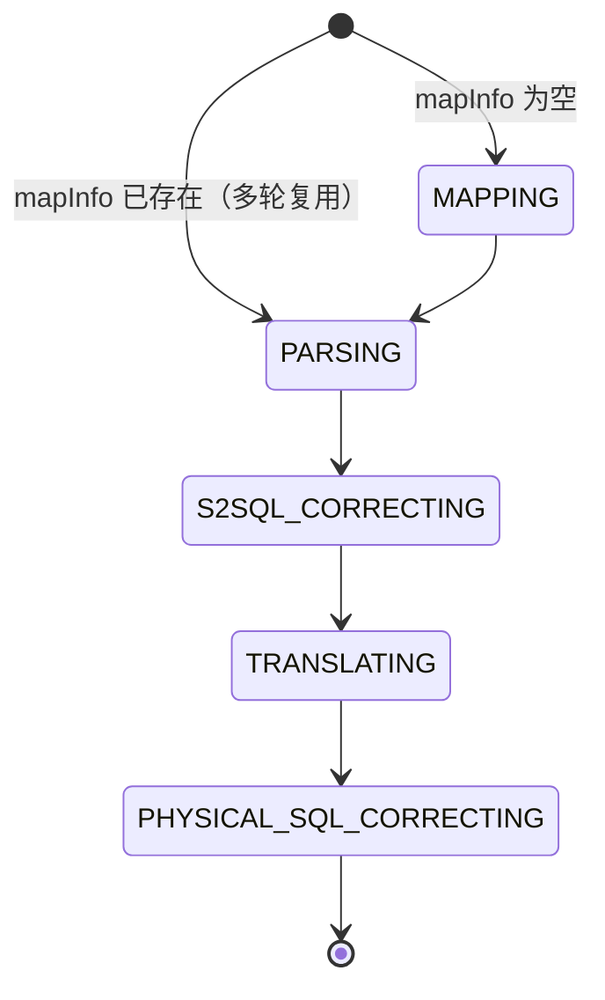

# 02 · 查询数据流详解

> 本文档面向数据平台 / 数仓团队面试官，从代码制口讲清「用户一次提问 → SQL 执行」的全链路。
> Part A 按管道阶段严谨解析（A0-A6）；Part B 用 sample query 贯穿（B1 基础聚合 + B2 派生同比）。
>
> **配套文档**：
> - 宏观鸟瞰见 [`01-架构总览.md`](./01-架构总览.md)
> - 数据权限见 [`03-数据权限控制.md`](./03-数据权限控制.md)
> - SchemaMapper 深挖见 [`../智能问数/02-SchemaMapper.md`](../智能问数/02-SchemaMapper.md)（本文 A3 仅概览）
>
> **诚实边界**：行号可漂移，类·方法为锚点；A6（Translator）声明不深挖。

## 导航

| 部分 | 章节 | 主题 |
|------|------|------|
| Part A | A0 | 全局视图：ChatWorkflowEngine 状态机 |
| Part A | A1 | 入口与编排 |
| Part A | A2 | ChatWorkflowEngine 状态机详解 |
| Part A | A3 | SchemaMapper 阶段（概览，引用 02-SchemaMapper.md） |
| Part A | A4 | SemanticParser 阶段（Rule + LLM） |
| Part A | A5 | SemanticCorrector 阶段（4 组中等粒度） |
| Part A | A6 | SemanticTranslator 阶段（简略） |
| Part B | B1 | sample query 基础聚合版（7 个状态快照） |
| Part B | B2 | sample query 派生同比版（7 个状态快照） |
| 收尾 | — | 面试问答速查（15 问） |

---

# Part A · 管道阶段章节

## A0 · 全局视图

整个解析流程由 `ChatWorkflowEngine`（`headless/server/.../utils/ChatWorkflowEngine.java`）的状态机驱动，共 5 个状态：



| State | 进入条件 | 退出条件 | 产出 |
|-------|---------|---------|------|
| **MAPPING** | `mapInfo` 为空（首轮提问） | 所有 SchemaMapper 执行完 | `SchemaMapInfo`：NL 中识别出的指标 / 维度 / 实体 / 值 |
| **PARSING** | mapInfo 已就绪 | 所有 SemanticParser 执行完 | `candidateQueries`：候选 SemanticQuery 列表 |
| **S2SQL_CORRECTING** | 至少 1 个候选 | 所有 SemanticCorrector 执行完 | 每个 candidate 的 `SqlInfo.correctedS2SQL` 被修正 |
| **TRANSLATING** | S2SQL 已校正 | SemanticTranslator 执行完 | `QueryStatement`：含物理 SQL |
| **PHYSICAL_SQL_CORRECTING** | 物理 SQL 已生成 | LLMPhysicalSqlCorrector 执行完 | 物理 SQL 被 LLM 二次优化 |

**为什么用状态机而非线性调用？**
- 多轮对话场景：`mapInfo` 已存在时直接跳过 MAPPING（性能优化）
- Rule 解析成功时跳过 LLM 调用（成本优化）
- 状态机让「按当前状态决定下一步」的逻辑显式化，便于扩展

---

## A1 · 入口与编排

### A1.1 REST 入口

`chat/server/.../rest/ChatQueryController.java` 提供三个端点：

| 端点 | 方法 | 行号 | 用途 |
|------|------|------|------|
| `POST /api/chat/query/search` | `search` | 34 | 输入联想 / schema 搜索（可选） |
| `POST /api/chat/query/parse` | `parse` | 41 | **主入口**：NL → 多个候选 parse |
| `POST /api/chat/query/execute` | `execute` | 48 | 执行用户选定的 parse |

代码片段（`ChatQueryController.java`）：
```java
@PostMapping("/parse")
public ChatParseResp parse(@RequestBody ChatParseReq chatParseReq, ...) {
    return chatQueryService.parse(chatParseReq);
}

@PostMapping("/execute")
public QueryResult execute(@RequestBody ChatExecuteReq chatExecuteReq, ...) {
    return chatQueryService.execute(chatExecuteReq);
}
```

### A1.2 编排中心：ChatQueryServiceImpl

`chat/server/.../service/impl/ChatQueryServiceImpl.java` 是 Chat 层的编排中心，用 **SPI 集合遍历模式**：

```java
// 字段：通过 ComponentFactory 加载所有 SPI 实现
private final List<ChatQueryParser> chatQueryParsers = ComponentFactory.getChatParsers();
private final List<ChatQueryExecutor> chatQueryExecutors = ComponentFactory.getChatExecutors();
private final List<ParseResultProcessor> parseResultProcessors = ComponentFactory.getParseProcessors();
private final List<ExecuteResultProcessor> executeResultProcessors = ComponentFactory.getExecuteProcessors();
```

`parse()` 方法（行 110-138）的双循环模式：

```java
public ChatParseResp parse(ChatParseReq chatParseReq) {
    // 1. 创建 queryId
    Long queryId = chatManageService.createChatQuery(chatParseReq);

    // 2. 构造 ParseContext
    ParseContext parseContext = buildParseContext(chatParseReq, new ChatParseResp(queryId));

    // 3. 遍历 ChatQueryParser 数组（NL2SQLParser 主路径）
    for (ChatQueryParser parser : chatQueryParsers) {
        if (parser.accept(parseContext)) {
            parser.parse(parseContext);  // 关键调用
        }
    }

    // 4. 遍历 ParseResultProcessor（推荐问题、格式化、耗时统计）
    for (ParseResultProcessor processor : parseResultProcessors) {
        if (processor.accept(parseContext)) {
            processor.process(parseContext);
        }
    }

    // 5. 持久化 + 返回
    chatManageService.batchAddParse(...);
    return parseContext.getResponse();
}
```

`execute()` 方法（行 141-164）结构对称——遍历 `chatQueryExecutors` 找第一个 accept 的执行，然后遍历 `executeResultProcessors` 做后处理。

**关键设计**：
- **双循环模式**：第一个循环做核心解析（parse）/ 执行（execute），第二个循环做后处理（推荐问题 / 数据解读）
- **accept 短路**：execute 循环里 `queryResult != null` 时 break（行 147-149），单 executor 负责
- **SPI 加载**：所有集合都走 `ComponentFactory`，便于扩展

---

## A2 · ChatWorkflowEngine 状态机详解

`headless/server/.../utils/ChatWorkflowEngine.java` 是 Headless 层的核心，`ChatLayerService.parse()` 入口后即调用。

### A2.1 主循环（start 方法）

```java
public void start(ChatWorkflowState state, ChatQueryContext queryCtx) {
    ChatWorkflowState curState = state;
    while (curState != ChatWorkflowState.END) {
        switch (curState) {
            case MAPPING:
                performMapping(queryCtx);              // 行 43
                curState = ChatWorkflowState.PARSING;
                break;
            case PARSING:
                performParsing(queryCtx);              // 行 55
                curState = ChatWorkflowState.S2SQL_CORRECTING;
                break;
            case S2SQL_CORRECTING:
                performCorrecting(queryCtx);           // 行 73
                curState = ChatWorkflowState.TRANSLATING;
                break;
            case TRANSLATING:
                performTranslating(queryCtx);          // 行 77
                curState = ChatWorkflowState.PHYSICAL_SQL_CORRECTING;
                break;
            case PHYSICAL_SQL_CORRECTING:
                performPhysicalSqlCorrecting(queryCtx); // 行 83
                curState = ChatWorkflowState.END;
                break;
        }
    }
}
```

### A2.2 各 state 的具体工作

| 方法 | 行号 | 工作 |
|------|------|------|
| `performMapping` | 43-52 | `schemaMappers.forEach(mapper -> mapper.map(queryCtx))` — 遍历 6 个 SchemaMapper，每个把识别到的 SchemaElementMatch 写入 `mapInfo` |
| `performParsing` | 55-70 | `semanticParsers.forEach(parser -> parser.parse(queryCtx))` — 遍历 2 个 SemanticParser（Rule + LLM），把候选 SemanticQuery 写入 `candidateQueries` |
| `performCorrecting` | 73-75 + 111-123 | 对每个 candidateQuery，遍历所有 SemanticCorrector 执行 `correct()` |
| `performTranslating` | 77-81 | 调用 `semanticLayerService.translate(queryStatement)`，把 S2SQL 翻译为物理 SQL |
| `performPhysicalSqlCorrecting` | 83-84 + 171-191 | 仅对 `LLMPhysicalSqlCorrector` 实例执行，对物理 SQL 做 LLM 二次优化（JOIN 顺序、条件下推） |

### A2.3 入口逻辑

`S2ChatLayerService.parse()`（`headless/server/.../facade/service/impl/S2ChatLayerService.java:67`）：

```java
public ParseResp parse(QueryNLReq queryNLReq) {
    ParseResp parseResp = new ParseResp(queryNLReq.getQueryText());
    ChatQueryContext queryCtx = buildChatQueryContext(queryNLReq);
    queryCtx.setParseResp(parseResp);
    // 关键：根据是否已有 mapInfo 决定从哪 state 进入
    if (queryCtx.getMapInfo().isEmpty()) {
        chatWorkflowEngine.start(ChatWorkflowState.MAPPING, queryCtx);
    } else {
        chatWorkflowEngine.start(ChatWorkflowState.PARSING, queryCtx);
    }
    return parseResp;
}
```

**性能优化点**：多轮对话场景下，前端可能把上一轮的 mapInfo 一起带过来，跳过 MAPPING 直接进 PARSING。但实际生产中 MAPPING 通常仍会重跑（避免上下文漂移），这层优化主要服务于「显式重用」API。

### A2.4 设计要点

1. **状态机而非 if-else 链**：扩展时只需加新 state（如未来加一个 `SQL_REWRITE`），不动主循环
2. **回退能力**：状态机理论上支持向后跳（如 PARSE 失败回到 MAPPING），当前实现是线性向前，但保留了扩展余地
3. **candidateQueries 是数组**：一次提问可能产出多个候选 parse，前端让用户选；这是 SuperSonic 的「澄清式 UX」设计

---

## A3 · SchemaMapper 阶段（概览）

**作用**：把用户问句中的指标 / 维度 / 实体 / 值识别出来，写入 `SchemaMapInfo`。

**详细解析见 [`../智能问数/02-SchemaMapper.md`](../智能问数/02-SchemaMapper.md)，本节仅做导航式概览。**

### A3.1 6 个 SchemaMapper

| Mapper | 文件 | 职责 |
|--------|------|------|
| `KeywordMapper` | `headless/chat/.../mapper/KeywordMapper.java` | HanLP 词典前缀/后缀匹配 + 数据库精确/模糊搜索 |
| `EmbeddingMapper` | `headless/chat/.../mapper/EmbeddingMapper.java` | 向量相似度召回（pgvector） + LLM 过滤 |
| `QueryFilterMapper` | `headless/chat/.../mapper/QueryFilterMapper.java` | 把前端传的 queryFilter 强制注入为 VALUE 匹配 |
| `PartitionTimeMapper` | `headless/chat/.../mapper/PartitionTimeMapper.java` | 自动把分区时间维度加入匹配 |
| `TermDescMapper` | `headless/chat/.../mapper/TermDescMapper.java` | 用术语描述递归调用所有 Mapper（处理「毛利率」类术语） |
| `AllFieldMapper` | `headless/chat/.../mapper/AllFieldMapper.java` | `MapModeEnum.ALL` 时返回所有字段（兜底） |

### A3.2 7 个 MatchStrategy

Mapper 内部委托 MatchStrategy 做实际匹配：

| MatchStrategy | 调用方 | 职责 |
|---------------|--------|------|
| `HanlpDictMatchStrategy` | KeywordMapper | HanLP 自定义词典 + 前缀/后缀搜索 |
| `DatabaseMatchStrategy` | KeywordMapper | 数据库维度值精确/模糊搜索 |
| `EmbeddingMatchStrategy` | EmbeddingMapper | 向量召回 + LLM 二次过滤 |
| `SearchMatchStrategy` | （备用） | 搜索类匹配 |
| `SingleMatchStrategy` | 抽象基类 | 单次匹配 |
| `BatchMatchStrategy` | 抽象基类 | 批量并发匹配 |

### A3.3 三种 MapMode 的调度

`NL2SQLParser.parse()`（`chat/server/.../parser/NL2SQLParser.java:99-108`）按以下顺序尝试：

```java
for (MapModeEnum mode : Lists.newArrayList(MapModeEnum.STRICT, MapModeEnum.MODERATE)) {
    queryNLReq.setMapModeEnum(mode);
    doParse(queryNLReq, parseResp);
}
if (parseResp.getSelectedParses().isEmpty() && candidateParses.isEmpty()) {
    queryNLReq.setMapModeEnum(MapModeEnum.LOOSE);
    doParse(queryNLReq, parseResp);
}
```

| MapMode | 阈值 | 用途 |
|---------|------|------|
| STRICT | 高相似度 | 优先精确匹配 |
| MODERATE | 中相似度 | 容忍一定模糊 |
| LOOSE | 低相似度 | 最后兜底 |
| ALL | 无阈值 | LLM-only 路径用，让 LLM 看到全部字段 |

### A3.4 知识库 backing

| 组件 | 角色 |
|------|------|
| `KnowledgeBaseService` | 管理 HanLP 词典 + 后缀索引 |
| `HanlpHelper` | HanLP 分词器封装 + 词典热重载 |
| `MetaEmbeddingService` | 元数据（指标/维度描述）向量化，写入 pgvector |

元数据变更时通过 `KnowledgeBaseService.updateSemanticKnowledge()` 增量更新（详见 [`../智能问数/02-SchemaMapper.md`](../智能问数/02-SchemaMapper.md)）。

---

**深入到这里就够了。** 想看具体每个 Mapper 怎么实现的，跳转 [`../智能问数/02-SchemaMapper.md`](../智能问数/02-SchemaMapper.md)。

---

## A4 · SemanticParser 阶段

**作用**：把 SchemaMapper 产出的 `SchemaMapInfo` 转换为候选 SemanticQuery（含 S2SQL 字符串）。

2 个 Parser 顺序执行：RuleSqlParser 先尝试（规则、快、零成本），失败后 LLMSqlParser 兜底（LLM、慢、有成本）。

### A4.1 RuleSqlParser（规则解析器）

**文件**：`headless/chat/.../parser/rule/RuleSqlParser.java:26-45`

**核心逻辑**：
1. 检查 `candidateQueries` 是否非空（已有其他 Parser 处理过则跳过）
2. 从 `SchemaMapInfo` 取出每个 dataSetId 的匹配结果
3. 对每个 dataSetId 调用 `RuleSemanticQuery.resolve()` —— **核心调度**

#### 指标查询 vs 明细查询的辨别

`RuleSemanticQuery.resolve()`（`headless/chat/.../query/rule/RuleSemanticQuery.java:195-211`）遍历所有注册的子类：

| 子类 | 文件 | 判定条件 |
|------|------|---------|
| `MetricSemanticQuery` | `query/rule/metric/MetricSemanticQuery.java:23` | 构造函数声明 `queryMatcher.addOption(METRIC, REQUIRED, AT_LEAST, 1)` —— **必须含至少 1 个 METRIC 元素** |
| `DetailSemanticQuery` | `query/rule/detail/DetailSemanticQuery.java:19` | 不要求 METRIC，匹配到就是明细 |

**结论**：如果 SchemaMapper 识别出 METRIC 元素（如「期间费用」「销售额」），走 MetricSemanticQuery；否则走 DetailSemanticQuery。

#### RuleSqlParser 的辅助解析

| 辅助 Parser | 作用 |
|-------------|------|
| `TimeRangeParser` | 从问句中提取时间范围（「今年」「上个月」） |
| `AggregateTypeParser` | 推断聚合类型（「总和」→SUM，「平均」→AVG） |

最后对每个候选调用 `query.buildS2Sql()` 生成 S2SQL 字符串。

### A4.2 LLMSqlParser（LLM 解析器）

**文件**：`headless/chat/.../parser/llm/LLMSqlParser.java:26-91`

**触发条件**：`queryNLReq.getText2SQLType()` 启用 LLM（默认 `LLM_OR_RULE`）。

#### Prompt 7 组件

`LLMRequestService.getLlmReq()`（`headless/chat/.../parser/llm/LLMRequestService.java`）组装 prompt：

| 组件 | 来源 | 用途 |
|------|------|------|
| `schema` | `SemanticSchema.getMetrics() + getDimensions()` 或映射子集 | 数据集的指标 / 维度定义 |
| `exemplar` | `promptHelper.getFewShotExemplars(llmReq)` | Few-shot 示例（NL-SQL 对） |
| `mappingResult` | `getMappedValues()` | SchemaMapper 识别的维度值匹配 |
| `terms` | `getMappedTerms()` | HanLP 分词的术语结果 |
| `sideInfo` | `promptHelper.buildSideInformation()` | 当前日期、分区时间、主键等 |
| `databaseType/Version` | `getDatabaseType()` | 目标数据库方言（影响 SQL 语法） |
| `question` | `queryText` | 用户原始问题 |

#### OnePassSCSqlGenStrategy（自一致性投票）

**文件**：`headless/chat/.../parser/llm/OnePassSCSqlGenStrategy.java`

`SqlGenType.ONE_PASS_SELF_CONSISTENCY`（当前唯一实现）：

1. **多次推理**（行 78-122）：`parallelStream` 并发调用 LLM N 次（默认 N=5），每次用相同 prompt + temperature=0.0（理论上应该相同，但 LLM 有随机性）
2. **投票**（`selfConsistencyVote`）：对多次结果做 SQL 标准化（去注释 / 大小写 / 空白），选出出现频次最高的 SQL

**价值**：单次 LLM 推理可能错；多次推理 + 投票显著提升准确率。

#### 重试机制

`tryParse()`（行 48-91）最多重试 `recallMaxRetries` 次；首次失败时把 `temperature` 从 `0` 调到 `0.5` 增加随机性，期望重试时 LLM 给出不同答案。

### A4.3 多轮对话改写

`NL2SQLParser.rewriteMultiTurn()`（`chat/server/.../parser/NL2SQLParser.java:179-222`）：

**触发**：ChatApp `REWRITE_MULTI_TURN` 启用时（默认关闭）。

**流程**：
1. 取上一轮 queryText + parseInfo + S2SQL
2. 调用 LLM 用固定模板改写当前问句（模板见 `REWRITE_MULTI_TURN_INSTRUCTION`，行 57-68）
3. 用改写后的 queryText 替换原始 queryText，进入正常 parse 流程

**例子**：
- 上轮：「比亚迪 2024 年营收」
- 本轮：「净利润呢」
- 改写后：「比亚迪 2024 年净利润」

### A4.4 Few-shot Exemplar 召回

`NL2SQLParser.addDynamicExemplars()`（行 262-274）：

```java
String memoryCollectionName = embeddingConfig.getMemoryCollectionName(agent.getId());
int exemplarRecallNumber = Integer.parseInt(
    parserConfig.getParameterValue(PARSER_EXEMPLAR_RECALL_NUMBER));
List<Text2SQLExemplar> exemplars = exemplarManager.recallExemplars(
    memoryCollectionName, queryNLReq.getQueryText(), exemplarRecallNumber);
queryNLReq.getDynamicExemplars().addAll(exemplars);
```

**来源**：与 [`../智能问数/03-查询记忆复用.md`](../智能问数/03-查询记忆复用.md) 同一 `memory_{agentId}` 向量库（用户成功查询的 NL-SQL 对）。

**召回数**：由 `parser.exemplarRecallNumber` 配置控制（默认 5）。
