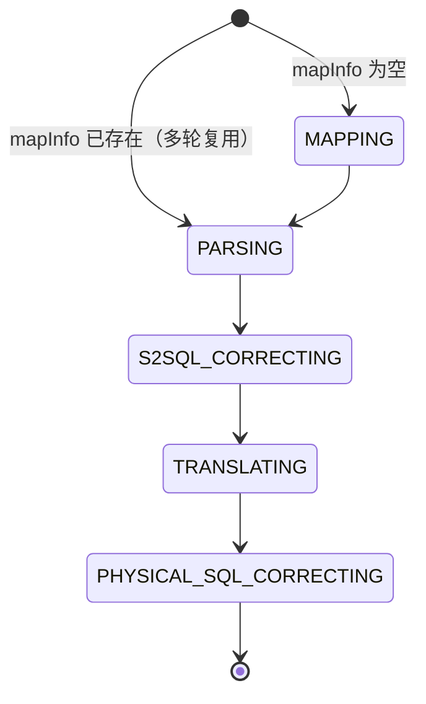

# 02 · 查询数据流详解

> 本文档面向数据平台 / 数仓团队面试官，从代码制口讲清「用户一次提问 → SQL 执行」的全链路。
> Part A 按管道阶段严谨解析（A0-A6）；Part B 用 sample query 贯穿（B1 基础聚合 + B2 派生同比）。
>
> **配套文档**：
> - 宏观鸟瞰见 [`01-架构总览.md`](./01-架构总览.md)
> - 数据权限见 [`03-数据权限控制.md`](./03-数据权限控制.md)
> - SchemaMapper 深挖见 [`../智能问数/02-SchemaMapper.md`](../智能问数/02-SchemaMapper.md)（本文 A3 仅概览）
>
> **诚实边界**：行号可漂移，类·方法为锚点；A6（Translator）声明不深挖。

## 导航

| 部分 | 章节 | 主题 |
|------|------|------|
| Part A | A0 | 全局视图：ChatWorkflowEngine 状态机 |
| Part A | A1 | 入口与编排 |
| Part A | A2 | ChatWorkflowEngine 状态机详解 |
| Part A | A3 | SchemaMapper 阶段（概览，引用 02-SchemaMapper.md） |
| Part A | A4 | SemanticParser 阶段（Rule + LLM） |
| Part A | A5 | SemanticCorrector 阶段（4 组中等粒度） |
| Part A | A6 | SemanticTranslator 阶段（简略） |
| Part B | B1 | sample query 基础聚合版（7 个状态快照） |
| Part B | B2 | sample query 派生同比版（7 个状态快照） |
| 收尾 | — | 面试问答速查（15 问） |

---

# Part A · 管道阶段章节

## A0 · 全局视图

整个解析流程由 `ChatWorkflowEngine`（`headless/server/.../utils/ChatWorkflowEngine.java`）的状态机驱动，共 5 个状态：



| State | 进入条件 | 退出条件 | 产出 |
|-------|---------|---------|------|
| **MAPPING** | `mapInfo` 为空（首轮提问） | 所有 SchemaMapper 执行完 | `SchemaMapInfo`：NL 中识别出的指标 / 维度 / 实体 / 值 |
| **PARSING** | mapInfo 已就绪 | 所有 SemanticParser 执行完 | `candidateQueries`：候选 SemanticQuery 列表 |
| **S2SQL_CORRECTING** | 至少 1 个候选 | 所有 SemanticCorrector 执行完 | 每个 candidate 的 `SqlInfo.correctedS2SQL` 被修正 |
| **TRANSLATING** | S2SQL 已校正 | SemanticTranslator 执行完 | `QueryStatement`：含物理 SQL |
| **PHYSICAL_SQL_CORRECTING** | 物理 SQL 已生成 | LLMPhysicalSqlCorrector 执行完 | 物理 SQL 被 LLM 二次优化 |

**为什么用状态机而非线性调用？**
- 多轮对话场景：`mapInfo` 已存在时直接跳过 MAPPING（性能优化）
- Rule 解析成功时跳过 LLM 调用（成本优化）
- 状态机让「按当前状态决定下一步」的逻辑显式化，便于扩展

---

## A1 · 入口与编排

### A1.1 REST 入口

`chat/server/.../rest/ChatQueryController.java` 提供三个端点：

| 端点 | 方法 | 行号 | 用途 |
|------|------|------|------|
| `POST /api/chat/query/search` | `search` | 34 | 输入联想 / schema 搜索（可选） |
| `POST /api/chat/query/parse` | `parse` | 41 | **主入口**：NL → 多个候选 parse |
| `POST /api/chat/query/execute` | `execute` | 48 | 执行用户选定的 parse |

代码片段（`ChatQueryController.java`）：
```java
@PostMapping("/parse")
public ChatParseResp parse(@RequestBody ChatParseReq chatParseReq, ...) {
    return chatQueryService.parse(chatParseReq);
}

@PostMapping("/execute")
public QueryResult execute(@RequestBody ChatExecuteReq chatExecuteReq, ...) {
    return chatQueryService.execute(chatExecuteReq);
}
```

### A1.2 编排中心：ChatQueryServiceImpl

`chat/server/.../service/impl/ChatQueryServiceImpl.java` 是 Chat 层的编排中心，用 **SPI 集合遍历模式**：

```java
// 字段：通过 ComponentFactory 加载所有 SPI 实现
private final List<ChatQueryParser> chatQueryParsers = ComponentFactory.getChatParsers();
private final List<ChatQueryExecutor> chatQueryExecutors = ComponentFactory.getChatExecutors();
private final List<ParseResultProcessor> parseResultProcessors = ComponentFactory.getParseProcessors();
private final List<ExecuteResultProcessor> executeResultProcessors = ComponentFactory.getExecuteProcessors();
```

`parse()` 方法（行 110-138）的双循环模式：

```java
public ChatParseResp parse(ChatParseReq chatParseReq) {
    // 1. 创建 queryId
    Long queryId = chatManageService.createChatQuery(chatParseReq);

    // 2. 构造 ParseContext
    ParseContext parseContext = buildParseContext(chatParseReq, new ChatParseResp(queryId));

    // 3. 遍历 ChatQueryParser 数组（NL2SQLParser 主路径）
    for (ChatQueryParser parser : chatQueryParsers) {
        if (parser.accept(parseContext)) {
            parser.parse(parseContext);  // 关键调用
        }
    }

    // 4. 遍历 ParseResultProcessor（推荐问题、格式化、耗时统计）
    for (ParseResultProcessor processor : parseResultProcessors) {
        if (processor.accept(parseContext)) {
            processor.process(parseContext);
        }
    }

    // 5. 持久化 + 返回
    chatManageService.batchAddParse(...);
    return parseContext.getResponse();
}
```

`execute()` 方法（行 141-164）结构对称——遍历 `chatQueryExecutors` 找第一个 accept 的执行，然后遍历 `executeResultProcessors` 做后处理。

**关键设计**：
- **双循环模式**：第一个循环做核心解析（parse）/ 执行（execute），第二个循环做后处理（推荐问题 / 数据解读）
- **accept 短路**：execute 循环里 `queryResult != null` 时 break（行 147-149），单 executor 负责
- **SPI 加载**：所有集合都走 `ComponentFactory`，便于扩展

---

## A2 · ChatWorkflowEngine 状态机详解

`headless/server/.../utils/ChatWorkflowEngine.java` 是 Headless 层的核心，`ChatLayerService.parse()` 入口后即调用。

### A2.1 主循环（start 方法）

```java
public void start(ChatWorkflowState state, ChatQueryContext queryCtx) {
    ChatWorkflowState curState = state;
    while (curState != ChatWorkflowState.END) {
        switch (curState) {
            case MAPPING:
                performMapping(queryCtx);              // 行 43
                curState = ChatWorkflowState.PARSING;
                break;
            case PARSING:
                performParsing(queryCtx);              // 行 55
                curState = ChatWorkflowState.S2SQL_CORRECTING;
                break;
            case S2SQL_CORRECTING:
                performCorrecting(queryCtx);           // 行 73
                curState = ChatWorkflowState.TRANSLATING;
                break;
            case TRANSLATING:
                performTranslating(queryCtx);          // 行 77
                curState = ChatWorkflowState.PHYSICAL_SQL_CORRECTING;
                break;
            case PHYSICAL_SQL_CORRECTING:
                performPhysicalSqlCorrecting(queryCtx); // 行 83
                curState = ChatWorkflowState.END;
                break;
        }
    }
}
```

### A2.2 各 state 的具体工作

| 方法 | 行号 | 工作 |
|------|------|------|
| `performMapping` | 43-52 | `schemaMappers.forEach(mapper -> mapper.map(queryCtx))` — 遍历 6 个 SchemaMapper，每个把识别到的 SchemaElementMatch 写入 `mapInfo` |
| `performParsing` | 55-70 | `semanticParsers.forEach(parser -> parser.parse(queryCtx))` — 遍历 2 个 SemanticParser（Rule + LLM），把候选 SemanticQuery 写入 `candidateQueries` |
| `performCorrecting` | 73-75 + 111-123 | 对每个 candidateQuery，遍历所有 SemanticCorrector 执行 `correct()` |
| `performTranslating` | 77-81 | 调用 `semanticLayerService.translate(queryStatement)`，把 S2SQL 翻译为物理 SQL |
| `performPhysicalSqlCorrecting` | 83-84 + 171-191 | 仅对 `LLMPhysicalSqlCorrector` 实例执行，对物理 SQL 做 LLM 二次优化（JOIN 顺序、条件下推） |

### A2.3 入口逻辑

`S2ChatLayerService.parse()`（`headless/server/.../facade/service/impl/S2ChatLayerService.java:67`）：

```java
public ParseResp parse(QueryNLReq queryNLReq) {
    ParseResp parseResp = new ParseResp(queryNLReq.getQueryText());
    ChatQueryContext queryCtx = buildChatQueryContext(queryNLReq);
    queryCtx.setParseResp(parseResp);
    // 关键：根据是否已有 mapInfo 决定从哪 state 进入
    if (queryCtx.getMapInfo().isEmpty()) {
        chatWorkflowEngine.start(ChatWorkflowState.MAPPING, queryCtx);
    } else {
        chatWorkflowEngine.start(ChatWorkflowState.PARSING, queryCtx);
    }
    return parseResp;
}
```

**性能优化点**：多轮对话场景下，前端可能把上一轮的 mapInfo 一起带过来，跳过 MAPPING 直接进 PARSING。但实际生产中 MAPPING 通常仍会重跑（避免上下文漂移），这层优化主要服务于「显式重用」API。

### A2.4 设计要点

1. **状态机而非 if-else 链**：扩展时只需加新 state（如未来加一个 `SQL_REWRITE`），不动主循环
2. **回退能力**：状态机理论上支持向后跳（如 PARSE 失败回到 MAPPING），当前实现是线性向前，但保留了扩展余地
3. **candidateQueries 是数组**：一次提问可能产出多个候选 parse，前端让用户选；这是 SuperSonic 的「澄清式 UX」设计

---

## A3 · SchemaMapper 阶段（概览）

**作用**：把用户问句中的指标 / 维度 / 实体 / 值识别出来，写入 `SchemaMapInfo`。

**详细解析见 [`../智能问数/02-SchemaMapper.md`](../智能问数/02-SchemaMapper.md)，本节仅做导航式概览。**

### A3.1 6 个 SchemaMapper

| Mapper | 文件 | 职责 |
|--------|------|------|
| `KeywordMapper` | `headless/chat/.../mapper/KeywordMapper.java` | HanLP 词典前缀/后缀匹配 + 数据库精确/模糊搜索 |
| `EmbeddingMapper` | `headless/chat/.../mapper/EmbeddingMapper.java` | 向量相似度召回（pgvector） + LLM 过滤 |
| `QueryFilterMapper` | `headless/chat/.../mapper/QueryFilterMapper.java` | 把前端传的 queryFilter 强制注入为 VALUE 匹配 |
| `PartitionTimeMapper` | `headless/chat/.../mapper/PartitionTimeMapper.java` | 自动把分区时间维度加入匹配 |
| `TermDescMapper` | `headless/chat/.../mapper/TermDescMapper.java` | 用术语描述递归调用所有 Mapper（处理「毛利率」类术语） |
| `AllFieldMapper` | `headless/chat/.../mapper/AllFieldMapper.java` | `MapModeEnum.ALL` 时返回所有字段（兜底） |

### A3.2 7 个 MatchStrategy

Mapper 内部委托 MatchStrategy 做实际匹配：

| MatchStrategy | 调用方 | 职责 |
|---------------|--------|------|
| `HanlpDictMatchStrategy` | KeywordMapper | HanLP 自定义词典 + 前缀/后缀搜索 |
| `DatabaseMatchStrategy` | KeywordMapper | 数据库维度值精确/模糊搜索 |
| `EmbeddingMatchStrategy` | EmbeddingMapper | 向量召回 + LLM 二次过滤 |
| `SearchMatchStrategy` | （备用） | 搜索类匹配 |
| `SingleMatchStrategy` | 抽象基类 | 单次匹配 |
| `BatchMatchStrategy` | 抽象基类 | 批量并发匹配 |

### A3.3 三种 MapMode 的调度

`NL2SQLParser.parse()`（`chat/server/.../parser/NL2SQLParser.java:99-108`）按以下顺序尝试：

```java
for (MapModeEnum mode : Lists.newArrayList(MapModeEnum.STRICT, MapModeEnum.MODERATE)) {
    queryNLReq.setMapModeEnum(mode);
    doParse(queryNLReq, parseResp);
}
if (parseResp.getSelectedParses().isEmpty() && candidateParses.isEmpty()) {
    queryNLReq.setMapModeEnum(MapModeEnum.LOOSE);
    doParse(queryNLReq, parseResp);
}
```

| MapMode | 阈值 | 用途 |
|---------|------|------|
| STRICT | 高相似度 | 优先精确匹配 |
| MODERATE | 中相似度 | 容忍一定模糊 |
| LOOSE | 低相似度 | 最后兜底 |
| ALL | 无阈值 | LLM-only 路径用，让 LLM 看到全部字段 |

### A3.4 知识库 backing

| 组件 | 角色 |
|------|------|
| `KnowledgeBaseService` | 管理 HanLP 词典 + 后缀索引 |
| `HanlpHelper` | HanLP 分词器封装 + 词典热重载 |
| `MetaEmbeddingService` | 元数据（指标/维度描述）向量化，写入 pgvector |

元数据变更时通过 `KnowledgeBaseService.updateSemanticKnowledge()` 增量更新（详见 [`../智能问数/02-SchemaMapper.md`](../智能问数/02-SchemaMapper.md)）。

---

**深入到这里就够了。** 想看具体每个 Mapper 怎么实现的，跳转 [`../智能问数/02-SchemaMapper.md`](../智能问数/02-SchemaMapper.md)。

---

## A4 · SemanticParser 阶段

**作用**：把 SchemaMapper 产出的 `SchemaMapInfo` 转换为候选 SemanticQuery（含 S2SQL 字符串）。

2 个 Parser 顺序执行：RuleSqlParser 先尝试（规则、快、零成本），失败后 LLMSqlParser 兜底（LLM、慢、有成本）。

### A4.1 RuleSqlParser（规则解析器）

**文件**：`headless/chat/.../parser/rule/RuleSqlParser.java:26-45`

**核心逻辑**：
1. 检查 `candidateQueries` 是否非空（已有其他 Parser 处理过则跳过）
2. 从 `SchemaMapInfo` 取出每个 dataSetId 的匹配结果
3. 对每个 dataSetId 调用 `RuleSemanticQuery.resolve()` —— **核心调度**

#### 指标查询 vs 明细查询的辨别

`RuleSemanticQuery.resolve()`（`headless/chat/.../query/rule/RuleSemanticQuery.java:195-211`）遍历所有注册的子类：

| 子类 | 文件 | 判定条件 |
|------|------|---------|
| `MetricSemanticQuery` | `query/rule/metric/MetricSemanticQuery.java:23` | 构造函数声明 `queryMatcher.addOption(METRIC, REQUIRED, AT_LEAST, 1)` —— **必须含至少 1 个 METRIC 元素** |
| `DetailSemanticQuery` | `query/rule/detail/DetailSemanticQuery.java:19` | 不要求 METRIC，匹配到就是明细 |

**结论**：如果 SchemaMapper 识别出 METRIC 元素（如「期间费用」「销售额」），走 MetricSemanticQuery；否则走 DetailSemanticQuery。

#### RuleSqlParser 的辅助解析

| 辅助 Parser | 作用 |
|-------------|------|
| `TimeRangeParser` | 从问句中提取时间范围（「今年」「上个月」） |
| `AggregateTypeParser` | 推断聚合类型（「总和」→SUM，「平均」→AVG） |

最后对每个候选调用 `query.buildS2Sql()` 生成 S2SQL 字符串。

### A4.2 LLMSqlParser（LLM 解析器）

**文件**：`headless/chat/.../parser/llm/LLMSqlParser.java:26-91`

**触发条件**：`queryNLReq.getText2SQLType()` 启用 LLM（默认 `LLM_OR_RULE`）。

#### Prompt 7 组件

`LLMRequestService.getLlmReq()`（`headless/chat/.../parser/llm/LLMRequestService.java`）组装 prompt：

| 组件 | 来源 | 用途 |
|------|------|------|
| `schema` | `SemanticSchema.getMetrics() + getDimensions()` 或映射子集 | 数据集的指标 / 维度定义 |
| `exemplar` | `promptHelper.getFewShotExemplars(llmReq)` | Few-shot 示例（NL-SQL 对） |
| `mappingResult` | `getMappedValues()` | SchemaMapper 识别的维度值匹配 |
| `terms` | `getMappedTerms()` | HanLP 分词的术语结果 |
| `sideInfo` | `promptHelper.buildSideInformation()` | 当前日期、分区时间、主键等 |
| `databaseType/Version` | `getDatabaseType()` | 目标数据库方言（影响 SQL 语法） |
| `question` | `queryText` | 用户原始问题 |

#### OnePassSCSqlGenStrategy（自一致性投票）

**文件**：`headless/chat/.../parser/llm/OnePassSCSqlGenStrategy.java`

`SqlGenType.ONE_PASS_SELF_CONSISTENCY`（当前唯一实现）：

1. **多次推理**（行 78-122）：`parallelStream` 并发调用 LLM N 次（默认 N=5），每次用相同 prompt + temperature=0.0（理论上应该相同，但 LLM 有随机性）
2. **投票**（`selfConsistencyVote`）：对多次结果做 SQL 标准化（去注释 / 大小写 / 空白），选出出现频次最高的 SQL

**价值**：单次 LLM 推理可能错；多次推理 + 投票显著提升准确率。

#### 重试机制

`tryParse()`（行 48-91）最多重试 `recallMaxRetries` 次；首次失败时把 `temperature` 从 `0` 调到 `0.5` 增加随机性，期望重试时 LLM 给出不同答案。

### A4.3 多轮对话改写

`NL2SQLParser.rewriteMultiTurn()`（`chat/server/.../parser/NL2SQLParser.java:179-222`）：

**触发**：ChatApp `REWRITE_MULTI_TURN` 启用时（默认关闭）。

**流程**：
1. 取上一轮 queryText + parseInfo + S2SQL
2. 调用 LLM 用固定模板改写当前问句（模板见 `REWRITE_MULTI_TURN_INSTRUCTION`，行 57-68）
3. 用改写后的 queryText 替换原始 queryText，进入正常 parse 流程

**例子**：
- 上轮：「比亚迪 2024 年营收」
- 本轮：「净利润呢」
- 改写后：「比亚迪 2024 年净利润」

### A4.4 Few-shot Exemplar 召回

`NL2SQLParser.addDynamicExemplars()`（行 262-274）：

```java
String memoryCollectionName = embeddingConfig.getMemoryCollectionName(agent.getId());
int exemplarRecallNumber = Integer.parseInt(
    parserConfig.getParameterValue(PARSER_EXEMPLAR_RECALL_NUMBER));
List<Text2SQLExemplar> exemplars = exemplarManager.recallExemplars(
    memoryCollectionName, queryNLReq.getQueryText(), exemplarRecallNumber);
queryNLReq.getDynamicExemplars().addAll(exemplars);
```

**来源**：与 [`../智能问数/03-查询记忆复用.md`](../智能问数/03-查询记忆复用.md) 同一 `memory_{agentId}` 向量库（用户成功查询的 NL-SQL 对）。

**召回数**：由 `parser.exemplarRecallNumber` 配置控制（默认 5）。

---

## A5 · SemanticCorrector 阶段（中等粒度）

**作用**：校正 S2SQL，让 LLM 生成的 SQL 从「语法合法但语义可能漂」变成「口径正确、可执行」。

> 粒度约定：按 4 组分类，每组总结 + 一段源码片段；不展开 8 个子 corrector 逐行。

### A5.1 调用链与编排

**SPI 注册**：`assembly/conf/META-INF/spring.factories:16-19`（3 个顶层 Corrector）

**加载**：`headless/chat/.../utils/ComponentFactory.java:37-41` 通过 `SpringFactoriesLoader.loadFactories()`

**调用入口**：`ChatWorkflowEngine.performCorrecting()`（行 111-123）—— 对每个 candidateQuery 遍历所有 corrector

**Corrector 树状调用结构**：

```
RuleSqlCorrector（编排器）
  ├─ SchemaCorrector              （Schema 修正组）
  ├─ TimeCorrector                （时间修正组）
  └─ GrammarCorrector（编排器）    （语法修正组）
       ├─ SelectCorrector
       ├─ WhereCorrector
       ├─ GroupByCorrector
       ├─ AggCorrector
       └─ HavingCorrector
LLMSqlCorrector                   （LLM 修正组，作用于 S2SQL）
LLMPhysicalSqlCorrector           （LLM 修正组，作用于物理 SQL，在 TRANSLATING 之后）
```

### A5.2 Schema 修正组（SchemaCorrector）

**职责**：把 LLM 输出的 SQL 字段从「alias / 用户写的样子」修正为「bizName」。

| 修正项 | 例子 |
|--------|------|
| 字段名修正 | `期间费用` → `period_expense`（bizName） |
| 聚合函数名 | `SUM` → `SUM`（无变化）；`总数` → `COUNT` |
| LinkingValue 映射 | `比亚迪` → SQL 中的 `'002594'`（基于 SchemaMapper 识别） |

**核心源码片段**（`SchemaCorrector.java`，示意）：
```java
// 1. 提取 SQL 中所有字段
List<String> fields = SqlSelectHelper.getAllSelectFields(s2sql);
// 2. 对每个字段，从 SchemaElement 中找 bizName
Map<String, String> aliasToBizName = schemaElementMatch.stream()
    .collect(Collectors.toMap(SchemaElementMatch::getWord, ...));
// 3. 替换
String corrected = SqlReplaceHelper.replaceTableAlias(s2sql, aliasToBizName);
```

### A5.3 时间修正组（TimeCorrector）

**职责**：处理「今年」「上个月」「同比」「环比」等相对时间。

| 场景 | 修正前 | 修正后 |
|------|--------|--------|
| 「今年」无 WHERE | `SELECT ... FROM finance` | `SELECT ... FROM finance WHERE year = 2025` |
| 「去年」分区已存在但 SQL 未含 | 自动追加 `year = 2024` | — |
| 「同比」需要本期 + 上期 | 单查询 → 双查询拼接 | 见 B2 示例 |

**设计要点**：依赖 SchemaMapper 的 `PartitionTimeMapper` 识别分区字段；TimeCorrector 把相对时间转换为绝对时间值。

### A5.4 语法修正组（GrammarCorrector + 5 个子 corrector）

**职责**：保证 SQL 语法完整正确。

**编排顺序**（GrammarCorrector 内部）：

| 顺序 | 子 Corrector | 职责 | 触发条件 |
|------|-------------|------|---------|
| 1 | `SelectCorrector` | 补全 SELECT 中缺失的 GROUP BY 字段 | 当 SELECT 含维度但 GROUP BY 缺失时 |
| 2 | `WhereCorrector` | 注入 queryFilter；维度值 bizName → techName | 当请求带 filter 时 |
| 3 | `GroupByCorrector` | AGGREGATE 查询自动补 GROUP BY | 当含聚合函数但无 GROUP BY |
| 4 | `AggCorrector` | 为指标字段补聚合函数 | 当指标 SELECT 缺 SUM/AVG |
| 5 | `HavingCorrector` | 为指标加 HAVING 聚合条件 | 当 WHERE 含聚合条件时移到 HAVING |

**GrammarCorrector 编排骨架**：
```java
public void correct(ChatQueryContext queryContext, SemanticQuery semanticQuery) {
    SemanticParseInfo parseInfo = semanticQuery.getParseInfo();
    String s2sql = parseInfo.getSqlInfo().getCorrectedS2SQL();
    // 按顺序执行 5 个子 corrector
    s2sql = new SelectCorrector().correct(s2sql, parseInfo);
    s2sql = new WhereCorrector().correct(s2sql, parseInfo);
    s2sql = new GroupByCorrector().correct(s2sql, parseInfo);
    s2sql = new AggCorrector().correct(s2sql, parseInfo);
    s2sql = new HavingCorrector().correct(s2sql, parseInfo);
    parseInfo.getSqlInfo().setCorrectedS2SQL(s2sql);
}
```

### A5.5 LLM 修正组（LLMSqlCorrector + LLMPhysicalSqlCorrector）

| Corrector | 作用阶段 | 职责 |
|-----------|---------|------|
| `LLMSqlCorrector` | S2SQL_CORRECTING（语义层） | LLM 对 S2SQL 做二次审查（senior data engineer review prompt） |
| `LLMPhysicalSqlCorrector` | PHYSICAL_SQL_CORRECTING（物理层） | LLM 对物理 SQL 做性能优化（JOIN 顺序、条件下推） |

**LLMSqlCorrector prompt 模板**（`LLMSqlCorrector.java`）：
```
You are a senior data engineer. Review the following S2SQL and fix any issues:
- Schema: {schema}
- Question: {question}
- Current SQL: {s2sql}
- Output the corrected SQL only.
```

**LLMPhysicalSqlCorrector** 触发条件：默认关闭（成本考虑）；通过 ChatApp 配置开启。

### A5.6 调用时机总结

| Corrector | 调用时机 | 文件 |
|-----------|---------|------|
| RuleSqlCorrector + 子 corrector | `performCorrecting`（行 111-123） | `RuleSqlCorrector.java` |
| LLMSqlCorrector | 同上 | `LLMSqlCorrector.java` |
| LLMPhysicalSqlCorrector | `performPhysicalSqlCorrecting`（行 171-191），仅对 `instanceof LLMPhysicalSqlCorrector` 执行 | `LLMPhysicalSqlCorrector.java` |

---

## A6 · SemanticTranslator 阶段（简略）

**作用**：把 S2SQL 翻译为可执行的物理 SQL。

> **粒度声明**：本节不深挖，面试现场能说清「语义层做了指标表达式展开 + 方言适配 + LIMIT 补全」即可。详细的物理 SQL 翻译不在面试重点。

### A6.1 入口

`DefaultSemanticTranslator.translate()`（`headless/core/.../translator/DefaultSemanticTranslator.java:27`）：

```java
public void translate(QueryStatement queryStatement) throws Exception {
    // 1. QueryParsers 逐个解析
    for (QueryParser parser : ComponentFactory.getQueryParsers()) {
        if (parser.accept(queryStatement)) {
            parser.parse(queryStatement);
        }
    }
    // 2. 合并 OntologyQuery（WITH 语句）
    mergeOntologyQuery(queryStatement);
    // 3. QueryOptimizers 逐个优化
    for (QueryOptimizer optimizer : ComponentFactory.getQueryOptimizers()) {
        if (optimizer.accept(queryStatement)) {
            optimizer.rewrite(queryStatement);
        }
    }
}
```

### A6.2 8 个 QueryParser

| QueryParser | 职责 |
|-------------|------|
| `SqlVariableParser` | 替换 SQL 中的变量（`{{var}}`） |
| `StructQueryParser` | 结构化请求（QueryStructReq）解析 |
| `SqlQueryParser` | SQL 请求（QuerySqlReq）解析 |
| `DefaultDimValueParser` | 维度值默认解析 |
| `DimExpressionParser` | 维度表达式解析 |
| **`MetricExpressionParser`** | **指标表达式展开**（如 `期间费用` → `SUM(销售费用)+SUM(管理费用)+SUM(财务费用)`） |
| **`MetricRatioParser`** | **同比 / 环比比率计算**（生成子查询拼接本期 vs 上期） |
| `OntologyQueryParser` | 本体查询解析（生成内部 SQL） |

**重点**（呼应 Part B2 同比场景）：`MetricRatioParser` 把含「同比 / 环比」语义的查询展开为子查询拼接，是金融场景的核心能力。

### A6.3 2 个 QueryOptimizer

| QueryOptimizer | 职责 |
|----------------|------|
| `DbDialectOptimizer` | 按目标数据库（MySQL / ClickHouse / Presto）适配 SQL 语法 |
| `ResultLimitOptimizer` | 当 SQL 无 LIMIT 时自动追加（默认 1000） |

### A6.4 Calcite 的角色

Calcite 在本项目中**不是翻译主路径**，仅用于 WITH 语句合并（`common/calcite/SqlMergeWithUtils.java:86`），按引擎类型决定是否用 Calcite。

### A6.5 进入执行

翻译完成后，物理 SQL 进入 `JdbcExecutor`（`headless/core/.../executor/JdbcExecutor.java:17`）执行。

**注意：权限拦截时机与机制**

- **时机**：权限拦截发生在 ChatWorkflowEngine 的 `TRANSLATING` 之后、`JdbcExecutor` 实际执行之前，确保物理 SQL 生成后才校验，避免语义阶段误拦。
- **位置**：通过 `@S2DataPermission` 注解 + `S2DataPermissionAspect` AOP 切面，拦截 `SemanticLayerService.query` / `translate` 方法入口（详见 [`03-数据权限控制.md`](./03-数据权限控制.md) §3）。
- **七步流程**：管理员跳过 → 模型可见性 → 列权限 → 行权限注入（OR 连接），每步不通过即返回空或抛异常（§3 完整流程）。
- **LLM SQL 三道防线**：S2SQL 校正之后注入行权限（注入到 S2SQL 而非物理 SQL），再由 AOP 切面兜底，双重保障（§4 详述）。

---

# Part B · 端到端示例（sample query 贯穿）

**主线 query**：「比亚迪今年的期间费用同比增加了多少」

拆为两个对照：
- **B1 基础聚合版**：「比亚迪今年的期间费用是多少」——讲清基础管道
- **B2 派生同比版**：「比亚迪今年的期间费用同比增加了多少」——引出 MetricRatioParser / MetricExpressionParser 差异化能力

---

## B1 · 基础聚合版：「比亚迪今年的期间费用是多少」

7 个状态快照，每个用代码块展示 + 1-2 段说明。

### 快照 1：HTTP 请求

```http
POST /api/chat/query/parse HTTP/1.1
Content-Type: application/json

{
  "queryText": "比亚迪今年的期间费用是多少",
  "chatId": 42,
  "agentId": 7,
  "user": {"name": "alice", "id": "u_001"}
}
```

**说明**：前端 chat-sdk 调用 `POST /api/chat/query/parse`（见 `webapp/packages/chat-sdk/src/service/index.ts:43-76` 的 `chatParse`）。`chatId` 标识会话；`agentId` 决定使用哪些 LLM App、词典、记忆库。

### 快照 2：ChatWorkflowEngine 入口

```
ChatQueryServiceImpl.parse(ChatParseReq)            ← 行 110
  → ParseContext 创建
  → for parser in chatQueryParsers:
       if parser.accept(parseCtx):
         parser.parse(parseCtx)                     ← NL2SQLParser 接管

NL2SQLParser.parse()                                 ← 行 82
  → buildQueryNLReq: text2SQLType=ONLY_RULE（首轮）
  → for datasetId in agent.dataSetIds:
       for mode in [STRICT, MODERATE]:
         doParse(queryNLReq, parseResp)             ← 进入 ChatLayerService.parse
```

**说明**：首轮提问，`mapInfo` 为空，进入 MAPPING state。

### 快照 3：SchemaMapper 输出（state=MAPPING 完成后）

`SchemaMapInfo`（简化 JSON）：
```json
{
  "dataSetId": 101,
  "matchedElements": [
    {"element": {"type": "ENTITY", "bizName": "company", "name": "公司"},
     "word": "比亚迪", "similarity": 0.95},
    {"element": {"type": "DIMENSION", "bizName": "company_name", "name": "公司名称"},
     "word": "比亚迪", "similarity": 0.92},
    {"element": {"type": "METRIC", "bizName": "period_expense", "name": "期间费用",
                 "expr": "SUM(sale_expense) + SUM(admin_expense) + SUM(fin_expense)"},
     "word": "期间费用", "similarity": 0.98},
    {"element": {"type": "DIMENSION", "bizName": "report_year", "name": "报告年度"},
     "word": "今年", "similarity": 0.88, "detectType": "PARTITION_TIME"}
  ]
}
```

**说明**：
- ENTITY「比亚迪」被 EmbeddingMapper 命中（公司实体向量召回）
- METRIC「期间费用」被 KeywordMapper 命中（HanLP 词典精确匹配）
- DIMENSION「报告年度」被 PartitionTimeMapper 自动加入（识别「今年」是分区时间）
- 三个 MatchMode（STRICT/MODERATE/LOOSE）中 STRICT 已命中，直接进入 PARSING

### 快照 4：RuleSqlParser 输出（state=PARSING）

`candidateQueries`（简化）：
```json
[{
  "queryMode": "METRIC_DOMAIN",
  "type": "METRIC",
  "parseInfo": {
    "dataSetId": 101,
    "metrics": [{"bizName": "period_expense", "name": "期间费用"}],
    "dimensions": [{"bizName": "company_name"}],
    "dimensionFilters": [{"bizName": "company_name", "operator": "=", "value": "比亚迪"}],
    "dateInfo": {"dateMode": "BETWEEN", "startDate": "2025-01-01", "endDate": "2025-12-31"},
    "aggregateType": "SUM",
    "sqlInfo": {
      "s2sql": "SELECT period_expense FROM finance_dataset WHERE company_name = '比亚迪' AND report_year = 2025"
    }
  }
}]
```

**说明**：
- 因含 METRIC 元素，`RuleSemanticQuery.resolve()` 选 `MetricSemanticQuery`（不选 Detail）
- `TimeRangeParser` 把「今年」转为 `2025-01-01 ~ 2025-12-31`
- `AggregateTypeParser` 推断 `aggregateType=SUM`
- `buildS2Sql()` 生成 S2SQL 字符串（**注意 S2SQL 用语义字段 `period_expense` 而非底表字段**）

### 快照 5：LLMSqlParser（rule 成功时跳过）

```
NL2SQLParser.parse 行 131:
  if (parseContext.needLLMParse() && !parseContext.needFeedback()):
    if (rule 解析非空):
      # 走 LLM 增强路径
      queryNLReq.setText2SQLType(LLM_OR_RULE)
      queryNLReq.setSelectedParseInfo(top1候选)  ← 把 rule 结果传给 LLM 参考
      rewriteMultiTurn(...)                       # 多轮改写（首关闭合，跳过）
      addDynamicExemplars(...)                    # 召回 few-shot
      doParse(queryNLReq, parseResp)              ← LLM 生成最终 S2SQL
```

LLM 生成（温度 0，自一致性 5 次投票后）：
```sql
SELECT period_expense
FROM finance_dataset
WHERE company_name = '比亚迪' AND report_year = 2025
```

**说明**：rule 已给出候选，LLM 通常会确认或微调；自一致性投票保证稳定。

### 快照 6：SemanticCorrector 输出（state=S2SQL_CORRECTING）

校正前后对比：

**校正前**（LLM 输出）：
```sql
SELECT period_expense
FROM finance_dataset
WHERE company_name = '比亚迪' AND report_year = 2025
```

**校正后**（4 组 corrector 作用后）：
```sql
SELECT SUM(period_expense) AS period_expense
FROM finance_dataset
WHERE company_name = '比亚迪' AND report_year BETWEEN '2025-01-01' AND '2025-12-31'
GROUP BY company_name
```

**校正细节**：
| Corrector | 动作 |
|-----------|------|
| SchemaCorrector | `比亚迪`（用户写法）→ `'002594'`（dimension value bizName，通过 LinkingValue）—— 但语义层仍保留 `company_name='比亚迪'`，物理层翻译时再展开 |
| TimeCorrector | `report_year = 2025` → `report_year BETWEEN '2025-01-01' AND '2025-12-31'`（按 PartitionTime 拆分） |
| GrammarCorrector.GroupByCorrector | 因 SELECT 含维度 `company_name` + 指标聚合，补 `GROUP BY company_name` |
| GrammarCorrector.AggCorrector | 为 `period_expense` 补 `SUM` |
| LLMSqlCorrector | （默认关闭；若开启，二次审查无变化） |

### 快照 7：SemanticTranslator 输出（state=TRANSLATING）

物理 SQL（`DefaultSemanticTranslator` 翻译后）：

```sql
SELECT
  SUM(d.sale_expense) + SUM(d.admin_expense) + SUM(d.fin_expense) AS period_expense
FROM (
  SELECT company_name, sale_expense, admin_expense, fin_expense, report_year
  FROM dim_finance_income_statement
  WHERE company_code = '002594'  -- 比亚迪的股票代码（维度值映射）
    AND report_year BETWEEN '2025-01-01' AND '2025-12-31'
) d
GROUP BY d.company_name
LIMIT 1000
```

**翻译细节**：
| 阶段 | 动作 |
|------|------|
| `MetricExpressionParser` | `period_expense` → `SUM(sale_expense) + SUM(admin_expense) + SUM(fin_expense)`（指标表达式展开） |
| `DimExpressionParser` | `company_name = '比亚迪'` → `company_code = '002594'`（维度值映射） |
| `DbDialectOptimizer` | 按目标数据库（如 ClickHouse）适配语法 |
| `ResultLimitOptimizer` | 追加 `LIMIT 1000` |

执行后 `JdbcExecutor` 调用目标数据库，返回结果集。

---

## B2 · 派生同比版：「比亚迪今年的期间费用同比增加了多少」

与 B1 的差异点（每个快照只讲**新增 / 变化**部分）。

### 快照 1：HTTP 请求

```json
{
  "queryText": "比亚迪今年的期间费用同比增加了多少",
  "chatId": 42,
  "agentId": 7
}
```

**差异**：多了「同比增加了多少」——这是派生指标场景。

### 快照 2：ChatWorkflowEngine 入口

同 B1。

### 快照 3：SchemaMapper 输出（差异）

新增匹配：
```json
{"element": {"type": "VALUE", "bizName": "yoy", "name": "同比",
             "concept": "METRIC_RATIO"},
 "word": "同比", "similarity": 0.91}
```

**差异**：
- EmbeddingMapper 命中「同比」概念（语义嵌入召回），标记为 `METRIC_RATIO` 类型
- 「增加了多少」可能被识别为聚合意图（增加 → 差值），但不一定匹配到 Schema 元素

### 快照 4：RuleSqlParser 输出（差异）

rule 也能解析，但需要 `MetricRatioParser` 在翻译阶段介入。候选 parseInfo 多了一个标记：
```json
{
  "parseInfo": {
    ...
    "ratioType": "YoY",  // 同比
    "sqlInfo": {
      "s2sql": "SELECT period_expense_yoy FROM finance_dataset WHERE company_name = '比亚迪' AND report_year = 2025"
    }
  }
}
```

**差异**：rule 识别出同比意图，S2SQL 里用了派生指标 `period_expense_yoy`（语义层定义的派生指标，由 MetricRatioParser 展开为子查询拼接）。

### 快照 5：LLMSqlParser 输出（差异）

LLM 看到 prompt 中 schema 含 `period_expense_yoy`（派生指标），生成：
```sql
SELECT (period_expense_yoy - 1) * 100 AS yoy_growth_rate
FROM finance_dataset
WHERE company_name = '比亚迪' AND report_year = 2025
```

或更直白：
```sql
SELECT
  (cur.period_expense - prev.period_expense) / prev.period_expense * 100 AS yoy_increase_rate
FROM ...
```

**差异**：LLM 可能直接生成嵌套 SQL，也可能依赖语义层派生指标。后者更稳定。

### 快照 6：SemanticCorrector 输出（差异）

主要差异：
| Corrector | 动作 |
|-----------|------|
| TimeCorrector | 同比需要本期 + 上期两个时间窗：本期 `report_year=2025`，上期 `report_year=2024` |
| HavingCorrector | 不一定触发（同比本身不是 HAVING 条件） |

校正后 S2SQL（简化）：
```sql
SELECT period_expense_yoy
FROM finance_dataset
WHERE company_name = '比亚迪' AND report_year = 2025
```

### 快照 7：SemanticTranslator 输出（**MetricRatioParser 展开**——B2 核心）

**这是 B2 与 B1 最大差异**：物理 SQL 含子查询拼接，由 `MetricRatioParser`（`headless/core/.../translator/parser/MetricRatioParser.java`）展开：

```sql
WITH cur AS (
  SELECT
    SUM(d.sale_expense) + SUM(d.admin_expense) + SUM(d.fin_expense) AS period_expense,
    d.company_code
  FROM dim_finance_income_statement d
  WHERE d.company_code = '002594'
    AND d.report_year BETWEEN '2025-01-01' AND '2025-12-31'  -- 本期
  GROUP BY d.company_code
),
prev AS (
  SELECT
    SUM(d.sale_expense) + SUM(d.admin_expense) + SUM(d.fin_expense) AS period_expense,
    d.company_code
  FROM dim_finance_income_statement d
  WHERE d.company_code = '002594'
    AND d.report_year BETWEEN '2024-01-01' AND '2024-12-31'  -- 上期（去年同期）
  GROUP BY d.company_code
)
SELECT
  (cur.period_expense - prev.period_expense) / prev.period_expense * 100 AS yoy_increase_rate
FROM cur
JOIN prev ON cur.company_code = prev.company_code
LIMIT 1000
```

**展开细节**：
| Parser | 动作 |
|--------|------|
| `MetricExpressionParser` | `period_expense` → `SUM(sale_expense) + SUM(admin_expense) + SUM(fin_expense)`（两处都展开） |
| **`MetricRatioParser`** | **本期 vs 上期子查询拼接 + JOIN + 比率计算** |
| `DimExpressionParser` | `company_name = '比亚迪'` → `company_code = '002594'`（两处都展开） |
| `DbDialectOptimizer` | 按目标数据库适配 |
| `ResultLimitOptimizer` | 追加 LIMIT |

### B2 末尾：派生指标差异化能力

| 能力 | 文件 | 价值 |
|------|------|------|
| **MetricExpressionParser** | `headless/core/.../translator/parser/MetricExpressionParser.java` | 指标表达式集中定义，避免散落各处 |
| **MetricRatioParser** | `headless/core/.../translator/parser/MetricRatioParser.java` | 同比 / 环比自动化，金融场景核心 |

**面试加分话术**：「SuperSonic 的语义层支持派生指标和同比 / 环比自动化——LLM 只用选指标，不用懂时间窗拼接；翻译层把语义展开为可执行 SQL。这让 LLM 的负担显著降低，准确率提升。」

---

## 面试问答速查（15 问）

⭐ 表示高频问题。

---

⭐ **Q1：画一下从用户提问到 SQL 执行的数据流。**

A：见 §A0 状态机图——5 个 state：MAPPING（SchemaMapper）→ PARSING（RuleSqlParser + LLMSqlParser）→ S2SQL_CORRECTING（4 组 corrector）→ TRANSLATING（SemanticTranslator）→ PHYSICAL_SQL_CORRECTING（LLMPhysicalSqlCorrector）。

---

⭐ **Q2：SchemaMapper 用了哪些策略？为什么需要 Embedding + 关键词 + 字典三种？**

A：三种互补——关键词（HanLP 字典）做精确匹配，Embedding 做语义召回（处理同义词 / 行业术语），数据库匹配做维度值搜索（处理「比亚迪」类具体值）。单一策略覆盖不全：纯关键词漏掉「营收 = 收入」，纯 Embedding 慢且对长尾词差。详见 [`../智能问数/02-SchemaMapper.md`](../智能问数/02-SchemaMapper.md)。

---

⭐ **Q3：LLM 生成的 SQL 怎么保证正确性？**

A：四道防线——
1. **Schema Mapper 限制**：LLM 只看到语义字段，不接触底表
2. **OnePassSCSqlGenStrategy 自一致性投票**：多次推理 + 投票
3. **4 组 SemanticCorrector**：Schema / 时间 / 语法 / LLM 二次审查
4. **PHYSICAL_SQL_CORRECTING**：物理 SQL 性能优化（默认关闭，可选）

---

⭐ **Q4：同比环比怎么实现？**

A：见 §B2——`MetricRatioParser`（翻译阶段）把派生指标展开为本期 + 上期两个子查询拼接 + JOIN + 比率计算。LLM 只用选指标 + 时间窗，不用懂时间拼接。

---

⭐ **Q5：为什么用状态机而不是直接调用？**

A：状态机的好处——按当前状态决定下一步（多轮场景跳过 MAPPING；rule 成功跳过 LLM 调用）；扩展时加新 state 不动主循环；显式状态便于调试。

---

**Q6：RuleSqlParser 和 LLMSqlParser 怎么协作？**

A：Rule 先尝试（快、零成本）；rule 成功时 LLM 仍会跑一次（LLM_OR_RULE 模式）做增强——把 rule 选的 parseInfo 作为 hint 传给 LLM。如果 rule 完全失败，LLM 独立生成。

---

⭐ **Q7：多轮对话怎么处理？**

A：`NL2SQLParser.rewriteMultiTurn`——ChatApp `REWRITE_MULTI_TURN` 启用时，取上一轮 queryText + parseInfo + S2SQL，调用 LLM 改写当前问句（「净利润呢」→「比亚迪 2024 年净利润」），再走正常流程。默认关闭，性能考虑。

---

⭐ **Q8：Few-shot exemplar 是怎么召回的？**

A：`NL2SQLParser.addDynamicExemplars`——从 `memory_{agentId}` 向量库召回相似 NL-SQL 对（默认 top 5）。来源是用户成功查询（详见 [`../智能问数/03-查询记忆复用.md`](../智能问数/03-查询记忆复用.md)）。

---

**Q9：SemanticTranslator 做了什么？**

A：3 步——
1. 8 个 QueryParser（重点：MetricExpressionParser 展开指标表达式；MetricRatioParser 处理同比环比）
2. mergeOntologyQuery（WITH 语句合并）
3. 2 个 QueryOptimizer（DbDialectOptimizer 方言适配；ResultLimitOptimizer 追加 LIMIT）

---

**Q10：Calcite 在项目里的角色？**

A：不是翻译主路径，仅用于 WITH 语句合并（`SqlMergeWithUtils`）。主解析器是 JSqlParser，因为更轻量、API 简单。

---

**Q11：5 个子 corrector 的顺序为什么是 Select → Where → GroupBy → Agg → Having？**

A：依赖关系——Select 决定字段集 → Where 注入 filter（可能改字段）→ GroupBy 基于 Select 的维度补全 → Agg 基于 GroupBy 决定聚合函数 → Having 把聚合条件从 WHERE 移到 HAVING。顺序错了会破坏中间状态。

---

**Q12：candidateQueries 为什么是数组？**

A：一次提问可能有多套解释（rule + LLM 各出候选）；前端让用户选最匹配的（澄清式 UX）。`SemanticParseInfo.sort` 按分数排序，取 top N（`PARSER_SHOW_COUNT`）。

---

**Q13：TimeCorrector 怎么处理「同比」「环比」？**

A：依赖 PartitionTimeMapper 识别分区字段；TimeCorrector 把「今年」转为本期绝对时间，把「同比」识别为派生指标（`period_expense_yoy`），翻译阶段由 MetricRatioParser 展开上期子查询。

---

**Q14：如果 LLM 生成的 SQL 完全错了怎么办？**

A：三道兜底——
1. SemanticCorrector 4 组会修正语法 / Schema
2. LLMSqlCorrector 二次审查
3. 执行失败时（SQL 报错）前端显示错误，用户可重新选 parse 或重提

---

⭐ **Q15：S2SQL 为什么不让 LLM 直接生成物理 SQL？**

A：三个理由——
1. **schema 简化**：LLM 只看语义字段，prompt 更短，准确率更高
2. **口径集中**：指标表达式在语义层定义，改了所有查询跟着改
3. **权限统一**：语义层做权限检查，LLM 永远不接触底表，安全
