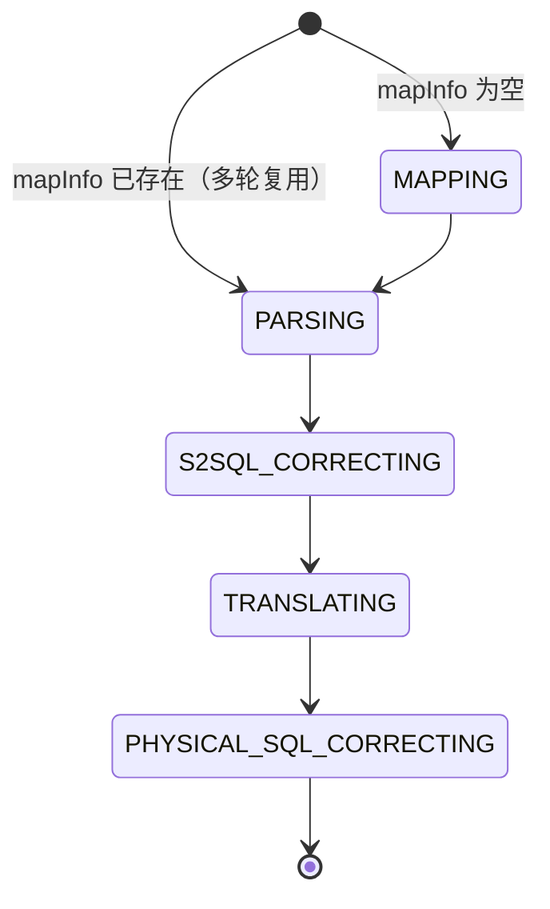

# 02 · 查询数据流详解

> 本文档面向数据平台 / 数仓团队面试官，从代码制口讲清「用户一次提问 → SQL 执行」的全链路。
> Part A 按管道阶段严谨解析（A0-A6）；Part B 用 sample query 贯穿（B0 多 DataSet 选型 + B1 基础聚合 + B2 派生同比）。
>
> **配套文档**：
> - 宏观鸟瞰见 [`01-架构总览.md`](./01-架构总览.md)
> - 数据权限见 [`03-数据权限控制.md`](./03-数据权限控制.md)
> - SchemaMapper 深挖见 [`../智能问数/02-SchemaMapper.md`](../智能问数/02-SchemaMapper.md)（本文 A3 仅概览）
>
> **诚实边界**：行号可漂移，类·方法为锚点；A6（Translator）声明不深挖。

## 导航

| 部分 | 章节 | 主题 |
|------|------|------|
| Part A | A0 | 全局视图：ChatWorkflowEngine 状态机 |
| Part A | A1 | 入口与编排 |
| Part A | A2 | ChatWorkflowEngine 状态机详解 |
| Part A | A3 | SchemaMapper 阶段（概览，引用 02-SchemaMapper.md） |
| Part A | A4 | SemanticParser 阶段（Rule + LLM） |
| Part A | A5 | SemanticCorrector 阶段（4 组中等粒度） |
| Part A | A6 | SemanticTranslator 阶段（简略） |
| Part B | B0 | 多 DataSet 同时命中 → 系统 top1 / 用户 Feedback 选型 |
| Part B | B1 | sample query 基础聚合版（7 个状态快照） |
| Part B | B2 | sample query 派生同比版（7 个状态快照） |

---

# Part A · 管道阶段章节

## A0 · 全局视图

整个解析流程由 `ChatWorkflowEngine`（`headless/server/.../utils/ChatWorkflowEngine.java`）的状态机驱动，共 5 个状态：



| State | 进入条件 | 退出条件 | 产出 |
|-------|---------|---------|------|
| **MAPPING** | `mapInfo` 为空（首轮提问） | 所有 SchemaMapper 执行完 | `SchemaMapInfo`：NL 中识别出的指标 / 维度 / 实体 / 值 |
| **PARSING** | mapInfo 已就绪 | 所有 SemanticParser 执行完 | `candidateQueries`：候选 SemanticQuery 列表 |
| **S2SQL_CORRECTING** | 至少 1 个候选 | 所有 SemanticCorrector 执行完 | 每个 candidate 的 `SqlInfo.correctedS2SQL` 被修正 |
| **TRANSLATING** | S2SQL 已校正 | SemanticTranslator 执行完 | `QueryStatement`：含物理 SQL |
| **PHYSICAL_SQL_CORRECTING** | 物理 SQL 已生成 | LLMPhysicalSqlCorrector 执行完 | 物理 SQL 被 LLM 二次优化 |

**为什么用状态机而非线性调用？**
- 多轮对话场景：`mapInfo` 已存在时直接跳过 MAPPING（性能优化）
- Rule 解析成功时跳过 LLM 调用（成本优化）
- 状态机让「按当前状态决定下一步」的逻辑显式化，便于扩展

---

## A1 · 入口与编排

### A1.1 REST 入口

`chat/server/.../rest/ChatQueryController.java` 提供三个端点：

| 端点 | 方法 | 行号 | 用途 |
|------|------|------|------|
| `POST /api/chat/query/search` | `search` | 34 | 输入联想 / schema 搜索（可选） |
| `POST /api/chat/query/parse` | `parse` | 41 | **主入口**：NL → 多个候选 parse |
| `POST /api/chat/query/execute` | `execute` | 48 | 执行用户选定的 parse |

代码片段（`ChatQueryController.java`）：
```java
@PostMapping("/parse")
public ChatParseResp parse(@RequestBody ChatParseReq chatParseReq, ...) {
    return chatQueryService.parse(chatParseReq);
}

@PostMapping("/execute")
public QueryResult execute(@RequestBody ChatExecuteReq chatExecuteReq, ...) {
    return chatQueryService.execute(chatExecuteReq);
}
```

### A1.2 编排中心：ChatQueryServiceImpl

`chat/server/.../service/impl/ChatQueryServiceImpl.java` 是 Chat 层的编排中心，用 **SPI 集合遍历模式**：

```java
// 字段：通过 ComponentFactory 加载所有 SPI 实现
private final List<ChatQueryParser> chatQueryParsers = ComponentFactory.getChatParsers();
private final List<ChatQueryExecutor> chatQueryExecutors = ComponentFactory.getChatExecutors();
private final List<ParseResultProcessor> parseResultProcessors = ComponentFactory.getParseProcessors();
private final List<ExecuteResultProcessor> executeResultProcessors = ComponentFactory.getExecuteProcessors();
```

`parse()` 方法（行 110-138）的双循环模式：

```java
public ChatParseResp parse(ChatParseReq chatParseReq) {
    // 1. 创建 queryId
    Long queryId = chatManageService.createChatQuery(chatParseReq);

    // 2. 构造 ParseContext
    ParseContext parseContext = buildParseContext(chatParseReq, new ChatParseResp(queryId));

    // 3. 遍历 ChatQueryParser 数组（NL2SQLParser 主路径）
    for (ChatQueryParser parser : chatQueryParsers) {
        if (parser.accept(parseContext)) {
            parser.parse(parseContext);  // 关键调用
        }
    }

    // 4. 遍历 ParseResultProcessor（推荐问题、格式化、耗时统计）
    for (ParseResultProcessor processor : parseResultProcessors) {
        if (processor.accept(parseContext)) {
            processor.process(parseContext);
        }
    }

    // 5. 持久化 + 返回
    chatManageService.batchAddParse(...);
    return parseContext.getResponse();
}
```

`execute()` 方法（行 141-164）结构对称——遍历 `chatQueryExecutors` 找第一个 accept 的执行，然后遍历 `executeResultProcessors` 做后处理。

**关键设计**：
- **双循环模式**：第一个循环做核心解析（parse）/ 执行（execute），第二个循环做后处理（推荐问题 / 数据解读）
- **accept 短路**：execute 循环里 `queryResult != null` 时 break（行 147-149），单 executor 负责
- **SPI 加载**：所有集合都走 `ComponentFactory`，便于扩展

---

## A2 · ChatWorkflowEngine 状态机详解

`headless/server/.../utils/ChatWorkflowEngine.java` 是 Headless 层的核心。承接 A1 的 `parser.parse(parseContext)`，经 `NL2SQLParser` 进入 `ChatLayerService.parse()`，再由状态机驱动后续阶段。

### A2.1 入口逻辑

`S2ChatLayerService.parse()`（`headless/server/.../facade/service/impl/S2ChatLayerService.java:67`）：

```java
public ParseResp parse(QueryNLReq queryNLReq) {
    ParseResp parseResp = new ParseResp(queryNLReq.getQueryText());
    ChatQueryContext queryCtx = buildChatQueryContext(queryNLReq);
    queryCtx.setParseResp(parseResp);
    // 关键：根据是否已有 mapInfo 决定从哪 state 进入
    if (queryCtx.getMapInfo().isEmpty()) {
        chatWorkflowEngine.start(ChatWorkflowState.MAPPING, queryCtx);
    } else {
        chatWorkflowEngine.start(ChatWorkflowState.PARSING, queryCtx);
    }
    return parseResp;
}
```

**性能优化点**：多轮对话场景下，前端可能把上一轮的 mapInfo 一起带过来，跳过 MAPPING 直接进 PARSING。但实际生产中 MAPPING 通常仍会重跑（避免上下文漂移），这层优化主要服务于「显式重用」API。

### A2.2 主循环（start 方法）

```java
public void start(ChatWorkflowState state, ChatQueryContext queryCtx) {
    ChatWorkflowState curState = state;
    while (curState != ChatWorkflowState.END) {
        switch (curState) {
            case MAPPING:
                performMapping(queryCtx);              // 行 43
                curState = ChatWorkflowState.PARSING;
                break;
            case PARSING:
                performParsing(queryCtx);              // 行 55
                curState = ChatWorkflowState.S2SQL_CORRECTING;
                break;
            case S2SQL_CORRECTING:
                performCorrecting(queryCtx);           // 行 73
                curState = ChatWorkflowState.TRANSLATING;
                break;
            case TRANSLATING:
                performTranslating(queryCtx);          // 行 77
                curState = ChatWorkflowState.PHYSICAL_SQL_CORRECTING;
                break;
            case PHYSICAL_SQL_CORRECTING:
                performPhysicalSqlCorrecting(queryCtx); // 行 83
                curState = ChatWorkflowState.END;
                break;
        }
    }
}
```

### A2.3 各 state 的具体工作

| 方法 | 行号 | 工作 |
|------|------|------|
| `performMapping` | 43-52 | `schemaMappers.forEach(mapper -> mapper.map(queryCtx))` — 遍历 6 个 SchemaMapper，每个把识别到的 SchemaElementMatch 写入 `mapInfo` |
| `performParsing` | 55-70 | `semanticParsers.forEach(parser -> parser.parse(queryCtx))` — 遍历 2 个 SemanticParser（Rule + LLM），把候选 SemanticQuery 写入 `candidateQueries` |
| `performCorrecting` | 73-75 + 111-123 | 对每个 candidateQuery，遍历所有 SemanticCorrector 执行 `correct()` |
| `performTranslating` | 77-81 | 调用 `semanticLayerService.translate(queryStatement)`，把 S2SQL 翻译为物理 SQL |
| `performPhysicalSqlCorrecting` | 83-84 + 171-191 | 仅对 `LLMPhysicalSqlCorrector` 实例执行，对物理 SQL 做 LLM 二次优化（JOIN 顺序、条件下推） |

### A2.4 设计要点

1. **状态机而非 if-else 链**：扩展时只需加新 state（如未来加一个 `SQL_REWRITE`），不动主循环
2. **回退能力**：状态机理论上支持向后跳（如 PARSE 失败回到 MAPPING），当前实现是线性向前，但保留了扩展余地
3. **candidateQueries 是数组**：一次提问可能产出多个候选 parse，前端让用户选；这是 SuperSonic 的「澄清式 UX」设计

---

## A3 · SchemaMapper 阶段（概览）

**作用**：把用户问句中的指标 / 维度 / 实体 / 值识别出来，写入 `SchemaMapInfo`。

**详细解析见 [`../智能问数/02-SchemaMapper.md`](../智能问数/02-SchemaMapper.md)，本节仅做导航式概览。**

### A3.1 一次 Mapping：6 个 SchemaMapper

贯穿例：「**比亚迪今年的期间费用同比增长多少**」。  
本节只谈 **MAPPING 状态**（`ChatWorkflowEngine.performMapping`）：把问句里的语义对象认进 `SchemaMapInfo`。Mapper **只对问句字面（或 TermDesc 伪问句）匹配**，问句里没有的词不会凭空出现。

**何时跑 Mapping**：`mapInfo` 为空才跑；已有 `elementMatches`（多轮复用 / 上游预填）则整段跳过，直接 PARSING。

SPI 顺序：`EmbeddingMapper → KeywordMapper → QueryFilterMapper → PartitionTimeMapper → TermDescMapper → AllFieldMapper`。

#### MapMode 怎么影响本阶段

Chat（`NL2SQLParser`）在进 Mapping 前会按 **STRICT → MODERATE** 各跑一轮完整 `doParse`；两轮都没解析出候选时再 **LOOSE**。这是**运行时动态降级**，不是启动前锁死一个模式：

```java
for (MapModeEnum mode : Lists.newArrayList(MapModeEnum.STRICT, MapModeEnum.MODERATE)) {
    queryNLReq.setMapModeEnum(mode);
    doParse(queryNLReq, parseResp);
}
if (parseResp.getSelectedParses().isEmpty() && candidateParses.isEmpty()) {
    queryNLReq.setMapModeEnum(MapModeEnum.LOOSE);
    doParse(queryNLReq, parseResp);
}
```

对本阶段最要紧的一点：**按 MapMode 叙事时，`EmbeddingMapper` 仅在 `LOOSE` 打开**（STRICT / MODERATE 下不跑）。常态问句在 STRICT/MODERATE 就认够时，Embedding 全程不参与。（`accept` 另有 `text2SQLType` 侧条件，属 PARSING/调度层，本节不展开。）

| MapMode | 阈值 | Mapping 侧含义 |
|---------|------|----------------|
| STRICT | 高 | 优先精确匹配；Embedding **关** |
| MODERATE | 中 | 容忍一定模糊；Embedding **关** |
| LOOSE | 低 | 最后兜底；Embedding **开**（向量近义召回） |
| ALL | 无（不靠相似度门槛） | 打开 `AllFieldMapper`：把**当前语义 schema 里该 DataSet 的全部 Metric + Dimension** 写入 `mapInfo`（见下） |

**`MapMode=ALL` 具体做什么**（`AllFieldMapper.doMap`）：

- **会灌**：该 DataSet 下所有 **指标 + 维度**（`getMetrics()` + `getDimensions()`），每条 `similarity` 固定写成 `0.1`
- **不灌**：维值 VALUE、Term 等——不是「数据集里一切对象」
- **写法注意**：用的是 `setMatchedElements`，会**整表替换**该 dataSet 的 match 列表（SPI 里它排在最后，前面 Keyword 等结果会被盖掉）
- **范围**：受本次请求的 DataSet / 语义 schema 裁剪限制（Agent 滤镜仍在），不是全库所有 DataSet
- **何时用**：不在 STRICT→MODERATE→LOOSE 主链里；Chat 在 LLM 轮失败（或规则全空走 LLM 兜底）时设 `MapMode=ALL`，让 LLM 能看到尽量全的字段再写 S2SQL（见 A4.2）

#### 6 个 Mapper（本例 · 常态 STRICT/MODERATE）

| Mapper | 职责 | 本例产出 |
|--------|------|----------|
| `EmbeddingMapper` | 向量近义召回 Metric / Dimension 名；内部可再 LLM 精选（详见 [`../智能问数/02-SchemaMapper.md`](../智能问数/02-SchemaMapper.md)） | 常态 **不跑**；仅落到 LOOSE 才可能出近义 Metric/Dimension。一般召不回 Term / 维值 |
| `KeywordMapper` | HanLP 词典 + DB 维值匹配 | VALUE「比亚迪」、TERM「期间费用」；**不会**字面命中「管理费用」 |
| `QueryFilterMapper` | 前端 filter 强制注入 VALUE | 纯 NL → 空 |
| `PartitionTimeMapper` | mapInfo 非空后自动注入分区时间 DIMENSION | DIMENSION「报告期」等；**不是**认出「今年」 |
| `TermDescMapper` | Term 的 description 当伪问句，再跑一遍 Mapper | → METRIC「管理费用 / 销售费用 / 财务费用」 |
| `AllFieldMapper` | `MapMode=ALL` 时把 DataSet 全部 Metric+Dimension 写入（并替换该集 match） | 常态不跑；见上 ALL 说明 |

#### 本例 Mapping 结束后的 `SchemaMapInfo`（示意）

| SchemaElement | 谁写的 |
|---------------|--------|
| VALUE「比亚迪」 | KeywordMapper |
| TERM「期间费用」 | KeywordMapper |
| DIMENSION「报告期」（partition） | PartitionTimeMapper |
| METRIC「管理费用」「销售费用」「财务费用」 | TermDescMapper |
| （可选）近义 Metric / Dimension | 仅 LOOSE 时 EmbeddingMapper |
| 「同比」/「今年」 | **通常不进 mapInfo**；留给后续 Parser / Ratio / Time |

> 配置若把「期间费用」直接做成派生 Metric，Keyword 也可能字面命中该 METRIC。本文按 A3.3：**Term + 三费用 Metric**，三费用只来自 TermDesc。

### A3.2 MatchStrategy（Keyword / Embedding 的匹配引擎）

**不是** 6 个 Mapper 的一一实现。MatchStrategy 是部分 Mapper **内部委托**的「怎么匹配」策略：

| MatchStrategy | 调用方 | 职责 |
|---------------|--------|------|
| `HanlpDictMatchStrategy` | KeywordMapper | HanLP 自定义词典 + 前缀/后缀搜索 |
| `DatabaseMatchStrategy` | KeywordMapper | 数据库维度值精确/模糊搜索 |
| `EmbeddingMatchStrategy` | EmbeddingMapper | 向量召回 + LLM 二次过滤 |
| `SearchMatchStrategy` | （备用） | 搜索类匹配 |
| `SingleMatchStrategy` | 抽象基类 | 单次匹配 |
| `BatchMatchStrategy` | 抽象基类 | 批量并发匹配 |

`QueryFilterMapper` / `PartitionTimeMapper` / `TermDescMapper` / `AllFieldMapper` 不走这套，逻辑写在各自的 `doMap` 里。

### A3.3 知识库 backing

先把两件事分开想：

- **语义层**：后台配好的指标/维度/术语等元数据（口径定义）。它本身不读自然语言。
- **知识库**：从语义层抄出来的检索副本（HanLP 词典 + 元数据向量），用来在问句里认出这些名字，并反查回语义对象。

没有语义层就灌不出知识库；没有知识库，「期间费用」只是普通汉字，对不上任何对象。

#### 知识库怎么构建出来

贯穿例子（财务场景）：

- Term：「期间费用」（用户常这么说）
- Metric：「管理费用」「销售费用」「财务费用」（真正可查的指标）
- Dimension：「公司名称」，值别名含「比亚迪」

**第 1 步：拉出 SemanticSchema**

`SchemaService.getSemanticSchema()` 返回 `SemanticSchema`，内部是 `List<DataSetSchema>`（每个上线 DataSet 一份）。其中一个 `DataSetSchema` 大致长这样（字段来自 `DataSetSchema.java`）：

```text
DataSetSchema {
  dataSet:          { id: 4, name: "财务分析数据集", type: DATASET }
  metrics:          [
    { id: 21, name: "管理费用", model: 7, type: METRIC, ... },
    { id: 22, name: "销售费用", model: 7, type: METRIC, ... },
    { id: 23, name: "财务费用", model: 7, type: METRIC, ... }
  ]
  dimensions:       [
    { id: 8, name: "公司名称", model: 7, type: DIMENSION, ... }
  ]
  dimensionValues:  [
    { id: 8, type: VALUE, alias: ["比亚迪", ...], ... }   // 来自 DimValueMap
  ]
  terms:            [
    { id: 3, name: "期间费用", type: TERM, ... }
  ]
  tags / queryConfig / databaseType ...
}
```

`SemanticSchema` 再提供 `getMetrics()` / `getDimensions()` / `getTerms()` 等扁平视图，供后续灌词典。

**第 2–3 步合起来看：建「字面词 → 语义对象」索引**

本质不是另起一套数据，而是给语义层建检索索引：

| 索引侧（词典里） | 语义层侧（台账里） |
|-----------------|-------------------|
| 字面词 `管理费用` / `期间费用` / `比亚迪` | `SchemaElement`（Metric / Term / VALUE…） |
| nature 标签 `_7_21_metric`、`_4_3_term`… | 用 modelId/dataSetId + 元素 id 定位到那条对象 |

- **第 2 步** `DictWordService.getAllDictWords()`：把每个语义元素编成 `DictWord`（字面词 + nature）。nature 不是语文词性，是索引的 **value 指针**。
- **第 3 步** `KnowledgeBaseService.reloadAllData()`：把这些条目装进 HanLP 自定义词典 + 后缀索引——HanLP 只是这张索引的**存放与查询引擎**（分词时顺带查出 nature）。

示意：

| 字面词 | nature | 反查到 |
|--------|--------|--------|
| 管理费用 | `_7_21_metric` | model 7 / metric 21 |
| 销售费用 | `_7_22_metric` | metric 22 |
| 财务费用 | `_7_23_metric` | metric 23 |
| 期间费用 | `_4_3_term` | dataSet 4 / term 3（Term 的 nature 用 dataSetId） |
| 比亚迪 | `_7_8` 一类 VALUE | 维度 8 的值 |

别名、倒序词是同一对象的多个索引键。没有 nature，命中只是字符串，回不到 `SchemaElement`。

**第 4 步：并行再建一份向量索引**

`MetaEmbeddingTask` 把 Metric / Dimension 的名称与描述向量化，给 `EmbeddingMapper` 近义召回——这是**另一条**「文本 → 语义对象」索引（相似度），不是 HanLP 那条精确词索引。Term、维度值一般不走这条。

**何时重建**：启动全量；定时发现变更再 reload；指标/维度增删改走事件增量更新。知识库跟着语义层配置自动生成，不是手写死表。

#### 语义层里哪些东西会灌进去

- **进词典**：三个费用 Metric、维度名、维度值（「比亚迪」）、Term「期间费用」
- **进向量库**：主要是 Metric / Dimension 文本
- **不直接灌**：物理表名、底表字段、Model、Identify。用户说「比亚迪」能命中，靠的是维度值进了词典。

口头「实体」≠ 代码里的独立 `ENTITY` 类型；本仓库没有该枚举值。

| 灌入对象 | HanLP | 向量库 |
|---------|-------|--------|
| Metric | ✓ | ✓ |
| Dimension | ✓ | ✓ |
| 维度值 | ✓ | ✗ |
| Term | ✓ | ✗ |
| DataSet / Model / Identify | 基本不灌¹ | ✗ |

¹ `DataSetWordBuilder` 存在，但 `getAllDictWords()` 当前未调用。

#### 提问时怎么用上

用户问「比亚迪今年期间费用多少」时：

1. 「期间费用」→ Term（`_4_3_term`）；后续由 `TermDescMapper` 等把术语展开/关联到具体 Metric
2. 「管理/销售/财务费用」若也被提到或由术语链路召回 → 三个 Metric
3. 「比亚迪」→ 维度值
4. 说法飘时走 Embedding；值词典没有则 `DatabaseMatchStrategy` 查库

运行时入口：`KnowledgeBaseService`、`HanlpHelper`、`MetaEmbeddingService`。详见 [`../智能问数/02-SchemaMapper.md`](../智能问数/02-SchemaMapper.md)。

### A3.4 Agent 如何框定 DataSet 范围

知识库是**进程内共享的一份**（HanLP 词典 + meta 向量），不是每个 Agent 各建一套。隔离靠：**Agent 配置能看哪些 DataSet → 提问时戴上「数据集滤镜」**。

通俗比喻：全公司共用一本大词典；财务助手只能查「财务分析」那几页，销售助手只能查「销售分析」那几页。

#### 范围从哪来

1. Agent 在工具配置里挂 `DatasetTool.dataSetIds`（`Agent.getDataSetIds()`）
2. `QueryReqConverter.buildQueryNLReq` 把该集合写入 `QueryNLReq.dataSetIds`
3. 若请求还带了单个 `dataSetId`，再与 Agent 集合求交（不能越权扩到 Agent 没配的集）

#### 过滤发生在哪（查询时，不是建库时）

| 环节 | 做什么 |
|------|--------|
| `schemaService.getSemanticSchema(dataSetIds)` | 本次能看到的语义 schema 先按 DataSet 裁过 |
| `HanlpHelper.getTerms(..., dataSetIds)` | 分词命中按 nature 里的 dataSetId，只留范围内的词 |
| Embedding `retrieveQuery(..., detectDataSetIds)` | 向量召回按关联 model / DataSet 加条件 |
| `MapFilter.filterByDataSetId` | Mapper 写完后再清掉范围外的 match |
| `NL2SQLParser` | 常按 dataset **逐个** `doParse`（集合再收成 singleton） |

面试一句话：**词典大家共用；每次提问按「这个 Agent 能看哪些 DataSet」把 Mapping 结果收窄。**

### A3.5 词命中如何落到 DataSet、最终如何选出一条

Agent/请求圈定允许范围后（A3.4），Mapping **边认词边分桶**：

1. 问句里的词经 Keyword / Embedding 等命中知识库条目  
2. **每条命中自带归属**（不是「先定一个 DataSet」）：  
   - HanLP nature → `NatureHelper.getDataSetId`；Embedding 读 metadata 的 `dataSetId`  
   - **同一维度名出现在多个 DataSet 时**：词典里往往是「一词多 nature」（或 model 级 nature 经 `changeModel2DataSet` **展开成多个 dataSetId**）。一次命中会变成**多条** `SchemaElementMatch`，分别进不同桶——不是只留一个集、也不是随便挑一个集  
3. 写入 `SchemaMapInfo`：`Map<dataSetId, List<match>>`  
4. 做完看 `getMatchedDataSetInfos()`：几个非空桶 = 命中几个 DataSet（事后计数）

#### 最终怎么从多条候选 SQL / 多 DataSet 里收成「执行哪一条」

Parser 阶段本来就可以留下**多条** `SemanticParseInfo`（不同 DataSet、不同 queryMode 都可能有）。收窄发生在 **parse 出候选之后、execute 之前**，不是 execute 里再做复杂选型：

```text
多候选 selectedParses
    │
    ├─ Agent 开了 Feedback 且候选 > 1、用户未指定
    │     → 先返回列表，等用户点选 parseId，再 execute（用户选定 = 唯一）
    │
    └─ 否则系统自动用排序后的 top1
          → LLM 轮常带 selectedParses.get(0)
          → 部分自动执行路径也用 get(0) 的 parseId 去 execute
```

**系统排序**（`SemanticParseInfo.sort` → `SemanticParseComparator`），大致优先级：

1. DataSet 名命中的最大相似度（`maxDatasetSimilarity`）  
2. 不同 DataSet 且上述接近时：看 **similarity==1 的精确命中个数**（多的优先）  
3. 指标命中的最大相似度  
4. 全部 elementMatch 的相似度之和  
5. 指标历史使用次数（`useCnt`）  

单条候选内部还有 `fillScore`（`detectWord.length × similarity` 等），供同轮内比较；跨候选最终以上面的 `sort` 为准。排完后重新编号 `parseId`（1…n），**第 1 名即 top1**。

一句话：**同名维多集会「一词多桶」；多候选靠 sort 出 top1，有 Feedback 则等人选，execute 只执行已定的那条 parse。**端到端示例见 **B0**。

---

**深入到这里就够了。** 想看具体每个 Mapper 怎么实现的，跳转 [`../智能问数/02-SchemaMapper.md`](../智能问数/02-SchemaMapper.md)。

---

## A4 · SemanticParser 阶段

**作用**：把 SchemaMapper 产出的 `SchemaMapInfo`，变成一条条「可继续往下走」的候选查询（`SemanticQuery` / `parseInfo`，并尽量给出 S2SQL）。

本阶段有规则解析与 LLM 解析两条路。下面先把 **RuleSqlParser** 讲透：它不靠大模型，只靠「mapInfo 里出现了哪几类 SchemaElement」来套查询模板。

### A4.1 RuleSqlParser（规则解析器）

**文件**：`headless/chat/.../parser/rule/RuleSqlParser.java`

#### 为什么要有规则解析？

SchemaMapper 已经告诉你「问句里认出了哪些指标 / 维值 / 术语」。很多常见问法其实是**固定句式**：

- 有指标 + 有公司名 → 「查某公司的某指标」（过滤型）
- 有指标 + 有维度 → 「按某维看指标」（分组型）
- 只有维值、没有指标 → 「查明细」

这类句式不必每次叫 LLM：快、零成本、结果可解释、可复现。规则解析做的就是：**看元素类型怎么共现 → 套上对应的查询模式 → 填成结构化 parseInfo → 再拼出 S2SQL**。

盖不住的复杂说法，再交给后面的 `LLMSqlParser`。

#### 它在干什么（一句话）

> 读 `mapInfo` → 用「元素类型清单」匹配多种 `RuleSemanticQuery` 模板 → 补时间/聚合 → `buildS2Sql`。

#### 执行步骤

```text
candidateQueries 已有内容？ ──是──► 直接 return（例如 LLM 已产出候选）
        │否
        ▼
按 dataSetId 取 elementMatches
        │
        ▼
RuleSemanticQuery.resolve(...)   ← 核心：按「类型共现」套模板，可产出多个候选
        │
        ▼
辅助解析：TimeRangeParser → AggregateTypeParser
        │
        ▼
每个候选 buildS2Sql(...)          ← 结构化请求 → S2SQL 字符串
```

对应代码骨架（`RuleSqlParser.parse`）：

1. `candidateQueries` 非空则跳过  
2. 对每个命中的 dataSet，调用 `RuleSemanticQuery.resolve`  
3. 跑 `TimeRangeParser`、`AggregateTypeParser`  
4. `query.buildS2Sql(dataSetSchema)`

#### 核心：不是 if-else 二选一，而是「模板海选」

`RuleSemanticQuery.resolve` 会遍历 `QueryManager` 里注册的**所有**规则查询类。每个类自带一个 `QueryMatcher`，用 `addOption(元素类型, 必选/可选, 数量约束)` 声明「我这种查询模式需要什么」。

`match` 非空 → 该模式入选，并 `fillParseInfo`（填 metrics、dimensionFilters、score 等）。

所以面试别说成「有 METRIC 就走 Metric，否则走 Detail」这种**互斥单选**——真相是：**凡是约束满足的模式都可以进候选列表**，后面再按 score 排序挑给人看 / 给 LLM 当 hint。

两大族（抽象基类）：

| 族 | 基类约束 | 含义 |
|----|----------|------|
| **指标查询** | `MetricSemanticQuery`：至少 1 个 `METRIC` | 「算一个数 / 看趋势」 |
| **明细查询** | `DetailSemanticQuery`：不要求 METRIC | 「列出明细行」 |

常用具体模式（`queryMode`）：

| queryMode | 典型约束 | 白话 |
|-----------|----------|------|
| `METRIC_FILTER` | METRIC≥1 + VALUE≥1 | 有过滤条件的指标查询（如公司=比亚迪） |
| `METRIC_GROUPBY` | METRIC≥1 + DIMENSION≥1 | 按维度聚合看指标 |
| `METRIC_MODEL` | 只需 METRIC | 只有指标、过滤很少的兜底指标模式 |
| `METRIC_ORDERBY` | METRIC + DIMENSION，且问句像「最大/最高」 | TopN / 排序类 |
| `DETAIL_VALUE` / `DETAIL_DIMENSION` | 无 METRIC（或限制 METRIC≤0） | 查明细 |

`QueryMatcher` 里：`REQUIRED` = 必须有；`OPTIONAL` = 可有可无；数量用 `AT_LEAST` / `AT_MOST`。TERM 在基类里通常是可选的。

#### 辅助解析（resolve 之后、`buildS2Sql` 之前）

| 辅助 Parser | 做什么 | 注意 |
|-------------|--------|------|
| `TimeRangeParser` | 从问句抽「今年 / 上个月 / 近 N 天」等，写入 `parseInfo.dateInfo`，挂到分区时间字段 | **这才是认「今年」的地方**；PartitionTimeMapper 只负责把时间维塞进 mapInfo |
| `AggregateTypeParser` | 从问句关键词推断 SUM/AVG/MAX… | 「同比增长多少」**不会**被它当成 SUM；同比是后续 Corrector/Translator（如 `MetricRatioParser`）的事。未命中时 `aggType` 常为 NONE，聚合回退指标默认 `defaultAgg` |

#### 本例走一遍：「比亚迪今年的期间费用同比增长多少」

假设 Mapping 已得到：VALUE「比亚迪」、METRIC 三费用（TermDesc 展开）、分区 DIMENSION「报告期」等。

1. **resolve**：`METRIC_FILTER`（有 METRIC+VALUE）会命中；若还有分区 DIMENSION，`METRIC_GROUPBY` / `METRIC_MODEL` 也可能同时命中 → **多个候选**，不是只留一个。  
2. **fillParseInfo**：metrics=三费用；`dimensionFilters` 含公司=比亚迪；按模式填 dimensions / score。  
3. **TimeRangeParser**：「今年」→ 时间范围写入 `dateInfo`。  
4. **AggregateTypeParser**：同比语意通常不改 aggType。  
5. **buildS2Sql**：结构化请求转成 S2SQL（语义字段名）；「同比」的物理展开留给后面阶段。

面试金句：**RuleSqlParser = 用 Schema 元素共现套查询模板；快、可解释；复杂语义再交给 LLM。**

### A4.2 LLMSqlParser（LLM 解析器）

**文件**：`headless/chat/.../parser/llm/LLMSqlParser.java:26-91`

**触发条件**：`queryNLReq.getText2SQLType()` 启用 LLM（默认 `LLM_OR_RULE`）。

#### Prompt 7 组件

`LLMRequestService.getLlmReq()`（`headless/chat/.../parser/llm/LLMRequestService.java`）组装 prompt：

| 组件 | 来源 | 用途 |
|------|------|------|
| `schema` | `SemanticSchema.getMetrics() + getDimensions()` 或映射子集 | 数据集的指标 / 维度定义 |
| `exemplar` | `promptHelper.getFewShotExemplars(llmReq)` | Few-shot 示例（NL-SQL 对） |
| `mappingResult` | `getMappedValues()` | SchemaMapper 识别的维度值匹配 |
| `terms` | `getMappedTerms()` | HanLP 分词的术语结果 |
| `sideInfo` | `promptHelper.buildSideInformation()` | 当前日期、分区时间、主键等 |
| `databaseType/Version` | `getDatabaseType()` | 目标数据库方言（影响 SQL 语法） |
| `question` | `queryText` | 用户原始问题 |

#### OnePassSCSqlGenStrategy（自一致性投票）

**文件**：`headless/chat/.../parser/llm/OnePassSCSqlGenStrategy.java`  
**类型**：`SqlGenType.ONE_PASS_SELF_CONSISTENCY`（当前主实现）

**直觉**：LLM 写 SQL 一次可能写飘。与其赌一次，不如**并行写好几次，看哪种 SQL 出现最多，就信哪种**——这就是 Self-Consistency（自一致性）。

**本仓库具体怎么做**（不完全是「同一 prompt 复制 N 次」）：

```text
1. 召回一批 few-shot exemplars
2. 按 `parser.selfConsistencyNumber`（配置项默认 **1**，调大如 5 才有投票意义）
   每次随机抽一小组 exemplars → 拼出一份 prompt
   （高相似 exemplar 优先保留，其余 shuffle）
3. parallelStream 并发调 LLM，每份 prompt 产出一条 SQL
4. ResponseHelper.selfConsistencyVote：
   按 SQL 字符串出现次数计票，票数最高者胜出
5. 带回胜出 SQL，以及各候选的得票占比（sqlWeight）
```

| 点 | 标本事实 |
|----|----------|
| 多样性从哪来 | **主要靠每轮 few-shot 组合不同**（`PromptHelper.getFewShotExemplars`）；不是文档里常说的「刻意抬 temperature」 |
| 怎么算「同一票」 | `selfConsistencyVote` 对 SQL 做**原文计票**（相同字符串累加）；**没有**先做去空白/大小写归一化 |
| N 条结果全不同 | 没有多数派。`count > maxCount` 更新胜者，全是 1 票时谁先被 `HashMap` 遍历到谁当选——**任意留一条**，不会因此失败/重试 |
| 投票输入怎么来的 | 生成结果先放进 `ConcurrentHashMap`（key=SQL 原文），再对 **`keySet()`** 计票。相同 SQL 在 Map 里只占 1 个 key，**多数票未必被累加出来**；严格说更像「去重候选里挑一个」 |
| 和重试的区别 | 自一致性是**一次 generate 内并行多推 + 投票**；`tryParse` 重试是整次失败后再跑，失败后才可能把 temperature 调高 |

**价值**：单次幻觉/写法抖动时，多数派 SQL 更稳；代价是 **N 倍 LLM 调用**（并行，墙钟时间不一定 ×N，但费用大致 ×N）。

**面试金句**：Self-Consistency = 多样本生成 + 多数表决；我们用不同 few-shot 制造样本多样性，再对 SQL 原文投票。

#### 失败怎么定义？失败后又做什么？

这里要分清 **两层**，别混成「LLMSqlParser 一失败就回 SchemaMapper」。

##### ① 层内：`LLMSqlParser.tryParse` 自己的重试

**怎样算这一轮 LLM 没产出可用 SQL**（任一即可）：

- `runText2SQL` 抛异常  
- 返回的 `llmResp` 为空  
- 经 `getDeduplicationSqlResp` 处理后，**没有留下合法可写的 S2SQL**  
  （该函数会：① 丢掉 `SqlValidHelper.isValidSQL` 判为**不合法**的 SQL；② 在 LLM 自己的多条结果间去重。  
  「不合法」= 用 JSqlParser（`CCJSqlParserUtil.parse`）**解析失败**——语法都过不了（残缺、乱码、不是 SQL 等）。  
  **不是**「字段不在 schema / 口径错了」那种语义错误；语义问题留给 Corrector / Translator。  
  map 变空，主因通常是**全解析失败或输出为空**，不是「和规则 SQL 撞车被去掉」。）

**怎么做**：最多 `recallMaxRetries` 次；若当前 `temperature==0`，失败后改成 `0.5` 再试。  
若耗尽仍空：`tryParse` **直接 return**，不往 `candidateQueries` 里加东西——**这里不会单独把 `ParseResp` 标成 FAILED**。

##### ② 层外：Chat 看的是「整次 Headless parse」成没成功

先分清调用关系，这句话才好懂：

```text
NL2SQLParser（Chat 侧编排）
    │
    │  doParse(queryNLReq)   ← 一次「整次」请求
    ▼
ChatLayerService.parse / ChatWorkflowEngine
    │  MAPPING → PARSING → CORRECTING → TRANSLATING → …
    ▼
返回 ParseResp.state = COMPLETED 或 FAILED
```

- **层内 ①** 发生在状态机的 **PARSING** 里（`LLMSqlParser.tryParse`），失败了只是不加候选。  
- **层外 ②** 是 `NL2SQLParser` 调完一次 `doParse` 之后，看 **Headless 整条流水线** 最终打在 `ParseResp` 上的状态——不是只看 LLM 有没有写出 SQL。

状态机何时把这次 `doParse` 标成 **FAILED**：

| 时机 | 条件（白话） |
|------|----------------|
| MAPPING 后 | `mapInfo` 仍空 |
| PARSING 后 | `candidateQueries` 仍空（LLM 没写出，**且**规则也没套上） |
| TRANSLATING 后 | 语义翻译不 ok |

`NL2SQLParser.doParse` 会把 Headless 的 `state` **原样抄回** Chat 的 `response`（只有 `COMPLETED` 时才把候选 parse 并进去）。

因此 LLM 轮的补救逻辑是（约 148-164 行）：

```text
1) 带上规则轮 top1 的 selectedParseInfo（mapInfo 预填 → 常跳过 Mapping）
   text2SQLType = LLM_OR_RULE
   调用 doParse  ←—— 第 1 次整次 Headless 跑完

2) 看 Chat response.state：
   · COMPLETED → 结束，用这次结果
   · FAILED    → 认为「带着旧 map 的这一整次」没成
                 selectedParseInfo = null   （别再预填旧 elementMatches）
                 MapMode = ALL              （AllFieldMapper 灌全量 Metric+Dimension）
                 再 doParse 一次            ←—— 第 2 次；mapInfo 空会重跑 Mapping
```

| 点 | 标本事实 |
|----|----------|
| 「整次状态」指什么 | 一次 `ChatLayerService.parse` 跑完后的 `ParseResp.state`，由状态机各阶段共同决定 |
| Chat 在看谁 | 看自己 `response.state`（从 Headless 抄来的），**不是**直接读 `tryParse` 的局部变量 |
| 「回 SchemaMapper」指什么 | **仅**第 1 次 LLM 轮 `doParse` 为 `FAILED` 后：清空 `selectedParseInfo` + `ALL`，第 2 次才会重新 Mapping |
| 不是什么 | 不是 `tryParse` 每次空结果都回 Mapping；层内只升 temperature 重调 LLM |
| 和规则轮 MapMode 降级 | STRICT→MODERATE→LOOSE 是另一条轴；ALL 重试是 LLM 轮整次失败后的补救 |

**面试一句话**：`tryParse` 失败只影响「LLM 有没有加候选」；Chat 要等整次 `doParse` 返回 `FAILED`，才会清空旧 map、改 `ALL` 重跑 Mapping。

### A4.3 多轮对话改写

`NL2SQLParser.rewriteMultiTurn()`（`chat/server/.../parser/NL2SQLParser.java:179-222`）：

**触发**：ChatApp `REWRITE_MULTI_TURN` 启用时（默认关闭）。

**流程**：
1. 取上一轮 queryText + parseInfo + S2SQL
2. 调用 LLM 用固定模板改写当前问句（模板见 `REWRITE_MULTI_TURN_INSTRUCTION`，行 57-68）
3. 用改写后的 queryText 替换原始 queryText，进入正常 parse 流程

**例子**：
- 上轮：「比亚迪 2024 年营收」
- 本轮：「净利润呢」
- 改写后：「比亚迪 2024 年净利润」

### A4.4 Few-shot Exemplar 召回

`NL2SQLParser.addDynamicExemplars()`（行 262-274）：

```java
String memoryCollectionName = embeddingConfig.getMemoryCollectionName(agent.getId());
int exemplarRecallNumber = Integer.parseInt(
    parserConfig.getParameterValue(PARSER_EXEMPLAR_RECALL_NUMBER));
List<Text2SQLExemplar> exemplars = exemplarManager.recallExemplars(
    memoryCollectionName, queryNLReq.getQueryText(), exemplarRecallNumber);
queryNLReq.getDynamicExemplars().addAll(exemplars);
```

**来源**：与 [`../智能问数/03-查询记忆复用.md`](../智能问数/03-查询记忆复用.md) 同一 `memory_{agentId}` 向量库（用户成功查询的 NL-SQL 对）。

**召回数**：由 `parser.exemplarRecallNumber` 配置控制（默认 5）。

---

## A5 · SemanticCorrector 阶段（中等粒度）

**作用**：校正 S2SQL，让 LLM 生成的 SQL 从「语法合法但语义可能漂」变成「口径正确、可执行」。

> 粒度约定：按 4 组分类，每组总结 + 一段源码片段；不展开 8 个子 corrector 逐行。

### A5.1 调用链与编排

**SPI 注册**：`assembly/conf/META-INF/spring.factories:16-19`（3 个顶层 Corrector）

**加载**：`headless/chat/.../utils/ComponentFactory.java:37-41` 通过 `SpringFactoriesLoader.loadFactories()`

**调用入口**：`ChatWorkflowEngine.performCorrecting()`（行 111-123）—— 对每个 candidateQuery 遍历所有 corrector

**Corrector 树状调用结构**：

```
RuleSqlCorrector（编排器）
  ├─ SchemaCorrector              （Schema 修正组）
  ├─ TimeCorrector                （时间修正组）
  └─ GrammarCorrector（编排器）    （语法修正组）
       ├─ SelectCorrector
       ├─ WhereCorrector
       ├─ GroupByCorrector
       ├─ AggCorrector
       └─ HavingCorrector
LLMSqlCorrector                   （LLM 修正组，作用于 S2SQL）
LLMPhysicalSqlCorrector           （LLM 修正组，作用于物理 SQL，在 TRANSLATING 之后）
```

### A5.2 Schema 修正组（SchemaCorrector）

**职责**：把 LLM 输出的 SQL 字段从「alias / 用户写的样子」修正为「bizName」。

| 修正项 | 例子 |
|--------|------|
| 字段名修正 | `期间费用` → `period_expense`（bizName） |
| 聚合函数名 | `SUM` → `SUM`（无变化）；`总数` → `COUNT` |
| LinkingValue 映射 | `比亚迪` → SQL 中的 `'002594'`（基于 SchemaMapper 识别） |

**核心源码片段**（`SchemaCorrector.java`，示意）：
```java
// 1. 提取 SQL 中所有字段
List<String> fields = SqlSelectHelper.getAllSelectFields(s2sql);
// 2. 对每个字段，从 SchemaElement 中找 bizName
Map<String, String> aliasToBizName = schemaElementMatch.stream()
    .collect(Collectors.toMap(SchemaElementMatch::getWord, ...));
// 3. 替换
String corrected = SqlReplaceHelper.replaceTableAlias(s2sql, aliasToBizName);
```

### A5.3 时间修正组（TimeCorrector）

**文件**：`headless/chat/.../corrector/TimeCorrector.java`  
**方式**：**纯规则改 SQL**（JSqlParser 增删 WHERE），**不是 LLM**。

先分清两件事——很多人把「认今年」安在 TimeCorrector 上，其实不对：

| 环节 | 谁 | 做什么 |
|------|-----|--------|
| **认出「今年 / 去年 / 近 N 天」** | **PARSING 阶段**的 `TimeRangeParser`（规则） | 读问句：正则「近N天」/ `yyyyMMdd` / **TimeNLP**（`TimeNLPUtil.parse`）解析中文时间 → 写入 `parseInfo.dateInfo` |
| **改 S2SQL 上的时间条件** | **CORRECTING 阶段**的 `TimeCorrector`（规则） | 看 SQL 里有没有分区时间字段；缺了就按配置**补默认时间窗**，或补下界、或删掉不该有的日期条件 |

`TimeCorrector.doCorrect` 逻辑（有分区时间维时）：

1. **`addDateIfNotExist`**：WHERE 里还没有分区字段 → 用数据集 `TimeDefaultConfig`（聚合/明细各有默认）算出起止日，拼 `(分区字段 >= '…' AND 分区字段 <= '…')` 塞进 SQL  
2. **`addLowerBoundDate`**：已有上界、缺下界时，补 `>=`  
3. 若**没有**分区时间维 → `removeDateIfExist`，去掉不该存在的日期条件  

**不负责**：「同比 / 环比」展开（那是 Translator 侧 `MetricRatioParser` 等）；也不在 Corrector 里再跑一遍「今年」NLP。

**和「今年」的关系**：`TimeRangeParser` 先把「今年」变成 `dateInfo`；LLM/规则生成的 S2SQL 若已经写了时间，Corrector 可能不再补；若 SQL 漏了时间条件，Corrector 按**默认时间配置**补窗——补的是配置默认，不一定逐字等于问句里的「今年」（问句语义主要靠 Parser 阶段的 `dateInfo` / 生成时的 SQL）。

面试一句话：**认相对时间靠 TimeRangeParser（规则+TimeNLP）；TimeCorrector 只做 SQL 上分区时间条件的规则补全/清理。**

### A5.4 语法修正组（GrammarCorrector + 5 个子 corrector）

**职责**：保证 SQL 语法完整正确。

**编排顺序**（GrammarCorrector 内部）：

| 顺序 | 子 Corrector | 职责 | 触发条件 |
|------|-------------|------|---------|
| 1 | `SelectCorrector` | 补全 SELECT 中缺失的 GROUP BY 字段 | 当 SELECT 含维度但 GROUP BY 缺失时 |
| 2 | `WhereCorrector` | 注入 queryFilter；维度值 bizName → techName | 当请求带 filter 时 |
| 3 | `GroupByCorrector` | AGGREGATE 查询自动补 GROUP BY | 当含聚合函数但无 GROUP BY |
| 4 | `AggCorrector` | 为指标字段补聚合函数 | 当指标 SELECT 缺 SUM/AVG |
| 5 | `HavingCorrector` | 为指标加 HAVING 聚合条件 | 当 WHERE 含聚合条件时移到 HAVING |

**GrammarCorrector 编排骨架**：
```java
public void correct(ChatQueryContext queryContext, SemanticQuery semanticQuery) {
    SemanticParseInfo parseInfo = semanticQuery.getParseInfo();
    String s2sql = parseInfo.getSqlInfo().getCorrectedS2SQL();
    // 按顺序执行 5 个子 corrector
    s2sql = new SelectCorrector().correct(s2sql, parseInfo);
    s2sql = new WhereCorrector().correct(s2sql, parseInfo);
    s2sql = new GroupByCorrector().correct(s2sql, parseInfo);
    s2sql = new AggCorrector().correct(s2sql, parseInfo);
    s2sql = new HavingCorrector().correct(s2sql, parseInfo);
    parseInfo.getSqlInfo().setCorrectedS2SQL(s2sql);
}
```

### A5.5 LLM 修正组（LLMSqlCorrector + LLMPhysicalSqlCorrector）

| Corrector | 作用阶段 | 职责 |
|-----------|---------|------|
| `LLMSqlCorrector` | S2SQL_CORRECTING（语义层） | LLM 对 S2SQL 做二次审查（senior data engineer review prompt） |
| `LLMPhysicalSqlCorrector` | PHYSICAL_SQL_CORRECTING（物理层） | LLM 对物理 SQL 做性能优化（JOIN 顺序、条件下推） |

**LLMSqlCorrector prompt 模板**（`LLMSqlCorrector.java`）：
```
You are a senior data engineer. Review the following S2SQL and fix any issues:
- Schema: {schema}
- Question: {question}
- Current SQL: {s2sql}
- Output the corrected SQL only.
```

**LLMPhysicalSqlCorrector** 触发条件：默认关闭（成本考虑）；通过 ChatApp 配置开启。

### A5.6 调用时机总结

| Corrector | 调用时机 | 文件 |
|-----------|---------|------|
| RuleSqlCorrector + 子 corrector | `performCorrecting`（行 111-123） | `RuleSqlCorrector.java` |
| LLMSqlCorrector | 同上 | `LLMSqlCorrector.java` |
| LLMPhysicalSqlCorrector | `performPhysicalSqlCorrecting`（行 171-191），仅对 `instanceof LLMPhysicalSqlCorrector` 执行 | `LLMPhysicalSqlCorrector.java` |

---

## A6 · SemanticTranslator 阶段（简略）

**作用**：把 S2SQL 翻译为可执行的物理 SQL。

> **粒度声明**：本节不深挖，面试现场能说清「指标表达式展开 + 本体 SQL 用 CTE/子查询拼上 + 方言适配 + LIMIT」即可。详细的物理 SQL 翻译不在面试重点。

### A6.1 入口

`DefaultSemanticTranslator.translate()`（`headless/core/.../translator/DefaultSemanticTranslator.java:27`）：

```java
public void translate(QueryStatement queryStatement) throws Exception {
    // 1. QueryParsers 逐个解析（含 OntologyQueryParser 产出本体层 SQL）
    for (QueryParser parser : ComponentFactory.getQueryParsers()) {
        if (parser.accept(queryStatement)) {
            parser.parse(queryStatement);
        }
    }
    // 2. 把本体层 SQL 与外层查询合并（优先 WITH/CTE，否则嵌套子查询）
    mergeOntologyQuery(queryStatement);
    // 3. QueryOptimizers 逐个优化
    for (QueryOptimizer optimizer : ComponentFactory.getQueryOptimizers()) {
        if (optimizer.accept(queryStatement)) {
            optimizer.rewrite(queryStatement);
        }
    }
}
```

### A6.2 8 个 QueryParser

| QueryParser | 职责 |
|-------------|------|
| `SqlVariableParser` | 替换 SQL 中的变量（`{{var}}`） |
| `StructQueryParser` | 结构化请求（QueryStructReq）解析 |
| `SqlQueryParser` | SQL 请求（QuerySqlReq）解析 |
| `DefaultDimValueParser` | 维度值默认解析 |
| `DimExpressionParser` | 维度表达式解析 |
| **`MetricExpressionParser`** | **指标表达式展开**（如 `期间费用` → `SUM(销售费用)+SUM(管理费用)+SUM(财务费用)`） |
| **`MetricRatioParser`** | **同比 / 环比**（本期 vs 上期；引擎支持 WITH 时也常写成 CTE） |
| `OntologyQueryParser` | 生成本体层内部 SQL（物理表 JOIN / 字段映射） |

**重点**（呼应 Part B2）：`MetricRatioParser` 展开同比 / 环比，是金融场景核心能力。

### A6.3 `mergeOntologyQuery`：本体 SQL 拼进外层（CTE 优先）

翻译不是「一行 S2SQL 直接变物理 SQL」，而是两层再合并：

| 层 | 来源 | 含义 |
|----|------|------|
| **外层** | `SqlQuery.sql` | 语义查询形状（SELECT 指标/维度、WHERE…），表名仍是语义表占位 |
| **内层（本体）** | `OntologyQuery.sql` | 该语义表背后的物理投影（底表 JOIN、字段映射） |

`mergeOntologyQuery`（同文件约 58–97 行）把内层嵌进外层：

```text
引擎支持 WITH（sqlQuery.isSupportWith()）
  ├─ 外层尚无 WITH → 直接包成：
  │     WITH <语义表名> AS ( <本体 SQL> )
  │     <外层 SQL>
  └─ 外层已有 WITH（如同比 CTE）→ SqlMergeWithUtils.mergeWith
        把本体 CTE 与已有 WITH 项合并进同一条语句

引擎不支持 WITH
  └─ 把外层里的表名替换成嵌套子查询：(...本体 SQL...) AS <表名>
```

所以你记得的「嵌套子查询 / 改成 CTE」主要就在这一步：**能写 CTE 就写 CTE，否则退回子查询替换**。不是通用「把任意嵌套 SQL 重写成 CTE 的优化器」，而是**语义表 ↔ 物理本体**的固定拼装策略。

### A6.4 2 个 QueryOptimizer

| QueryOptimizer | 职责 |
|----------------|------|
| `DbDialectOptimizer` | 按目标数据库（MySQL / ClickHouse / Presto）适配 SQL 语法 |
| `ResultLimitOptimizer` | 当 SQL 无 LIMIT 时自动追加（默认 1000） |

### A6.5 Calcite / JSqlParser 在合并里的角色

- **`SqlMergeWithUtils`**（包名在 `common.calcite`，实现是 **JSqlParser**）：外层已有 WITH 时，把本体 CTE 项 merge 进去。
- **Calcite**：另有路径参与本体/复杂 SQL 构造（如 `SemanticNode` 等），**不是** `mergeOntologyQuery` 的主合并器；面试别说成「全靠 Calcite 做 CTE」。

### A6.6 进入执行

翻译完成后，物理 SQL 进入 `JdbcExecutor`（`headless/core/.../executor/JdbcExecutor.java`）执行。

**权限**：卡在语义层门面 `translate` / `queryByReq` 入口（S2SQL 已成、进 Translator / 执行前），见 [`03-数据权限控制.md`](./03-数据权限控制.md) §3–§4——不是「译完物理 SQL 之后才第一次校验」。

# Part B · 端到端示例（sample query 贯穿）

**主线 query**：「比亚迪今年的期间费用同比增加了多少」

拆为三段：
- **B0 多 DataSet 选型**：同一问句下财务集 + 销售集都命中 → **系统默认 top1** vs **用户 Feedback 点选**（呼应 A3.5）
- **B1 基础聚合版**：「比亚迪今年的期间费用是多少」——讲清基础管道（假定已落到财务集）
- **B2 派生同比版**：「比亚迪今年的期间费用同比增加了多少」——引出 MetricRatioParser / MetricExpressionParser

---

## B0 · 多 DataSet 同时命中，再选出一条

**设定**（贯穿例同一问句，先放大「集」这一维）：

- Agent 绑定两个 DataSet：`4` 财务分析、`12` 销售经营  
- 两集都有维度「公司名称」、维值「比亚迪」  
- Term / 指标「期间费用」主要在财务集  

问句：「比亚迪今年的期间费用是多少」

### B0-1 Mapping：一词多桶

规则轮按集循环时，每集各自 Mapping；整轮看下来等价于「比亚迪」在两集都进桶，「期间费用」主要进财务桶：

```text
SchemaMapInfo（示意）
  dataSetId=4  财务分析
    VALUE「比亚迪」、TERM/METRIC「期间费用」、分区时间维…
  dataSetId=12 销售经营
    VALUE「比亚迪」、DIMENSION「公司名称」…
    （无「期间费用」或相似度过低）
```

同名维「公司名称」→ 词典「一词多 nature」/ model→多 dataSet 展开 → **两条 match、两个桶**（见 A3.5）。

### B0-2 Parsing：每集可产出候选，再汇总排序

`NL2SQLParser` 对每个 `datasetId` 各跑 STRICT/MODERATE（必要时 LOOSE），每集取该集内 top1 放进 `candidateParses`，最后再 `SemanticParseInfo.sort`：

```json
[
  {"id": 1, "dataSetId": 4,  "dataSetName": "财务分析", "queryMode": "METRIC_FILTER",
   "s2sql": "SELECT … period_expense … WHERE company_name='比亚迪' …"},
  {"id": 2, "dataSetId": 12, "dataSetName": "销售经营", "queryMode": "DETAIL_DIMENSION",
   "s2sql": "SELECT … WHERE company_name='比亚迪' …"}
]
```

排序依据（系统默认，摘要）：DataSet 名相似度 → 精确命中个数 → 指标相似度 → 总相似度 → 指标 `useCnt`。本例财务集因「期间费用」等指标命中更强，**通常排第 1**。

### B0-3 收成「执行哪一条」：两条路径

```text
selectedParses（已 sort，可多条、多 DataSet）
        │
        ├─【路径 A · 系统默认】Agent 未开 Feedback，或只有 1 条候选
        │     → 自动用 get(0)（top1）
        │     → LLM 轮 selectedParseInfo、自动 execute 都吃这条
        │     → 本例默认落到 dataSetId=4 财务分析
        │
        └─【路径 B · 用户 Feedback】agent.enableFeedback()
              且候选 > 1、请求里还没有 selectedParse
              → parse 接口先把多条候选返回前端（不急着 execute）
              → 用户点选 parseId（可选财务或销售）
              → POST /execute 带上该 parseId → 只跑用户选的那条
```

| | 系统默认（A） | 用户 Feedback（B） |
|--|--------------|-------------------|
| 触发 | 无 Feedback / 单候选 | Feedback 开且多候选 |
| 谁定 DataSet | `SemanticParseInfo.sort` 的 top1 | 用户点的那条 parse |
| 后续 | LLM 增强 / execute 跟 top1 | execute 跟用户 parseId |

**面试点**：多 DataSet 不是 Mapping 开头锁死的；是命中分桶 → 每集出候选 → **sort 出默认第一条**，或 **Feedback 让人改选**。B1/B2 默认按路径 A 已选定财务集继续讲管道。

---

## B1 · 基础聚合版：「比亚迪今年的期间费用是多少」

承接 **B0 路径 A**（系统已用 top1 落到财务集）。下文 7 个快照按**单集已定**讲管道细节；快照里的 `dataSetId: 101` 仅作示意 ID。

### 快照 1：HTTP 请求

```http
POST /api/chat/query/parse HTTP/1.1
Content-Type: application/json

{
  "queryText": "比亚迪今年的期间费用是多少",
  "chatId": 42,
  "agentId": 7,
  "user": {"name": "alice", "id": "u_001"}
}
```

**说明**：前端 chat-sdk 调用 `POST /api/chat/query/parse`（见 `webapp/packages/chat-sdk/src/service/index.ts:43-76` 的 `chatParse`）。`chatId` 标识会话；`agentId` 决定使用哪些 LLM App、词典、记忆库。

### 快照 2：ChatWorkflowEngine 入口

```
ChatQueryServiceImpl.parse(ChatParseReq)            ← 行 110
  → ParseContext 创建
  → for parser in chatQueryParsers:
       if parser.accept(parseCtx):
         parser.parse(parseCtx)                     ← NL2SQLParser 接管

NL2SQLParser.parse()                                 ← 行 82
  → buildQueryNLReq: text2SQLType=ONLY_RULE（首轮）
  → for datasetId in agent.dataSetIds:
       for mode in [STRICT, MODERATE]:
         doParse(queryNLReq, parseResp)             ← 进入 ChatLayerService.parse
```

**说明**：首轮提问，`mapInfo` 为空，进入 MAPPING state。

### 快照 3：SchemaMapper 输出（state=MAPPING 完成后）

`SchemaMapInfo`（简化 JSON）：
```json
{
  "dataSetId": 101,
  "matchedElements": [
    {"element": {"type": "ENTITY", "bizName": "company", "name": "公司"},
     "word": "比亚迪", "similarity": 0.95},
    {"element": {"type": "DIMENSION", "bizName": "company_name", "name": "公司名称"},
     "word": "比亚迪", "similarity": 0.92},
    {"element": {"type": "METRIC", "bizName": "period_expense", "name": "期间费用",
                 "expr": "SUM(sale_expense) + SUM(admin_expense) + SUM(fin_expense)"},
     "word": "期间费用", "similarity": 0.98},
    {"element": {"type": "DIMENSION", "bizName": "report_year", "name": "报告年度"},
     "word": "今年", "similarity": 0.88, "detectType": "PARTITION_TIME"}
  ]
}
```

**说明**：
- ENTITY「比亚迪」被 EmbeddingMapper 命中（公司实体向量召回）
- METRIC「期间费用」被 KeywordMapper 命中（HanLP 词典精确匹配）
- DIMENSION「报告年度」被 PartitionTimeMapper 自动加入（识别「今年」是分区时间）
- 三个 MatchMode（STRICT/MODERATE/LOOSE）中 STRICT 已命中，直接进入 PARSING

### 快照 4：RuleSqlParser 输出（state=PARSING）

`candidateQueries`（简化）：
```json
[{
  "queryMode": "METRIC_DOMAIN",
  "type": "METRIC",
  "parseInfo": {
    "dataSetId": 101,
    "metrics": [{"bizName": "period_expense", "name": "期间费用"}],
    "dimensions": [{"bizName": "company_name"}],
    "dimensionFilters": [{"bizName": "company_name", "operator": "=", "value": "比亚迪"}],
    "dateInfo": {"dateMode": "BETWEEN", "startDate": "2025-01-01", "endDate": "2025-12-31"},
    "aggregateType": "SUM",
    "sqlInfo": {
      "s2sql": "SELECT period_expense FROM finance_dataset WHERE company_name = '比亚迪' AND report_year = 2025"
    }
  }
}]
```

**说明**：
- 因含 METRIC 元素，`RuleSemanticQuery.resolve()` 选 `MetricSemanticQuery`（不选 Detail）
- `TimeRangeParser` 把「今年」转为 `2025-01-01 ~ 2025-12-31`
- `AggregateTypeParser` 推断 `aggregateType=SUM`
- `buildS2Sql()` 生成 S2SQL 字符串（**注意 S2SQL 用语义字段 `period_expense` 而非底表字段**）

### 快照 5：LLMSqlParser（rule 成功时跳过）

```
NL2SQLParser.parse 行 131:
  if (parseContext.needLLMParse() && !parseContext.needFeedback()):
    if (rule 解析非空):
      # 走 LLM 增强路径
      queryNLReq.setText2SQLType(LLM_OR_RULE)
      queryNLReq.setSelectedParseInfo(top1候选)  ← 把 rule 结果传给 LLM 参考
      rewriteMultiTurn(...)                       # 多轮改写（首关闭合，跳过）
      addDynamicExemplars(...)                    # 召回 few-shot
      doParse(queryNLReq, parseResp)              ← LLM 生成最终 S2SQL
```

LLM 生成（温度 0，自一致性 5 次投票后）：
```sql
SELECT period_expense
FROM finance_dataset
WHERE company_name = '比亚迪' AND report_year = 2025
```

**说明**：rule 已给出候选，LLM 通常会确认或微调；自一致性投票保证稳定。

### 快照 6：SemanticCorrector 输出（state=S2SQL_CORRECTING）

校正前后对比：

**校正前**（LLM 输出）：
```sql
SELECT period_expense
FROM finance_dataset
WHERE company_name = '比亚迪' AND report_year = 2025
```

**校正后**（4 组 corrector 作用后）：
```sql
SELECT SUM(period_expense) AS period_expense
FROM finance_dataset
WHERE company_name = '比亚迪' AND report_year BETWEEN '2025-01-01' AND '2025-12-31'
GROUP BY company_name
```

**校正细节**：
| Corrector | 动作 |
|-----------|------|
| SchemaCorrector | `比亚迪`（用户写法）→ `'002594'`（dimension value bizName，通过 LinkingValue）—— 但语义层仍保留 `company_name='比亚迪'`，物理层翻译时再展开 |
| TimeCorrector | `report_year = 2025` → `report_year BETWEEN '2025-01-01' AND '2025-12-31'`（按 PartitionTime 拆分） |
| GrammarCorrector.GroupByCorrector | 因 SELECT 含维度 `company_name` + 指标聚合，补 `GROUP BY company_name` |
| GrammarCorrector.AggCorrector | 为 `period_expense` 补 `SUM` |
| LLMSqlCorrector | （默认关闭；若开启，二次审查无变化） |

### 快照 7：SemanticTranslator 输出（state=TRANSLATING）

物理 SQL（`DefaultSemanticTranslator` 翻译后）：

```sql
SELECT
  SUM(d.sale_expense) + SUM(d.admin_expense) + SUM(d.fin_expense) AS period_expense
FROM (
  SELECT company_name, sale_expense, admin_expense, fin_expense, report_year
  FROM dim_finance_income_statement
  WHERE company_code = '002594'  -- 比亚迪的股票代码（维度值映射）
    AND report_year BETWEEN '2025-01-01' AND '2025-12-31'
) d
GROUP BY d.company_name
LIMIT 1000
```

**翻译细节**：
| 阶段 | 动作 |
|------|------|
| `MetricExpressionParser` | `period_expense` → `SUM(sale_expense) + SUM(admin_expense) + SUM(fin_expense)`（指标表达式展开） |
| `DimExpressionParser` | `company_name = '比亚迪'` → `company_code = '002594'`（维度值映射） |
| `DbDialectOptimizer` | 按目标数据库（如 ClickHouse）适配语法 |
| `ResultLimitOptimizer` | 追加 `LIMIT 1000` |

执行后 `JdbcExecutor` 调用目标数据库，返回结果集。

---

## B2 · 派生同比版：「比亚迪今年的期间费用同比增加了多少」

与 B1 的差异点（每个快照只讲**新增 / 变化**部分）。

### 快照 1：HTTP 请求

```json
{
  "queryText": "比亚迪今年的期间费用同比增加了多少",
  "chatId": 42,
  "agentId": 7
}
```

**差异**：多了「同比增加了多少」——这是派生指标场景。

### 快照 2：ChatWorkflowEngine 入口

同 B1。

### 快照 3：SchemaMapper 输出（差异）

新增匹配：
```json
{"element": {"type": "VALUE", "bizName": "yoy", "name": "同比",
             "concept": "METRIC_RATIO"},
 "word": "同比", "similarity": 0.91}
```

**差异**：
- EmbeddingMapper 命中「同比」概念（语义嵌入召回），标记为 `METRIC_RATIO` 类型
- 「增加了多少」可能被识别为聚合意图（增加 → 差值），但不一定匹配到 Schema 元素

### 快照 4：RuleSqlParser 输出（差异）

rule 也能解析，但需要 `MetricRatioParser` 在翻译阶段介入。候选 parseInfo 多了一个标记：
```json
{
  "parseInfo": {
    ...
    "ratioType": "YoY",  // 同比
    "sqlInfo": {
      "s2sql": "SELECT period_expense_yoy FROM finance_dataset WHERE company_name = '比亚迪' AND report_year = 2025"
    }
  }
}
```

**差异**：rule 识别出同比意图，S2SQL 里用了派生指标 `period_expense_yoy`（语义层定义的派生指标，由 MetricRatioParser 展开为子查询拼接）。

### 快照 5：LLMSqlParser 输出（差异）

LLM 看到 prompt 中 schema 含 `period_expense_yoy`（派生指标），生成：
```sql
SELECT (period_expense_yoy - 1) * 100 AS yoy_growth_rate
FROM finance_dataset
WHERE company_name = '比亚迪' AND report_year = 2025
```

或更直白：
```sql
SELECT
  (cur.period_expense - prev.period_expense) / prev.period_expense * 100 AS yoy_increase_rate
FROM ...
```

**差异**：LLM 可能直接生成嵌套 SQL，也可能依赖语义层派生指标。后者更稳定。

### 快照 6：SemanticCorrector 输出（差异）

主要差异：
| Corrector | 动作 |
|-----------|------|
| TimeCorrector | 同比需要本期 + 上期两个时间窗：本期 `report_year=2025`，上期 `report_year=2024` |
| HavingCorrector | 不一定触发（同比本身不是 HAVING 条件） |

校正后 S2SQL（简化）：
```sql
SELECT period_expense_yoy
FROM finance_dataset
WHERE company_name = '比亚迪' AND report_year = 2025
```

### 快照 7：SemanticTranslator 输出（**MetricRatioParser 展开**——B2 核心）

**这是 B2 与 B1 最大差异**：物理 SQL 含子查询拼接，由 `MetricRatioParser`（`headless/core/.../translator/parser/MetricRatioParser.java`）展开：

```sql
WITH cur AS (
  SELECT
    SUM(d.sale_expense) + SUM(d.admin_expense) + SUM(d.fin_expense) AS period_expense,
    d.company_code
  FROM dim_finance_income_statement d
  WHERE d.company_code = '002594'
    AND d.report_year BETWEEN '2025-01-01' AND '2025-12-31'  -- 本期
  GROUP BY d.company_code
),
prev AS (
  SELECT
    SUM(d.sale_expense) + SUM(d.admin_expense) + SUM(d.fin_expense) AS period_expense,
    d.company_code
  FROM dim_finance_income_statement d
  WHERE d.company_code = '002594'
    AND d.report_year BETWEEN '2024-01-01' AND '2024-12-31'  -- 上期（去年同期）
  GROUP BY d.company_code
)
SELECT
  (cur.period_expense - prev.period_expense) / prev.period_expense * 100 AS yoy_increase_rate
FROM cur
JOIN prev ON cur.company_code = prev.company_code
LIMIT 1000
```

**展开细节**：
| Parser | 动作 |
|--------|------|
| `MetricExpressionParser` | `period_expense` → `SUM(sale_expense) + SUM(admin_expense) + SUM(fin_expense)`（两处都展开） |
| **`MetricRatioParser`** | **本期 vs 上期子查询拼接 + JOIN + 比率计算** |
| `DimExpressionParser` | `company_name = '比亚迪'` → `company_code = '002594'`（两处都展开） |
| `DbDialectOptimizer` | 按目标数据库适配 |
| `ResultLimitOptimizer` | 追加 LIMIT |

### B2 末尾：派生指标差异化能力

| 能力 | 文件 | 价值 |
|------|------|------|
| **MetricExpressionParser** | `headless/core/.../translator/parser/MetricExpressionParser.java` | 指标表达式集中定义，避免散落各处 |
| **MetricRatioParser** | `headless/core/.../translator/parser/MetricRatioParser.java` | 同比 / 环比自动化，金融场景核心 |

**面试加分话术**：「SuperSonic 的语义层支持派生指标和同比 / 环比自动化——LLM 只用选指标，不用懂时间窗拼接；翻译层把语义展开为可执行 SQL。这让 LLM 的负担显著降低，准确率提升。」
