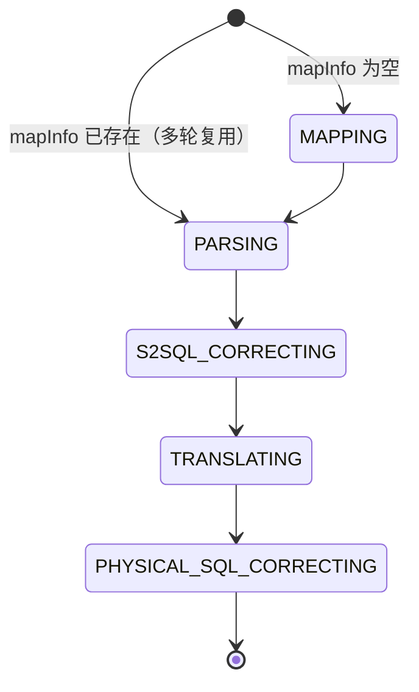

# 02 · 查询数据流详解

> 本文档面向数据平台 / 数仓团队面试官，从代码制口讲清「用户一次提问 → SQL 执行」的全链路。
> Part A 按管道阶段严谨解析（A0-A6）；Part B 用 sample query 贯穿（B1 基础聚合 + B2 派生同比）。
>
> **配套文档**：
> - 宏观鸟瞰见 [`01-架构总览.md`](./01-架构总览.md)
> - 数据权限见 [`03-数据权限控制.md`](./03-数据权限控制.md)
> - SchemaMapper 深挖见 [`../智能问数/02-SchemaMapper.md`](../智能问数/02-SchemaMapper.md)（本文 A3 仅概览）
>
> **诚实边界**：行号可漂移，类·方法为锚点；A6（Translator）声明不深挖。

## 导航

| 部分 | 章节 | 主题 |
|------|------|------|
| Part A | A0 | 全局视图：ChatWorkflowEngine 状态机 |
| Part A | A1 | 入口与编排 |
| Part A | A2 | ChatWorkflowEngine 状态机详解 |
| Part A | A3 | SchemaMapper 阶段（概览，引用 02-SchemaMapper.md） |
| Part A | A4 | SemanticParser 阶段（Rule + LLM） |
| Part A | A5 | SemanticCorrector 阶段（4 组中等粒度） |
| Part A | A6 | SemanticTranslator 阶段（简略） |
| Part B | B1 | sample query 基础聚合版（7 个状态快照） |
| Part B | B2 | sample query 派生同比版（7 个状态快照） |
| 收尾 | — | 面试问答速查（15 问） |

---

# Part A · 管道阶段章节

## A0 · 全局视图

整个解析流程由 `ChatWorkflowEngine`（`headless/server/.../utils/ChatWorkflowEngine.java`）的状态机驱动，共 5 个状态：



| State | 进入条件 | 退出条件 | 产出 |
|-------|---------|---------|------|
| **MAPPING** | `mapInfo` 为空（首轮提问） | 所有 SchemaMapper 执行完 | `SchemaMapInfo`：NL 中识别出的指标 / 维度 / 实体 / 值 |
| **PARSING** | mapInfo 已就绪 | 所有 SemanticParser 执行完 | `candidateQueries`：候选 SemanticQuery 列表 |
| **S2SQL_CORRECTING** | 至少 1 个候选 | 所有 SemanticCorrector 执行完 | 每个 candidate 的 `SqlInfo.correctedS2SQL` 被修正 |
| **TRANSLATING** | S2SQL 已校正 | SemanticTranslator 执行完 | `QueryStatement`：含物理 SQL |
| **PHYSICAL_SQL_CORRECTING** | 物理 SQL 已生成 | LLMPhysicalSqlCorrector 执行完 | 物理 SQL 被 LLM 二次优化 |

**为什么用状态机而非线性调用？**
- 多轮对话场景：`mapInfo` 已存在时直接跳过 MAPPING（性能优化）
- Rule 解析成功时跳过 LLM 调用（成本优化）
- 状态机让「按当前状态决定下一步」的逻辑显式化，便于扩展

---

## A1 · 入口与编排

### A1.1 REST 入口

`chat/server/.../rest/ChatQueryController.java` 提供三个端点：

| 端点 | 方法 | 行号 | 用途 |
|------|------|------|------|
| `POST /api/chat/query/search` | `search` | 34 | 输入联想 / schema 搜索（可选） |
| `POST /api/chat/query/parse` | `parse` | 41 | **主入口**：NL → 多个候选 parse |
| `POST /api/chat/query/execute` | `execute` | 48 | 执行用户选定的 parse |

代码片段（`ChatQueryController.java`）：
```java
@PostMapping("/parse")
public ChatParseResp parse(@RequestBody ChatParseReq chatParseReq, ...) {
    return chatQueryService.parse(chatParseReq);
}

@PostMapping("/execute")
public QueryResult execute(@RequestBody ChatExecuteReq chatExecuteReq, ...) {
    return chatQueryService.execute(chatExecuteReq);
}
```

### A1.2 编排中心：ChatQueryServiceImpl

`chat/server/.../service/impl/ChatQueryServiceImpl.java` 是 Chat 层的编排中心，用 **SPI 集合遍历模式**：

```java
// 字段：通过 ComponentFactory 加载所有 SPI 实现
private final List<ChatQueryParser> chatQueryParsers = ComponentFactory.getChatParsers();
private final List<ChatQueryExecutor> chatQueryExecutors = ComponentFactory.getChatExecutors();
private final List<ParseResultProcessor> parseResultProcessors = ComponentFactory.getParseProcessors();
private final List<ExecuteResultProcessor> executeResultProcessors = ComponentFactory.getExecuteProcessors();
```

`parse()` 方法（行 110-138）的双循环模式：

```java
public ChatParseResp parse(ChatParseReq chatParseReq) {
    // 1. 创建 queryId
    Long queryId = chatManageService.createChatQuery(chatParseReq);

    // 2. 构造 ParseContext
    ParseContext parseContext = buildParseContext(chatParseReq, new ChatParseResp(queryId));

    // 3. 遍历 ChatQueryParser 数组（NL2SQLParser 主路径）
    for (ChatQueryParser parser : chatQueryParsers) {
        if (parser.accept(parseContext)) {
            parser.parse(parseContext);  // 关键调用
        }
    }

    // 4. 遍历 ParseResultProcessor（推荐问题、格式化、耗时统计）
    for (ParseResultProcessor processor : parseResultProcessors) {
        if (processor.accept(parseContext)) {
            processor.process(parseContext);
        }
    }

    // 5. 持久化 + 返回
    chatManageService.batchAddParse(...);
    return parseContext.getResponse();
}
```

`execute()` 方法（行 141-164）结构对称——遍历 `chatQueryExecutors` 找第一个 accept 的执行，然后遍历 `executeResultProcessors` 做后处理。

**关键设计**：
- **双循环模式**：第一个循环做核心解析（parse）/ 执行（execute），第二个循环做后处理（推荐问题 / 数据解读）
- **accept 短路**：execute 循环里 `queryResult != null` 时 break（行 147-149），单 executor 负责
- **SPI 加载**：所有集合都走 `ComponentFactory`，便于扩展
