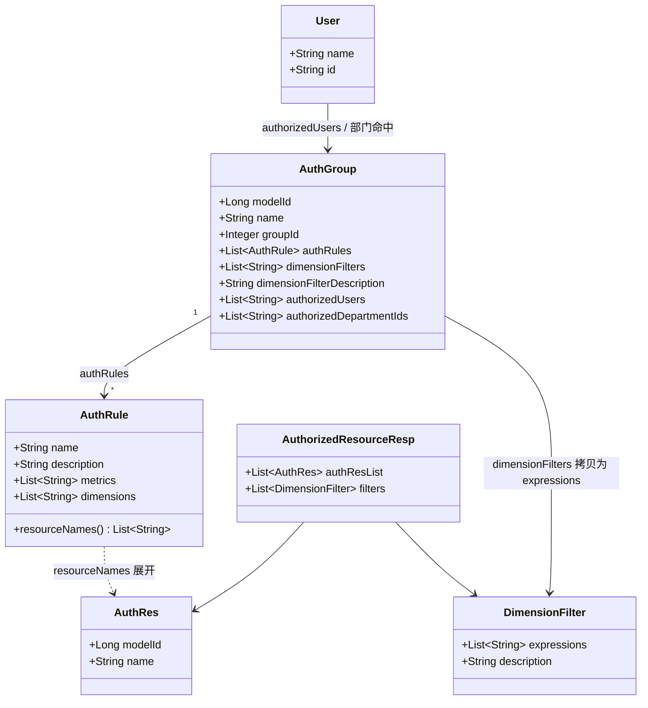
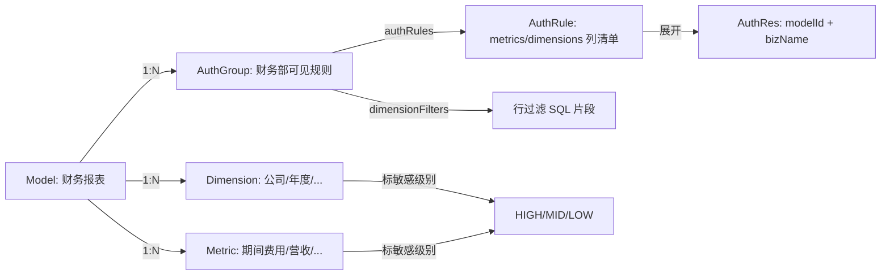
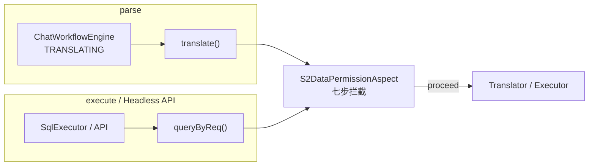
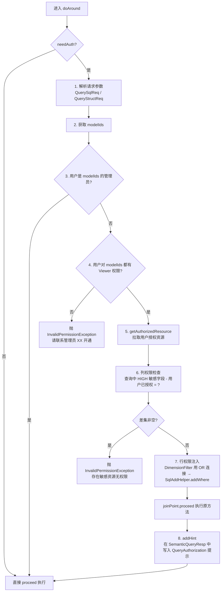

# 03 · 数据权限控制

> 本文档面向数据平台 / 数仓团队面试官，回答「SuperSonic 怎么做数据权限」。
> **本文档只讲数据资源权限**（模型可见性、列权限、行权限），不讲登录鉴权（Token / ApiKey / SSO）——后者是 `auth/authentication` 子包的职责，与数仓团队关心的「数据安全」不是一回事。
>
> **配套文档**：
> - 宏观鸟瞰见 [`01-架构总览.md`](./01-架构总览.md)
> - 查询数据流见 [`02-查询数据流详解.md`](./02-查询数据流详解.md)（本文 §3 引用其 A2 状态机）
>
> **诚实边界**：行号可漂移，类·方法为锚点；规则落库表结构以对码时为准（事实清单 `/tmp/03-perm-fact-sheet.md`）。

## 导航

| 章 | 主题 | 一句话 |
|----|------|--------|
| §1 | 设计哲学 | 数据权限从业务代码下沉到语义层，AOP 零侵入 |
| §2 | 权限数据模型 | AuthGroup / AuthRule / AuthRes / DimensionFilter + RBAC 对位 |
| §3 | 查询时拦截链路（核心） | 挂点（translate/queryByReq）→ AOP → 七步流程 |
| §4 | LLM SQL 场景下的权限注入 | 三道防线（差异化亮点） |
| §5 | 管理端配置与持久化 | AuthController + 热生效 |
| §6 | 边界场景与陷阱 | 多模型 JOIN / 子查询 / 嵌套语义层 |

---

## §1 · 设计哲学

传统数据权限的痛点：权限逻辑散落在各处业务代码里（每个 SQL 查询点都要手写 `if user.hasPermission(field) then ...`），导致：

1. **遗漏风险**：新加的接口忘记加权限检查 → 数据泄露
2. **维护成本**：权限规则改了要改 N 处代码
3. **测试困难**：每个接口都要测权限场景

**SuperSonic 的解法**：把权限从业务代码**下沉到语义层**，用 AOP 切面零侵入实现。

### 1.1 三个核心设计

| 设计 | 实现 | 价值 |
|------|------|------|
| **AOP 切面零侵入** | `@S2DataPermission` 注解 + `S2DataPermissionAspect` 切面 | 业务代码无感；新接口自动获得权限检查（只要加注解） |
| **与元数据绑定** | 敏感级别（`SensitiveLevelEnum`）在 Model 管理界面配置；权限规则基于 bizName 而非 SQL 字符串 | 规则跟着字段走，重命名字段不破坏权限 |
| **三层授权模型** | 模型可见性（Viewer）+ 列权限（敏感字段 HIGH）+ 行权限（DimensionFilter） | 与数仓团队的「表级 + 列级 + 行级」权限模型对位 |

### 1.2 与数仓权限模型的对位

| 数仓视角 | SuperSonic 对应 | 说明 |
|---------|---------------|------|
| 表级权限（GRANT SELECT ON table） | 模型可见性（`AuthType.VIEWER`） | 用户能查哪些模型 |
| 列级脱敏（MASKING） | 列权限（`SensitiveLevelEnum.HIGH`） | 敏感字段按需授权 |
| 行级安全（RLS） | 行权限（`DimensionFilter`） | 自动注入 WHERE 条件 |

**对面试官的话术**：「我们的数据权限是语义层做的，不是分散在业务代码里——AOP 切面 + 元数据绑定，让权限规则可治理。这套思路与数仓团队的 RLS（Row Level Security）是同一个理念，只是 SuperSonic 把它做到了语义层。」

---

## §2 · 权限数据模型

四个核心 POJO，位于 `auth/api/.../pojo/`：

### 2.1 类图



### 2.2 四个 POJO 详解

| POJO | 文件 | 含义 | 数仓视角 |
|------|------|------|---------|
| **`AuthGroup`** | `auth/api/.../pojo/AuthGroup.java` | 授权组：绑 Model；含列资源规则、行过滤表达式、授权用户/部门 | 角色 / Role |
| **`AuthRule`** | `auth/api/.../pojo/AuthRule.java` | 列资源清单：本组允许访问的 metrics / dimensions（bizName 列表） | 列级授权条目 |
| **`AuthRes`** | `auth/api/.../pojo/AuthRes.java` | 查询时展开的「已授权列资源」：`modelId + name` | 列级权限（运行时） |
| **`DimensionFilter`** | `auth/api/.../pojo/DimensionFilter.java` | 行权限运行时形态：SQL 片段 + 人读描述 | 行级安全（RLS） |

落库形态：整组 `AuthGroup` 序列化进 `s2_auth_groups.config`（JSON），不是 AuthRule / AuthRes 各一张表。查询时 `AuthServiceImpl.queryAuthorizedResources` 把用户命中的 Group **展开**成 `AuthorizedResourceResp`（`authResList` + `filters`）。

**关键字段说明**（与源码一致）：

`AuthGroup`：
```java
public class AuthGroup {
    private Long modelId;                          // 绑定的语义 Model
    private String name;                           // 组名，如「财务部-比亚迪可见」
    private Integer groupId;                       // 组 ID（表主键语义，insert 时自增分配）
    private List<AuthRule> authRules;              // 列资源规则列表
    private List<String> dimensionFilters;         // 行权限 SQL 片段，如 ["company_name = '比亚迪'"]
    private String dimensionFilterDescription;     // 行权限人读说明，进 DimensionFilter.description
    private List<String> authorizedUsers;          // 授权用户名列表
    private List<String> authorizedDepartmentIds;  // 授权部门 ID；用户所属部门命中即生效
}
```

`AuthRule`（注意：管的是**列资源**，不是 `bizName+operator+value` 行条件）：
```java
public class AuthRule {
    private String name;                 // 规则名
    private String description;          // 人读描述
    private List<String> metrics;        // 允许的指标 bizName，如 ["period_expense"]
    private List<String> dimensions;     // 允许的维度 bizName，如 ["profit"]
    // resourceNames() = metrics ∪ dimensions，供展开成 AuthRes
}
```

`AuthRes`（**不落库**；由 `AuthRule.resourceNames()` × `modelId` 现算）：
```java
public class AuthRes {
    private Long modelId;   // 所属 Model
    private String name;    // 字段 bizName（指标或维度名），列权限比对用这个
}
```

`DimensionFilter`（**不落库**；从 `AuthGroup.dimensionFilters` / `dimensionFilterDescription` 拷贝）：
```java
public class DimensionFilter {
    private List<String> expressions;  // SQL 片段列表，切面 OR 拼接后注入 WHERE
    private String description;        // 人读描述（单条 String，非 List）
}
```

### 2.3 与 RBAC / ABAC 的对位

| 模型 | User → Role → Permission | SuperSonic 实现 |
|------|--------------------------|----------------|
| **RBAC**（Role-Based） | User → Role → Resource | User/部门 → AuthGroup（角色）→ AuthRule→AuthRes（列）+ dimensionFilters（行） |
| **ABAC**（Attribute-Based） | 基于属性的策略 | 弱——行条件是预写 SQL 片段，不是通用属性引擎 |

**SuperSonic 偏 RBAC**：每个 AuthGroup 绑定一个 Model；用户名进 `authorizedUsers`，或部门 ID 进 `authorizedDepartmentIds` 即命中该组。列权限靠 `AuthRule.metrics/dimensions`；行权限靠组上的 `dimensionFilters` 字符串（可写 `dept='销售' AND region='华东'` 这类组合，但是配置态 SQL，不是独立规则引擎）。

### 2.4 与 Model / DataSet 的关系



**关键**：敏感级别（`SensitiveLevelEnum`）在 Dimension / Metric 上配置，不依赖 AuthGroup——这是「与元数据绑定」的体现。改字段名，权限规则跟着 bizName 走；改敏感级别，列权限检查跟着自动调整。

---

## §3 · 查询时拦截链路（核心）

权限检查不散落在 Controller / Executor 里，而是挂在**语义层门面**的两个方法上。读完「挂在哪 → 谁调到」再看 AOP 与七步，顺序才顺。

### 3.1 挂在哪：语义层门面的两道口

实现类：`S2SemanticLayerService`（`headless/server/.../facade/service/impl/S2SemanticLayerService.java`）。

| 带注解的方法 | 职责 | 主要调用方 |
|-------------|------|-----------|
| **`translate(SemanticQueryReq, User)`** | S2SQL → 物理 SQL（只译不跑） | `ChatWorkflowEngine.performTranslating`（parse 阶段 TRANSLATING）；部分 Chat 二次 explain |
| **`queryByReq(SemanticQueryReq, User)`** | 翻译（若需）+ 执行，返回结果 | `SqlExecutor`（Chat execute）；`SqlQueryApiController` 等 Headless 开放 API |

```java
@S2DataPermission
public SemanticTranslateResp translate(SemanticQueryReq queryReq, User user) { ... }

@S2DataPermission
public SemanticQueryResp queryByReq(SemanticQueryReq queryReq, User user) { ... }
```

**放在门面而不是 Chat 状态机里**：Chat 问数和 Headless API 都走同一语义层入口，权限只守这一道门，业务代码零侵入。

#### 问数链路里何时撞上

```text
① parse（生成候选 SQL）
   ChatQueryController.parse
     → … → ChatWorkflowEngine（MAPPING → PARSING → CORRECTING → TRANSLATING）
          → SemanticLayerService.translate   ← @S2DataPermission 生效
               切面：可见性 / 列权限 / 行过滤注入到请求
               proceed → SemanticTranslator → 物理 SQL 写回 SqlInfo

② execute（真正查数）
   ChatQueryController.execute
     → … → SqlExecutor
          → SemanticLayerService.queryByReq  ← @S2DataPermission 再次生效
               切面：同一套七步（列再检 + 行再注）
               proceed →（已有 querySQL 则跳过重译）→ JdbcExecutor
```



**面试点**：权限卡在「进语义层执行/翻译之前」，不卡在 NL Mapping；parse、execute 各拦一次——parse 保证候选 SQL 已按权限收窄，execute 防止绕过 parse 直查。

### 3.2 怎么挂上：注解 + AOP 切面

注解本身只是标记（`headless/server/.../annotation/S2DataPermission.java`）：

```java
@Target({ElementType.METHOD})
@Retention(RetentionPolicy.RUNTIME)
public @interface S2DataPermission {
}
```

切面：`S2DataPermissionAspect`（`headless/server/.../aspect/S2DataPermissionAspect.java`）拆成「定范围」和「做事情」两步：

```java
@Pointcut("@annotation(com.tencent.supersonic.headless.server.annotation.S2DataPermission)")
private void s2PermissionCheck() {}   // 只声明切点，方法体永远是空的

@Around("s2PermissionCheck()")
public Object doAround(ProceedingJoinPoint joinPoint) throws Throwable { ... }  // 真正干活
```

| 方法 | 注解 | 干什么 |
|------|------|--------|
| **`s2PermissionCheck`** | `@Pointcut` | **选哪些方法要拦**：凡是带了 `@S2DataPermission` 的方法。本身不执行业务逻辑，空方法只是给切点起个可引用的名字 |
| **`doAround`** | `@Around("s2PermissionCheck()")` | **拦到之后怎么处理**：引用上面的切点名；在原方法前后织入七步权限（含 `proceed()`） |

为何拆开：切点可复用（以后若再加 `@Before` / `@After` 可继续绑同一个 `s2PermissionCheck()`）；读代码时「拦谁」和「拦了干什么」一眼分开。

调用顺序：`translate` / `queryByReq` 被调 → Spring 代理匹配到切点 → 进 `doAround` → 七步通过后 `joinPoint.proceed()` 才进原方法体。

### 3.3 七步流程图

对应 `doAround()`（约行 70-125）：



**注意**：流程图标注 8 步，官方口径「七步」对应代码注释的 7 个步骤（addHint 是额外提示，不算拦截步骤）。本文按代码注释走，称为「七步拦截 + 一道提示」。

### 3.4 每一步的代码片段

#### 第 1 步：解析请求参数

`S2DataPermissionAspect.java:70-86`：

```java
@Around("s2PermissionCheck()")
public Object doAround(ProceedingJoinPoint joinPoint) throws Throwable {
    Object[] objects = joinPoint.getArgs();
    SemanticQueryReq queryReq = null;
    if (objects[0] instanceof SemanticQueryReq) {
        queryReq = (SemanticQueryReq) objects[0];
        // 处理 QuerySqlReq 的表名转义
        if (queryReq instanceof QuerySqlReq) {
            QuerySqlReq sqlReq = (QuerySqlReq) queryReq;
            if (sqlReq.getDataSetName() != null) {
                String escapedTable = SqlReplaceHelper.escapeTableName(sqlReq.getDataSetName());
                sqlReq.setSql(sqlReq.getSql().replaceAll(...));
            }
        }
    }
```

#### 第 2 步：needAuth 短路

```java
if (!queryReq.isNeedAuth()) {
    log.info("needAuth is false, there is no need to check permissions.");
    return joinPoint.proceed();  // 跳过所有检查
}
```

**用途**：内部调用（如系统定时任务）可设 `needAuth=false` 跳过权限，但默认 true。

#### 第 3 步：管理员判定

```java
if (checkModelAdmin(user, modelIds)) {
    return joinPoint.proceed();  // 管理员跳过所有检查
}
```

`checkModelAdmin`（行 260-270）：调用 `modelService.getModelListWithAuth(user, null, AuthType.ADMIN)`，若用户是所有 modelIds 的 ADMIN，跳过。

#### 第 4 步：模型可见性检查

`checkModelVisible`（行 272-289）：

```java
public void checkModelVisible(User user, Set<Long> modelIds) {
    List<Long> modelListVisible = modelService.getModelListWithAuth(user, null, AuthType.VIEWER)
        .stream().map(ModelResp::getId).collect(Collectors.toList());
    List<Long> modelIdCopied = new ArrayList<>(modelIds);
    modelIdCopied.removeAll(modelListVisible);
    if (!CollectionUtils.isEmpty(modelIdCopied)) {
        // 有不可见的模型
        throw new InvalidPermissionException(
            String.format("您没有模型[%s]权限，请联系管理员%s开通", modelResp.getName(), modelResp.getAdmins()));
    }
}
```

**判定逻辑**：用户对所有 modelIds 都要有 VIEWER 权限。任一缺失 → 抛异常。

#### 第 5 步：获取授权资源

```java
AuthorizedResourceResp authorizedResource = getAuthorizedResource(user, modelIds);
```

返回 `AuthorizedResourceResp`，含：
- `authResList: List<AuthRes>` —— 用户被授权的列资源
- `filters: List<DimensionFilter>` —— 用户的行权限规则

#### 第 6 步：列权限检查

`checkColPermission`（行 127-149）：

```java
// 1. 获取查询中的所有字段
Set<String> bizNamesInQueryReq = getBizNameInQueryReq(queryReq, semanticSchemaResp);
// 2. 筛出 HIGH 敏感字段
Set<String> sensitiveBizNameInQuery = bizNamesInQueryReq.parallelStream()
    .filter(sensitiveBizNamesByModel::contains).collect(Collectors.toSet());
// 3. 减去用户已授权的字段
sensitiveBizNameInQuery.removeAll(sensitiveBizNameUserAuthed);
// 4. 若有差集，说明用户查了未授权的敏感字段
if (!CollectionUtils.isEmpty(sensitiveBizNameInQuery)) {
    throw new InvalidPermissionException(
        String.format("存在以下敏感资源:%s您暂无权限，请联系管理员%s申请", sensitiveResNames, modelAdmin));
}
```

#### 第 7 步：行权限注入（**核心陷阱：OR 连接**）

`doRowPermission`（QuerySqlReq 版本，行 192-226）：

```java
private void doRowPermission(QuerySqlReq querySqlReq, AuthorizedResourceResp authorizedResource) {
    if (CollectionUtils.isEmpty(authorizedResource.getFilters())) return;

    List<String> dimensionFilters = authorizedResource.getFilters().stream()
        .flatMap(filter -> filter.getExpressions().stream())
        .filter(StringUtils::isNotBlank)
        .collect(Collectors.toList());

    if (dimensionFilters.isEmpty()) return;

    // 关键：用 OR 连接所有 filter
    StringJoiner joiner = new StringJoiner(" OR ");
    dimensionFilters.forEach(filter -> joiner.add(" ( " + filter + " ) "));

    Expression expression = CCJSqlParserUtil.parseCondExpression(" ( " + joiner + " ) ");
    String modifiedSql = SqlAddHelper.addWhere(originalSql, expression);
    querySqlReq.setSql(modifiedSql);
}
```

**陷阱点（面试常问）**：

> **为什么行权限用 OR 而不是 AND？**

对。这里的 OR 就是把用户命中的多条行过滤表达式拼成「任一范围可见」：

```sql
-- 原查询已有业务 WHERE 时，切面再 AND 上一整块授权条件：
WHERE <原条件>
  AND (
       ( company_name = '比亚迪' )          -- AuthGroup A 的 dimensionFilters
    OR ( company_name = '宁德时代' )        -- AuthGroup B 的 dimensionFilters
  )
```

语义：用户同时挂了两个授权组 → **两个公司都能看**（并集）。若用 AND，会变成「既是比亚迪又是宁德时代」，结果为空。

注意粒度：
- **组与组 / 多条 expression 之间**：代码用 `OR` 拼（并集）
- **单条 expression 内部**：管理员怎么写就怎么进 SQL（里面可以自己写 `dept='销售' AND region='华东'`）

`QueryStructReq` 版本（行 228-258）逻辑类似，但把 filter 加到 `dimensionFilters` 而非改 SQL。

### 3.5 第八步：addHint（提示回传前端）

`addHint`（行 322-350）：**只在 `queryByReq` 路径**、原方法返回 `SemanticQueryResp` 之后，写入 `QueryAuthorization`（过滤表达式 + 人读描述 + 提示文案）。它**不改任何 SQL 字段**，只告诉前端「结果已被行权限收窄」。

```java
QueryAuthorization auth = new QueryAuthorization(
    modelResp.getName(), exprList, descList, message);
queryResultWithColumns.setQueryAuthorization(auth);
```

**前端展示**：用户看到结果时会有一条提示：「当前结果已经过行权限过滤，详细过滤条件如下：[公司='比亚迪'], 申请权限请联系管理员XX」。这是「权限透明性」——用户知道数据为什么不全。

#### 易混点：回传的三类 SQL，谁带了行权限？

`SqlInfo` 里三（四）段字符串**不是同一时刻、同一对象**上改出来的：

| 字段 | 何时写入 | 是否含行权限 WHERE |
|------|---------|-------------------|
| `parsedS2SQL` | Parser 产出 | **否** |
| `correctedS2SQL` | SemanticCorrector 产出后落在 `SqlInfo` 上 | **否**（落库/回传的这份不会被切面改写） |
| `querySQL` | `translate` 成功后 `setQuerySQL(explain.getQuerySQL())` | **是**（见下） |
| `correctedQuerySQL` | `LLMPhysicalSqlCorrector` 基于当时的 `querySQL` 做性能改写 | **通常是**（输入已是带权限的物理 SQL；校正规则也要求逻辑等价） |

原因（parse 翻译路径）：

```text
SqlInfo.correctedS2SQL          ← 语义校正结果，此后不再被权限切面回写
        │
        ▼ 拷贝进请求（临时字段）
QuerySqlReq.sql = correctedS2SQL
        │
        ▼ S2DataPermissionAspect.doRowPermission
QuerySqlReq.sql = 原 S2SQL AND (行权限 OR …)   ← 只改请求副本，不改 SqlInfo
        │
        ▼ SemanticTranslator
querySQL = 物理 SQL（已从「带权限的 S2SQL」译出）
        │
        ▼ （可选）PHYSICAL_SQL_CORRECTING
correctedQuerySQL / 覆盖 querySQL
```

所以你看到的现象成立：**回传前端的物理 SQL / 物理校正 SQL 往往带着权限条件；语义 SQL（parsed / corrected S2SQL）仍是「纯解析口径」，不含行权限。**  
行权限实际作用在「进 Translator 前的 `QuerySqlReq.sql`」上——语义层注入，但**不回写**到 `SqlInfo.correctedS2SQL`。前端若要展示「为何数据被过滤」，应看 `queryAuthorization`（及物理 SQL），不要指望从 S2SQL 文本里读出行权。

`translate` 的返回值只有 `querySQL`，没有 `addHint`（hint 绑在查数结果上）；parse 阶段同样靠落库的 `querySQL` 体现权限，语义字段保持干净便于审阅「模型理解了什么」。

---

## §4 · LLM SQL 场景下的权限注入（差异化亮点）

> 这是面试官最爱问的「AI 时代新问题」——LLM 生成的 SQL 不可信，如何防止数据泄露？

### 4.1 LLM SQL 的三大风险

| 风险 | 例子 |
|------|------|
| **引用无权限的表/字段** | LLM 看到 schema 含 `利润` 字段（HIGH 敏感），但用户无权限，直接 SELECT 利润 |
| **缺少必要的行权限过滤** | LLM 生成的 SQL 没有 WHERE 条件，全表扫描 |
| **通过子查询/CTE 绕过权限** | LLM 用 `WITH high_profit AS (SELECT 利润 FROM ...)` 绕过顶层 SELECT 检查 |

### 4.2 三道防线（诚实版）

先澄清：**MAPPING / LLM prompt 并不按用户 AuthGroup、敏感列做 ACL 过滤。**  
你印象里的「不属于这个 Agent 的 DataSet schema 进不来」才是真的——那是 **Agent 工具范围**，不是数据权限。

| 防线 | 位置 | 实际做什么 | 是不是用户数据权限 |
|------|------|-----------|-------------------|
| **① Agent DataSet 裁剪** | `QueryReqConverter` → `request.dataSetIds`；Mapping / `schemaService.getSemanticSchema(dataSetIds)`；LLM 用该范围内的 schema（见 [`02`](./02-查询数据流详解.md) A3.4） | LLM / Mapper 只看见 Agent 挂上的 DataSet | **否**——缩小爆炸半径，HIGH 字段若在 Agent 集内仍可能进 prompt |
| **② translate 入口 AOP** | `SemanticLayerService.translate` + `@S2DataPermission`（parse 的 TRANSLATING） | 列权限检查 + 行权限注入到 `QuerySqlReq.sql` 再翻译 | **是** |
| **③ queryByReq 入口 AOP** | `SemanticLayerService.queryByReq`（execute / Headless API） | 同一套七步再跑一遍（列再检 + 行再注） | **是**（真正查数兜底） |

LLM prompt 里字段从哪来（`LLMRequestService.getLlmReq`）：命中字段少时甚至塞 **当前 SemanticSchema 的全部 Metric/Dimension**；多时用 Mapping 命中子集——都**不查** `AuthRes` / `SensitiveLevel`。

所以：**数据权限真正生效的是 ②③**；① 只保证「这个助手不该碰的业务域」进不了 NL2SQL，拦不住「同域里用户没权的敏感列」。

### 4.3 注入时机：为什么是「S2SQL 生成后、物理 SQL 执行前」？

管线位置（对码）：

```text
MAPPING → PARSING → S2SQL_CORRECTING
                         │  correctedS2SQL 已就绪
                         ▼
              SemanticLayerService.translate / queryByReq
                         │  @S2DataPermission：列检查 + 行权写入 QuerySqlReq.sql
                         ▼
              SemanticTranslator → querySQL（物理）
                         ▼
              JdbcExecutor 执行   ← 数据离开库之前必须已带权
```

**为什么卡在这一拍，而不是更早 / 更晚：**

| 若改到… | 问题 |
|---------|------|
| **更早（Mapping / LLM）** | 还没有稳定的最终 S2SQL；且代码本就不在 prompt 组装时做用户 ACL（§4.2）。过早注入也干扰「模型理解了什么」的语义产物 |
| **更晚（物理 SQL 已生成、甚至执行后）** | 数据可能已按无过滤口径查出；事后过滤不可靠。物理 SQL 里指标已展开、多表 JOIN，再塞 WHERE 易挂错层 |
| **当前时机（S2SQL 已校正 → 进 Translator / 执行门面）** | ① 语义 SQL 已定，用 bizName 挂行权最干净；② 注入发生在门面入口，**先改请求再翻译/执行**，物理 SQL 自然继承条件；③ parse 的 `translate` 与 execute 的 `queryByReq` 共用同一套切面，Headless API 也走同一道门 |

补充：挂在**语义层门面**而不是 Chat 状态机内部，是为了 Chat 与开放 API 共用一道闸；「时机」= 语义查询即将落地执行（或为执行而翻译）之前。细节见 §3.1、§3.5（`correctedS2SQL` 不回写，带权的是译出的 `querySQL`）。

### 4.4 场景怎么落到防线

| 场景 | ① Agent DataSet | ② translate AOP | ③ queryByReq AOP |
|------|----------------|-----------------|------------------|
| 用户查「利润」（HIGH）但无 AuthRes | Agent 若挂了该集，prompt **仍可能含「利润」** | 列权限差集 → 抛异常（parse 译 SQL 阶段就可能挂） | execute 再拦一次 |
| 用户查「比亚迪」但行权只能看「宁德时代」 | 无关 | S2SQL 副本注入行过滤 → 物理 SQL 带条件 | 再注入 / 结果带 hint |
| LLM 用 CTE 引用未授权字段 | 不挡 | 列检查按请求字段抽（视解析覆盖） | 执行前再检；漏网靠执行失败/拦截 |

### 4.5 面试加分话术

> 「NL 阶段先按 **Agent 绑定的 DataSet** 收窄 schema，这是助手能力边界，不是用户 ACL。真正的数据权限卡在 **S2SQL 已生成之后、物理 SQL 执行之前**——语义层门面 `translate` / `queryByReq` 的 `@S2DataPermission`：列权限拦截，行权限写入进 Translator 的请求副本。更早没有稳定 SQL 可注，更晚物理层难注且可能已泄数。」

---

## §5 · 管理端配置与持久化

### 5.1 AuthController REST 接口

`auth/authorization/.../rest/AuthController.java` 提供管理端 API（具体路径以事实清单为准）：

| 接口 | 用途 |
|------|------|
| `POST /api/auth/group` | 创建 AuthGroup（绑定到某 Model） |
| `PUT /api/auth/group` | 更新 AuthGroup（增删 AuthRule / AuthRes） |
| `DELETE /api/auth/group/{id}` | 删除 AuthGroup |
| `GET /api/auth/group` | 查询某 Model 的所有 AuthGroup |
| `POST /auth/applicableModel` | 查询用户可授权的 Model 列表（管理员视角） |
| `GET /auth/visible/model` | 查询用户可见的 Model 列表（普通用户视角） |

**前端管理界面**：webapp 的「模型管理 → 权限配置」页（具体组件在 `webapp/packages/supersonic-fe/src/pages/` 下）。

### 5.2 规则落库

| 实体 | 表 / 形态 | 关键字段 |
|------|-----------|---------|
| AuthGroup（整包） | `s2_auth_groups` | `group_id`；`config`（整份 AuthGroup 的 JSON） |
| AuthRule / 行过滤 / 授权人 | 嵌在 `config` JSON 内 | `authRules`、`dimensionFilters`、`authorizedUsers` 等 |
| AuthRes / DimensionFilter | **不落库** | 查询时由 `queryAuthorizedResources` 展开 |
| Model-User 关系（可见性） | 另表 / Model 侧配置 | model 的 ADMIN/VIEWER（与 AuthGroup 并列） |

**说明**：授权组是「一行 JSON」而不是 AuthRule/AuthRes 范式拆表；对码以 `AuthServiceImpl.load()` 为准。

### 5.3 热生效机制

**关键**：权限规则修改后**无需重启**，下次查询即生效。

**原理**：
1. `S2DataPermissionAspect` 每次查询都调用 `getAuthorizedResource(user, modelIds)`（行 308-315）
2. 该方法走 `AuthServiceImpl.queryAuthorizedResources()`，每次都查库（无缓存或缓存 TTL 极短）
3. 管理员修改 AuthGroup 后立即 commit，下次查询读到最新数据

**对比**：知识库（HanLP 词典 + 向量索引）的更新需要走 `KnowledgeBaseService.reloadAllData()` 显式触发，与权限不同。

### 5.4 与元数据绑定

**敏感级别配置**：在 Model 管理界面，每个 Dimension / Metric 可标 `SensitiveLevelEnum`：

| 级别 | code | 用途 |
|------|------|------|
| `LOW` | "1" | 不做列权限检查 |
| `MID` | "2" | 不做列权限检查（默认级别） |
| `HIGH` | "3" | 触发列权限检查（必须显式授权） |

**关键**：敏感级别与字段（bizName）绑定，与 AuthGroup 解耦。改字段名（bizName 变更）→ 权限规则跟着 bizName 走；改敏感级别 → 列权限检查自动调整。这就是「与元数据绑定」的体现。

### 5.5 管理员配置

| 配置点 | 用途 |
|--------|------|
| Model 管理员（`ModelResp.getAdmins()`） | 决定谁跳过权限检查（第 3 步）；决定失败提示中的联系人 |
| Model 可见用户（VIEWER） | 决定谁能查这个 Model（第 4 步） |

管理员配置在 Model 创建 / 编辑时设定，存 `s2_model_user` 表。

---

## §6 · 边界场景与陷阱

面试官最爱问的「如果……怎么办」——这节覆盖三种典型边界场景。

### 6.1 多模型 JOIN

**场景**：用户问「比亚迪今年的期间费用和营收对比」，涉及财务表 + 业务表两个 Model。

**处理方式**：
1. `S2DataPermissionAspect.getModelIdInQuery()`（行 151-162）返回 `Set<Long>` —— **所有涉及的 modelIds**
2. 对每个 modelId **独立检查**：
   - 模型可见性：用户对两个 Model 都要有 VIEWER
   - 列权限：两表的所有敏感字段分别检查
   - 行权限：**每个 Model 的 DimensionFilter 分别注入到对应表的 WHERE**

**陷阱**：行权限注入按 modelId 分组——若财务表规则是「公司=比亚迪」，业务表规则是「部门=销售」，最终 SQL 会有两组独立 WHERE：

```sql
SELECT ...
FROM finance f
JOIN business b ON f.company_code = b.company_code
WHERE (f.company_name = '比亚迪')   -- 财务表的行权限
  AND (b.department = '销售部')     -- 业务表的行权限
```

### 6.2 子查询

**场景**：LLM 生成的 SQL 含子查询：`SELECT * FROM (SELECT 利润 FROM finance) t`。

**处理方式**：
- JSqlParser 解析后**按顶层 SELECT 检查**
- 列权限检查基于 SQL 中出现的所有字段（包括子查询内的）
- 行权限注入到**最外层 WHERE**，子查询层的字段也受约束

**关键代码**：`queryStructUtils.getBizNameFromSql()`（行 174-183）递归提取所有字段。

### 6.3 嵌套语义层（DataSet 含多 Model）

**场景**：DataSet「财务分析」含 3 个 Model（利润表 / 资产负债表 / 现金流表），用户问一个跨表指标。

**处理方式**：
1. `getSemanticSchemaResp(queryReq)`（行 185-190）取 DataSet 完整 schema
2. `getModelIdInQuery()` 返回这 3 个 modelId 的并集
3. 权限按集合检查——用户对 3 个 Model 都要有权限
4. DimensionFilter 按 modelId 分别注入

**陷阱**：DataSet 的 schema 是合并视图，但权限检查**不合并**——每个 modelId 独立。如果用户只能看利润表，问跨表查询会被第 4 步（可见性检查）拦截。

### 6.4 边界场景总结

| 场景 | 关键检查 | 失败行为 |
|------|---------|---------|
| 多模型 JOIN | modelIds 集合；DimensionFilter 按 modelId 分组 | 任一 modelId 不可见 → InvalidPermissionException |
| 子查询 | JSqlParser 递归提取所有字段 | 列权限覆盖子查询内字段 |
| 嵌套语义层（DataSet） | modelIds 并集；按 modelId 分别检查 | 任一 modelId 不可见 → 拦截 |
| LLM CTE 绕过 | Agent 范围不挡字段级；靠 ②③ AOP 列检查 | 引用未授权 HIGH 字段 → InvalidPermissionException |
