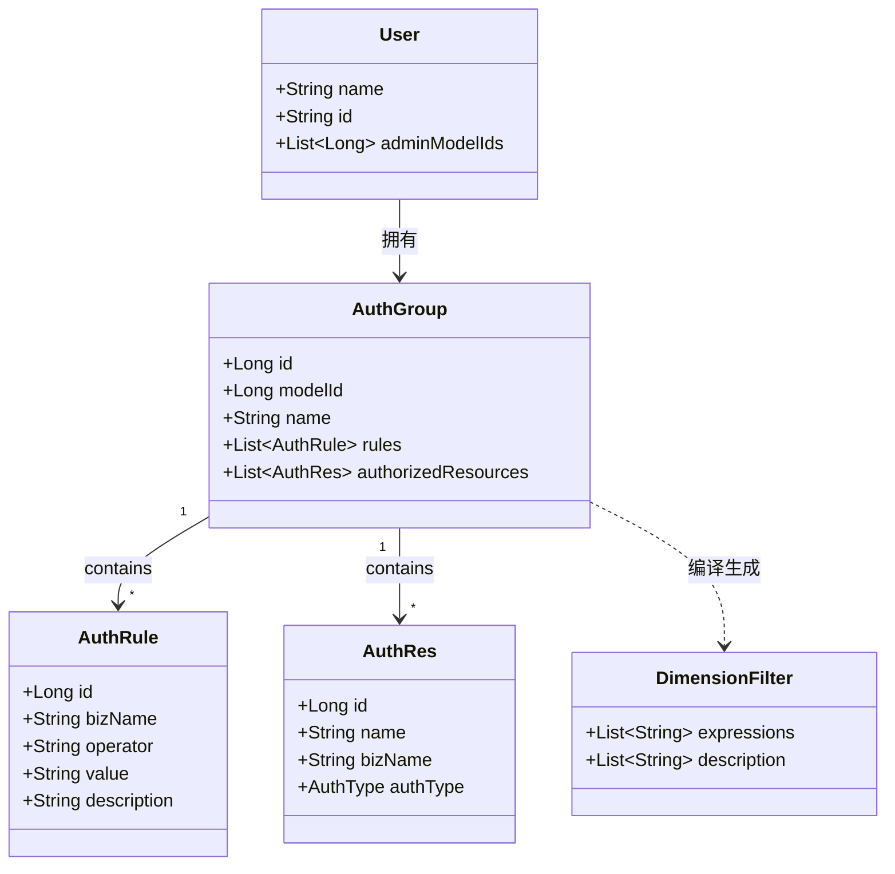
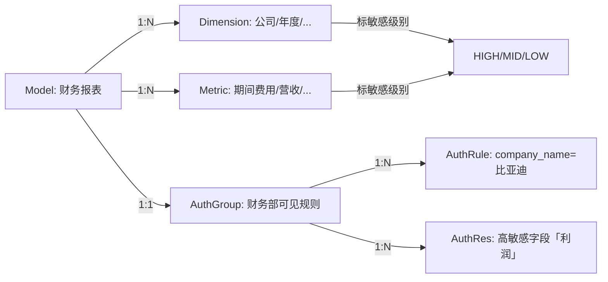
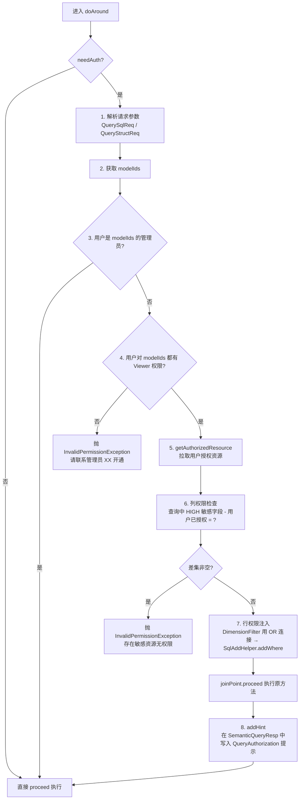

# 03 · 数据权限控制

> 本文档面向数据平台 / 数仓团队面试官，回答「SuperSonic 怎么做数据权限」。
> **本文档只讲数据资源权限**（模型可见性、列权限、行权限），不讲登录鉴权（Token / ApiKey / SSO）——后者是 `auth/authentication` 子包的职责，与数仓团队关心的「数据安全」不是一回事。
>
> **配套文档**：
> - 宏观鸟瞰见 [`01-架构总览.md`](./01-架构总览.md)
> - 查询数据流见 [`02-查询数据流详解.md`](./02-查询数据流详解.md)（本文 §3 引用其 A2 状态机）
>
> **诚实边界**：行号可漂移，类·方法为锚点；规则落库表结构以对码时为准（事实清单 `/tmp/03-perm-fact-sheet.md`）。

## 导航

| 章 | 主题 | 一句话 |
|----|------|--------|
| §1 | 设计哲学 | 数据权限从业务代码下沉到语义层，AOP 零侵入 |
| §2 | 权限数据模型 | AuthGroup / AuthRule / AuthRes / DimensionFilter + RBAC 对位 |
| §3 | 查询时拦截链路（核心） | @S2DataPermission + 七步流程 |
| §4 | LLM SQL 场景下的权限注入 | 三道防线（差异化亮点） |
| §5 | 管理端配置与持久化 | AuthController + 热生效 |
| §6 | 边界场景与陷阱 | 多模型 JOIN / 子查询 / 嵌套语义层 |
| §7 | 面试问答速查 | 8 问 |

---

## §1 · 设计哲学

传统数据权限的痛点：权限逻辑散落在各处业务代码里（每个 SQL 查询点都要手写 `if user.hasPermission(field) then ...`），导致：

1. **遗漏风险**：新加的接口忘记加权限检查 → 数据泄露
2. **维护成本**：权限规则改了要改 N 处代码
3. **测试困难**：每个接口都要测权限场景

**SuperSonic 的解法**：把权限从业务代码**下沉到语义层**，用 AOP 切面零侵入实现。

### 1.1 三个核心设计

| 设计 | 实现 | 价值 |
|------|------|------|
| **AOP 切面零侵入** | `@S2DataPermission` 注解 + `S2DataPermissionAspect` 切面 | 业务代码无感；新接口自动获得权限检查（只要加注解） |
| **与元数据绑定** | 敏感级别（`SensitiveLevelEnum`）在 Model 管理界面配置；权限规则基于 bizName 而非 SQL 字符串 | 规则跟着字段走，重命名字段不破坏权限 |
| **三层授权模型** | 模型可见性（Viewer）+ 列权限（敏感字段 HIGH）+ 行权限（DimensionFilter） | 与数仓团队的「表级 + 列级 + 行级」权限模型对位 |

### 1.2 与数仓权限模型的对位

| 数仓视角 | SuperSonic 对应 | 说明 |
|---------|---------------|------|
| 表级权限（GRANT SELECT ON table） | 模型可见性（`AuthType.VIEWER`） | 用户能查哪些模型 |
| 列级脱敏（MASKING） | 列权限（`SensitiveLevelEnum.HIGH`） | 敏感字段按需授权 |
| 行级安全（RLS） | 行权限（`DimensionFilter`） | 自动注入 WHERE 条件 |

**对面试官的话术**：「我们的数据权限是语义层做的，不是分散在业务代码里——AOP 切面 + 元数据绑定，让权限规则可治理。这套思路与数仓团队的 RLS（Row Level Security）是同一个理念，只是 SuperSonic 把它做到了语义层。」

---

## §2 · 权限数据模型

四个核心 POJO，位于 `auth/api/.../pojo/`：

### 2.1 类图



### 2.2 四个 POJO 详解

| POJO | 文件 | 含义 | 数仓视角 |
|------|------|------|---------|
| **`AuthGroup`** | `auth/api/.../pojo/AuthGroup.java` | 授权组：一组规则 + 授权资源集合，绑定到某 Model | 角色 / Role |
| **`AuthRule`** | `auth/api/.../pojo/AuthRule.java` | 行权限规则：`bizName + operator + value`（如 `company_name=比亚迪`） | 行级安全策略（RLS） |
| **`AuthRes`** | `auth/api/.../pojo/AuthRes.java` | 列权限资源：被授权的敏感字段 | 列级权限 |
| **`DimensionFilter`** | `auth/api/.../pojo/DimensionFilter.java` | 规则编译后的 SQL 片段 + description（用于前端展示） | — |

**关键字段说明**：

`AuthRule`：
```java
public class AuthRule {
    private String bizName;       // 维度 bizName，如 "company_name"
    private String operator;      // 操作符，如 "="、"IN"
    private String value;         // 值，如 "比亚迪"
    private String description;   // 人读描述，如 "仅可见比亚迪的数据"
}
```

`DimensionFilter`：
```java
public class DimensionFilter {
    private List<String> expressions;   // SQL 片段列表，如 ["company_name = '比亚迪'"]
    private List<String> description;   // 人读描述列表，前端展示用
}
```

### 2.3 与 RBAC / ABAC 的对位

| 模型 | User → Role → Permission | SuperSonic 实现 |
|------|--------------------------|----------------|
| **RBAC**（Role-Based） | User → Role → Resource | User → AuthGroup（角色）→ AuthRes（资源） + AuthRule（操作） |
| **ABAC**（Attribute-Based） | 基于属性的策略 | 部分支持——`AuthRule` 用 bizName/value 表达属性条件 |

**SuperSonic 偏 RBAC**：每个 AuthGroup 绑定一个 Model，User 通过加入 AuthGroup 获得对应权限。但 `AuthRule` 的「bizName + operator + value」结构带 ABAC 味道——可以表达「部门=销售部 AND 地区=华东」这种属性组合。

### 2.4 与 Model / DataSet 的关系



**关键**：敏感级别（`SensitiveLevelEnum`）在 Dimension / Metric 上配置，不依赖 AuthGroup——这是「与元数据绑定」的体现。改字段名，权限规则跟着 bizName 走；改敏感级别，列权限检查跟着自动调整。

---

## §3 · 查询时拦截链路（核心）

这是本文档最重要的一节，对应 `S2DataPermissionAspect.doAround()`（`headless/server/.../aspect/S2DataPermissionAspect.java:70-125`）。

### 3.1 入口：@S2DataPermission 注解

`headless/server/.../annotation/S2DataPermission.java:12`：

```java
@Target({ElementType.METHOD})
@Retention(RetentionPolicy.RUNTIME)
public @interface S2DataPermission {
}
```

**使用位置**：`S2SemanticLayerService`（`headless/server/.../facade/service/impl/S2SemanticLayerService.java`）的 `translate()` 和 `queryByReq()` 方法都加了此注解：

```java
@S2DataPermission
public SemanticTranslateResp translate(SemanticQueryReq queryReq, User user) { ... }

@S2DataPermission
public SemanticQueryResp queryByReq(SemanticQueryReq queryReq, User user) { ... }
```

**触发机制**：Spring AOP，`S2DataPermissionAspect` 通过 `@Pointcut("@annotation(...)")` 拦截所有带此注解的方法（行 66-67）。

### 3.2 七步流程图



**注意**：流程图标注 8 步，但官方口径「七步」对应代码注释的 7 个步骤（addHint 是额外提示，不算拦截步骤）。本文按代码注释走，称为「七步拦截 + 一道提示」。

### 3.3 每一步的代码片段

#### 第 1 步：解析请求参数

`S2DataPermissionAspect.java:70-86`：

```java
@Around("s2PermissionCheck()")
public Object doAround(ProceedingJoinPoint joinPoint) throws Throwable {
    Object[] objects = joinPoint.getArgs();
    SemanticQueryReq queryReq = null;
    if (objects[0] instanceof SemanticQueryReq) {
        queryReq = (SemanticQueryReq) objects[0];
        // 处理 QuerySqlReq 的表名转义
        if (queryReq instanceof QuerySqlReq) {
            QuerySqlReq sqlReq = (QuerySqlReq) queryReq;
            if (sqlReq.getDataSetName() != null) {
                String escapedTable = SqlReplaceHelper.escapeTableName(sqlReq.getDataSetName());
                sqlReq.setSql(sqlReq.getSql().replaceAll(...));
            }
        }
    }
```

#### 第 2 步：needAuth 短路

```java
if (!queryReq.isNeedAuth()) {
    log.info("needAuth is false, there is no need to check permissions.");
    return joinPoint.proceed();  // 跳过所有检查
}
```

**用途**：内部调用（如系统定时任务）可设 `needAuth=false` 跳过权限，但默认 true。

#### 第 3 步：管理员判定

```java
if (checkModelAdmin(user, modelIds)) {
    return joinPoint.proceed();  // 管理员跳过所有检查
}
```

`checkModelAdmin`（行 260-270）：调用 `modelService.getModelListWithAuth(user, null, AuthType.ADMIN)`，若用户是所有 modelIds 的 ADMIN，跳过。

#### 第 4 步：模型可见性检查

`checkModelVisible`（行 272-289）：

```java
public void checkModelVisible(User user, Set<Long> modelIds) {
    List<Long> modelListVisible = modelService.getModelListWithAuth(user, null, AuthType.VIEWER)
        .stream().map(ModelResp::getId).collect(Collectors.toList());
    List<Long> modelIdCopied = new ArrayList<>(modelIds);
    modelIdCopied.removeAll(modelListVisible);
    if (!CollectionUtils.isEmpty(modelIdCopied)) {
        // 有不可见的模型
        throw new InvalidPermissionException(
            String.format("您没有模型[%s]权限，请联系管理员%s开通", modelResp.getName(), modelResp.getAdmins()));
    }
}
```

**判定逻辑**：用户对所有 modelIds 都要有 VIEWER 权限。任一缺失 → 抛异常。

#### 第 5 步：获取授权资源

```java
AuthorizedResourceResp authorizedResource = getAuthorizedResource(user, modelIds);
```

返回 `AuthorizedResourceResp`，含：
- `authResList: List<AuthRes>` —— 用户被授权的列资源
- `filters: List<DimensionFilter>` —— 用户的行权限规则

#### 第 6 步：列权限检查

`checkColPermission`（行 127-149）：

```java
// 1. 获取查询中的所有字段
Set<String> bizNamesInQueryReq = getBizNameInQueryReq(queryReq, semanticSchemaResp);
// 2. 筛出 HIGH 敏感字段
Set<String> sensitiveBizNameInQuery = bizNamesInQueryReq.parallelStream()
    .filter(sensitiveBizNamesByModel::contains).collect(Collectors.toSet());
// 3. 减去用户已授权的字段
sensitiveBizNameInQuery.removeAll(sensitiveBizNameUserAuthed);
// 4. 若有差集，说明用户查了未授权的敏感字段
if (!CollectionUtils.isEmpty(sensitiveBizNameInQuery)) {
    throw new InvalidPermissionException(
        String.format("存在以下敏感资源:%s您暂无权限，请联系管理员%s申请", sensitiveResNames, modelAdmin));
}
```

#### 第 7 步：行权限注入（**核心陷阱：OR 连接**）

`doRowPermission`（QuerySqlReq 版本，行 192-226）：

```java
private void doRowPermission(QuerySqlReq querySqlReq, AuthorizedResourceResp authorizedResource) {
    if (CollectionUtils.isEmpty(authorizedResource.getFilters())) return;

    List<String> dimensionFilters = authorizedResource.getFilters().stream()
        .flatMap(filter -> filter.getExpressions().stream())
        .filter(StringUtils::isNotBlank)
        .collect(Collectors.toList());

    if (dimensionFilters.isEmpty()) return;

    // 关键：用 OR 连接所有 filter
    StringJoiner joiner = new StringJoiner(" OR ");
    dimensionFilters.forEach(filter -> joiner.add(" ( " + filter + " ) "));

    Expression expression = CCJSqlParserUtil.parseCondExpression(" ( " + joiner + " ) ");
    String modifiedSql = SqlAddHelper.addWhere(originalSql, expression);
    querySqlReq.setSql(modifiedSql);
}
```

**陷阱点（面试常问）**：

> **为什么行权限用 OR 而不是 AND？**

答：每个 `DimensionFilter` 是一个**授权范围**。用户被授权了「公司=比亚迪」和「公司=宁德时代」两条规则，意味着「两个公司都能看」——这是 OR（满足任一即可）。如果用 AND，会让用户什么都看不到。

`QueryStructReq` 版本（行 228-258）逻辑类似，但把 filter 加到 `dimensionFilters` 而非改 SQL。

### 3.4 第八步：addHint（提示回传前端）

`addHint`（行 322-350）：执行原方法后，在 `SemanticQueryResp` 中写入 `QueryAuthorization` POJO：

```java
QueryAuthorization auth = new QueryAuthorization(
    modelResp.getName(), exprList, descList, message);
queryResultWithColumns.setQueryAuthorization(auth);
```

**前端展示**：用户看到结果时会有一条提示：「当前结果已经过行权限过滤，详细过滤条件如下：[公司='比亚迪'], 申请权限请联系管理员XX」。

这是「权限透明性」设计——用户知道数据为什么不全。

---

## §4 · LLM SQL 场景下的权限注入（差异化亮点）

> 这是面试官最爱问的「AI 时代新问题」——LLM 生成的 SQL 不可信，如何防止数据泄露？

### 4.1 LLM SQL 的三大风险

| 风险 | 例子 |
|------|------|
| **引用无权限的表/字段** | LLM 看到 schema 含 `利润` 字段（HIGH 敏感），但用户无权限，直接 SELECT 利润 |
| **缺少必要的行权限过滤** | LLM 生成的 SQL 没有 WHERE 条件，全表扫描 |
| **通过子查询/CTE 绕过权限** | LLM 用 `WITH high_profit AS (SELECT 利润 FROM ...)` 绕过顶层 SELECT 检查 |

### 4.2 三道防线

| 防线 | 位置 | 作用 | 失败兜底 |
|------|------|------|---------|
| **第一道：Schema Mapper 阶段（前置过滤）** | `ChatWorkflowEngine` 的 MAPPING state | LLM 看到的 schema 已按用户权限过滤（不可见模型/字段不出现在 prompt 中） | 若 LLM 仍引用未授权字段，第三道兜底 |
| **第二道：S2SQL 校正之后注入行权限** | `ChatWorkflowEngine` 的 TRANSLATING 之前（由 `S2DataPermissionAspect` 在 `SemanticLayerService.translate` 入口拦截） | 在 S2SQL 层把 DimensionFilter 注入到 WHERE 子句 | 物理层还有第三道 |
| **第三道：执行时 AOP 切面兜底** | `S2DataPermissionAspect.doAround`（七步流程） | 列权限检查 + 行权限再次注入，双保险 | 抛 `InvalidPermissionException` |

### 4.3 注入时机：为什么选在 S2SQL 而非物理 SQL？

**S2SQL 阶段注入**（实际选择）：
- 语义层知道字段是维度还是指标
- 语义层知道 bizName → 物理 name 的映射
- 物理 SQL 已被翻译展开，结构稳定，注入会破坏表达式

**反例：物理 SQL 阶段注入**（未选择）：
- 物理层字段已被展开为底表列（如 `period_expense` → `SUM(sale_expense)+...`）
- 注入 WHERE 条件到错位置会破坏聚合逻辑
- 多模型 JOIN 时难以定位哪个表对应哪条规则

### 4.4 双保险机制

| 场景 | 第一道（Schema Mapper） | 第二道（S2SQL 注入） | 第三道（执行 AOP） |
|------|------------------------|---------------------|-------------------|
| 用户查「利润」（HIGH 敏感）但无权限 | LLM prompt 不含「利润」 | — | 若 LLM 仍生成，列权限检查拦截 |
| 用户查「比亚迪」但只能看「宁德时代」 | schema 仍含公司维度 | S2SQL 注入 `company_name='宁德时代'` | 物理 SQL 再次注入相同条件（双保险） |
| LLM 用 CTE 子查询绕过 | — | 顶层 WHERE 注入 | AOP 按 JSqlParser 解析顶层 SELECT 检查 |

### 4.5 面试加分话术

> 「我们设计三道防线——前置过滤让 LLM 看不到不该看的，中置注入让 S2SQL 在校正后就含权限条件，后置切面兜底防止任何漏网。**关键是注入到 S2SQL 而非物理 SQL**——因为语义层知道字段的语义角色（维度 vs 指标），物理层已经展开表达式了，再注入会破坏结构。」

---

## §5 · 管理端配置与持久化

### 5.1 AuthController REST 接口

`auth/authorization/.../rest/AuthController.java` 提供管理端 API（具体路径以事实清单为准）：

| 接口 | 用途 |
|------|------|
| `POST /api/auth/group` | 创建 AuthGroup（绑定到某 Model） |
| `PUT /api/auth/group` | 更新 AuthGroup（增删 AuthRule / AuthRes） |
| `DELETE /api/auth/group/{id}` | 删除 AuthGroup |
| `GET /api/auth/group` | 查询某 Model 的所有 AuthGroup |
| `POST /auth/applicableModel` | 查询用户可授权的 Model 列表（管理员视角） |
| `GET /auth/visible/model` | 查询用户可见的 Model 列表（普通用户视角） |

**前端管理界面**：webapp 的「模型管理 → 权限配置」页（具体组件在 `webapp/packages/supersonic-fe/src/pages/` 下）。

### 5.2 规则落库

| 实体 | 表（推测） | 关键字段 |
|------|-----------|---------|
| AuthGroup | `s2_auth_group` | id, model_id, name |
| AuthRule | `s2_auth_rule` | id, group_id, biz_name, operator, value |
| AuthRes | `s2_auth_res` | id, group_id, biz_name, auth_type |
| Model-User 关系 | `s2_model_user` | model_id, user_id, auth_type（ADMIN/VIEWER） |

**说明**：表名基于命名约定推测，对码时确认实际 DO 类（搜索 `@TableName` 注解）。

### 5.3 热生效机制

**关键**：权限规则修改后**无需重启**，下次查询即生效。

**原理**：
1. `S2DataPermissionAspect` 每次查询都调用 `getAuthorizedResource(user, modelIds)`（行 308-315）
2. 该方法走 `AuthServiceImpl.queryAuthorizedResources()`，每次都查库（无缓存或缓存 TTL 极短）
3. 管理员修改 AuthGroup 后立即 commit，下次查询读到最新数据

**对比**：知识库（HanLP 词典 + 向量索引）的更新需要走 `KnowledgeBaseService.reloadAllData()` 显式触发，与权限不同。

### 5.4 与元数据绑定

**敏感级别配置**：在 Model 管理界面，每个 Dimension / Metric 可标 `SensitiveLevelEnum`：

| 级别 | code | 用途 |
|------|------|------|
| `LOW` | "1" | 不做列权限检查 |
| `MID` | "2" | 不做列权限检查（默认级别） |
| `HIGH` | "3" | 触发列权限检查（必须显式授权） |

**关键**：敏感级别与字段（bizName）绑定，与 AuthGroup 解耦。改字段名（bizName 变更）→ 权限规则跟着 bizName 走；改敏感级别 → 列权限检查自动调整。这就是「与元数据绑定」的体现。

### 5.5 管理员配置

| 配置点 | 用途 |
|--------|------|
| Model 管理员（`ModelResp.getAdmins()`） | 决定谁跳过权限检查（第 3 步）；决定失败提示中的联系人 |
| Model 可见用户（VIEWER） | 决定谁能查这个 Model（第 4 步） |

管理员配置在 Model 创建 / 编辑时设定，存 `s2_model_user` 表。

---

## §6 · 边界场景与陷阱

面试官最爱问的「如果……怎么办」——这节覆盖三种典型边界场景。

### 6.1 多模型 JOIN

**场景**：用户问「比亚迪今年的期间费用和营收对比」，涉及财务表 + 业务表两个 Model。

**处理方式**：
1. `S2DataPermissionAspect.getModelIdInQuery()`（行 151-162）返回 `Set<Long>` —— **所有涉及的 modelIds**
2. 对每个 modelId **独立检查**：
   - 模型可见性：用户对两个 Model 都要有 VIEWER
   - 列权限：两表的所有敏感字段分别检查
   - 行权限：**每个 Model 的 DimensionFilter 分别注入到对应表的 WHERE**

**陷阱**：行权限注入按 modelId 分组——若财务表规则是「公司=比亚迪」，业务表规则是「部门=销售」，最终 SQL 会有两组独立 WHERE：

```sql
SELECT ...
FROM finance f
JOIN business b ON f.company_code = b.company_code
WHERE (f.company_name = '比亚迪')   -- 财务表的行权限
  AND (b.department = '销售部')     -- 业务表的行权限
```

### 6.2 子查询

**场景**：LLM 生成的 SQL 含子查询：`SELECT * FROM (SELECT 利润 FROM finance) t`。

**处理方式**：
- JSqlParser 解析后**按顶层 SELECT 检查**
- 列权限检查基于 SQL 中出现的所有字段（包括子查询内的）
- 行权限注入到**最外层 WHERE**，子查询层的字段也受约束

**关键代码**：`queryStructUtils.getBizNameFromSql()`（行 174-183）递归提取所有字段。

### 6.3 嵌套语义层（DataSet 含多 Model）

**场景**：DataSet「财务分析」含 3 个 Model（利润表 / 资产负债表 / 现金流表），用户问一个跨表指标。

**处理方式**：
1. `getSemanticSchemaResp(queryReq)`（行 185-190）取 DataSet 完整 schema
2. `getModelIdInQuery()` 返回这 3 个 modelId 的并集
3. 权限按集合检查——用户对 3 个 Model 都要有权限
4. DimensionFilter 按 modelId 分别注入

**陷阱**：DataSet 的 schema 是合并视图，但权限检查**不合并**——每个 modelId 独立。如果用户只能看利润表，问跨表查询会被第 4 步（可见性检查）拦截。

### 6.4 边界场景总结

| 场景 | 关键检查 | 失败行为 |
|------|---------|---------|
| 多模型 JOIN | modelIds 集合；DimensionFilter 按 modelId 分组 | 任一 modelId 不可见 → InvalidPermissionException |
| 子查询 | JSqlParser 递归提取所有字段 | 列权限覆盖子查询内字段 |
| 嵌套语义层（DataSet） | modelIds 并集；按 modelId 分别检查 | 任一 modelId 不可见 → 拦截 |
| LLM CTE 绕过 | 第一道 schema 过滤 + 第三道 AOP 兜底 | LLM 生成的 CTE 引用未授权字段时，第三道列权限拦截 |

---

## §7 · 面试问答速查（8 问）

⭐ 表示高频问题。

---

⭐ **Q1：行权限注入为什么用 OR 而不是 AND？**

A：每个 `DimensionFilter` 是一个**授权范围**，不是限制条件。用户被授权「公司=比亚迪」+「公司=宁德时代」意味着两个都能看——满足任一即可，所以是 OR。用 AND 会让用户什么都看不到。

---

⭐ **Q2：多模型 JOIN 时权限怎么加？**

A：见 §6.1——`getModelIdInQuery` 返回所有涉及的 modelIds；每个 modelId 独立检查可见性 + 列权限；行权限按 modelId 分组，分别注入到对应表的 WHERE。最终 SQL 含多组独立 WHERE。

---

⭐ **Q3：LLM 生成的 SQL 如何保证不泄露数据？**

A：三道防线（§4）——
1. Schema Mapper 阶段过滤不可见字段（LLM 看不到）
2. S2SQL 校正之后注入行权限
3. 执行时 AOP 切面兜底（列权限 + 行权限双保险）
关键是注入到 S2SQL 而非物理 SQL（语义层知道字段角色）。

---

⭐ **Q4：敏感字段是怎么标识的？怎么检查？**

A：标识——每个 Dimension / Metric 在管理端配置 `SensitiveLevelEnum`（LOW/MID/HIGH）。检查——`checkColPermission` 取查询中所有 HIGH 字段，减去用户已授权的 AuthRes，差集非空则拦截。失败提示含「请联系管理员 XX 申请」。

---

⭐ **Q5：管理员为什么跳过权限检查？怎么判定？**

A：跳过是为了运维便利（管理员需要查问题）。判定——`checkModelAdmin` 调 `modelService.getModelListWithAuth(user, null, AuthType.ADMIN)`，若用户是**所有 modelIds** 的 ADMIN 则跳过。注意：是「所有」不是「任一」，避免部分管理员权限绕过。

---

⭐ **Q6：权限规则修改后多久生效？**

A：立即生效（下次查询即生效）。`getAuthorizedResource` 每次查询都查库（无缓存），管理员 commit 后下次查询读到最新数据。对比：知识库（HanLP 词典）的更新需要显式 reload。

---

**Q7：权限失败时用户看到什么？**

A：两种——
1. **拦截型**（不可见/无权限敏感字段）：抛 `InvalidPermissionException`，前端显示「您没有模型[X]权限，请联系管理员[XX]开通」
2. **提示型**（行权限过滤后）：正常返回结果，但 `SemanticQueryResp.queryAuthorization` 含提示「当前结果已经过行权限过滤，详细过滤条件如下：[公司='比亚迪']」

---

⭐ **Q8：这套权限模型怎么和我们现有的 RBAC 打通？**

A：三层映射（§2.3）——
- 你们的 Role → 我们的 `AuthGroup`
- 你们的 Permission → 我们的 `AuthRes`（列权限）+ `AuthRule`（行权限）
- 你们的 User → 直接用 SuperSonic 的 `User`

集成方式有两种：
- **方案 A**：把你们 RBAC 的 Role 同步成 `AuthGroup`，User 通过 SSO 接入
- **方案 B**：实现 `AuthService` SPI，把权限查询直接委托给你们现有的权限服务（无需同步）

方案 B 更轻量，是大型企业集成的推荐做法。
