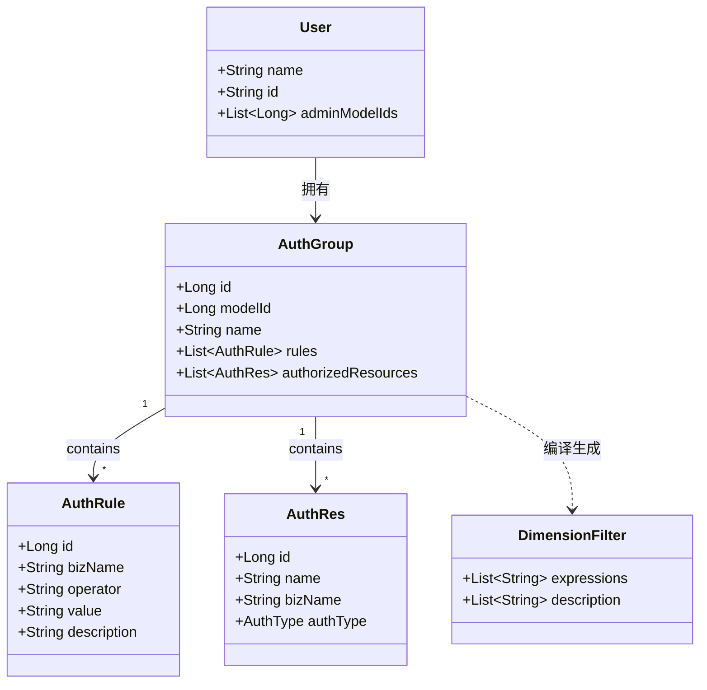
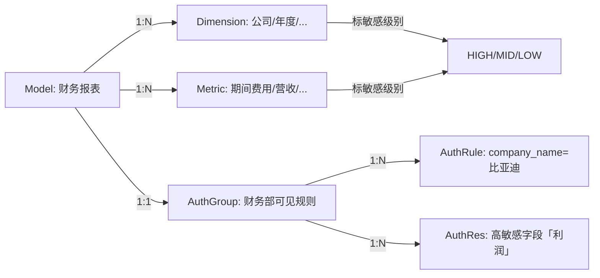

# 03 · 数据权限控制

> 本文档面向数据平台 / 数仓团队面试官，回答「SuperSonic 怎么做数据权限」。
> **本文档只讲数据资源权限**（模型可见性、列权限、行权限），不讲登录鉴权（Token / ApiKey / SSO）——后者是 `auth/authentication` 子包的职责，与数仓团队关心的「数据安全」不是一回事。
>
> **配套文档**：
> - 宏观鸟瞰见 [`01-架构总览.md`](./01-架构总览.md)
> - 查询数据流见 [`02-查询数据流详解.md`](./02-查询数据流详解.md)（本文 §3 引用其 A2 状态机）
>
> **诚实边界**：行号可漂移，类·方法为锚点；规则落库表结构以对码时为准（事实清单 `/tmp/03-perm-fact-sheet.md`）。

## 导航

| 章 | 主题 | 一句话 |
|----|------|--------|
| §1 | 设计哲学 | 数据权限从业务代码下沉到语义层，AOP 零侵入 |
| §2 | 权限数据模型 | AuthGroup / AuthRule / AuthRes / DimensionFilter + RBAC 对位 |
| §3 | 查询时拦截链路（核心） | @S2DataPermission + 七步流程 |
| §4 | LLM SQL 场景下的权限注入 | 三道防线（差异化亮点） |
| §5 | 管理端配置与持久化 | AuthController + 热生效 |
| §6 | 边界场景与陷阱 | 多模型 JOIN / 子查询 / 嵌套语义层 |
| §7 | 面试问答速查 | 8 问 |

---

## §1 · 设计哲学

传统数据权限的痛点：权限逻辑散落在各处业务代码里（每个 SQL 查询点都要手写 `if user.hasPermission(field) then ...`），导致：

1. **遗漏风险**：新加的接口忘记加权限检查 → 数据泄露
2. **维护成本**：权限规则改了要改 N 处代码
3. **测试困难**：每个接口都要测权限场景

**SuperSonic 的解法**：把权限从业务代码**下沉到语义层**，用 AOP 切面零侵入实现。

### 1.1 三个核心设计

| 设计 | 实现 | 价值 |
|------|------|------|
| **AOP 切面零侵入** | `@S2DataPermission` 注解 + `S2DataPermissionAspect` 切面 | 业务代码无感；新接口自动获得权限检查（只要加注解） |
| **与元数据绑定** | 敏感级别（`SensitiveLevelEnum`）在 Model 管理界面配置；权限规则基于 bizName 而非 SQL 字符串 | 规则跟着字段走，重命名字段不破坏权限 |
| **三层授权模型** | 模型可见性（Viewer）+ 列权限（敏感字段 HIGH）+ 行权限（DimensionFilter） | 与数仓团队的「表级 + 列级 + 行级」权限模型对位 |

### 1.2 与数仓权限模型的对位

| 数仓视角 | SuperSonic 对应 | 说明 |
|---------|---------------|------|
| 表级权限（GRANT SELECT ON table） | 模型可见性（`AuthType.VIEWER`） | 用户能查哪些模型 |
| 列级脱敏（MASKING） | 列权限（`SensitiveLevelEnum.HIGH`） | 敏感字段按需授权 |
| 行级安全（RLS） | 行权限（`DimensionFilter`） | 自动注入 WHERE 条件 |

**对面试官的话术**：「我们的数据权限是语义层做的，不是分散在业务代码里——AOP 切面 + 元数据绑定，让权限规则可治理。这套思路与数仓团队的 RLS（Row Level Security）是同一个理念，只是 SuperSonic 把它做到了语义层。」

---

## §2 · 权限数据模型

四个核心 POJO，位于 `auth/api/.../pojo/`：

### 2.1 类图



### 2.2 四个 POJO 详解

| POJO | 文件 | 含义 | 数仓视角 |
|------|------|------|---------|
| **`AuthGroup`** | `auth/api/.../pojo/AuthGroup.java` | 授权组：一组规则 + 授权资源集合，绑定到某 Model | 角色 / Role |
| **`AuthRule`** | `auth/api/.../pojo/AuthRule.java` | 行权限规则：`bizName + operator + value`（如 `company_name=比亚迪`） | 行级安全策略（RLS） |
| **`AuthRes`** | `auth/api/.../pojo/AuthRes.java` | 列权限资源：被授权的敏感字段 | 列级权限 |
| **`DimensionFilter`** | `auth/api/.../pojo/DimensionFilter.java` | 规则编译后的 SQL 片段 + description（用于前端展示） | — |

**关键字段说明**：

`AuthRule`：
```java
public class AuthRule {
    private String bizName;       // 维度 bizName，如 "company_name"
    private String operator;      // 操作符，如 "="、"IN"
    private String value;         // 值，如 "比亚迪"
    private String description;   // 人读描述，如 "仅可见比亚迪的数据"
}
```

`DimensionFilter`：
```java
public class DimensionFilter {
    private List<String> expressions;   // SQL 片段列表，如 ["company_name = '比亚迪'"]
    private List<String> description;   // 人读描述列表，前端展示用
}
```

### 2.3 与 RBAC / ABAC 的对位

| 模型 | User → Role → Permission | SuperSonic 实现 |
|------|--------------------------|----------------|
| **RBAC**（Role-Based） | User → Role → Resource | User → AuthGroup（角色）→ AuthRes（资源） + AuthRule（操作） |
| **ABAC**（Attribute-Based） | 基于属性的策略 | 部分支持——`AuthRule` 用 bizName/value 表达属性条件 |

**SuperSonic 偏 RBAC**：每个 AuthGroup 绑定一个 Model，User 通过加入 AuthGroup 获得对应权限。但 `AuthRule` 的「bizName + operator + value」结构带 ABAC 味道——可以表达「部门=销售部 AND 地区=华东」这种属性组合。

### 2.4 与 Model / DataSet 的关系



**关键**：敏感级别（`SensitiveLevelEnum`）在 Dimension / Metric 上配置，不依赖 AuthGroup——这是「与元数据绑定」的体现。改字段名，权限规则跟着 bizName 走；改敏感级别，列权限检查跟着自动调整。
