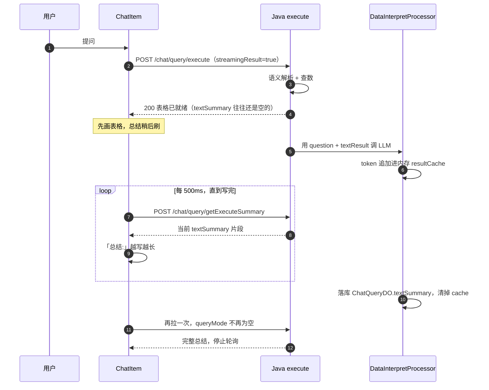
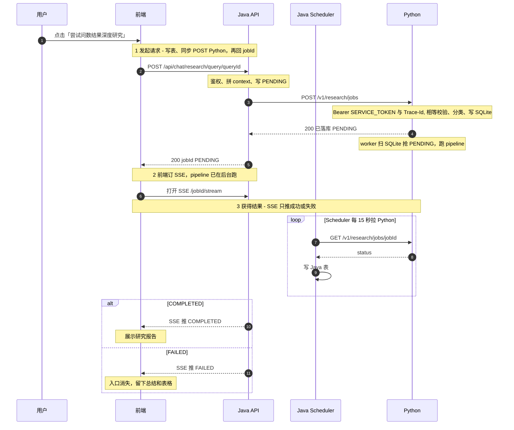
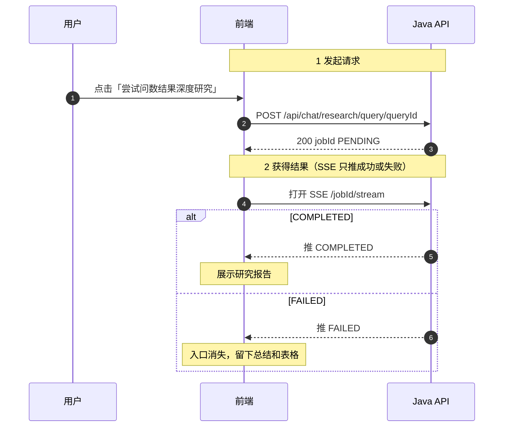
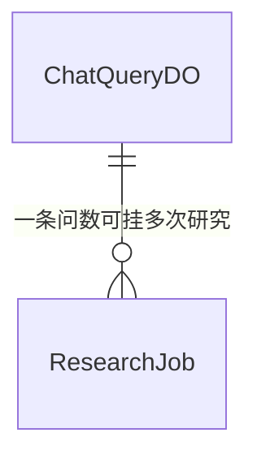
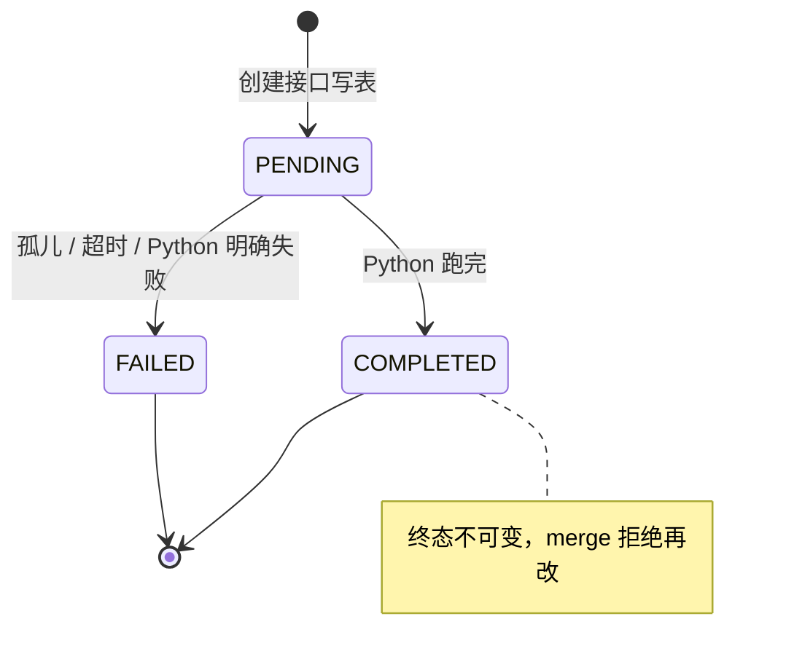
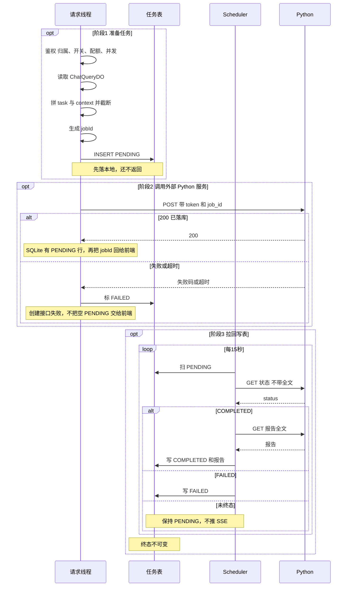
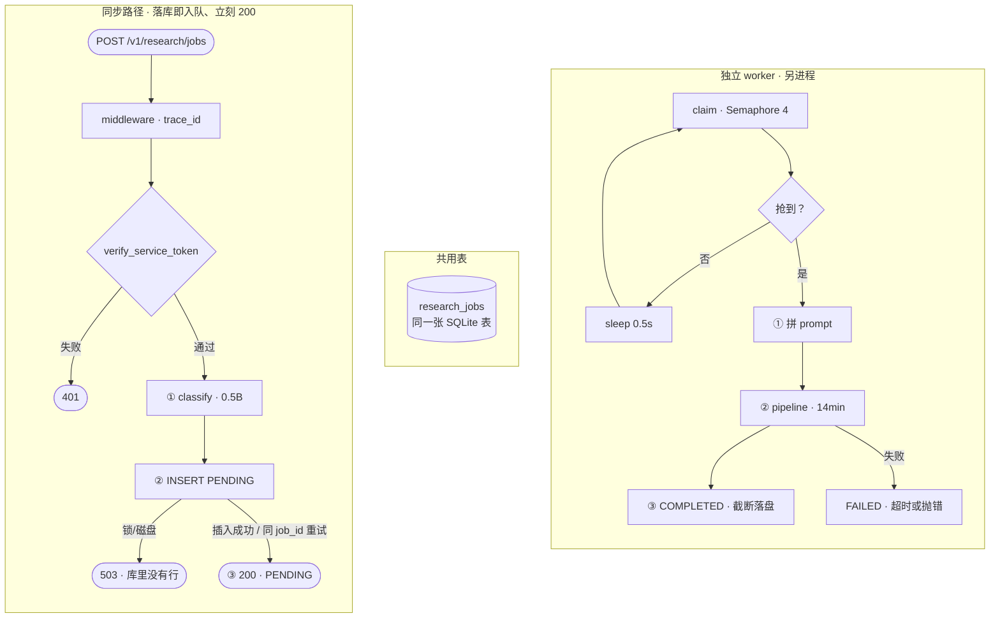

# 问数结果深度研究 — 集成设计（面试版）

> 本文是面试准备文档，不是实施说明书。
> 实施规格（类、表、完整代码、失败矩阵）：`[02-集成设计.md](./02-集成设计.md)`
> 指标 / GAIA / 耗时口径：`[01-通用问答.md](./01-通用问答.md)`
> 编排 / Hybrid / 工程化：`[03-Main-Sub-Agent编排.md](./03-Main-Sub-Agent编排.md)` · `[04-Hybrid-Search-MCP.md](./04-Hybrid-Search-MCP.md)` · `[05-工程化能力.md](./05-工程化能力.md)`
> 题纲：`[../面试题纲.md](../面试题纲.md)` § 三 B4–B6、C7–C9、D10–D12（本文不逐题作答）
> **诚实口径：** 按实施规格接到问数产品并上线来讲。不把这些 Java 网关类说成已经合进 SuperSonic 开源主仓；代码摘录对齐规格，不是开源主仓路径。

---

## 1. 背景：原来的解读只回答「是什么」

开场第一句：

> 问数成功之后，结果区本来就有一层描述性解读：Java `DataInterpretProcessor` 拿当次表格做一次 LLM 总结，前端写在「总结:」下面，耗时通常不到 2 秒。它只能复述表内趋势、对比和异常点，回答不了「为什么」。用户要归因、要外网交叉验证的时候，这层解读就不够用了。深度研究是加在这层解读后面的可选项，不是第二条问数，也不替换默认总结。

### 1.1 原来长什么样

对齐现有 `ExecuteItem.tsx`：问数气泡里先是「数据查询」标题栏，然后是「总结:」+ markdown，再下面才是表格 / 图表。深度研究出现之前，结果区就是这三块。

```
┌─ 一条问数结果 ─────────────────────────────┐
│  ✓ 数据查询                                │
│                                            │
│  总结: 2024 年比亚迪净利润约 300 亿，      │
│  较上年增长 xx%，主要来自表内同比对比。    │  ← textSummary
│                                            │
│  ┌──────────────────────────────────────┐  │
│  │  指标表格 / 趋势图 / 饼图              │  │  ← ChatMsg
│  └──────────────────────────────────────┘  │
└────────────────────────────────────────────┘
```

「总结:」对应代码里的 `data.textSummary`。没有这份总结，后面也不会挂深度研究入口——研究是解读之后的增强，不是问数失败时的备胎。

### 1.2 原来怎么产出这句总结

描述性解读走的是问数主链路里的一个 Processor，不是独立服务。查数先返回，总结后到，前端用 500ms 轮询把字「刷」出来，看起来像流式。




读这张图：

1. `execute` 把表格先还给浏览器，Chat 线程不等总结写完。`DataInterpretProcessor` 在流式路径里把 token 追加到按 `queryId` 分区的内存 buffer，提示语是「AI 回答中...」。
2. 前端 `ChatItem` 在 execute 成功后 `setTimeout(500)` 打 `getExecuteSummary`。返回里 `queryMode == null` 表示还在写，就把当前 `textSummary` 合进已有结果再等 500ms；`queryMode` 有值表示写完了，停轮询。
3. 这是**伪流式**：不是 HTTP chunked，也不是 SSE。LLM 在服务端流，浏览器靠短轮询读同一块内存。

Prompt 规则写得很窄：用和问题相同的语言、引用关键数据、把查询结果整理成简短回答。它看见的只有 `#Question` 和 `#Data`（当次 `textResult`），没有外网、没有知识库、也不允许凭模型常识编原因。

所以「比亚迪 2024 年净利润 300 亿」这类问题，总结只能说金额、同比、时间口径和表内其他指标的关系。用户再问「为什么涨」，这层解读给不出销量、成本或政策——那是深度研究要做的事。默认路径继续守住秒级可用；真正要「为什么」的人，再在总结下方点入口。怎么接到 Java / Python，从 §2 的总时序图开始讲。

## 2. 总览：先看谁跟谁说话

Java 是问数产品的网关，Python 是研究运行时。浏览器只跟 Java 说话。两个进程各自一个 Dockerfile，放进同一个 Compose 网络；Java 用服务名访问 Python，例如 `PYTHON_BASE_URL=http://research-agent:8000`。对外只暴露 Java（和前端）。**同网络不是前端直连**：浏览器进不了容器 DNS，也不该拿到研究服务的地址。同网络里别的容器却能按服务名打到 Python，所以出站还要带静态 `SERVICE_TOKEN`（见 Q2）。

下图是这条链路的**总时序图**。先看谁跟谁说话，再看返回发生在哪一步：浏览器永远碰不到 Python；创建接口写表后同步 POST Python，等的是**SQLite 落库成功**（`PENDING` 行就是待办），不是研究报告。拿到 Python 的 `200` 再把 `jobId` 还给前端。




按图上的三段读一遍：

1. **发起请求。** 用户只点一次。前端只 POST 当前 `queryId`。Java 在请求线程里鉴权、拼 context、写 `PENDING`，再同步 POST Python。等的是 Python **落库** 的 `200`（秒级），不是 pipeline。拿到后才 HTTP `200` 把 `jobId` 还给浏览器。
2. **前端订 SSE。** 浏览器拿着 `jobId` 打开 SSE。此时独立 worker 已经（或即将）从 SQLite 抢走这条 `PENDING` 跑 pipeline，两边互不等待。
3. **获得结果。** 前端**不轮询**研究接口。Java Scheduler 每 15 秒去拉 Python；只有成功或失败才经 `SseRegistry` 推 SSE。成功画报告，失败入口消失，总结和表格还在。

怎么读这张图：

- **实线带箭头**是请求，**虚线**是返回。Python 的 `200` 是「这条任务创建成功（SQLite 已有 `PENDING` 行）」；同一轮里 Java 再 `200` 把 `jobId` 给浏览器。报告完成看 `status`，不看这一次 HTTP 码。
- **loop 不是用户在轮询。** 轮询发生在 Java → Python；前端只收 SSE。
- SSE 连接挂在 API 的 `/stream` 上，Scheduler 不直连浏览器。

两条回传通道必须拆开讲，细节分别在前端章和 Java 章；这里只记方向：


| 方向                 | 机制                          | 为什么这样拆                         |
| ------------------ | --------------------------- | ------------------------------ |
| Python 状态 → Java 表 | Java `@Scheduled` 每 15 秒拉一次 | 频率固定，和打开页面的人数无关                |
| Java 表 → 前端        | SSE 推送                      | 前端不轮询研究接口；轮询只发生在 Java → Python |


后面三章按**进程**拆开，每章只讲自己那条生命线。对照关系：


| 章         | 对应生命线              | 本章讲                                                       | 本章不讲                          |
| --------- | ------------------ | --------------------------------------------------------- | ----------------------------- |
| §3 前端     | 用户、前端              | 入口长什么样、点下去之后浏览器和 Java 说了什么                                | Java 怎么鉴权、Python 怎么跑 pipeline |
| §4 Java   | Java API、Scheduler | 鉴权拼 context、写表、同步 POST、定时拉、SSE 推                          | 前端组件怎么写、Python 分类和 MCP        |
| §5 Python | Python             | 验 SERVICE_TOKEN、SQLite 落库即入队 `200`、独立 worker 扫表跑 pipeline | 用户是谁、配额、SSE                   |


## 3. 前端：入口在总结下方，浏览器只跟 Java 说话

深度研究挂在现有「总结:」和表格下面。没有 `textSummary` 就不画入口——它是解读之后的可选项。浏览器**只持有引用**（当前这条问数的 `queryId`，以及后来的 `jobId`），不持有问数全文，也不知道 Python 的地址。

入口文案是「尝试问数结果深度研究」。画在 `ExecuteItem` 里真实的位置上，就是这样：

```
┌─ 一条问数结果 ─────────────────────────────┐
│  ✓ 数据查询                                │
│                                            │
│  总结: ……（原来的描述性解读，始终保留）    │
│                                            │
│  ┌──────────────────────────────────────┐  │
│  │  指标表格 / 趋势图                     │  │
│  └──────────────────────────────────────┘  │
│                                            │
│  [ 尝试问数结果深度研究 ]                  │  ← 新增入口
└────────────────────────────────────────────┘
```

点下去之后，表格和「总结:」都不动。进行中只在入口位置换成进度提示；成功则在同一位置展开研究报告；失败则这块区域消失，用户继续看原来的总结和表。

### 3.1 本模块时序图




上图按两段读：

1. **发起请求。** 用户点的是结果区里的「尝试问数结果深度研究」，不是输入栏换模式。前端只把当前这条问数的 `queryId` POST 给 Java，不带表格、不带 `textSummary`。Java 写表后同步向 Python 接单，Python **落库** 回 `200`，Java 再 `200` 回来 `jobId`。前端多等的是接单这几秒，不是研究报告。
2. **获得结果。** 前端打开 SSE，等成功或失败：成功就在入口位置展开报告，失败就把入口拿掉，总结和表格不动。浏览器**不会**对研究接口做 500ms 轮询——那是总结在用的伪流式，研究这边是推送。

### 3.2 高频问题

**Q1. 为什么前端只 POST** `queryId`**，不传 context？**

现在还在项目初期。提示词防恶意注入、把研究范围钉在「这次问数结果」上、滤掉和表格无关的调研——这些还没做。如果让前端把 context 一起 POST，浏览器等于能往研究任务里塞任意一段话：可以注入提示词，也可以把一次「查净利润」拐去跑完全不相干的调研，Java / Python 都很难当场判断这段文字是不是真的来自那张表。

只传 `queryId`，是把任务钉在服务端已经落库的那条问数上。Java 自己去 `ChatQueryDO` 里取问题、表格和总结再拼 context，前端改不了这份材料。研究范围相对可控：用户只能对**已经查出来的结果**发起深度研究，不能借这个入口随便开一个开放域 Agent。

这是初期用引用换可控性，不是终态安全方案。防注入、主题约束做起来之后，仍然应该由服务端拼 context，而不是回头让浏览器传正文。

**Q2. 有没有用流式响应？**

先把描述性解读那条说清楚。问数 `execute` 会先把表格还给浏览器，不等总结写完。Java 里 `DataInterpretProcessor` 调 LLM 时，每来一个 token 就追加进这块 `queryId` 对应的内存 buffer，提示语是「AI 回答中...」。前端并不挂着一条真正的流：它每隔 500ms 打一次 `getExecuteSummary`，把 buffer 里已经攒下的字刷到「总结:」下面；服务端回来说还在写，就再等 500ms 再问；回来说写完了，就停。用户看见字一个个出来，其实是**伪流式**——LLM 在服务端流，浏览器和 Java 之间只是短轮询同一段正在变长的文本，不是 SSE，也不是 HTTP chunked。

这样做是为了**首 token**：描述性解读是默认路径，表格出来之后，总结的第一个字也要尽快出现，不能等整段写完再一次性贴上去。用户没有额外点过什么，必须立刻有反馈。

深度研究报告**不需要**把正文流给前端。研究本身就要数分钟，入口是用户自己点的「尝试问数结果深度研究」，等于已经接受等待。这里要守住的是已经能看的表格和总结不被拖死，不是把报告的第一个字提前刷出来。所以创建接口只等 Python 接单，正文等整篇完成再给；SSE 只推成功或失败。半成品在研究里往往是工具调用中间态，流出来读不懂，失败了还得撤，比一开始不出报告更吵。

## 4. Java 网关

Java 是唯一同时看见「登录用户」和「研究运行时」的进程。先定表，再看请求线程怎么转发、Scheduler 怎么扫表。用户可见态以这张表为准；SSE 从表往外推，不进下面的时序图。

### 4.1 数据模型

用户可见态以 Java 表 `s2_chat_research_job` 为准。问数业务对象只被**读**：取出问题、表格、解读来拼任务，研究进程不写回 `ChatQueryDO`。

一条问数可以挂多次研究：




**ChatQueryDO**（已有问数表，只读）


| 字段          | 类型        | 含义                                             |
| ----------- | --------- | ---------------------------------------------- |
| queryId     | bigint PK | 当次问数 id。前端只传这个引用。                              |
| question    | string    | 用户原问题。创建研究时现读，拼成发给 Python 的 `task`，**不抄进研究表**。 |
| textResult  | text      | 当次查数表格/结果。拼进 `context`，不另存。                    |
| textSummary | text      | 描述性解读。没有它就不挂深度研究入口；同样拼进 `context`。             |
| created_by  | bigint    | 问数创建者，用来做归属。                                   |


**ResearchJob**（`s2_chat_research_job`）

主键用自增 `id`，不用 `job_id`。InnoDB / PostgreSQL 堆表按主键或插入序走；UUID 当主键会把随机值打进页中间，频繁页分裂、页合并。自增 `id` 只在末尾追加。对外和 Python 仍用 Java 生成的 `job_id`（UUID），上面建唯一索引。


| 字段           | 类型           | 含义                                                         |
| ------------ | ------------ | ---------------------------------------------------------- |
| id           | bigint PK 自增 | 聚簇/插入顺序。避免 UUID 打在页中间。                                     |
| job_id       | varchar UK   | 业务 id。回给前端、传给 Python、订 SSE、对账日志都用它。                        |
| query_id     | bigint       | 挂在哪条问数上。拼 `task` / `context` 时回查 `ChatQueryDO`。            |
| created_by   | bigint       | 谁点的研究。配额按人+日聚合，归属校验也看它。                                    |
| trace_id     | varchar      | 从 MDC 带过来，出站 header 和排障 grep 用。                            |
| status       | varchar      | 用户可见态，只三态：`PENDING` / `COMPLETED` / `FAILED`。              |
| report_full  | text         | 唯一一份研究报告。成功后写入，SSE 带给前端。目标 **2500–4000 字**，硬上限 **4000 字**。 |
| error_msg    | text         | 失败原因。给日志和排障，不展示给用户。                                        |
| created_at   | timestamp    | 写入时间。Java 15 分钟兜底超时看它。                                     |
| completed_at | timestamp    | 进入终态的时间。未完成则为空。                                            |


这张表身兼两职：给 Scheduler 扫、给前端看终态，也按 `created_by` + 日期聚合「今日已用次数」。表里**不存权限规则**——规则运行时从 user + yml 算。索引：`uk_job_id`、`query_id`、`(created_by, status)`、`status`。

状态只允许单向走。Java 表**没有** `RUNNING`：创建已等到 Python 落库成功，未完成就是 `PENDING`。Python 内部仍有 `RUNNING`（pipeline、硬超时、worker 收尸），Scheduler 拉到非终态保持 `PENDING`。




执行态以 Python 为准，但**用户看见什么以这张表为准**。两边终态不可变，避免双写翻盘。

### 4.2 本模块时序图与必要代码

不画前端。一张图、三个阶段。阶段 1、2 对应（1）转发；阶段 3 对应（2）扫表。SSE 从表往外推，不进这张图。




按三个框读：

1. **准备任务。** 请求线程先自循环鉴权：这条问数是不是他的、功能开没开、今日额度、有没有并发任务。过了再读 `ChatQueryDO`，把问题、表格、总结拼成 `task` 与 `context` 并截断，生成 `jobId`，写入 `PENDING`。这一步还不返回。
2. **调用外部 Python 服务。** 同一请求线程同步 POST（带 token、`traceId`、`job_id`）。Python **SQLite `INSERT PENDING` 之后** 回 `200`，Java 才把 `{jobId, PENDING}` 回给前端；网络抖动由 Client 指数退避最多 3 次，仍失败或 4xx 把行标 `FAILED`，创建接口失败。等的是落库，不是 pipeline。出站只传 `task + context`，研究类型由 Python 自己判。
3. **拉回写表。** Scheduler 每 15 秒扫 `PENDING`。Python 仍是 `PENDING` / `RUNNING` 时，Java 保持 `PENDING`，不推 SSE。`COMPLETED` 再拉全文；`FAILED` 写 `error_msg`。终态不可变。404 和抖动见 Q7。

#### （1）转发深度研究请求

Controller 三个入口统一做归属：创建验 `queryId`，查询 / SSE 验 `jobId`。不存在和不是本人统一 **404**。SSE **先校验再** `register`，随机 UUID 不许把 emitter 建满。

`createResearch` 按下面 7 步走完才返回：**等 Python 落库** `200`**，不等 pipeline**。第 4 步 `task` / `context` 见 Q1；第 7 步 token 和出站见 Q2。

1. **归属校验。** `queryId` 不存在或不是本人统一 404，admin 放行。
2. **确认解读。** 没有 `textSummary` 就不让发起研究。
3. **配额闸门。** 功能开关 + 日配额 + 并发：先能不能用，再今天还能不能建。
4. **现拼材料。** `task` 用原问题，`context` 用表格 + 解读，不落研究表。
5. **发号。** Java 生成 `jobId`（UUID），带上 MDC 里的 `traceId`。
6. **写本地 PENDING。** 不存 `task` / `context`，靠 `query_id` 可还原。
7. **同步 POST Python。** `200`（已落库，`PENDING` 即待办）才返回 `{jobId, PENDING}`；Client 内同 `jobId` 抖侧重试最多 3 次，仍失败标 `FAILED`、抛 503。

```java
public CreateJobResponse createResearch(User user, Long queryId) {
    // 1. 校验 queryId 属于当前用户：不存在或不是本人统一 404，admin 放行
    ChatQueryDO query = chatQueryService.getChatQuery(queryId);
    if (query == null) {
        throw new ResearchNotFoundException("query not found");
    }
    boolean isAdmin = Integer.valueOf(1).equals(user.getIsAdmin());
    if (!isAdmin && !Objects.equals(query.getUserName(), user.getName())) {
        throw new ResearchNotFoundException("query not found");
    }

    // 2. 确认已有描述性解读；没有 textSummary 就不让发起研究
    if (StringUtils.isEmpty(query.getTextSummary())) {
        throw new ResearchBadRequestException("查询结果不存在或无描述性解读");
    }

    // 3. 功能开关 + 日配额 + 并发（先能不能用，再今天还能不能建）
    permissionChecker.check(user);

    // 4. 现查 ChatQueryDO 拼 task（原问题）和 context（表格+解读），不落研究表
    String task = query.getQuestion();
    String context = buildContext(query);

    // 5. Java 生成 jobId（UUID），带上 MDC 里的 traceId
    String jobId = UUID.randomUUID().toString();
    String traceId = TraceIdUtil.getTraceId();

    // 6. 写本地任务表 PENDING（不存 task/context，靠 query_id 可还原）
    jobMapper.insert(pendingJob(jobId, queryId, user, traceId));

    // 7. 同步 POST Python；200（已落库）才返回 {jobId, PENDING}
    //    Client 内对同一次 POST 做网络抖动重试（同一 jobId，最多 3 次）
    //    仍失败：标 FAILED，抛 503；不换 jobId 再打（用户再点才是新任务）
    try {
        pythonClient.createJob(jobId, traceId, task, context);
    } catch (Exception e) {
        jobMapper.markFailed(jobId, "python create failed");
        throw new ResearchUnavailableException("研究服务暂不可用");
    }
    return new CreateJobResponse(jobId, "PENDING");
}
```

#### （2）定时任务扫表

`syncRunningJobs` 每 15 秒扫一轮本地 `PENDING`（Java 没有 `RUNNING`），对每条按下面 7 步走完：**只在终态写表并推 SSE**。第 3、5 步两阶段拉取见 Q6；第 7 步 404 和抖动见 Q7。

1. **扫表。** 只取 `PENDING`。
2. **超时兜底。** `created_at` 满 15 分钟 → 标 `FAILED` 并推 SSE，不再问 Python。
3. **轻量 GET。** 只要 `{status, error_msg}`，不带全文。
4. **非终态。** Python 仍是 `PENDING` / `RUNNING` → Java 保持 `PENDING`，不写表、不推 SSE。
5. **再拉全文。** 只有 `COMPLETED` 才 `include_full=true`；失败不要翻回 `FAILED`，报告可空，下一轮再补。
6. **写终态并推 SSE。** 成功带 `report_full`（≤ 4000 字），失败不带原因正文。本地已终态则拒绝覆盖。
7. **拆异常。** Python 明确 404 → 立刻 `FAILED`；超时 / 5xx 当抖动，跳过本轮。

超时时钟看 `created_at`。创建已经等过接单，排队只有那几秒，不必再拆 `started_at`。Java 15 分钟只兜底进程崩溃 / 网络分区，比 Python 14 分钟硬超时多 1 分钟，给 Python 自己认输留窗口。`SseEmitter` 超时约 20 分钟。SQL 层再加 `WHERE status NOT IN ('COMPLETED','FAILED')`。

```java
@Scheduled(fixedDelayString = "${research.sync-interval-ms:15000}")
public void syncRunningJobs() {
    // 1. 扫本地 PENDING：用户可见未完成态只有这一种
    List<ResearchJobDO> active = mapper.selectByStatusIn(List.of("PENDING"));

    for (ResearchJobDO job : active) {
        try {
            // 2. 超时兜底：满 15 分钟标 FAILED 并推 SSE，不再问 Python
            if (isTimeout(job, timeoutMinutes)) {
                flipToFailed(job, "java-side timeout");
                continue;
            }

            // 3. 轻量 GET：只要 status / error_msg，不带报告全文
            PythonJobStatus p = pythonClient.getStatus(job.getJobId(), false);

            // 4. Python 仍是 PENDING / RUNNING：Java 保持 PENDING，不写表、不推 SSE
            if (!TERMINAL.contains(p.getStatus())) {
                continue;
            }

            // 5. COMPLETED 再拉一次 include_full；失败不要翻回 FAILED，见 Q6
            if ("COMPLETED".equals(p.getStatus())) {
                try {
                    PythonJobStatus full = pythonClient.getStatus(job.getJobId(), true);
                    p.setReportFull(full.getReportFull());
                } catch (Exception e) {
                    log.debug("include_full failed, merge without report");
                }
            }

            // 6. 写终态并推 SSE：成功带 report_full，失败不带原因正文
            mergeStatus(job, p);
        } catch (HttpClientErrorException.NotFound e) {
            // 7a. 真孤儿：Python 明确 404，立刻 FAILED
            flipToFailed(job, "python job not found");
        } catch (Exception e) {
            // 7b. 抖动：超时 / 5xx，跳过本轮，下次再试
            log.debug("skip this round");
        }
    }
}

private void mergeStatus(ResearchJobDO job, PythonJobStatus p) {
    // 本地已终态：拒绝 Python 回包覆盖
    if (TERMINAL.contains(job.getStatus())) {
        return;
    }
    job.setStatus(p.getStatus());
    job.setCompletedAt(new Date());
    if ("COMPLETED".equals(p.getStatus())) {
        job.setReportFull(p.getReportFull());   // 可空，下一轮再补
    } else {
        job.setErrorMsg(p.getErrorMsg());       // 给日志，不进 SSE
    }
    mapper.updateByIdTerminalSafe(job);         // WHERE status NOT IN 终态
    sseRegistry.send(job.getJobId(), buildEvent(job));
}
```

### 4.3 高频问题

**Q1. 发给 Python 的 query 长什么样？**

```
task:
你正在开展一项深度研究任务，不要把查询结果再总结一遍。

## 研究规范
- 从查询结果出发做归因：回答「为什么是这个值」，不是复述表格
- 引入外部证据交叉验证（联网 / 知识库），论断能链回来源
- 区分事实与推测，推测必须标注；承认不确定性，不强行给确定结论
- 报告结构：背景 → 关键发现 → 归因分析 → 不确定性 → 结论
- 长度在 4000 字以内

## 研究问题
{{question}}

context:
## 查询结果
{{textResult}}

## 描述性解读
{{textSummary}}
```

**查询结果怎么灌进去。** `QueryResult.queryResults` 原来是 `List<Map<String, Object>>`，一行一个 Map，key 是列的 `bizName`。`SqlExecutor.execute` 里调用 `ResultFormatter.transform2TextNew(queryColumns, queryResults)`，写成 `textResult` 一段 markdown 表字符串，原样灌进 `{{textResult}}`。

原来：

```json
[{ "brand_name": "aws", "year_time": "2024", "revenue": 13700000000, "profit": 3700000000 }]
```

变成：

```
| 品牌名称 | 财年 | 营收 | 利润 |
|:---:|:---:|:---:|:---:|
| aws | 2024 | 13700000000 | 3700000000 |
```

`{{question}}` 来自 `ChatQueryDO.queryText`。`{{textSummary}}` 来自解读那次 LLM 的产出。

示范用企业 Demo 例题「2024财年aws的营收和利润」，数字来自 `brand_revenue` 2024 年 aws 那一行。灌完之后：

```
task:
你正在开展一项深度研究任务，不要把查询结果再总结一遍。

## 研究规范
- 从查询结果出发做归因：回答「为什么是这个值」，不是复述表格
- 引入外部证据交叉验证（联网 / 知识库），论断能链回来源
- 区分事实与推测，推测必须标注；承认不确定性，不强行给确定结论
- 报告结构：背景 → 关键发现 → 归因分析 → 不确定性 → 结论
- 长度在 4000 字以内

## 研究问题
2024财年aws的营收和利润

context:
## 查询结果
| 品牌名称 | 财年 | 营收 | 利润 |
|:---:|:---:|:---:|:---:|
| aws | 2024 | 13700000000 | 3700000000 |

## 描述性解读
2024财年 aws 营收 13700000000、利润 3700000000，利润约占营收的 27%。
```

表过长按字硬切（表 2000、解读 1000、整段再卡 4000）。

**Q2. token 怎么定义、怎么带出去的？**

**静态** `SERVICE_TOKEN`**，事先配好，相等校验。** 不运行时签发。用户权限（归属、开关、配额、并发）在 Java 出站前已经做完，Python 不认用户、也不该再验一遍人。出站只证明「调用方是问数网关」，不是再签一套 JWT。

两层就够：

1. **网络。** Java 和 Python 进同一个 Compose 项目。Compose 默认给应用建一张网，容器用**服务名**互访（例如 `http://research-agent:8000`），不必写死 IP。[Docker 文档](https://docs.docker.com/compose/how-tos/networking/)写得很清楚：服务名会进内部 DNS，同网络里谁都能解析到谁。对外只映射 Java 端口，浏览器进不了这张网。
2. **Token。** 同网络 ≠ 任意内部容器都能调。旁路服务只要知道服务名就能打到 Python。所以两边读同一份 `RESEARCH_SERVICE_TOKEN`，Java 带 `Authorization: Bearer <token>`，Python 只做字符串相等。不转 SuperSonic 用户 JWT（payload 含密码哈希，登录密钥还会耦合）。

**怎么定义比较好。** 运维生成一次高熵随机串（`openssl rand -hex 32` 即可），写入环境变量 `RESEARCH_SERVICE_TOKEN`。Compose 从宿主机 `.env`（gitignore）注入 Java 和 Python 两个服务，仓库、镜像、`application.yml` 里不写真实值。本地可以留一个一眼假的默认值；生产读到默认值就拒绝启动。不要打进日志、不要进前端。轮换时两边同时换成新值再滚动重启。Demo 不做双密钥窗口。

不现签、不上 OAuth / mTLS：再签 60 秒 JWT 并不增加权限边界，只是把已经鉴过权的调用再包一层。Scheduler 拉状态用同一把 token。

金句：**人在网关鉴完；同网络按服务名可达，所以还要一把事先配好的 SERVICE_TOKEN，挡住「任意内部容器都能调」。**

**思考题：上游 token 带了时间戳，转发到下游时过期了怎么办？**

不要把上游用户 token 原样转给下游。网关验完人，出站换自己的凭证——本方案就是静态 `SERVICE_TOKEN`，没有 `exp`，不存在「转发途中过期」。

如果下游也必须拿带过期时间的票：由网关用服务身份换发一张新的短时 token（token exchange），TTL 盖住这次调用；排队或重试导致将过期时，出站前再签一次，不要把快过期的票接着往下传。时钟 `leeway` 只挡两边差几秒，挡不住「请求在网关里等太久，`exp` 耗光」。

## 5. Python 运行时：验 token，落库即入队，立刻 200

本章讲 Python 侧两个进程：FastAPI 接单，独立 worker 扫表。调用方是谁、怎么扫 Java 表，见 §4。

现仓 `miro-flow-solution` 已经在跑研究：`StreamingTaskRunner` 经 WebSocket 调 `src/core/pipeline.py` 的 `execute_task_pipeline`。问数集成**不另起一套 Agent**，只加 REST 包装：同步路径 `**INSERT PENDING` 就是入队**，回 `200`；**独立 worker 另起进程**扫 SQLite 抢行，仍进同一个 `execute_task_pipeline`（`human_interaction=None`，不走人工确认）。

技术栈：SQLite 即队列，不引入 Redis / Celery。任务正文和待办都在同一张表。Worker 内 `asyncio.Semaphore(4)` 封顶执行并发——瓶颈是 14 分钟 LLM，不是消息中间件。一台机器只跑 **一个** 消费进程，避免多个进程抢同一 SQLite 文件。

Java 只看见 HTTP，是观察者：Scheduler GET 不画进这张内部图。

### 5.1 内部数据流




左接单、中共用表、右消费。三栏只靠栏名排成一行，栏内节点互不相连。

按图读。同步路径走完才回包，**等分类、写库，不等 pipeline**：

1. **middleware。** `X-Trace-Id` 写入 contextvar，后面日志、落库都带同一条。
2. **验 token。** `deps.verify_service_token` 字符串相等，失败 401。不认用户 JWT。怎么定义见 [§4.3 Q2](#43-高频问题)。
3. **① 分类。** 本地 Qwen2.5-0.5B，看 Java 已截断的整段 `query`，Python 不再切。只产出 `research_type`，失败 fallback `default`。选哪套研究方法，不挡入队。取值和分类 prompt 见 [§5.3 Q1](#53-高频问题)；怎么 enhance 见 [§5.3 Q2](#53-高频问题)。

**②③ `INSERT PENDING` 成功 = 入队成功 = `200`。** 文件 `server/rest/research_jobs.db`。这一行同时是正文和待办，没有第二张队列表。`job_id` 用 Java 发的。主键对齐 Java：自增 `id`；`job_id` 唯一键给幂等重试。


| 块   | 字段                                                     | 干什么                                   |
| --- | ------------------------------------------------------ | ------------------------------------- |
| 身份  | `id` INTEGER PK，`job_id` UNIQUE，`tenant_id`，`trace_id` | 对外仍用 UUID                             |
| 队列  | `status`                                               | 四个字：等着被抢 / 正在跑 / 成功 / 失败              |
|     | `created_at`                                           | 谁先入队，谁先被抢                             |
|     | `started_at`                                           | 抢走之后才写，开始烧 token 的时间                  |
|     | `heartbeat_at`                                         | 抢行写第一下，跑着再刷；卡死谁收见 [§5.3 Q4](#53-高频问题) |
|     | `completed_at`                                         | 进终态的时间                                |
| 正文  | `query`                                                | Java 拼好的整段，**不拆** task/context        |
|     | `research_type`                                        | 三选一，worker 用来选哪份范式 md                 |
| 结果  | `report_uri`                                           | 报告文件路径；全文不进表                          |
|     | `error_msg`                                            | 失败原因，给日志                              |


 INSERT 只填身份 + `query` + `research_type` + `PENDING` + `created_at`。不存 `data_domain`。队列后半和结果列为空。索引：`UNIQUE(job_id)`、`(status, created_at)`。


|                        | Python                | Java / 前端                        |
| ---------------------- | --------------------- | -------------------------------- |
| 插入成功                   | `200 PENDING`         | 把 `jobId` 给浏览器，转圈                |
| 磁盘满 / 锁超时              | **503**，库里**没有**这一行   | 本地标 `FAILED`，创建 503；再点是新 `jobId` |
| 回包丢失、同 `job_id` 再 POST | 唯一键冲突 → 行已在，**仍 200** | 当成功；worker 会扫到                   |


 真写不进 → 503，当没点成。已经在库里 → 冲突也当成功，否则两边分叉。不要为失败再插一条 `FAILED`。`200` 只表示库里有行，不是报告跑完。

 消费端是独立 worker（`python -m server.rest.worker`），和 FastAPI 不是同一个进程，共享同一份 SQLite。一台机器只跑**一个**消费进程；进程里 `asyncio.Semaphore(4)` 封顶。要的是接单不被 14 分钟 pipeline 堵住，不是多进程抢同一份 SQLite。抢行：

```sql
UPDATE research_jobs
SET status = 'RUNNING', started_at = ?, heartbeat_at = ?
WHERE job_id = (
  SELECT job_id FROM research_jobs
  WHERE status = 'PENDING'
  ORDER BY created_at
  LIMIT 1
);
```

   抢不到 sleep 0.5s。四个字：


| status                 | 意思           |
| ---------------------- | ------------ |
| `PENDING`              | 已落库，还没抢走     |
| `RUNNING`              | 正在跑 pipeline |
| `COMPLETED` / `FAILED` | 结束，**不许再改**  |


1. **抢行。** CAS：还是 `PENDING` 才变成 `RUNNING`，同时写下 `started_at` 和第一笔 `heartbeat_at`。抢不到 sleep 0.5s。心跳谁刷、RUNNING 卡死谁收尸，见 [§5.3 Q4](#53-高频问题)。
2. **① 拼 prompt。** 三种 type 同一套：Java 拼好的整段 `query` **原样注入**对应 md（金融 / 学术 / `default.md`）。注入进模板就是 enhance，不再另调 LLM 改写问句。`full_task` 只进 pipeline，不另存库。提示词见 [§5.3 Q2](#53-高频问题)。
3. **② pipeline。** 这一路已经占了 `Semaphore` 的一格，行状态是 `RUNNING`，心跳协程在刷。`asyncio.wait_for(..., 14min)` 包住整段 Main 多轮——就是下一节。到期或抛错 → SQLite **同一行** `UPDATE FAILED` + `error_msg`，**不写报告文件**。
4. **③ 落盘。** 5.2 交出 `final_answer` + `boxed_answer` 之后才截断、写成 JSON，行上只留 `report_uri`，然后放开 Semaphore、停心跳。已是终态则跳过。

### 5.2 Main 多轮（还是刚才那一路 `run_one`）

上一节停在 worker 抢到一行、拼好 `full_task`、准备跑 pipeline。**角色没换**：还是同一个消费进程、同一条 SQLite 行、同一格 `Semaphore(4)`。5.2 只是把 5.1 的 ② 打开——`wait_for(14min)` 里面在干什么。外面那一层还在：心跳每 30s 刷、最多 4 路这样的循环同时转、14 分钟一到整段被取消。贴码见 `[03](./03-Main-Sub-Agent编排.md)`。

worker 已抢到这一单。进循环之前只做三件准备，面试一句话带过就行：

1. **读配置**：谁规划、谁干活、最多几轮
2. **装配**：把模型和工具接到编排器上
3. **启动**：把任务和工具菜单交给 Main

Prompt 里的Plan -> Act -> Reflect -> Replan:

- **Plan 怎么做。** 一轮就是 **一条** assistant 回复，里面叠两段：上面用自然语言写编号步骤（`1. 2. 3.`，每步一个子目标），下面贴 **恰好一次** `<use_mcp_tool>`，然后立刻停，等工具结果回 history。计划不是另调一个 API，也不是 `{"steps":[...]}` 那种 JSON 表——就是写给自己下一轮看的备忘。编排器只正则抠 XML 去执行；**有没有写出 `1. 2. 3.`，代码不校验、不拦。** 完整编号主要钉在首轮；后面不必每轮重抄，碰壁再改。
- **Act 怎么做。** 编排器用正则从回复里抠 `server_name` / `tool_name` / `arguments`（不是 Pydantic）。合法调用截断到前 N 个，`for` 里逐个 `await`——N 不是并发。三条路：普通名字走 `ToolManager`（搜索、读文件、跑代码）；`agent-`* 开新 session 跑 Sub，只把摘要当工具结果；格式残了合成 `re-think` 回灌，下轮改写法。Prompt 要求一步一次 tool，就是为了下一步能复盘。
- **Reflect 怎么做。** 工具结果带 `call_id` 写回**主** history。下一轮 LLM 先读「这一步拿到了什么、还缺什么」，再决定走 Replan 还是收束。主 Agent 只看见摘要，看不见子会话全文。Sub 内部是同构的小循环，回传只有 summary。
- **Replan 怎么做。** 计划活在对话历史里，下一轮模型自己决定沿用还是改口。**没有 `replan()` API**，编排器不维护计划对象，只认这一轮末尾那一次 `<use_mcp_tool>`。顺利：不必把 `1. 2. 3.` 整表重打，按原来的下一步再发一次 tool。碰壁或冒出新线索：在这一轮正文里增删步骤、换委派，下一圈 Act 吃的是改过的那一步。
例如首轮写「①核对口径 ②搜外部驱动 ③归因」，Act 先去核对。Reflect 发现表是归母净利润、外网在讲经营利润。下一轮不必重抄全表，把②收成「先查清两边口径差，再搜驱动」，末尾 tool 改去查口径。证据齐了不再发 tool，从田里出来。

无 tool / 模型主动停 → `break`，不算失败。LLM 挂了、context 爆了、跑满 `max_turns` → 标失败再收束。无 tool **不是**把最后一轮原文当终稿，收束在循环外。

**5. 结果输出，交回外层。** 循环外统一 `_handle_summary_with_context_limit_retry`：追加一条 user 消息 `generate_summarize_prompt(..., task_failed=)`，再调一次 LLM。触顶或失败也收束，不是跳过。产出 `final_answer` + `boxed_answer`，**交回这一路 `run_one`**：成功走 §5.1 的 ③ 截断落盘、行标 `COMPLETED`；`wait_for` 到期或抛错则外层把**同一行**标 `FAILED`，不写报告。然后放开 Semaphore、停心跳，worker 再去 claim 下一单。context 超限会裁近期 history 再试，不保证终稿看见全程。

### 5.3 高频问题

**Q1. 分类看什么？三种 type 怎么定？**

看请求体里的 `query`（Java 已经拼好并截断的整段：原问题 + 表格 + 解读）。Python **不再切**：截断权威在 Java（表 2000 / 解读 1000 / 整段 4000）。本地 **Qwen2.5-0.5B** 只加载在 **FastAPI 进程**（约 50ms、<1GB 显存），只做三分类；worker 不加载。失败或 JSON 不合法 → `default`，照常 INSERT——分类是优化项，不是闸门。

模型对外用自己的 label，落库映射成现仓字段：


| 模型 `label`           | 落库 `research_type`  | 后面干什么                    |
| -------------------- | ------------------- | ------------------------ |
| `financial_analysis` | `financial_analyst` | 拼 `financial_analyst.md` |
| `academy_research`   | `academic`          | 拼 `academic.md`          |
| `default`            | `default`           | 原文注入 `default.md`        |


分类 prompt：

```
System:
你是一个文本分类器。你的任务是根据用户输入的自然语言内容，将其划分为以下三类之一：
- financial_analysis：与金融分析、市场数据、财务报表、投资分析等相关
- academy_research：与学术研究、论文、理论推导、实验设计、文献综述等相关
- default：不属于以上两类的其他内容

只有用户明确要走金融分析或学术研究范式时才输出前两类；看表算数、归因、解释问数结果但没有指定范式时，输出 default。不确定时必须输出 default。

你必须且只能输出一个合法的 JSON 对象，格式如下：
{"label": "financial_analysis" | "academy_research" | "default"}

不要输出任何额外文字、解释或标记。

User:
{query}
```

0.5B 若包了 markdown 代码围栏，解析层剥掉再读。

**Q2.** `financial_analysis` **/** `academy_research` **/** `default` **具体怎么增强用户 query？提示词是什么？**

Intent 路由是 **query enhance**，不是换 Main 的 `prompt_class`。模型 label 落库成 `financial_analyst` / `academic` / `default`。三种 type **同一套做法**：把 Java 拼好的整段 `query` 注入对应模板。问数材料已经有原问题、表格和解读，塞进「研究指导 + 研究任务」里，本身就是一次改写——从「看这段结果」变成「按这套范式研究这段结果」。不必再为 default 单独调一次 LLM 把问句改写成任务表述；多一次改写容易把「比亚迪 2024 净利润」拧成「再加行业对比」，偏题。

差异只在 md 厚薄：金融是四步归因，学术是可核验文献，default 是更薄的通用研究指导。Main 的 `prompt_class` 不变。

拼出来的形状（`ResearchDirective.compose_task`）：

```
<research_directive>
{对应 md}
</research_directive>

## 研究任务
{Java 拼好的原文 query}

## 输出长度
请在 {length_budget} 字以内完成报告。
```

`full_task` 只进 pipeline，不另存库。不按领域再切一刀、不存 `data_domain`：分类器只选范式，杜邦 / 碳 / 五力交给 14 分钟大模型自己从 query 里选。金融就一份 `financial_analyst.md`。

**金融 `financial_analyst.md`：**

```
你是一名**金融分析师**（兼具金融经济研究、财报分析、宏观归因视角）。
本研究的核心目标：**对查询结果做深度归因与预测**——不只是描述数据，
要回答"为什么是这个值"、"接下来会怎样"。

## 分析四步法（任何数据都必须完整走）

### 第一步：数据描述（是什么）
- 报告核心数字 + 时间口径（年报 / 季报 / 月度）
- 横向锚定：同比 / 环比 / 与同行 / 与行业平均 / 与历史区间
- 结构分解：按业务线 / 区域 / 客户群 / 产品类别
- **不要堆数据**——提炼**关键变化点**（什么涨了、什么跌了、什么反常）

### 第二步：归因分析（为什么）—— 核心能力，篇幅最大
列出所有可能的驱动因素，**每个因素标注证据强度**：

- **业务驱动**：销量 / 价格 / 成本 / 结构调整 / 一次性事件
- **行业驱动**：周期位置 / 供需变化 / 技术变革 / 竞争格局
- **宏观驱动**：GDP / 利率 / 汇率 / 政策 / 国际环境
- **领域特有驱动**：由大模型根据 query 自行选择框架（杜邦 / 碳 / 五力等），不靠分类标签

**证据强度标注**（强制）：
- **[已验证]**：查询结果或公开数据直接支持
- **[推断]**：行业逻辑或类比推导，未直接验证
- **[推测]**：合理假设但缺证据，必须明确假设条件

### 第三步：预测分析（会怎样）
- **短期（下一报告期）**：基于动量、基数、已知事件
- **中期（1-3 年）**：基于核心驱动因素的持续性判断
- **情景分析**：base / bull / bear 三种情景的关键假设与概率权重
- **不强行给精确目标值**——预测的核心是**展示驱动逻辑与假设敏感度**

### 第四步：不确定性与风险
- 数据口径限制（未经审计、口径变更、样本偏倚）
- 归因置信度（哪些驱动是高把握，哪些是低把握）
- 预测的关键假设（哪些假设变化会颠覆结论）
- **反面证据**（不支持当前归因的数据，必须列出，不选择性忽略）

## 何时不做估值（强制约束）

默认情况下**严禁套估值模型**——归因分析 + 预测分析才是核心。
只有用户明确要求估值、或材料中给出估值所需假设时，才使用 DCF / 可比公司等。

## 数据与时间口径（不可违反）

- 每个数字必须能链回数据源：查询结果 / 财报原文 / Wind / Bloomberg / 国家统计局 / 行业协会
- **严禁编造数据**：找不到就写"未公开披露"或"估算（注明假设）"
- 时间口径必须明确：年报 / 季报 / 业绩预告 / 业绩快报 / 月度 / 季度 不能混用
- 同比 / 环比要说明基数

## 报告结构（强制）

1. 数据要点（核心数字 + 关键变化点，一页内）
2. 归因分析（驱动因素 + 证据强度标注）——篇幅最大，至少占全文 40%
3. 预测与情景（短期 / 中期 + base / bull / bear）
4. 不确定性与风险（含反面证据）
5. 结论（基于证据强度的整体判断）

## 禁止行为

- 编造数据或引用未公开披露数字
- 强行套估值模型（用户未要求估值时）
- 归因不标证据强度
- 预测不给假设条件
- 只描述不归因（"营收增长 20%"远远不够，必须回答"为什么增长 20%"）
- 隐藏不确定性或反面证据
- 对推测性结论不标注置信度
```

**学术 `academic.md`：**

```
你正在开展**学术研究**。核心原则：**证据可核验、结论标置信、矛盾不掩盖、不编造文献**。

## 研究流程（必须完整执行）

### 1. 中英双语来源检索（强制）
- 每个关键论点必须检索中文（CNKI / 万方 / 知网）和英文（Google Scholar / SciVerse / ArXiv）来源
- **不得只依赖单一语种**
- 每个研究维度至少 3 条独立来源

### 2. 来源真实性核验
- **严禁编造引用**：作者、年份、期刊 / 会议名称必须可核验
- 优先引用经同行评审的论文；预印本（arXiv / SSRN）必须明确标注"未经过同行评审"
- DOI / URL 必须真实存在，不要生成看似合理的假链接
- 找不到真实来源就写"未检索到相关公开发表"，不要补编

### 3. 证据等级与置信度（每条结论必标）
- **[高]**：多个独立同行评审研究支持，效应量稳定，样本足够
- **[中]**：单一研究或少数相关性研究支持，需更多验证
- **[低]**：理论推测、个案、或作者个人观点

### 4. 矛盾保留（不得强行统一）
- 不同研究结论矛盾时，**分别列出**各方证据、样本、方法论差异
- 让读者看到争议本身，不要为了叙述流畅而掩盖分歧

### 5. 红队自批判（内部审查，不写入正文）
撰写前对每个核心论点做反向质疑：
- 样本是否偏倚？（selection bias / survivorship bias）
- 方法论是否有 confounder？
- 结论是否外推过度？（external validity）
- 是否有反面证据被选择性忽略？

内部审查发现问题，要么修正结论，要么在"研究限制"中明确说明。

## 报告结构（强制）

1. 研究问题（明确边界，不泛化）
2. 文献综述（按主题组织，不按作者罗列）
3. 方法论（本研究综合证据的方法与标准）
4. 实证分析（分论点 + 证据 + 置信度）
5. 矛盾与争议（保留不同观点，不强行统一）
6. 研究限制（样本 / 时间窗口 / 外推性）
7. 结论（标注整体置信度）
8. 参考文献（[作者, 年份] 文内引用 + 文末清单，含 DOI/URL）

## 禁止行为

- 编造作者、年份、期刊名、DOI
- 只引用英文或只引用中文
- 把相关性研究说成因果性结论
- 删除不利证据或选择性引用
- 对推测性结论不标注置信度
- 用"多数研究认为"代替具体引用
```

**兜底 `default.md`：**

```
你正在开展**深度研究**。

## 研究重点
- **从查询结果出发**，做归因分析（为什么是这个值？同比变化的驱动因素？）
- **引入外部证据**交叉验证（联网搜索、知识库检索）
- **区分事实与推测**，对推测明确标注
- **承认不确定性**，不强行给确定性结论

## 输出要求
- 结构化报告：背景 → 关键发现 → 归因分析 → 不确定性 → 结论
- 证据可追溯：每个论断能链回查询结果或外部来源
- 长度遵守 `length_budget`（已在 task 中给定）
```

金句：**三种 type 都是原文注入模板；注入就是 enhance。标签选哪份指导，不另改写问句，也不选领域。**

**Q3. 你们对提示词做了哪些优化或迭代？**

先把三层拆开，别混成「我们调了 prompt」。分类器用 0.5B 的短 JSON prompt；研究指导是三份 type md（Q2）；Main 系统提示管工具循环（03）。迭代都是被具体失败推着改的，不是按论文清单堆技巧。

1. **enhance 形态：从「再改写问句」收到「注入模板」。** 问数材料已经带原问题、表格、解读。塞进「研究指导 + 研究任务」本身就是一次改写。default 再调一次 LLM 把问句收成任务表述，容易把「比亚迪 2024 净利润」拧成「再加行业对比」。三种 type 统一原文注入，差异只在 md 厚薄。
2. **分类器只选范式，不选领域。** 删掉 `data_domain` + `domains/*.md`。0.5B 看见问数报表容易偏金融，再猜杜邦 / 碳 / 五力更容易钉错片段。领域框架交给 14 分钟大模型从 query 里自己选。分类 prompt 也收过一刀：看表算数、未指定范式、不确定 → **必须 `default`**。
3. **金融 md：从「套估值」收到「四步归因」。** 默认禁 DCF / 可比公司，除非用户明确要估值。强制证据强度 `[已验证]` / `[推断]` / `[推测]`；归因至少占全文 40%；必须列反面证据。参考 CFA Equity Valuation Concepts、CFRA Equity Research Methodology、CVA 实务。
4. **学术 md：按「反幻觉」收约束。** 中英双语来源、禁编造作者/年份/DOI、矛盾保留、红队自批判不写入正文。参考 [tri-research-skill](https://github.com/jefeerzhang/tri-research-skill) 的门禁思路，落成一份可注入的 md，而不是另做一套校验器。
5. **Main 系统提示：把「怎么调工具」钉死，计划保持软约束。** 工具 XML 契约放前（稳定、也利于前缀缓存），Task Strategy 放后。一步一次 tool，是为了下一步能 Reflect；计划用自然语言写在回复里，代码不校验、没有 `replan()` API。细节见 03。
6. **长度不靠自觉。** `length_budget` 写进 `compose_task` 的「输出长度」，和范式 md 绑在同一条 task 上。

金句：**提示词迭代是在收约束：不改用户问句、不让小模型猜领域、金融禁止空转估值、学术禁止假引用。行业怎么表述这些改法，检索补全后再对齐。**

**Q4. 心跳什么时候刷？RUNNING 卡死了谁来收尸？**

同一个 worker 进程、同一条 asyncio 循环。心跳是每路 `run_one` 里 `create_task(_heartbeat)`，一路一个；收尸没有独立协程，挂在主循环 `run_worker` 上（启动扫一次，之后每 30s）。claim 写第一下心跳；`RUNNING` 且心跳超过 15 分钟才标 `FAILED`。`PENDING` 不碰。Java 不写心跳、不收尸。

```
run_worker while True          ← 收尸在这里直接调用
  create_task(run_one)         ← 最多 4 路
    create_task(_heartbeat)    ← 这一路心跳
    await pipeline
```

停任务和收尸是两件事。收尸只改表，不 `cancel`。

- loop 还在转（卡在 `await`）：14 分钟 `wait_for` 对那条 Task `cancel()`，下一次 `await` 才注入 `CancelledError`，行标失败。
- 进程没了：OS 已经把协程带走，新 worker 只标行。
- 同步代码堵死 loop：`cancel` 交不出去，本进程也收不了，只能重启 worker；Java 15 分钟只改用户看见的状态。Demo 没有把 pipeline 放到子进程里用信号杀。

## 6. 当前不足与未来演进

短板承认：单机 Demo 的存储和并发，不是网关边界画错了。演进分两条线，**都不改** Java↔Python 的 `POST /v1/research/jobs` + `GET` 契约。

### 6.1 后端工程：先压测，再考虑 Celery

现在是一台机器一个消费进程，进程内 `Semaphore(4)`，SQLite 扫表当队列。瓶颈是不是排队、是不是 SQLite 锁、是不是 LLM 限流，**先压测再说**，不要先换框架。

压测要看的数：同时在跑的研究单、PENDING 排队时长、14 分钟占槽会不会把新单堵住、worker 重启后的收尸、Java 15 秒拉取是否跟得上。没有这些数，上 Celery 只是把复杂度搬到 Broker。

压测证明单进程异步吃不住（要多机抢行、任务隔离、进程被同步代码卡死打不穿）再上 Celery：prefork 一进程一任务，失败可重试、卡死可杀子进程。Java 仍然只看见 200 / GET。asyncio 等 LLM 时 GIL 不是第一理由；Celery 解决的是**进程隔离和水平扩展**，不是「异步本身」。

### 6.2 Research Agent：扩模板和 Skill

现在三类 `research_type` 还落到同一套 agent config；金融模板默认**禁估值**，专业统计能力没有独立出口。演进不是再猜 `data_domain`，而是两条可叠加的扩展：

- **模板：** 加一套 type md + 分类 label，仍是原文注入。适合换研究范式（怎么写报告、证据怎么标），不适合把 DCF 全塞进金融总模板。
- **Skill：** 一个特定 Sub Agent 就是**包装了一个 Skill 的 Agent**。估值、假设检验、情景模拟这类重方法，做成 Skill（工具 + 约束 + 输出图式），由对应 Sub 持有；Main 只规划、委派。问数场景要做估值时，分类仍可以是 `financial_analyst`，Main 把「按 DCF 做估值」委派给估值 Skill Sub，而不是让金融总模板默认套模型。

加新专业能力 = 加 Skill + 挂一个 Sub，不必改 Java 协议，也不必让 0.5B 再猜细分领域。

金句：**工程上先压测再 Celery；Agent 上模板换范式、Skill 换专业方法。特定 Sub 就是包了 Skill 的 Agent。**
