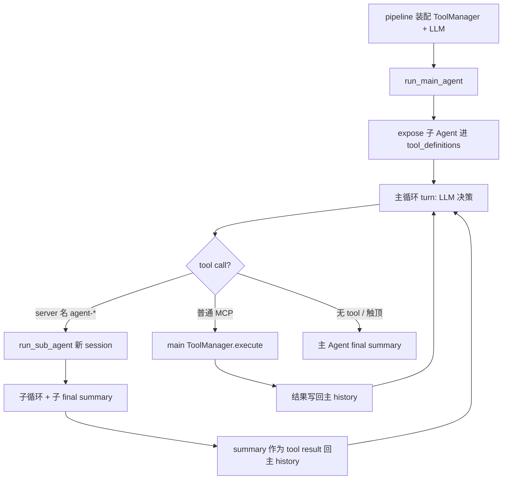

# Main–Sub Agent 编排 — 代码精读与面试深挖

> 对应简历：问数结果深度研究 · 第二点（Main–Sub Agent 编排）
> 题纲：[`../面试题纲.md`](../面试题纲.md) § 三 E13–E16
> 索引本：[`02-面试问答.md`](./02-面试问答.md)（E 节已迁出至本文）
> 设计规格：[`../../../superpowers/specs/2026-08-05-main-sub-agent-deep-dive-design.md`](../../../superpowers/specs/2026-08-05-main-sub-agent-deep-dive-design.md)
> 复习标本：`miro-flow-solution`（对齐工程细节；面试不主动对比 MiroFlow，不宣称「我发明框架」）

---

## 0. 目标与诚实边界

### 0.1 本文做什么

- 按一次任务跑通 Main→Sub→回传→final summary 的调用链，贴关键代码并注释。
- 钉死「简历并发」与「标本顺序执行」的可答辩关系。
- 承接原 `02` E13–E16 详答，供面试深挖。

### 0.2 本文不做什么

- Hybrid Search / MCP 98% / GAIA 断点续跑全文 / Java↔Python 集成契约 / 完整 TaskTracer 回放教程。

### 0.3 诚实边界总表

| 说法 | 可讲 | 不可讲 |
|------|------|--------|
| 子会话隔离 | 新 `message_history` + 独立 session；只回传 summary | 「子 Agent 共享主会话全量上下文」 |
| 动态拆分 | 主 Agent 按 tool 描述决定是否委派 | 「每类问题写死固定角色路由表」（无额外依据时） |
| 并发 | 架构可并行无依赖子任务；业务需另加并发/超时/隔离 | 标本 `for` 说成已 `gather`；把 `10` 说成同时跑 10 个 |
| 结构化报告 | 逻辑结构（结论/证据/缺口/不确定性）；标本多为自然语言 summary | 「代码级 JSON schema 强校验已落地」 |
| 归属 | 工程 harness owner；标本对齐细节 | 「我发明了这套编排框架」 |

---

## 1. 架构总览

### 1.1 角色

| 角色 | 职责 | 标本依据 |
|------|------|----------|
| Main Agent | 拆任务、选工具/子 Agent、汇总最终答案 | `run_main_agent`；工具偏轻（如 `tool-reasoning`） |
| Sub Agent（如 `agent-worker`） | 独立会话内检索/阅读/代码等，产出 summary | `run_sub_agent`；工具更重 |
| Tool 化外壳 | `agent-` 前缀暴露为可调用工具 | `expose_sub_agents_as_tools` |
| TaskTracer | 主/子 history 分存；`session_id = {name}_{counter}` | `start_sub_agent_session` |

### 1.2 一次任务数据流



### 1.3 配置骨架（标本示例，非业务最优）

以 `config/agent_llm_qwen37plus.yaml` 为准列出 Main/Sub 的 `llm`、`tool_config`、`max_turns`、`max_tool_calls_per_turn`；注明 Main/Sub llm 块分开故**支持**异构，GAIA 示例通常同模。

---

## 2. 调用链精读①：配置装配

### 2.1 配置先定义 Main/Sub 的能力边界

`main_agent` 与 `sub_agents.agent-worker` 各自拥有独立的 LLM、工具和轮次预算。以下仅删除密钥、采样参数等环境噪音，保留影响编排的关键字段。

文件：`config/agent_llm_qwen37plus.yaml:7-67`

```yaml
main_agent:
  prompt_class: MainAgentPrompt_GAIA
  llm:
    model_name: "qwen3.7-plus"
  tool_config:
    - tool-reasoning
  max_turns: 20
  max_tool_calls_per_turn: 10

sub_agents:
  agent-worker:
    prompt_class: SubAgentWorkerPrompt
    llm:
      model_name: "qwen3.7-plus"
    tool_config:
      - tool-searching
      - tool-reading
      - tool-code
      - tool-image-video
      - tool-audio
    max_turns: 50
    max_tool_calls_per_turn: 10
```

旁注：

- Main Agent 只配置 `tool-reasoning`，负责规划、委派与汇总；`agent-worker` 持有搜索、阅读、代码和多模态等执行工具。
- Main/Sub 的 `llm` 配置块相互独立，因此架构上支持异构模型；这份 GAIA 示例恰好都使用 `qwen3.7-plus`，不能据此说成只能同模。
- `max_turns` 是会话轮次上限，`max_tool_calls_per_turn` 是单轮工具调用上限；后者不等于并发数。

### 2.2 `create_pipeline_components`：按 Agent 隔离 ToolManager

文件：`src/core/pipeline.py:200-234`

```python
def create_pipeline_components(cfg: DictConfig, logs_dir: str | None = None):
    """
    Creates and initializes the core components of the agent pipeline.

    Args:
        cfg: The Hydra configuration object.

    Returns:
        Tuple of (main_agent_tool_manager, sub_agent_tool_managers, output_formatter)
    """
    # Create ToolManagers for main agent and sub-agents
    main_agent_mcp_server_configs, main_agent_blacklist = create_mcp_server_parameters(
        cfg, cfg.main_agent, logs_dir
    )
    main_agent_tool_manager = ToolManager(
        main_agent_mcp_server_configs,
        tool_blacklist=main_agent_blacklist,
    )

    sub_agent_tool_managers = {}
    if cfg.sub_agents is not None and cfg.sub_agents:
        for sub_agent in cfg.sub_agents:
            sub_agent_mcp_server_configs, sub_agent_blacklist = (
                create_mcp_server_parameters(cfg, cfg.sub_agents[sub_agent], logs_dir)
            )
            sub_agent_tool_manager = ToolManager(
                sub_agent_mcp_server_configs,
                tool_blacklist=sub_agent_blacklist,
            )
            sub_agent_tool_managers[sub_agent] = sub_agent_tool_manager

    # Create OutputFormatter
    output_formatter = OutputFormatter()

    return main_agent_tool_manager, sub_agent_tool_managers, output_formatter
```

旁注：Main Agent 创建一个 `ToolManager`；每个 Sub Agent 也分别创建一个 `ToolManager`，再按子 Agent 名称放入字典。这不是把所有工具塞进同一个全局管理器，而是在装配期落实工具集合与黑名单隔离。`create_mcp_server_parameters` 会依据各自的 `tool_config` 加载工具配置。

### 2.3 `execute_task_pipeline`：运行时入口完成 LLM 与 Orchestrator 装配

文件：`src/core/pipeline.py:111-155`

```python
        # Initialize main agent LLM client
        # Require agent-specific LLM configuration
        if hasattr(cfg.main_agent, "llm") and cfg.main_agent.llm is not None:
            main_agent_llm_client = LLMClient(
                task_id=task_id, llm_config=cfg.main_agent.llm
            )
        else:
            raise ValueError(
                "No LLM configuration found in main_agent. Please ensure the agent configuration includes an LLM section."
            )

        # Initialize sub agent LLM client
        # Require agent-specific LLM configuration for sub-agents
        if cfg.sub_agents is not None and cfg.sub_agents:
            first_sub_agent = next(iter(cfg.sub_agents.values()))
            if hasattr(first_sub_agent, "llm") and first_sub_agent.llm is not None:
                sub_agent_llm_client = LLMClient(
                    task_id=f"{task_id}_sub", llm_config=first_sub_agent.llm
                )
            else:
                raise ValueError(
                    "No LLM configuration found in sub-agent. Please ensure the agent configuration includes an LLM section."
                )
        else:
            sub_agent_llm_client = None
            logger.info("No sub agents defined, using main agent only for the task")

        # Initialize orchestrator
        orchestrator = Orchestrator(
            main_agent_tool_manager=main_agent_tool_manager,
            sub_agent_tool_managers=sub_agent_tool_managers,
            llm_client=main_agent_llm_client,
            sub_agent_llm_client=sub_agent_llm_client,
            output_formatter=output_formatter,
            task_log=task_log,
            cfg=cfg,
            human_interaction=human_interaction,
        )

        task_log.status = "running"
        final_answer, final_boxed_answer = await orchestrator.run_main_agent(
            task_description=task_description,
            task_file_name=task_file_name,
            task_id=task_id,
        )
```

旁注：真正的 Python 运行时入口是 pipeline。它从配置创建 Main/Sub 的 `LLMClient`，把 LLM、两个层级的 `ToolManager`、日志与配置注入 `Orchestrator`，最后调用 `run_main_agent`。当前实现只读取第一个 Sub Agent 的 LLM 配置并复用一个 `sub_agent_llm_client`，所以「配置结构支持异构」不等于「多个 Sub Agent 已逐个实例化不同 LLMClient」。

### 面试时怎么说

1. 我先用 YAML 把 Main 与 Sub 的模型、工具和预算边界配置化，Main 偏规划汇总，Sub 偏执行。
2. pipeline 装配时，Main 有一个独立 `ToolManager`，每个 Sub 也各有一个，工具权限不是全局共享。
3. `execute_task_pipeline` 再创建 LLM client 和 `Orchestrator`，由 `run_main_agent` 正式进入编排循环。
4. 配置块允许 Main/Sub 选不同模型，但这份标本当前只从第一个 Sub 配置创建共享的 Sub LLM client，我会明确区分架构能力与现状。

### 易踩坑

- 不要说「整个 Data Agent 都在 Python 里装配」：这里只能证明深度研究 Agent harness 的 Python 装配链；Data Agent 主体还涉及 Java/Spring 等边界。
- 不要把 `max_tool_calls_per_turn: 10` 解释成同时并发 10 个工具，它只是单轮调用数量上限。
- 不要仅凭 Main/Sub 各有 `llm` 块就宣称多个 Sub Agent 已实现逐角色异构模型；当前 pipeline 取的是 `first_sub_agent`。

**下一跳：** §3 继续看配置中的 Sub Agent 如何被转换成 Main Agent 可见的工具。

## 3. 调用链精读②：子 Agent 工具化

### 3.1 `expose_sub_agents_as_tools`：把配置项转换为工具定义

文件：`src/utils/tool_utils.py:87-105`

```python
def expose_sub_agents_as_tools(sub_agents_cfg: DictConfig):
    """Expose sub-agents as tools"""
    sub_agents_server_params = []
    for sub_agent in sub_agents_cfg.keys():
        if not sub_agent.startswith("agent-"):
            raise ValueError(
                f"Sub-agent name must start with 'agent-': {sub_agent}. Please check the sub-agent name in the agent's config file."
            )
        try:
            sub_agent_prompt_instance = _load_agent_prompt_class(
                sub_agents_cfg[sub_agent].prompt_class
            )
            sub_agent_tool_definition = sub_agent_prompt_instance.expose_agent_as_tool(
                subagent_name=sub_agent
            )
            sub_agents_server_params.append(sub_agent_tool_definition)
        except Exception as e:
            raise ValueError(f"Failed to expose sub-agent {sub_agent} as a tool: {e}")
    return sub_agents_server_params
```

旁注：函数遍历 Sub Agent 配置，按 `prompt_class` 动态加载 Prompt 类，再调用其 `expose_agent_as_tool` 生成工具定义。名称必须以 `agent-` 开头；这既是配置校验，也是后续执行阶段区分「普通 MCP 工具」与「子 Agent 工具」的协议约定。

### 3.2 `SubAgentWorkerPrompt.expose_agent_as_tool`：定义委派契约

文件：`config/agent_prompts/sub_worker.py:229-247`

```python
    def expose_agent_as_tool(self, subagent_name: str) -> dict:
        tool_definition = dict(
            name=subagent_name,
            tools=[
                dict(
                    name="execute_subtask",
                    description="This tool is an agent that performs various subtasks to collect information and execute specific actions. It can access the internet, read files, program, and process multimodal content, but is not specialized in complex reasoning or logical thinking. The tool returns processed summary reports rather than raw information - it analyzes, synthesizes, and presents findings in a structured format. The subtask should be clearly defined, include relevant background, and focus on a single, well-scoped objective. It does not perform vague or speculative subtasks. \nArgs: \n\tsubtask: the subtask to be performed. \nReturns: \n\tthe processed summary report of the subtask. ",
                    schema={
                        "type": "object",
                        "properties": {
                            "subtask": {"title": "Subtask", "type": "string"}
                        },
                        "required": ["subtask"],
                        "title": "execute_subtaskArguments",
                    },
                )
            ],
        )
        return tool_definition
```

旁注：

- 对 Main Agent 暴露的动作名是 `execute_subtask`，入参只有必填的 `subtask` 字符串；因此 Main 需要把背景、目标与范围写进这段委派指令。
- 描述明确承诺返回 **processed summary reports**，而不是原始搜索结果。也就是说，Sub Agent 先分析、综合并结构化表达，再把摘要作为工具结果交还 Main。
- 工具定义描述的是调用契约，不代表此刻已执行子 Agent；真正执行发生在主循环选择该工具之后。

### 3.3 主循环合并普通工具与子 Agent 工具

文件：`src/core/orchestrator.py:994-1000`

```python
        # 2. Get tool definitions
        tool_definitions = await self.main_agent_tool_manager.get_all_tool_definitions()
        if self.cfg.sub_agents is not None and self.cfg.sub_agents:
            tool_definitions += expose_sub_agents_as_tools(self.cfg.sub_agents)
        if self._human_feature_enabled("allow_ask_user"):
            tool_definitions.append(ASK_USER_TOOL_DEFINITION)
        if not tool_definitions:
```

旁注：`run_main_agent` 先取得 Main 自身的普通工具，再把 Sub Agent 的工具定义追加到同一份 `tool_definitions`。LLM 看到的是统一工具面，因而可以依据名称、描述和 schema 在运行时决定直接用普通工具，还是调用 `agent-worker.execute_subtask`。

### 面试时怎么说

子 Agent 在 Main Agent 眼里就是一种可调用工具。系统从配置动态生成工具定义，Main 根据当前问题和工具描述决定是否委派，并把明确的 `subtask` 交给它；因此这是 LLM 驱动的动态委派，不是代码里写死「某类问题固定路由到某角色」的路由表。Sub 完成后返回处理过的 summary report，Main 再继续推理和汇总。

### 易踩坑

- 不要把 expose 说成子 Agent 共享主 history：这里只是把子 Agent 的调用契约加入主工具列表；会话是否隔离要看后续 `run_sub_agent` 的新 `message_history` 与 session 实现。
- 不要漏掉 `agent-` 前缀，它是暴露阶段的硬校验，也是后续识别子 Agent 工具的约定。
- 不要把 `execute_subtask` 的返回说成原始网页、文件或工具日志；描述明确要求 processed summary reports。

**下一跳：** §4 将沿着 `run_main_agent` 主循环，继续追踪模型如何选择并执行这些工具。

## 4. 调用链精读③：主循环

（任务 3 填充）

## 5. 调用链精读④：`run_sub_agent`

（任务 3 填充）

## 6. 调用链精读⑤：主 Agent final summary

（任务 4 填充）

## 7. 预算与熔断

（任务 4 填充）

## 8. 专节：顺序执行 vs 简历「并发」

（任务 5 填充）

## 9. 面试题索引（E13–E16）

（任务 6 填充）

## 10. 回看清单

（任务 6 填充）
