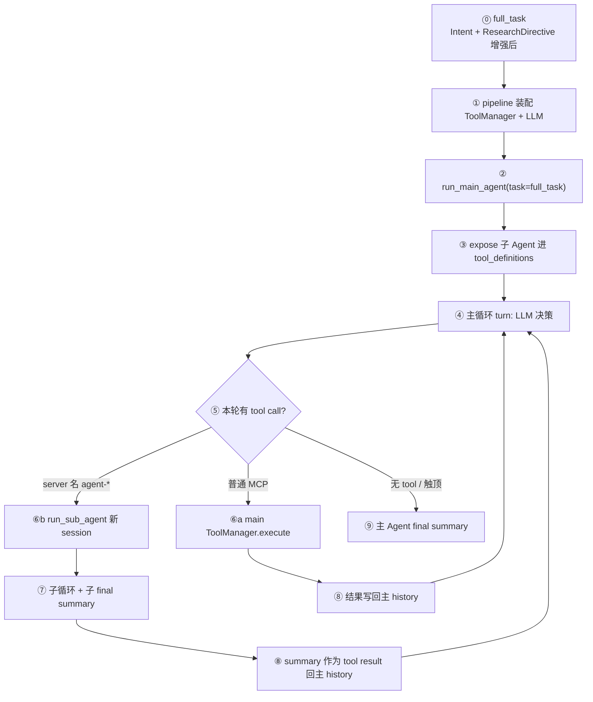
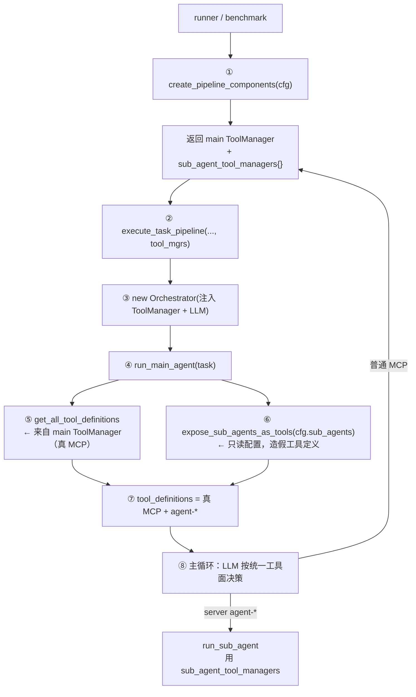

# Main–Sub Agent 编排 — 代码精读与面试深挖

> 对应简历：问数结果深度研究 · 第二点（Main–Sub Agent 编排）
> 题纲：[`../面试题纲.md`](../面试题纲.md) § 三 E13–E16
> 索引本：[`02-面试问答.md`](./02-面试问答.md)（E 节已迁出至本文）
> 设计规格：[`../../../superpowers/specs/2026-08-05-main-sub-agent-deep-dive-design.md`](../../../superpowers/specs/2026-08-05-main-sub-agent-deep-dive-design.md)
> 复习标本：`miro-flow-solution`（对齐工程细节；面试不主动对比 MiroFlow，不宣称「我发明框架」）

---

## 0. 目标与诚实边界

### 0.1 本文做什么

- **先接上游**：用户从 Chat 触发深度研究后，请求如何经 Java 网关、Python Intent / query enhance，落到 `execute_task_pipeline`（§1.2）。
- **Prompt 可答辩**：Main/Sub **段落大纲 + 每段职责**（§4），勿默写全文；含「工具开篇」与 cache 的诚实口径。
- 再按一次任务跑通 Main→Sub→回传→final summary 的调用链（§1.3 / §2–§3 / §6–§7）；Prompt 见 §4；**代码只贴签名与关键分支**，其余用文字概括。
- 钉死「简历并发」与「标本顺序执行」的可答辩关系。
- 承接原 `02` E13–E16 详答，供面试深挖。

### 0.2 本文不做什么

- **预算熔断、两类并发、TaskTracer 回放、断点续跑** 的完整详解 → [`05-工程化能力.md`](./05-工程化能力.md) §2–§4（G21–G24）。
- **Hybrid Search / MCP** 全文 → [`04-Hybrid-Search-MCP.md`](./04-Hybrid-Search-MCP.md)（F17–F20）。
- Java↔Python 契约、SSE、权限配额、SQLite 状态机的**全文**仍在 [`01-集成设计.md`](./01-集成设计.md)；本文只保留「进到 Main–Sub 之前」的衔接，避免与编排精读脱节。
- 主循环里「单轮 tool 过多如何截断」见 [§3.4](#34-工具执行截断--顺序-await--三路分流) 与 [§8](#8-预算与熔断) 短指针；G22/G23 追问表不在本文展开。

### 0.3 诚实边界总表

| 说法 | 可讲 | 不可讲 |
|------|------|--------|
| 子会话隔离 | 新 `message_history` + 独立 session；只回传 summary | 「子 Agent 共享主会话全量上下文」 |
| 动态拆分 | 主 Agent 按 tool 描述决定是否委派 | 「每类问题写死固定角色路由表」（无额外依据时） |
| 并发 | 架构可并行无依赖子任务；业务需另加并发/超时/隔离 | 标本 `for` 说成已 `gather`；把 `10` 说成同时跑 10 个 |
| 结构化报告 | 逻辑结构（结论/证据/缺口/不确定性）；标本多为自然语言 summary | 「代码级 JSON schema 强校验已落地」 |
| 归属 | 工程 harness owner；标本对齐细节 | 「我发明了这套编排框架」 |

---

## 1. 架构总览

### 1.1 角色

| 角色 | 职责 | 标本依据 |
|------|------|----------|
| Main Agent | 拆任务、选工具/子 Agent、汇总最终答案 | `run_main_agent`；工具偏轻（如 `tool-reasoning`） |
| Sub Agent（如 `agent-worker`） | 独立会话内检索/阅读/代码等，产出 summary | `run_sub_agent`；工具更重 |
| Tool 化外壳 | `agent-` 前缀暴露为可调用工具 | `expose_sub_agents_as_tools` |
| TaskTracer | 主/子 history 分存；`session_id = {name}_{counter}` | `start_sub_agent_session` |

### 1.2 上游衔接：用户 query 如何进到 Main–Sub

本文 §1.3 起的 ①–⑨ 是**编排运行时**。业务里用户并不是直接调用 `run_main_agent`：先有一条「问数结果 → 深度研究 Job → 增强后的 task → pipeline」的入口链。下面只保留与 Main–Sub 衔接相关的部分；HTTP 契约 / SSE / 权限配额细节见 [`01` §3](./01-集成设计.md#3-整体架构) 与 [`01` §7.0](./01-集成设计.md#70-miro-flow-solution-内部数据流路由后架构图)。

#### 端到端：从点击到 `execute_task_pipeline`

```
[用户] Chat 结果区点「想要对结果做深度研究吗？」
   │
   ▼  POST /api/chat/research/query/{queryId}     ← 前端只传 queryId
[Java 网关]
   · 鉴权 / 配额 / 并发
   · 从 ChatQueryDO 取 question + textResult/textSummary + 维度/指标
   · 截断拼成 task + context；生成 jobId；写本地 PENDING
   · @Async POST Python /v1/research/jobs（Bearer + X-Trace-Id）
   · 立刻返回 {jobId, PENDING}（不阻塞问数主链路）
   │
   ▼
[Python FastAPI · 同步路径]
   · IntentClassifier.classify(task, context)
   ·   → (research_type, data_domain)     # 一次 LLM；失败 fallback default/unknown
   · JobStore.create(PENDING) + BackgroundTasks → run_pipeline_async
   · 立即 202
   │
            ─── 异步路径（真正跑研究）───
   ▼
[run_pipeline_async]
   ① QueryRewriter.rewrite(task, research_type)
      · default：prepend 通用归因约束
      · financial_analyst / academic：原样
   ② ResearchDirective.compose_task(...)
      · 加载 research_prompts/{type}.md（± domains/{domain}.md）
      · prepend <research_directive>...</research_directive>
      · + rewritten_task + context + length_budget
      · → full_task
   ③ asyncio.wait_for(execute_task_pipeline(task=full_task, …), 14min)
      · ★ 此处进入本文 §1.3 的 ①–⑨ Main–Sub 编排
   ④ enforce_length_budget → ReportStore → JobStore COMPLETED/FAILED
```

面试一句话：**路由不换 Main 的 `prompt_class`，只增强交给 pipeline 的用户任务文本；编排骨架始终是同一套 Main–Sub。**

#### Python 内部三层 vs 本文编排

| 层 | 组件 | 产出 | 与本文关系 |
|----|------|------|------------|
| 分类 | IntentClassifier | `research_type` + 可选 `data_domain` | 决定**怎么 enhance**，不决定 Main/Sub 配置类 |
| 轻量改写 | QueryRewriter | `rewritten_task` | 多数 type 几乎不动原文 |
| **Query enhance** | ResearchDirective | `full_task`（directive + 用户任务 + context） | **`run_main_agent` 的首条用户消息来源** |
| 编排运行时 | `execute_task_pipeline` → Orchestrator | final_answer / boxed_answer | 本文 §1.3–§8 |

对应代码骨架（业务包装；标本 `miro-flow` 本体从 `execute_task_pipeline` 起）：

```python
# 业务侧 pipeline_adapter.run_pipeline_async（示意；详见 01 §7.8）
rewritten_task = await rewriter.rewrite(task, research_type)
full_task = directive.compose_task(
    research_type=research_type,
    data_domain=data_domain,
    user_task=rewritten_task,
    context=context,
    length_budget=length_budget,
)
# ↓ 以下才是本文精读的 Main–Sub 入口
final_answer, boxed_answer, log_path = await run_with_timeout(
    execute_task_pipeline(..., task=full_task, ...),
    timeout_s=14 * 60,
)
```

#### 易混点（与 §2.1 `prompt_class` 对照）

| 概念 | 何时定 | 作用 |
|------|--------|------|
| `prompt_class`（如 `MainAgentPrompt_GAIA`） | Hydra **配置期** | Main/Sub 的编排角色类；不随每条 Job 热切换 |
| `research_type`（`financial_analyst` / `academic` / `default`） | **每条 Job** Intent 分类 | 选研究指导模板，拼进 `full_task` |
| `data_domain` | 仅金融增强下可选 | `domains/*.md` 补丁，不是第四种平行 type |

更细的 Intent / 模板 / 命名口径见 [`01` §3.3](./01-集成设计.md#33-python-内部处理流意图识别--分发--执行)、[`01` §7.4 IntentClassifier](./01-集成设计.md#74-intentclassifier路由分类--演进锚点-2) 与 [`01` §7.5 ResearchDirective](./01-集成设计.md#75-researchdirectivetype-specific-研究指导-prompt)。

### 1.3 一次任务数据流（编排运行时 ①–⑨）

下图从 **⓪ `full_task` 进入 pipeline** 起，按 **①→⑨** 描述标本里一次深度研究的控制流。⓪ 的来源见上一节；**⓪ 只改 task 文本，不改这里的 Main–Sub 调度骨架。**



| 步骤 | 节点在做什么 | 阅读时抓住什么 |
|------|--------------|----------------|
| ⓪ | 业务侧把问数结果 + 研究指导拼成 `full_task` | 见 §1.2；不是换一套 Agent 配置 |
| ① | `create_pipeline_components` 为 Main/各 Sub 建 **ToolManager**（真工具执行器），再经 pipeline 装配 LLM / Orchestrator | **不是**在这里 expose Sub；入口是 pipeline |
| ② | `run_main_agent(task, …)` 启动主会话 | 主会话 history 从**增强后的**用户任务开始 |
| ③ | **在 `run_main_agent` 内**调用 `expose_sub_agents_as_tools`，把 `agent-*` 并入 `tool_definitions` | 与 ① **无直接调用关系**；更晚一步，只造给 LLM 看的假工具目录 |
| ④ | 主循环按 `max_turns` 调 LLM | 每轮由模型决定：直接答、调 MCP，还是委派子 Agent |
| ⑤ | 看本轮是否产出 tool call | 无调用 / 触顶 → 跳 ⑨；有调用 → ⑥ |
| ⑥a / ⑥b | **顺序**执行本轮截断后的前 N 个调用：普通 MCP 走 ToolManager；`agent-*` 走 `run_sub_agent` | `N = max_tool_calls_per_turn`；不是并发度 |
| ⑦ | 子 Agent 独立 session + 独立 history，内部再多轮工具调用，最后生成 summary | 隔离发生在这里 |
| ⑧ | 子摘要或 MCP 结果写回**主** history，回到 ④ | 主 Agent 只看见摘要/工具结果，不看见子会话全文 |
| ⑨ | 主 Agent 基于当前主 history 做 final summary 并结束 | 触顶或失败仍可能尝试收束，不等于立刻丢弃证据 |

更细的贴码分别在 §2（①–③ 含工具化）、§3（④–⑥）、§6（⑥b–⑦）、§7（⑨）；Prompt 文案见 §4。上游 ⓪ 的 Intent / Directive 贴码与契约见 `01`。

### 1.4 配置骨架（标本示例，非业务最优）

标本中 Main 配置为 `max_turns=20`、`max_tool_calls_per_turn=10`，只挂载 `tool-reasoning` 等偏轻工具，专注规划、委派与汇总。
Sub `agent-worker` 配置为 `max_turns=50`、`max_tool_calls_per_turn=10`，持有 searching、reading、code 等更重的执行工具。
Main/Sub 的 `llm` 配置块彼此分开，因此配置结构**支持**异构模型；GAIA 示例通常为 Main/Sub 配置同一模型。
但如 [§2.5](#25-execute_task_pipeline运行时入口完成-llm-与-orchestrator-装配) 所示，当前 pipeline 常复用首个 Sub 的 LLM client，配置支持不等于多个 Sub 已各自实例化不同 client。
以上参数仅是便于精读控制流的标本示例，并非经过业务压测得出的最优配置。

---

## 2. 调用链精读①：配置装配

### 2.1 配置先定义 Main/Sub 的能力边界

`main_agent` 与 `sub_agents.agent-worker` 各自拥有独立的 LLM、工具和轮次预算。以下仅删除密钥、采样参数等环境噪音，保留影响编排的关键字段。

文件：`config/agent_llm_qwen37plus.yaml:7-67`

```yaml
main_agent:
  prompt_class: MainAgentPrompt_GAIA   # 编排角色类（配置期钉死，非每条 job 热切换）
  llm:
    model_name: "qwen3.7-plus"        # Main 可用独立模型配置
  tool_config:
    - tool-reasoning                  # Main 工具偏轻：偏规划/推理
  max_turns: 20                       # 主循环最多 20 轮
  max_tool_calls_per_turn: 10         # 单轮最多处理前 10 个 tool call（≠并发度）

sub_agents:
  agent-worker:
    prompt_class: SubAgentWorkerPrompt  # Sub 角色类
    llm:
      model_name: "qwen3.7-plus"        # 配置上可与 Main 异构；本例同模
    tool_config:                        # Sub 工具偏重：检索/阅读/代码等
      - tool-searching
      - tool-reading
      - tool-code
      - tool-image-video
      - tool-audio
    max_turns: 50                       # 子循环允许更深
    max_tool_calls_per_turn: 10
```

旁注：

- Main Agent 只配置 `tool-reasoning`，负责规划、委派与汇总；`agent-worker` 持有搜索、阅读、代码和多模态等执行工具。
- Main/Sub 的 `llm` 配置块相互独立，因此架构上支持异构模型；这份 GAIA 示例恰好都使用 `qwen3.7-plus`，不能据此说成只能同模。
- `max_turns` 是会话轮次上限，`max_tool_calls_per_turn` 是单轮工具调用上限；后者不等于并发数。

#### `prompt_class` 切换 vs Intent→Directive：模式相似，业务侧更准确叫 **query enhance**

上游如何把 `full_task` 交进来，见 [§1.2](#12-上游衔接用户-query-如何进到-mainsub)。你直觉里「按任务类型换模板」和 `01` 的 IntentClassifier → ResearchDirective **确实同一类设计模式**——都是按任务特征选择一套 prompt 变体。业务接入后更贴切的说法是：

> Intent 做完分类后，路由机制本质是 **user query enhance**：把研究指导拼进交给 Main–Sub 的 task 文本，而不是热切换 Main 的 `prompt_class`。

当前增强类型（命名以 `01` 为准）：

| `research_type` | 增强内容（概要） | 备注 |
|-----------------|------------------|------|
| `financial_analyst` | 金融分析师四步归因等核心框架；可再拼 `data_domain` 片段 | 原讨论中的「industry」已正名为金融分析师视角，覆盖更广 |
| `academic` | 学术向：双语、置信度、红队等 | |
| `default` | 通用研究指导；QueryRewriter 还可加轻量归因约束 | 分类失败也 fallback 到这里 |

| 维度 | 标本 `prompt_class`（本文） | `01` 的 query enhance（Intent → Directive） |
|------|---------------------------|-----------------------------------------------|
| 抽象模式 | 按任务特征选 prompt 变体 | 按任务特征选 prompt 变体 |
| 业务语义 | **编排角色**：怎么当 Main/Sub | **增强本条 query/task**：用什么研究套路 / 领域口径 |
| 绑定时机（标本可核对） | **启动/配置时**：一份 yaml 钉死一个类；**不是**同进程按 job 热切换 | **每条 job 运行时** prepend `<research_directive>` |
| 产物形态 | Python 角色类 | Markdown 核心模板 ± `domains/*.md` |
| 接入位置 | pipeline / orchestrator **内部** | **进入** `execute_task_pipeline` **之前** |

诚实边界：

- 标本没有「同进程按 query 换 `prompt_class`」的路由；业务侧运行时路由 = query enhance。
- `data_domain` 是金融增强下的可插拔补丁，不要说成与 `financial_analyst` / `academic` 并列的第三种「大类型」。
- 串联：enhance 先改 task → pipeline 再用（通常固定的）角色类跑 ①→⑨。

面试若被问「为什么不统一成一种路由？」：统一的是**模式**；载体不同——角色类要挂 expose/summarize，query enhance 要 Markdown 可插拔加域。

### 2.2 `create_pipeline_components`：按 Agent 隔离 ToolManager

文件：`src/core/pipeline.py:200-234`

```python
def create_pipeline_components(cfg, logs_dir=None):
    # Main / 每个 Sub 各建独立 ToolManager（按 tool_config + blacklist）
    main_agent_tool_manager = ToolManager(...)
    sub_agent_tool_managers = {name: ToolManager(...) for name in cfg.sub_agents}
    return main_agent_tool_manager, sub_agent_tool_managers, OutputFormatter()
```

旁注：Main / 每个 Sub 各建 `ToolManager`——这是**真 MCP 工具的执行器**（能 `execute_tool_call`）。调用方：`server/bridge/runner.py`、`common_benchmark.py` 等，在进 `execute_task_pipeline` **之前**先造好，再作为参数传进去。

### 2.3–2.6 和 `create_pipeline_components` 的关系（先钉死）★

**二者不是互相调用，是前后两段装配。**

| | `create_pipeline_components` | `expose_sub_agents_as_tools` |
|--|--|--|
| **何时** | pipeline / runner **启动任务时**，进 Orchestrator 之前 | **更晚**：已进入 `run_main_agent`，主循环**开始前**组 `tool_definitions` 时 |
| **哪里调** | `runner.py` / `common_benchmark.py` → 再把返回值传给 `execute_task_pipeline` | **唯一调用点**：`orchestrator.py` 的 `run_main_agent`（约 994–997 行） |
| **产出什么** | Main/Sub 的 **ToolManager 实例**（真工具执行器） | **假工具定义列表**（给 Main LLM 看的 catalog，形态像 MCP） |
| **读什么** | 各 Agent 的 `tool_config` → 挂真 MCP server | `cfg.sub_agents` + 各 Sub 的 `prompt_class.expose_agent_as_tool` |
| **不做什么** | **不**把 Sub 暴露成 Main 可调用的工具 | **不**创建 ToolManager；**不**启动 Sub |

关系一句话：

- `create_pipeline_components` → 准备好「谁能真正执行 searching/reading…」
- `expose_sub_agents_as_tools` → 让 Main **在工具菜单里看见** `agent-worker`；真跑 Sub 时走 `run_sub_agent`，用的是前面造好的 `sub_agent_tool_managers`



易混：**图里 ① 与 ⑥ 没有箭头相连**——expose **不**被 `create_pipeline_components` 调用；只是同一次任务里更晚的一步。

### 2.3 `expose_sub_agents_as_tools`：调用点与做什么

**何时 / 哪里：** `run_main_agent` 内，组装 Main 的 `tool_definitions` 时（主循环 while **之前**）。

```python
# src/core/orchestrator.py ≈ 994-997（run_main_agent 内）
tool_definitions = await self.main_agent_tool_manager.get_all_tool_definitions()
if self.cfg.sub_agents is not None and self.cfg.sub_agents:
    tool_definitions += expose_sub_agents_as_tools(self.cfg.sub_agents)
```

函数本身（`src/utils/tool_utils.py:87-105`）：

```python
def expose_sub_agents_as_tools(sub_agents_cfg):
    # 名须 agent- 开头；按 prompt_class → expose_agent_as_tool() → 「假 MCP」工具定义列表
    ...
    return sub_agents_server_params  # 尚未执行子 Agent
```

旁注：遍历 Sub 配置 → `expose_agent_as_tool` → 与 MCP **同形状**的 dict。`agent-` 前缀：配置校验 + 主循环分流协议。

### 2.4 `SubAgentWorkerPrompt.expose_agent_as_tool`：写出那份「工具说明书」

文件：`config/agent_prompts/sub_worker.py:229-247`。description 里怎么写委派见 [§4](#4-prompt-精读计划任务分发与收束)；此处只留关键 schema。

```python
def expose_agent_as_tool(self, subagent_name: str) -> dict:
    return {
        "name": subagent_name,  # 假 server 名，如 agent-worker；不是真 MCP 进程
        "tools": [{
            "name": "execute_subtask",
            "description": "... processed summary ... single, well-scoped ...",  # ← 就是「伪工具描述」
            "schema": {"required": ["subtask"], "properties": {"subtask": {"type": "string"}}},
        }],
    }
```

旁注：

- **不是**把 Sub 注册成真实 MCP Server；只是造一条同形状的工具定义，好塞进 Main 的工具列表。
- `description` = 分发说明书（能力、回传摘要、`subtask` 怎么写）——Main 读这段决定要不要委派。
- 动作名 `execute_subtask`，入参只有必填字符串 `subtask`；Main 要把背景/目标/范围写进这段委派指令。
- 此刻只是挂定义，还没跑 Sub；真执行要等主循环认出 `agent-` 前缀。

### 2.5 `execute_task_pipeline`：运行时入口完成 LLM 与 Orchestrator 装配

文件：`src/core/pipeline.py:111-155`  
（调用方已先跑完 `create_pipeline_components`，把 ToolManager 传进来。）

```python
# execute_task_pipeline 关键逻辑：
main_llm = LLMClient(..., llm_config=cfg.main_agent.llm)
# Sub：只取 first_sub_agent.llm 复用一个 client（配置可异构 ≠ 已逐角色实例化）
sub_llm = LLMClient(..., llm_config=first_sub_agent.llm) if cfg.sub_agents else None
orchestrator = Orchestrator(main_tool_mgr, sub_tool_mgrs, main_llm, sub_llm, ..., cfg=cfg)
final_answer, boxed = await orchestrator.run_main_agent(task_description, ...)
# ↑ 进入后才会调用 expose_sub_agents_as_tools（见 2.3 / 2.6）
```

旁注：真正的 Python 运行时入口是 pipeline。它从配置创建 Main/Sub 的 `LLMClient`，把 LLM、两个层级的 `ToolManager`、日志与配置注入 `Orchestrator`，最后调用 `run_main_agent`。当前实现只读取第一个 Sub Agent 的 LLM 配置并复用一个 `sub_agent_llm_client`，所以「配置结构支持异构」不等于「多个 Sub Agent 已逐个实例化不同 LLMClient」。

### 2.6 合并：真 MCP + 假工具 → 统一 `tool_definitions`

与 [§2.3](#23-expose_sub_agents_as_tools调用点与做什么) 是同一处代码，这里强调**合并语义**：

```python
# run_main_agent 内（主循环前）
tool_definitions = await self.main_agent_tool_manager.get_all_tool_definitions()  # 真 MCP
tool_definitions += expose_sub_agents_as_tools(self.cfg.sub_agents)               # 假工具
# 可选再 + ask_user
# → 交给 generate_system_prompt_with_mcp_tools / 主循环 LLM
```

旁注：LLM 看到**统一工具面**。选 `agent-*` 时主循环转 `run_sub_agent`（§3），**不走** `ToolManager.execute`；Sub 内部再用 `sub_agent_tool_managers[name]` 调真 MCP。

### 面试时怎么说

1. 我先用 YAML 把 Main 与 Sub 的模型、工具和预算边界配置化，Main 偏规划汇总，Sub 偏执行。
2. **先** `create_pipeline_components`：为 Main/各 Sub 建独立 `ToolManager`（真工具执行器）。
3. **再** `execute_task_pipeline` → `Orchestrator` → `run_main_agent`。
4. **进入 `run_main_agent` 后、主循环前**：`expose_sub_agents_as_tools` 把 Sub 挂成 Main 可见的假工具，与真 MCP 拼成 `tool_definitions`——**不是** `create_pipeline_components` 里做的。
5. 配置块允许 Main/Sub 选不同模型，但这份标本当前只从第一个 Sub 配置创建共享的 Sub LLM client，我会明确区分架构能力与现状。

### 易踩坑

- 不要说「整个 Data Agent 都在 Python 里装配」：这里只能证明深度研究 Agent harness 的 Python 装配链；Data Agent 主体还涉及 Java/Spring 等边界。
- 不要把 `max_tool_calls_per_turn: 10` 解释成同时并发 10 个工具，它只是单轮调用数量上限。
- 不要仅凭 Main/Sub 各有 `llm` 块就宣称多个 Sub Agent 已实现逐角色异构模型；当前 pipeline 取的是 `first_sub_agent`。
- **不要说 expose 是 `create_pipeline_components` 调的**——调用点在 `run_main_agent`；前者造执行器，后者造给 LLM 看的目录。
- 把「伪工具」说成封装成真实 MCP Server——错；形态像工具，执行是 `run_sub_agent`。
- 把 expose 说成 Sub 共享主 history——错；这里只挂调用契约。

**下一跳：** [§3 主循环](#3-调用链精读主循环)；计划/委派/收束文案见 [§4](#4-prompt-精读计划任务分发与收束)。

## 3. 调用链精读②：主循环

文件：`src/core/orchestrator.py`（`run_main_agent` 内 `# 4. Main loop: LLM <-> Tools` 起，约 1052–1258）。  
前接 §2.3–2.6 工具挂载；后接 §4 Prompt、§6 委派、§7 收束、§8 预算、§9 顺序执行——都锚在这段——**尽量按源码读通**，下面只略去计时/日志噪音。

### 3.1 进入循环前（锚点）

```python
# … 前面已就绪：message_history / tool_definitions（含 agent-*）/ system_prompt …

max_turns = self.cfg.main_agent.max_turns
if max_turns < 0:
    max_turns = sys.maxsize
turn_count = 0
task_failed = False

while turn_count < max_turns:
    turn_count += 1
    # ↓ 3.2 LLM 一轮
    # ↓ 3.3 无 tool / 失败则 break
    # ↓ 3.4 有 tool → 顺序执行并写回 history，继续 while
# ↓ 3.5 循环外：置 task_failed（若触顶）→ final summary
```

### 3.2–3.3 每轮：调 LLM → 判退出

```python
    (
        assistant_response_text,
        should_break,
        tool_calls,
    ) = await self._handle_llm_call_with_logging(
        system_prompt,
        message_history,
        tool_definitions,
        turn_count,
        f"Main agent turn {turn_count}",
        keep_tool_result=keep_tool_result,
        agent_type="main",
    )

    # A. LLM 有文本
    if assistant_response_text:
        if should_break:
            break                          # 模型侧主动结束
    else:
        # B. LLM 失败 / context_limit → 标记失败，去收束
        task_failed = True
        break

    # C. 无工具调用 → 成功提前停（稍后收束，task_failed 仍为 False）
    if (
        tool_calls is None
        or len(tool_calls) < 2
        or (len(tool_calls[0]) == 0 and len(tool_calls[1]) == 0)
    ):
        break

    # D. 有工具 → 进入 3.4
```

旁注：`_handle_llm_call_with_logging` 内部在拿到 assistant 文本后，调 `llm_client.extract_tool_calls_info(...)` → 通常落到 `parse_llm_response_for_tool_calls`。  
`tool_calls` 是 **`(valid_list, bad_list)`** 二元组，**不是** Pydantic 模型。  
**无 tool 只是 break 循环**；真正写 FINAL ANSWER 在循环外的 summary（§7 / §4 收束）。

### 3.2a LLM 输出怎么变成「有字段的 tool call」？★（不是 Pydantic）

**诚实口径：主循环不靠 Pydantic / `response_format` 强校验 LLM 每轮输出。**  
标本里 Pydantic 主要用于 `TaskTracer` 落盘、评测侧抽答案等，**不**用于约束 Main/Sub 的 tool-call 回合。

「看起来有 `server_name` / `tool_name` / `arguments`」靠三层**软契约**：

| 层 | 做什么 | 能否硬保证字段 |
|----|--------|----------------|
| ① Prompt | 规定 `<use_mcp_tool>` XML；须含 `server_name` / `tool_name` / `arguments`；arguments 为 JSON | 只能「教」模型 |
| ② 解析 | `parse_llm_response_for_tool_calls`（`src/utils/parsing_utils.py`）用**正则**抠标签，再 `robust_json_loads` 解析 arguments | 抠得出 → valid；否则 → bad |
| ③ 回灌 | `tool_calls[1]` 格式错误 → 合成 `re-think` 写回 history，下轮改格式 | 容错，不是 ValidationError |

**解析产物**（手写 dict shape）：

```python
# valid 每一项：
{"server_name": "...", "tool_name": "...", "arguments": {...}, "id": ... | None}
# 返回：(valid_tool_calls, bad_tool_calls)
```

**Qwen / Anthropic 路径（标本常用）——正则抽 XML：**

```python
# parsing_utils.parse_llm_response_for_tool_calls（文本分支，缩略）
re.findall(
    r"<use_mcp_tool[^>]*?>\s*"
    r"<server_name[^>]*?>(.*?)</server_name>\s*"
    r"<tool_name[^>]*?>(.*?)</tool_name>\s*"
    r"<arguments[^>]*?>\s*([\s\S]*?)\s*</arguments>\s*"
    r"</use_mcp_tool>",
    text, re.DOTALL | re.IGNORECASE,
)
# 残缺标签 → bad_tool_calls；arguments 字符串 → robust_json_loads（json/json5/转义修复）
```

**部分 OpenAI 路径**：原生 `tool_calls`，从 `name` 里 `rsplit("-")` 拆 `server_name`/`tool_name`——同样不是业务侧 Pydantic。

要点：编排器**假定** valid 项上有这些键，因为解析器**按此组装**；**没有**再按每个工具 JSONSchema 做 Pydantic 校验（例如不在解析阶段强制 `subtask` 必填）。缺参多在 execute / Sub 侧暴露；格式烂了走 `re-think`，不是 schema reject。

面试勿说「用 Pydantic 保证 LLM 输出结构」。应说：**Prompt 约定 XML → 正则解析成固定 dict → 坏格式回灌；参数级校验靠工具/执行侧。**

### 3.4 工具执行：截断 + 顺序 `await` + 三路分流

```python
    tool_calls_data = []
    all_tool_results_content_with_id = []

    max_tool_calls = self.cfg.main_agent.max_tool_calls_per_turn
    tool_calls_exceeded = (
        len(tool_calls) > 0 and len(tool_calls[0]) > max_tool_calls
    )
    # 超出只告警；真正执行用切片截断前 N 个（N ≠ 并发度）

    # 注释原文：Execute tool calls (in sequence)
    for call in tool_calls[0][:max_tool_calls]:
        server_name = call["server_name"]
        tool_name = call["tool_name"]
        arguments = call["arguments"]
        call_id = call["id"]

        try:
            if server_name == "human" and tool_name == "ask_user":
                tool_result = await self._ask_user_tool(arguments)

            elif server_name.startswith("agent-"):
                # ★ 委派：新 session；返回摘要字符串，再包成普通 tool_result
                sub_agent_result = await self.run_sub_agent(
                    server_name, str(arguments), keep_tool_result
                )
                tool_result = {
                    "server_name": server_name,
                    "tool_name": tool_name,
                    "result": sub_agent_result,
                }

            else:
                # 真 MCP：searching / reading / …
                tool_result = await self.main_agent_tool_manager.execute_tool_call(
                    server_name=server_name,
                    tool_name=tool_name,
                    arguments=arguments,
                )

            tool_calls_data.append({...})          # 审计用
        except Exception as e:
            tool_result = {"server_name": ..., "tool_name": ..., "error": error_msg}
            tool_calls_data.append({...})

        # 格式化后按 call_id 攒结果（供下一轮 LLM 读）
        tool_result_for_llm = self.output_formatter.format_tool_result_for_user(
            tool_result
        )
        all_tool_results_content_with_id.append((call_id, tool_result_for_llm))

    # 解析失败的伪调用 → 回灌错误提示，让模型重试格式
    if len(tool_calls) > 1 and len(tool_calls[1]) > 0:
        tool_result = {
            "result": f"Your tool call format was incorrect... {tool_calls[1][0]['error']}",
            "server_name": "re-think",
            "tool_name": "re-think",
        }
        all_tool_results_content_with_id.append(("FAILED", ...))

    # 写回 Main history → while 下一轮
    message_history = self.llm_client.update_message_history(
        message_history, all_tool_results_content_with_id, tool_calls_exceeded
    )
```

三条必须钉死：

1. **顺序执行**：`for` + 逐个 `await`；无 `gather`。Prompt 还要求每步 ideally 1 次 tool；`max_tool_calls_per_turn` 是违规连发时的**截断**，不是并发度。  
2. **三路分流**：`human.ask_user` / `agent-*` → `run_sub_agent` / 其余 → `ToolManager`。  
3. **委派结果协议同 MCP**：Sub 的 `final_answer_text` 放进 `tool_result["result"]`，再带 `call_id` 进 history。

### 3.5 循环结束 → 统一收束

```python
# while 结束之后：
if turn_count >= max_turns:
    if not task_failed:
        task_failed = True                 # 触顶也算失败语境
    # log max_turns_reached
else:
    # log main_loop_completed（含「无 tool 提前停」）

final_answer_text = await self._handle_summary_with_context_limit_retry(
    ...,
    task_failed,                           # 只影响收束提示词是否插入失败声明
    ...
)
```

#### `task_failed` 触发逻辑（Main / Sub 同构）

初始：`task_failed = False`。它**不是**「跳过 summary」开关，只影响 `generate_summarize_prompt(..., task_failed=)` 是否多一段「必须承认失败」。

| 循环内发生了什么 | `task_failed` | 依据 |
|------------------|---------------|------|
| LLM 返回空 / 调用失败（含超时等，`assistant_response_text` 为空） | **→ True** 后 `break` | `orchestrator` 约 1082–1099 |
| 第三返回值是 `"context_limit"`（上下文触顶） | **→ True** 后 `break` | 同上分支（先打不同 log） |
| 有文本且 `should_break` | **保持 False**，`break` | 模型侧主动结束，不当失败 |
| **无 tool call**（成功提前停） | **保持 False**，`break` | 约 1101–1108 |
| 工具执行抛错 | **不改**（错误写进该次 tool result） | for 内 except，不置位 |
| 单轮 tool 过多被截断 | **不改**（只设 `tool_calls_exceeded`） | |

| 循环结束后 | `task_failed` |
|------------|---------------|
| `turn_count >= max_turns` 且此前仍是 False | **→ True**（触顶补标） |
| 已因 LLM 失败标过 True | 保持 True |

| 收束阶段额外 | |
|--------------|--|
| `_handle_summary_with_context_limit_retry` 因 context 裁 history 重试 | 一旦裁掉对话对，会再 **`task_failed = True`**（信息已丢） |

**一句话：** 只有「LLM 挂了 / context 爆了 / 跑满 max_turns（含 summary 重试裁历史）」才标失败；**无 tool 正常收工不算失败。** Sub 的 `run_sub_agent` 同一套逻辑。

### 主循环步骤 ↔ 后文章节

| 主循环步骤 | 后文 |
|------------|------|
| `tool_definitions` 含 `agent-*` | §2.3–2.6 伪工具挂载 |
| LLM 文本 → `server_name`/`tool_name`/`arguments` | §3.2a（正则解析，**非** Pydantic） |
| `startswith("agent-")` → `run_sub_agent` | §6 |
| 无 tool / 触顶 / 失败 → summary | §4 收束、§7 |
| `max_turns` / `max_tool_calls_per_turn` | §8 |
| `for` + `await` in sequence | §9 |

### 面试时怎么说

> Main 是有轮次上限的 LLM—Tool 闭环：每轮先 `_handle_llm_call_with_logging`；文本里用正则/`parse_llm_response_for_tool_calls` 抽出 `server_name`/`tool_name`/`arguments`（**不是** Pydantic 强校验）；无 tool 或失败就 break；有 tool 则截断后**顺序**执行——`agent-*` 转 `run_sub_agent`。循环外走 summary，用 `task_failed` 区分是否承认未完成。

### 易踩坑

- 把「一轮多个 tool calls」说成已并发——标本是 `in sequence`。  
- 把 `max_tool_calls_per_turn` 说成并发 worker 数。  
- 说所有工具都会开子 Agent——只有 `agent-` 前缀。  
- 说无 tool 就直接当最终答案、不再 summary——错，收束在循环外。  
- 说触顶/失败就跳过 summary——错，仍会收束。  
- **说主循环用 Pydantic 保证 LLM 输出字段**——错；是 Prompt XML 约定 + 正则解析 + 坏格式 `re-think` 回灌。

**下一跳：** Prompt 精读见 [§4](#4-prompt-精读计划任务分发与收束)；执行委派见 [§6](#6-调用链精读run_sub_agent)。

## 4. Prompt 精读：计划、任务分发与收束

面试高频追问：「Main 的 prompt 里怎么写计划 / 怎么分发任务？」**不要背全文**——背**段落大纲 + 每段在管什么**；原文核对：`config/agent_prompts/main_agent_prompt_gaia.py`、`sub_worker.py`。

| 层 | 写在哪 | 管什么 |
|----|--------|--------|
| Main 系统提示 | `MainAgentPrompt_GAIA.generate_system_prompt_with_mcp_tools` | **怎么计划、怎么调工具** |
| 子 Agent 假工具的 description | `SubAgentWorkerPrompt.expose_agent_as_tool` | **怎么委派**（详见下方专节） |
| Sub 系统提示 | `SubAgentWorkerPrompt.…` | 前半与 Main 同结构；文末 **Agent Specific** 钉执行边界 |
| 收束提示 | `generate_summarize_prompt` → 循环结束后作 **user 消息** 注入 | 何时/怎么跑见下方专节；出口汇合见 §6.3 / §7 |

诚实边界：业务 Intent / ResearchDirective 增强的是用户消息 `full_task`，**不是** Main 的 system。动态工具 JSONSchema 插在 Formatting 与 General Objective 之间。

---

### 为什么「工具使用」放在开篇？

**为了更稳定，不是更显眼。** 前缀缓存从输入开头匹配，把工具契约/schema 等少变内容放前、用户问题与历史放后，多轮/多请求更易命中；同时让模型尽早建立调用边界，少漏调/乱调。核心是协议清晰可复用，位置只是载体。标本也是 Formatting + 工具表在前、Task Strategy 在后；源码未写「为 cache 而设计」，勿过度断言。

---

### Main 系统提示大纲（背这个）

| # | 段落 | 一句话：在讲什么 | 面试抓点 |
|---|------|------------------|----------|
| 1 | **开场** | 你有一组工具；每消息只用一个；逐步用、下一条消息才给结果；带今日日期 | 设定「工具循环」世界观 |
| 2 | **Tool-Use Formatting** | 必须用 `<use_mcp_tool>` XML；`server_name` / `tool_name` / `arguments`；放在回复**末尾顶层**；用正则解析非严格 XML | **怎么写调用**（解析器契约） |
| 3 | **动态工具列表** | 按当前 MCP + `agent-*` 拼 JSONSchema（Description / schema） | Main 在这里「看见」可委派的 worker |
| 4 | **General Objective** | 迭代拆解、有条不紊完成任务 | 总目标一句话 |
| 5 | **Task Strategy** ★ | 见下节合并细讲 | Plan → Act → Reflect → Replan |
| 6 | **Tool-Use Guidelines** | 每步**恰好一次** tool；调用前自检已知/缺口/参数；查询须自包含；忌宽泛猜测；结果榨干再下一步 | **单步纪律** |
| 7 | **Communication Rules** | 发一次 tool 后立刻停；未完成勿给 final；勿提工具名；同语言；可不调工具直答 | **停顿边界** |
| 8 | **（可选）中文语境** | 委托/搜索/思考/输出用中文 | 提一句即可 |

#### Task Strategy（含写计划）：一段讲清

原文 `main_agent_prompt_gaia.py`（Sub 同文）。四条是一条闭环，不是「开头写完计划就结束」：

| # | 做什么 | 要点 |
|---|--------|------|
| 1 | 拆子目标并排序 | 可达成、有依赖顺序；尚未调工具 |
| 2 | **写计划** | **首次行动前**产出简洁编号列表 `1. 2. 3.`（*before taking any action*）；每步≈一个 sub-goal；自然语言即可，无 JSON/无固定路由表；写在 assistant **文本**里，同轮末尾再发**恰好 1 次** tool |
| 3 | 顺序执行 → 复盘 → **必要时**改计划 | 看完本步工具结果再下一步；*reflect* 后 *revise **if needed***（增删改步骤/换委派）；顺利则不必重打全表。*Revisit* 防漏早期线索。**无 `replan()` API**，改写在回复文本里 |
| 4 | 策略性用工具 | 工具服务当前计划步，不为调用而调用 |

金句：*numbered step-by-step plan… before taking any action*；*revise your plan **if needed***；Guidelines 另写 *do not repeat the same analysis across steps*。

**每轮要不要输出计划？** 不是。完整编号计划主要钉在**开干前**；之后每轮是「简要已知/缺口 → 选下一步工具」（Guidelines §2），**不是**每轮重抄 `1.2.3.`。进展顺、原计划仍适用 → 复盘后直接执行下一步；有新信息/碰壁才 revise。代码也不校验「有没有写计划」，靠 prompt 软约束。

运行时一圈：`（首轮：写计划）分析 + 1 次 tool → STOP → 结果回 history → 下轮复盘 → 照旧下一步 / 改计划 / 或收束`。  
一轮最多一个 Sub（或一个 MCP）；整题可跨轮多次委派。Prompt 钉死单步是为保住复盘（多数步骤有依赖）；并行只适合确认无依赖的扇出，标本默认不做。`max_tool_calls_per_turn` 是违规连发时的截断，≠并发度。

**例子（日志缩略）** — USGS 小丑鱼 zip（`logs/.../task_17b5a6a3-…`）：Turn1 写 Step1（确认物种→查 NAS）并委派；结果无 zip → Turn2 *more targeted*（改计划）再委派；仍不够再收窄。诺贝尔教程同理：查到名单后加「交叉验证」步，两次一致才 no-tool 收束。

易踩坑：不是固定 DAG；计划会 revise；改计划≠代码 API；sequentially ≠ 已 `gather`。

---

### Main 怎么委派 Sub？★

#### 伪工具是什么

**不是**把 Sub 装成真 MCP Server。用 `expose_agent_as_tool` 生成一条**看起来像 MCP 工具**的定义（`name=agent-worker`、`execute_subtask` + description + schema），塞进 Main 的 `tool_definitions`，与搜索/读文件等真 MCP **并列**。Main 的 LLM 调用写法不变（仍是 `<use_mcp_tool>`）；编排器看见 `server_name` 以 `agent-` 开头则**不走** `ToolManager`，拦截去跑 `run_sub_agent`。

| 说法 | 含义 |
|------|------|
| **伪工具 / 假工具** | 形态像工具；执行是再开一轮 Sub，不是 MCP |
| **description（工具说明书）** | 这条定义里的说明文字——Main 读它决定要不要委派、`subtask` 怎么写 |
| **真 MCP 工具** | searching / reading 等；走 `ToolManager.execute` |

#### description 里写了啥（委派要点）

Main 的 system **不会**写死「去叫 agent-worker」。委派规则就在假工具的 **`description`** 里；Main 选工具时读这段，**不是**另读 Sub 的 system。原文见 `sub_worker.py` 的 `expose_agent_as_tool`（全文不长）：

| # | 在讲什么 | EN | 中 |
|---|----------|----|----|
| 1 | Worker 是谁 | This tool is an agent that performs various subtasks to collect information and execute specific actions. | 执行各类子任务的 agent：收集信息、执行具体动作。 |
| 2 | 能干什么 / **不擅长**啥 | It can access the internet, read files, program, and process multimodal content, but is not specialized in complex reasoning or logical thinking. | 能上网、读文件、编程、处理多模态；**不擅长**复杂推理/逻辑（推理留 Main）。 |
| 3 | 回传形态 | The tool returns processed summary reports rather than raw information — it analyzes, synthesizes, and presents findings in a structured format. | 回传**加工后的摘要报告**，不是原始信息堆；会分析、综合并结构化呈现。 |
| 4 | Main **怎么写** `subtask` | The subtask should be clearly defined, include relevant background, and focus on a single, well-scoped objective. It does not perform vague or speculative subtasks. | `subtask` 须清晰、含背景、**单一范围**；不接含糊或投机性子任务。 |
| 5 | schema 契约 | Args: `subtask` … Returns: the processed summary report … | 入参 `subtask`；返回加工后的摘要报告。 |

---

### 收束提示：何时调用、怎么跑

不是常驻 system，而是工具循环**结束后**追加的一条 **user 消息**（`_handle_summary_with_context_limit_retry`）。贴码见 [§6.3](#63-即使失败或耗尽轮次也尝试生成最终摘要) / [§7](#7-调用链精读主-agent-final-summary)。

**提前停也会收束。** 成功路径 = 无 tool call → `break` → 收束（`task_failed=False`）。跑满 `max_turns` / 失败则 `task_failed=True`。**没有**单独的提前终止 prompt；只有 `generate_summarize_prompt(..., task_failed=)`：

| 场景 | `task_failed` | 提示词 |
|------|---------------|--------|
| 正常提前停（无 tool） | `False` | 禁工具 + 汇总 FINAL ANSWER（无失败声明） |
| 触顶 / context / LLM 失败 | `True` | 同上 + 须承认未完成 |

流程：`generate_summarize_prompt` →（可选）`handle_max_turns_reached_summary_prompt` 钩子 → `append` 为 user → 再调 LLM；超限则裁 history 重试。Sub 的 summary 回主会话当 tool result；Main 的是任务终稿。

注意：「无 tool」只是 break 循环，收束在循环外；`handle_max_turns_reached_*` 名字误导，提前停也会走。

**中英对照**（`main_agent_prompt_gaia.py` / `sub_worker.py` 的 `generate_summarize_prompt`，主干相同）：

| EN | 中 |
|----|----|
| This is a direct instruction to you (the assistant), not the result of a tool call. | 这是给你（助手）的**直接指令**，不是某次工具调用的结果。 |
| *(仅 `task_failed=True`)* You have either exhausted the context token limit or reached the maximum number of interaction turns … you failed to complete the task. You Must explicitly state that you failed… | 上下文耗尽或轮次触顶仍无结论 → **任务失败**；回复里**必须明确承认失败**。 |
| We are now ending this session… You must NOT initiate any further tool use. | 会话结束；**禁止**再发起任何工具调用。 |
| Summarize the above conversation, and output the FINAL ANSWER… | 汇总上文，输出对原问题的 **FINAL ANSWER**。 |
| If a clear answer has already been provided… simply extract… If a definitive answer could not be determined, make a well-informed educated guess… | 已有清晰答案则直接抽取改格式，勿重算；定不下来则基于对话做有依据的猜测。 |
| Summarize ALL working history… full solving trajectory… Output the FINAL ANSWER and detailed supporting information… | 汇总全部工作史（思考、工具调用与结果）；输出终答 + 详细支撑信息。 |
| If the task could not be fully answered, return all partially relevant findings… If partial, conflicting, or inconclusive… clearly indicate… | 答不全就回传部分相关发现；部分/冲突/不确定须标明。 |
| …structured report… Do NOT include any tool call instructions… Focus on factual, specific… | 结构化报告；勿含工具调用指令/空话；聚焦事实、具体、条理。 |

---

### Sub 相对 Main 多出来的大纲

前半（Formatting → Task Strategy → Guidelines → Communication）与 Main **同结构**。文末多：

| # | 段落 | 在讲什么 |
|---|------|----------|
| 1 | **Agent Specific Objective** | 单范围执行；不推断、不补全；只回事实 |
| 2 | **File Path Handling** | 本地路径 vs 沙箱；最终回本地路径 |
| 3 | **可靠性 / 透明输出** | 存疑就标；交叉核验；优先摘录原文+URL；缺上下文就澄清，勿硬查；聚焦本子任务不做宽推理 |

**中英对照**（`sub_worker.py` 文末三段，面试够用）：

**Agent Specific Objective**

| EN | 中 |
|----|----|
| You are an agent that performs various subtasks… complete well-defined, single-scope objectives efficiently and accurately. | 你执行各类子任务：高效、准确地完成**定义清楚、单一范围**的目标。 |
| Do not infer, speculate, or attempt to fill in missing parts yourself. Only return factual content and execute actions as specified. | **勿推断、勿臆测、勿自行补全**；只回事实内容，按指定执行动作。 |

**File Path Handling**

| EN | 中 |
|----|----|
| When subtasks mention file paths, these are local system file paths (not sandbox paths). | 子任务里的路径是**本地系统路径**，不是沙箱路径。 |
| Use tools to directly access… / Upload files to the sandbox… (create a new sandbox for each task…) | 可直接访问本地；也可上传到沙箱处理（**每任务新建沙箱**，仅当前任务存活）。 |
| If the final response requires returning a file, download it to the local system first and then return the local path, the sandbox path is not allowed. | 最终要回文件时：先下到本地再回**本地路径**；**禁止**回沙箱路径。 |

**可靠性 / 透明输出**（节选）

| EN | 中 |
|----|----|
| If the credibility of a source is uncertain, clearly flag it. | 来源可信度不定 → **明确标注**。 |
| Do not treat information as trustworthy just because it appears — cross-check when necessary. | 别因「出现过」就当真 → 必要时**交叉核验**。 |
| Prefer quoting or excerpting original source text… and provide the URL if available. | 优先**摘录原文**，有 URL 就带上；少自行改写解读。 |
| If more context is needed, return a clarification request and do not proceed with tool use. | 缺上下文 → 回澄清请求，**先别继续调工具**。 |
| Focus on completing the specific subtask assigned to you, not broader reasoning. | 聚焦**本子任务**，不做更宽的推理。 |

---

### 面试时怎么说（30 秒版）

1. **为何工具开篇**：稳定契约靠前 → 前缀缓存易命中；协议早建立 → 少漏调/乱调。核心是稳定清晰可复用，不是位置魔法。  
2. **结构**：Formatting + 工具表在前，Task Strategy / 纪律在后；用户任务在消息侧。  
3. **计划**：Task Strategy = 拆子目标 → 行动前编号计划 → 顺序执行 → 步后复盘 → 必要时 revise（无单独 replan API，写在回复文本里）。  
4. **分发**：Sub 被暴露成假 MCP 工具（`agent-worker.execute_subtask`）；分发规则在其 description；`subtask` = 背景 + 单范围目标；执行时编排器拦截 `agent-` 前缀去跑 Sub。  
5. **执行**：Sub 共用前半纪律，Agent Specific 钉事实收集与摘要。  
6. **收束**：工具循环结束后才调用（**含未达 max_turns 的提前停**）；同一 `generate_summarize_prompt`，靠 `task_failed` 决定是否多一段失败声明；作为 **user 消息**再调 LLM。

### 易踩坑

- 面试默写整段英文 prompt（不必要；大纲 + 计划金句即可）。
- 把「靠前」说成成功率的充分条件，忽略协议清晰度与 schema 稳定性。
- 声称「标本注释写明为 cache 而设计」（无依据）；或否认前缀缓存与「稳定内容靠前」的一般工程关系。
- 把 ResearchDirective 讲成 Main system。
- 说 Main system 写死了叫哪个 Sub。
- 把「每步 1 次 tool」与 `max_tool_calls_per_turn` 混成并发度。
- 说「Sub 不做计划」——Sub 前半同样有 Task Strategy。

**下一跳：** 工具化与主循环已在 §2.3–§3；继续 [§6 `run_sub_agent`](#6-调用链精读run_sub_agent)。


<a id="6-调用链精读run_sub_agent"></a>
## 6. 调用链精读④：`run_sub_agent`

### 6.1 建立隔离单元：新 session、新 history、自己的工具集

文件：`src/core/orchestrator.py:577-623`

```python
async def run_sub_agent(self, sub_agent_name, task_description, keep_tool_result=-1):
    self.task_log.start_sub_agent_session(...)
    message_history = [{"role": "user", "content": [{"type": "text", "text": task_description}]}]  # 不复制主 history
    tools = (await self._list_sub_agent_tools()).get(sub_agent_name, [])
    system_prompt = PromptClass.generate_system_prompt_with_mcp_tools(tools, ...)
    # → 进入与 Main 同构的 while 循环（§6.2）
```

这里的隔离不是只换一个名字，而是至少包含四层：调用 `start_sub_agent_session` 建立独立 session、重置 Sub LLM 用量统计、从任务描述新建 `message_history`、按 `sub_agent_name` 选择该角色自己的工具定义与 prompt。它没有把 Main 的完整 history 复制进来。

### 6.2 子循环：与 Main 同构，但工具执行器属于 Sub

文件：`src/core/orchestrator.py:625-804`

```python
while turn_count < sub.max_turns:
    ... = await self._handle_llm_call_with_logging(..., agent_type=sub_agent_name)
    # 出口同 Main：无 tool / 失败 / 触顶
    for call in tool_calls[0][:sub.max_tool_calls_per_turn]:
        result = await self.sub_agent_tool_managers[sub_agent_name].execute_tool_call(...)
        # 注意：走 Sub 的 ToolManager，不是 Main 的
    update_message_history(...)
```

Sub 与 Main 的循环骨架同构：都有 `max_turns`、统一 LLM 调用、退出判断、工具调用截断、异常转工具结果和 history 回写。关键差异是工具集来自 `_list_sub_agent_tools()` 按名称筛选，执行则通过 `self.sub_agent_tool_managers[sub_agent_name]`，不会借用 Main 的 ToolManager。

### 6.3 即使失败或耗尽轮次，也尝试生成最终摘要

文件：`src/core/orchestrator.py:806-861`

```python
# 循环结束后（含触顶）：
if turn_count >= max_turns: task_failed = True
final_answer_text = await self._handle_summary_with_context_limit_retry(
    system_prompt, sub_prompt, message_history, tools, ...,
    task_description, task_failed, agent_type=sub_agent_name,
)
# → 只把 final_answer_text 返回给 Main（§6.4）
```

`task_failed` 不是「立即跳过总结」开关。上下文超限、LLM 调用失败或 `max_turns` 耗尽会先结束子循环，但控制流仍进入 `sub_agent_final_summary`，调用 `_handle_summary_with_context_limit_retry`；该函数接收失败标记和现有 history，尽力把已经获得的信息压缩为可回传结果。

### 6.4 持久化隔离 history，结束 session，只返回摘要文本

文件：`src/core/orchestrator.py:863-884`

```python
self.task_log.sub_agent_message_history_sessions[session_id] = {
    "system_prompt": system_prompt, "message_history": message_history,
}
self.task_log.end_sub_agent_session(sub_agent_name)
return final_answer_text  # 摘要字符串，不是 dialogue dump
```

Sub 的完整对话保存在 `sub_agent_message_history_sessions[session_id]`，便于追踪和审计；函数边界却只 `return final_answer_text`。Main 收到的是 summary 文本，不是 Sub 的完整消息历史、原始工具日志或共享可变 history。

### 6.5 `session_id` 的生成规则

文件：`src/logging/task_tracer.py:68-84`

```python
# start_sub_agent_session: session_id = f"{sub_agent_name}_{counter}"
# 例：agent-worker_1, agent-worker_2；主/子 history 分存
```

规则是「`sub_agent_name` + 下划线 + 任务内递增计数器」，例如 `agent-worker_1`、`agent-worker_2`。计数器先自增，再更新 `current_sub_agent_session_id`，并把 session ID 与完整 subtask 写入日志 metadata。

### 隔离与信息传递的边界

1. **隔离单元**：每次委派都有独立 session、从零创建的 Sub `message_history`、角色专属 prompt/tool definitions、独立用量统计；完整记录按 session 保存。
2. **回传契约**：`run_sub_agent` 返回的是 `final_answer_text` 摘要，Main 把它当成一次普通工具调用结果写回自己的 history。
3. **信息缺失的解决方式**：因为 Sub 不继承 Main 全历史，Main 必须在 `subtask` 中写全必要背景、目标、输入、约束和期望输出；正确方向不是把 Main 的全部 history 无差别塞给 Sub，否则会破坏隔离、扩大上下文并引入无关信息。

### 面试时怎么说

> `run_sub_agent` 是一个完整但隔离的 Agent 运行时：它新建 session 和 message history，加载角色专属 prompt 与工具集，再运行与 Main 同构的 LLM—Tool 循环。即使达到轮次上限或中途失败，也会基于已有 history 尝试做 final summary。完整子对话按 session 落盘用于审计，但回给 Main 的只有摘要文本，所以委派边界清晰、上下文可控。

### 易踩坑

- 不要说 Sub 继承 Main 全部 history；源码从 `task_description` 新建单条 user message。
- 不要把 `sub_agent_message_history_sessions` 说成 Main 的推理输入；它是按 session 持久化的追踪记录。
- 不要说失败就没有输出；失败标记会传给 summary 逻辑，仍会尝试整理已有结果。
- 不要把摘要回传误说成原始工具结果透传；函数注释明确写着返回 final answer，而不是 dialogue log。

## 7. 调用链精读⑤：主 Agent final summary

### 7.1 主循环结束后统一进入总结阶段

文件：`src/core/orchestrator.py:1227-1258`

```python
if turn_count >= max_turns: task_failed = True
final_answer_text = await self._handle_summary_with_context_limit_retry(
    ..., main_prompt, message_history, ..., task_failed, agent_type="main",
)
# 提前停 / 触顶 / 失败都进这里；task_failed 只影响收束提示词（见 §4）
```

主循环可能因为模型主动停止、无工具调用、LLM 调用失败、上下文超限或达到 `max_turns` 而结束，但这些出口最终都会汇合到 `_handle_summary_with_context_limit_retry`。如果达到轮次上限，代码先把 `task_failed` 置为 `True`；如果循环内 LLM 调用失败，也已设置该标记。它不是「失败后跳过 summary」的开关，而是传入总结 Prompt 的状态，使模型基于已有 `message_history` 尽力给出带失败语境的最终答案。这与 §6.3 的 Sub Agent 处理方式对称。

**与 §4「收束提示」专节的关系：** §4 讲清触发时机、**提前停 vs 触顶共用同一 `generate_summarize_prompt`、仅 `task_failed` 分叉**、Main/Sub 产物去向；本节贴主路径代码。完整 helper 见 `_handle_summary_with_context_limit_retry`。

**提前停也会进本节这段代码：** 无 tool call 导致 `break` 后，`task_failed` 仍为 `False`，于是 summary **不含**「Must explicitly state that you failed」那段；只有触顶/失败才会先置 `task_failed=True` 再调同一函数。

### 7.2 输出契约：自然语言报告，而非已强校验的 JSON

标本中的 `final_answer_text` 是 LLM 生成的**自然语言 summary**。工程上希望最终报告具备「结论、证据、缺口、不确定性」等逻辑结构，方便 Main 把多个 Sub Agent 的结果综合为可解释答案；但这是一项输出质量关注点，不等于代码已经落地 JSON schema 强校验。

因此，遇到 summary 质量不足时，合理的编排动作是：

1. **重派**：原子任务定义不清或执行方向错误时，改写 `subtask` 后重新委派。
2. **补证**：结论缺少来源或证据冲突时，追加定向检索、阅读或验证任务。
3. **降置信**：预算耗尽、关键证据缺失或冲突无法消解时，在最终答案中显式保留缺口与不确定性。

标本未展示一个对 summary 自动打分并据分数触发上述动作的质量评估器；这些动作应由 Main 根据任务状态、证据完整性和预算作出决策，不能说成已有自动评分闭环。

### 面试时怎么说

> Main Agent 不直接把最后一轮回复当最终答案，而是在主循环结束后统一调用 `_handle_summary_with_context_limit_retry`，优先基于完整主 history 生成 summary；若触发上下文超限重试，则会裁剪近期对话后再生成，并不保证始终保留完整 history。即使 LLM 调用失败或达到 `max_turns`，也会把 `task_failed` 传入总结逻辑，尽量保留已有成果。我们关注结论、证据、缺口和不确定性的逻辑结构，但标本没有 JSON schema 强校验或自动质量打分器；质量不足时采用重派、补证或降置信。

### 易踩坑

- 不要说 `task_failed=True` 就直接返回错误；控制流仍会进入 final summary。
- 不要把「结构化表达」等同于「返回 JSON」；标本产物是自然语言文本。
- 不要声称已有自动 summary 打分器；能确认的是总结生成与上下文超限重试路径。
- 不要把 Main summary 与 Sub summary 混为一次调用：Sub 先返回摘要作为工具结果，Main 再基于主 history 做总汇总。

## 8. 预算与熔断

> **权威详解：** [`05` §3 预算熔断 + 两类「并发」](./05-工程化能力.md#3-预算熔断--两类并发g22g23)（G22、G23）。

编排主循环（[§3](#3-调用链精读主循环)）有两道基础预算：**`max_turns`** 限制 Agent 循环深度；**`max_tool_calls_per_turn`** 限制单轮只执行前 N 个 tool call（超出切片，不先全跑再统计）。标本一行：Main **20/10**、Sub worker **50/10**（`config/agent_llm_qwen37plus.yaml`）。触顶后仍尝试 final summary（[§7](#7-调用链精读主-agent-final-summary)）。**诚实口径：** qwen 标本的 `GPTOpenAIClient.update_message_history` 对 `tool_calls_exceeded` **接受但忽略**，不会把截断提示写入 message history——详见 [`05` §3.3.2](./05-工程化能力.md#332-第二层tool_calls_exceeded-截断单轮调用数)。

<a id="8-专节顺序执行-vs-简历并发"></a>
## 9. 专节：顺序执行 vs 简历「并发」

> **权威详解：** 同上 [`05` §3](./05-工程化能力.md#3-预算熔断--两类并发g22g23) [§3.5–§3.7](./05-工程化能力.md#35-第一类并发单题内顺序调度)。

**单题内：** `src/core/orchestrator.py`（L1110–1150）对 `tool_calls[0][:max_tool_calls]` **顺序 `for` + `await`**（`run_sub_agent` / `execute_tool_call`），无 `gather`。**简历口径：** 架构支持无依赖子任务并行化，但当前标本是顺序调度；评测 `common_benchmark.run_parallel_inference` 的 `Semaphore + gather` 是**多题并行**，不是单题内同时跑 N 个子 Agent。完整对照、可背模板与易踩坑见 [`05` §3.5–§3.9](./05-工程化能力.md#35-第一类并发单题内顺序调度)。

## 10. 面试题索引（E13–E16）

模型追问 B4 的口径是：Main/Sub 的 `llm` 配置块分开，说明架构**支持**异构；当前 pipeline 复用首个 Sub Agent 的 LLMClient，不能说已在线上实现逐角色异构。详见本文 [§1.4](#14-配置骨架标本示例非业务最优)。

<a id="e13-子会话隔离具体怎么做信息缺失怎么办"></a>
### E13. 子会话隔离具体怎么做？信息缺失怎么办？

- **第一句：** 主 Agent 不把完整对话历史复制给子 Agent，而是把子任务描述作为新会话的首条消息；每次调用都有独立的 session ID 和 message history，子 Agent 最终只把摘要报告回传主会话，从而控制上下文膨胀。
- **要点：**
  - 配置中的子 Agent 会先暴露成主 Agent 可调用的工具；主 Agent 选中后，`run_sub_agent()` 调用 `start_sub_agent_session()` 创建新会话，并以子任务描述初始化独立的 `message_history`。
  - `TaskTracer` 分开保存 `main_agent_message_history` 和按 session ID 索引的 `sub_agent_message_history_sessions`，既隔离推理上下文，也保留分会话追踪能力。
  - 隔离的代价是子 Agent 看不到主会话里的隐含条件。解决方式不是重新塞入全部历史，而是要求主 Agent 在委派时写全目标、范围、输入事实、输出要求和约束；若仍缺信息，再由主 Agent 补充描述后重派。
- **易踩坑：** 把隔离说成子 Agent 共享主 Agent 全量上下文，或只讲节省 Token、不承认任务描述不完整会导致误判。
- **回看标本 + 详见：** `src/core/orchestrator.py` 的 `run_sub_agent()` 初始化独立 `message_history`；`src/logging/task_tracer.py` 的 `start_sub_agent_session()` 和 `sub_agent_message_history_sessions` 维护分会话记录。详见本文 [§6](#6-调用链精读run_sub_agent)，尤其是 §6.1、§6.4 与 §6.5 的 `task_tracer` 摘录。

<a id="e14-子任务怎么分配最多同时跑几个"></a>
### E14. 子任务怎么分配？最多同时跑几个？

- **第一句：** 子任务由主 Agent 根据问题和可用子 Agent 的工具描述动态拆分、调度，不是把每类问题写死给固定角色；并发上限必须由运行配置和执行器共同约束，我不会把「每轮工具调用上限」直接当成「同时并发数」。
- **要点：**
  - `expose_sub_agents_as_tools()` 将每个子 Agent 的名称、能力描述和入参暴露给主 Agent，主 Agent 在推理过程中决定是否调用、调用哪个以及传入什么任务描述。
  - 主 Agent 可在一轮提出多个子任务，但标本的主循环当前对 tool call 逐个执行；因此它展示了 Main–Sub 调度边界，并不能证明这些调用已并行执行。业务侧若并发化，只应并行无依赖子任务，并设置全局并发、超时和异常隔离。
  - 上限分两层：`max_turns` 限制 Agent 循环深度，`max_tool_calls_per_turn` 限制单轮接收的工具调用数。以读过的 qwen37plus 示例为准，主 Agent `max_turns=20`、`max_tool_calls_per_turn=10`；后者是单轮调用上限，不是同时运行 10 个子 Agent。
- **易踩坑：** 临场编造固定并发数，把配置中的 `10` 说成并发度，或声称标本已用 `asyncio.gather()` 并行执行子 Agent。
- **回看标本 + 详见：** 委派大纲与 Main 计划结构见本文 [§4](#4-prompt-精读计划任务分发与收束)；`expose_sub_agents_as_tools()` 见 [§2.3](#23-expose_sub_agents_as_tools调用点与做什么)；主循环顺序执行见 [§3](#3-调用链精读主循环) 与 [§9](#9-专节顺序执行-vs-简历并发)；G22 多题并行及异常隔离、G23 预算追问见 [`05` §3](./05-工程化能力.md#3-预算熔断--两类并发g22g23)（[`G22`](./05-工程化能力.md#g22-并发数一般设多少一个任务挂了会影响其他任务吗) / [`G23`](./05-工程化能力.md#g23-max_turns-和-max_tool_calls_per_turn-怎么设会截断正常任务吗)）。

<a id="e15-主-agent-如何汇总子-agent-质量差怎么办"></a>
### E15. 主 Agent 如何汇总？子 Agent 质量差怎么办？

- **第一句：** 子 Agent 不把原始 tool dump 整包塞回主会话，而是在独立会话内先生成摘要报告，再作为一次工具结果回传；主 Agent 基于各报告的结论、证据和不确定性做二次汇总。
- **要点：**
  - 标本返回的是自然语言 summary，不是强制 JSON schema；工程上我更关注逻辑结构稳定，包括子任务结论、支持证据、来源、未解决冲突和置信度，而不是把所有中间调用细节复制给主 Agent。
  - 子 Agent 达到轮次上限或部分工具失败后仍会尝试基于已有上下文生成 summary，并在日志中保留失败状态；主 Agent 汇总时应区分「有证据的结论」和「未完成的候选」。
  - 如果报告答非所问、证据不足或彼此冲突，主 Agent 可以收紧任务描述后重派，或换子任务/工具补证；若预算或轮次不足，则保留不确定性并降低最终结论置信度，而不是强行拼成确定答案。
- **易踩坑：** 声称已有代码级 JSON 强校验或自动质量评分，或把低质量子报告未经核验直接写入最终结论。
- **回看标本 + 详见：** `src/core/orchestrator.py` 的 `run_sub_agent()` 先生成 `sub_agent_final_summary`，再将 `final_answer_text` 作为工具结果交回主循环；主 Agent 最后执行 final summary。详见本文 [§6.3–§6.4](#63-即使失败或耗尽轮次也尝试生成最终摘要) 与 [§7](#7-调用链精读主-agent-final-summary)。

<a id="e16-模块是谁做的花了多久"></a>
### E16. 模块是谁做的？花了多久？

- **第一句：** 我从 0-1 负责深度研究服务的工程落地，基础来自业余参加阿里云 Research Agent 比赛时的实现，实习期再魔改接入 Data Agent；算法博士后提供 Prompt 调优和评测方法咨询，不主导开发。
- **要点：**
  - 我的职责包括编排运行时、工具接入、服务化、追踪与熔断，以及与 Java 查数主链路和领域知识库的衔接。
  - 时间口径只讲「业余比赛基础 + 实习期工程化接入」两个阶段；没有可核对记录时，不拆成精确人天，也不虚构 Prompt 与工程代码的百分比分配。
  - 贡献重点是把比赛原型变成不阻断主链路、可追踪、可回退的业务能力，不把 Prompt / 评测咨询说成自己独立完成，也不把开源标本说成自己的原创框架。
- **易踩坑：** 说成博士后带队共同开发，临场给出无法核对的工期占比，或把比赛原型与业务上线版本混为一谈。
- **回看标本 + 详见：** 职责与来源回看本文 [§0.3](#03-诚实边界总表) 以及 [`02` §0.1](./02-面试问答.md#01-职责与来源)；工程编排细节回看 `src/core/orchestrator.py`，不把标本代码直接认领为个人原创。

## 11. 回看清单

按以下顺序回看，先接上游入口，再 **§2 配置/工具化/装配** → **§3 主循环** → §4 Prompt → Sub/收束，最后对照题目级并行：

0. [`01` §3.3 / §7.0 / §7.8](./01-集成设计.md#33-python-内部处理流意图识别--分发--执行)：Java 触发 → Intent → ResearchDirective → `full_task` → `execute_task_pipeline`（本文 §1.2）。
1. `config/agent_llm_qwen37plus.yaml`：Main/Sub 的 LLM、工具和两层预算。
2. 本文 [§2](#2-调用链精读配置装配)：`create_pipeline_components` → `expose_sub_agents_as_tools`（§2.3–2.4）→ `execute_task_pipeline`（§2.5）→ 工具面合并（§2.6）。
3. `src/core/orchestrator.py` + 本文 [§3](#3-调用链精读主循环)：主循环分流 → [§6](#6-调用链精读run_sub_agent) → [§7](#7-调用链精读主-agent-final-summary)。
4. **本文 §4 +** `config/agent_prompts/main_agent_prompt_gaia.py` / `sub_worker.py`：计划、委派、收束大纲（勿默写全文）。
5. `src/logging/task_tracer.py`：`session_id`、主/子 history 分存。
6. 对比 `common_benchmark.py` 的 `run_parallel_inference`（[`05` §3.6](./05-工程化能力.md#36-第二类并发评测多题并行)）：多题并行 ≠ 单题内 Sub 并发；G22/G23 详答见 [`05` §3](./05-工程化能力.md#3-预算熔断--两类并发g22g23)。
