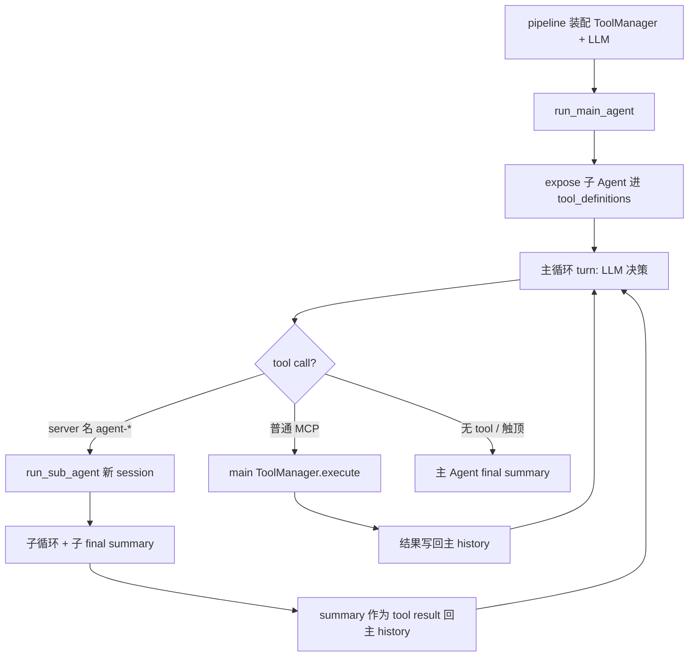

# Main–Sub Agent 编排 — 代码精读与面试深挖

> 对应简历：问数结果深度研究 · 第二点（Main–Sub Agent 编排）
> 题纲：[`../面试题纲.md`](../面试题纲.md) § 三 E13–E16
> 索引本：[`02-面试问答.md`](./02-面试问答.md)（E 节已迁出至本文）
> 设计规格：[`../../superpowers/specs/2026-08-05-main-sub-agent-deep-dive-design.md`](../../superpowers/specs/2026-08-05-main-sub-agent-deep-dive-design.md)
> 复习标本：`miro-flow-solution`（对齐工程细节；面试不主动对比 MiroFlow，不宣称「我发明框架」）

---

## 0. 目标与诚实边界

### 0.1 本文做什么

- 按一次任务跑通 Main→Sub→回传→final summary 的调用链，贴关键代码并注释。
- 钉死「简历并发」与「标本顺序执行」的可答辩关系。
- 承接原 `02` E13–E16 详答，供面试深挖。

### 0.2 本文不做什么

- Hybrid Search / MCP 98% / GAIA 断点续跑全文 / Java↔Python 集成契约 / 完整 TaskTracer 回放教程。

### 0.3 诚实边界总表

| 说法 | 可讲 | 不可讲 |
|------|------|--------|
| 子会话隔离 | 新 `message_history` + 独立 session；只回传 summary | 「子 Agent 共享主会话全量上下文」 |
| 动态拆分 | 主 Agent 按 tool 描述决定是否委派 | 「每类问题写死固定角色路由表」（无额外依据时） |
| 并发 | 架构可并行无依赖子任务；业务需另加并发/超时/隔离 | 标本 `for` 说成已 `gather`；把 `10` 说成同时跑 10 个 |
| 结构化报告 | 逻辑结构（结论/证据/缺口/不确定性）；标本多为自然语言 summary | 「代码级 JSON schema 强校验已落地」 |
| 归属 | 工程 harness owner；标本对齐细节 | 「我发明了这套编排框架」 |

---

## 1. 架构总览

### 1.1 角色

| 角色 | 职责 | 标本依据 |
|------|------|----------|
| Main Agent | 拆任务、选工具/子 Agent、汇总最终答案 | `run_main_agent`；工具偏轻（如 `tool-reasoning`） |
| Sub Agent（如 `agent-worker`） | 独立会话内检索/阅读/代码等，产出 summary | `run_sub_agent`；工具更重 |
| Tool 化外壳 | `agent-` 前缀暴露为可调用工具 | `expose_sub_agents_as_tools` |
| TaskTracer | 主/子 history 分存；`session_id = {name}_{counter}` | `start_sub_agent_session` |

### 1.2 一次任务数据流

### 1.3 配置骨架（标本示例，非业务最优）

以 `config/agent_llm_qwen37plus.yaml` 为准列出 Main/Sub 的 `llm`、`tool_config`、`max_turns`、`max_tool_calls_per_turn`；注明 Main/Sub llm 块分开故**支持**异构，GAIA 示例通常同模。

---

## 2. 调用链精读①：配置装配

（任务 2 填充）

## 3. 调用链精读②：子 Agent 工具化

（任务 2 填充）

## 4. 调用链精读③：主循环

（任务 3 填充）

## 5. 调用链精读④：`run_sub_agent`

（任务 3 填充）

## 6. 调用链精读⑤：主 Agent final summary

（任务 4 填充）

## 7. 预算与熔断

（任务 4 填充）

## 8. 专节：顺序执行 vs 简历「并发」

（任务 5 填充）

## 9. 面试题索引（E13–E16）

（任务 6 填充）

## 10. 回看清单

（任务 6 填充）
