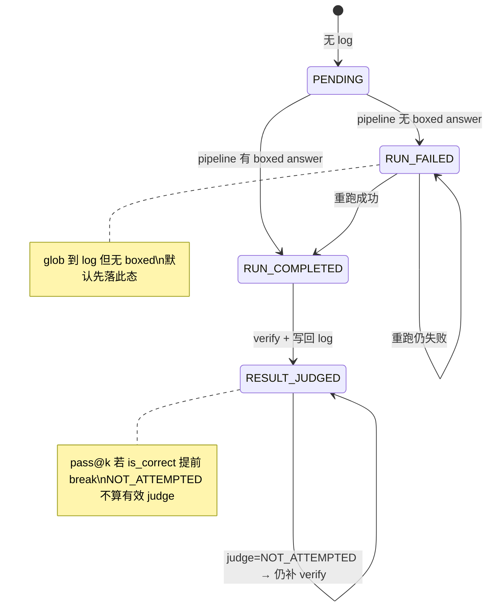

# 工程化能力 — 追踪、熔断、并发与断点续跑

> 对应简历：问数结果深度研究 · 追踪 / 熔断 / 断点续跑
> 题纲：[`../面试题纲.md`](../面试题纲.md) § 三 G21–G24
> 索引本：[`02-面试问答.md`](./02-面试问答.md)（G 节已迁出至本文）
> 上一章工具：[`04-Hybrid-Search-MCP.md`](./04-Hybrid-Search-MCP.md)
> 编排章：[`03-Main-Sub-Agent编排.md`](./03-Main-Sub-Agent编排.md)（§8–§9 指针指向本文）
> 设计规格：[`../../superpowers/specs/2026-08-06-hybrid-search-and-engineering-interview-prep-design.md`](../../superpowers/specs/2026-08-06-hybrid-search-and-engineering-interview-prep-design.md)
> 复习标本：`miro-flow-solution`（对齐工程细节；面试不主动对比 MiroFlow，不宣称「我发明框架」）

---

## 1. 与前两章的关系 + 地图 + 诚实边界

### 1.1 与 `03` / `04` 的衔接

[`03`](./03-Main-Sub-Agent编排.md) 讲 **Main–Sub 编排决策与会话隔离**：主循环怎么拆任务、怎么委派 Sub、怎么汇总 final summary。

[`04`](./04-Hybrid-Search-MCP.md) 讲 **工具 harness 与 Hybrid Search**：MCP 怎么注册/发现/调用/降级，Hybrid 怎么路由召回融合并产出可引用 hit。

本章从 **「任务跑起来之后怎么可观测、怎么控预算、怎么批量跑、怎么续跑」** 往下钻——承接 [`04` §5 回看清单第 7 条](./04-Hybrid-Search-MCP.md#回看清单) 指过来的工程化专题，并成为 **预算熔断与两类并发的权威详解**（[`03` §8–§9](./03-Main-Sub-Agent编排.md) 已改为短指针链到本文 §3）。

**不在本章展开（后续章）：**

- 预算熔断、`max_turns` / `max_tool_calls_per_turn`、评测多题并行（→ §3 / G22–G23）
- 断点续跑状态机、`scan_latest_attempt`（→ §4 / G24）
- G 节题索引与回看清单（→ §5）

### 1.2 本章地图

| 章 | 内容 | 题纲 |
|----|------|------|
| **§1** | 与 `03`/`04` 衔接 + 诚实边界 | — |
| **§2** | 全链路追踪与回放 | G21 |
| **§3** | 预算熔断 + 两类「并发」 | G22、G23 |
| **§4** | 断点续跑状态机 | G24 |
| **§5** | 面试题索引 G21–G24 + 回看清单 | G21–G24 |

阅读顺序：**先 §2 追踪回放（排障基础）→ §3 预算/并发 → §4 续跑**。面试被追问「任务挂了怎么查」时，先答 `task_id` + step 时间线 + message history，再落到熔断/并发/续跑机制。

### 1.3 诚实边界总表

| 说法 | 可讲 | 不可讲 |
|------|------|--------|
| **并发** | 多题并行隔离（`Semaphore` + `gather(return_exceptions=True)`）；单题内 tool call 顺序 `for`；架构可演进并行无依赖子任务 | 标本已 `gather` 子 Agent；`10` = 同时跑 10 个子任务 |
| **单轮截断** | 超限只执行前 N 个；orchestrator 可能 `logger.warning` | 模型一定能从 message history 看到「超限提示」 |
| **熔断参数** | 标本配置示例（Main 20/10、Sub worker 50/10）；触顶后仍尝试 final summary | 线上已验证最优；熔断绝不误伤正常长任务 |
| **续跑省时** | 跳过已完成 attempt 的机制；有效 judge 跳过 verify；pass@k 提前停 | 无实测数据时报「节省 X 小时」或百分比；直接汇总历史 `start_time`/`end_time` |
| **超时 660s** | `n=3` 历史样本的临时建议值 | 正式 P95 / SLA |
| **追踪回放** | 按 `task_id` → step 时间线 → message history / metadata 排查；异常前链路通常可保留 | 虚构具体生产事故与损失；把仅定义未持续更新的 turn ID 字段说成已完整驱动回放 |
| **归属** | 工程 harness owner；标本对齐细节 | 「我发明了这套追踪框架」 |

---

## 2. 全链路追踪与回放（G21）

### 2.1 前置条件

读到这里应已知（来自 [`03` §1–§3](./03-Main-Sub-Agent编排.md#1-架构总览) 与 [`04` §2](./04-Hybrid-Search-MCP.md#2-工具如何注册发现调用与降级)）：

1. 单题入口是 `execute_task_pipeline`（`pipeline.py`），创建 `TaskTracer` 后交给 `Orchestrator.run_main_agent`。
2. Main 主循环在 LLM 调用前后、每 turn 开头、Sub 会话边界等处写 step 并阶段性 `save()`。
3. 工具调用走 `ToolManager.execute_tool_call` 或 `run_sub_agent`；Hybrid 额外有 `hybrid_search_observability` step（见 §2.5）。

### 2.2 数据模型：`StepRecord` 与 `TaskTracer`

**单步记录** — 每条 step 是一条 `StepRecord`：

```python
# src/logging/task_tracer.py · StepRecord（L20–27）
class StepRecord(BaseModel):
    step_name: str
    message: str
    timestamp: datetime
    status: Literal["info", "warning", "failed", "success", "debug"] = "info"
    metadata: dict[str, Any] = Field(default_factory=dict)
```

**任务级 trace** — 一份 JSON 文件对应一次 attempt，核心字段分组如下：

| 分组 | 字段 | 何时写入 | 回放用途 |
|------|------|----------|----------|
| 任务标识 | `task_id`、`task_name`、`task_file_name` | pipeline 创建时 | 定位日志文件 |
| 任务输入 | `input`（含 `task_description`、`metadata`） | pipeline 创建时；索引阶段可追加 `index_ref` | 复现初始 prompt 与附件 |
| 运行状态 | `status`（`pending` / `running` / `completed` / `interrupted` / `failed`） | `running` 在 orchestrator 前；终态在 pipeline `try`/`except` | 判断正常结束还是异常中断 |
| 时间 | `start_time`、`end_time` | 创建时 / `finally` | 粗算耗时（见 §1.3 诚实边界：历史样本 `end_time` 可能未准确反映真实耗时） |
| 结果 | `final_boxed_answer`、`judge_result`、`error` | 成功 / 判分 / 异常路径 | 对齐最终输出与判分 |
| 会话快照 | `main_agent_message_history` | LLM 调用前后、主循环结束 | 按 turn 复现 LLM 输入输出 |
| 子会话 | `sub_agent_message_history_sessions`（key = `session_id`） | Sub LLM 调用前后、Sub 结束 | 隔离回放各 Sub 会话 |
| 子会话边界 | `sub_agent_counter`、`current_sub_agent_session_id` | `start_sub_agent_session` / `end_sub_agent_session` | 对齐 step 与子 history |
| 逐步日志 | `step_logs: list[StepRecord]` | 全程 `log_step` | **主排查时间线** |
| 落盘路径 | `log_path: Path` | 创建时 | 文件位置 |

旁注：

- **`current_main_turn_id` / `current_sub_agent_turn_id`** 在 `TaskTracer` 中**有定义**（L57–58），但标本 orchestrator **未持续更新**——回放应优先看 `step_logs` 时间线 + `message_history`，不要声称「turn ID 字段已完整驱动回放」。
- `log_step()` 同时写 `step_logs` 并可选触发 `event_sink`（供 Web UI 实时推送）；`save()` 整份 `model_dump_json` 落盘，**永不抛异常**（`finally` 安全）。

```python
# src/logging/task_tracer.py · log_step / save（L97–126，骨架）
def log_step(self, step_name, message, status="info", metadata=None):
    step_log = StepRecord(
        step_name=step_name, message=message,
        timestamp=datetime.now(), status=status,
        metadata=metadata or {},
    )
    self.step_logs.append(step_log)
    if self.event_sink:
        self.event_sink(step_log)

def save(self):
    """Persist TaskTracer to disk. used in a finally block, thus never raise Exception."""
    with open(self.log_path, mode="w") as dest:
        dest.write(self.model_dump_json(indent=2))
```

### 2.3 落盘时机：主循环阶段性 `save` vs `pipeline.finally` 终态

**两层落盘分工：**

| 层级 | 位置 | 何时 `save()` | 写什么 |
|------|------|---------------|--------|
| **热路径** | `orchestrator.py` | 每 Main/Sub turn 开头；每次 LLM 调用前后；Sub final summary 后（写入 `message_history` 后）；Main 主循环结束（写入 `message_history` 后） | 截至该时刻的 `message_history` + 已 `log_step` 的 `step_logs` |
| **终态** | `pipeline.py` `try`/`except` + `finally` | `try`/`except` 设终态字段；`finally` 无论成功/异常必执行一次 `save()` | `try` 成功 → `status=completed`、`final_boxed_answer`；`except` → `status=interrupted`、`error`；`finally` → `end_time`、`task_execution_finished` step |

**pipeline 创建与终态：**

```python
# src/core/pipeline.py · 创建 TaskTracer（L69–81）
task_log = TaskTracer(
    log_path=log_path,
    task_name=task_name,
    task_id=task_id,
    task_file_name=task_file_name,
    ground_truth=ground_truth,
    input={"task_description": task_description, "task_file_name": task_file_name, "metadata": metadata or {}},
    event_sink=event_sink,
)
# ...
try:
    task_log.status = "running"
    final_answer, final_boxed_answer = await orchestrator.run_main_agent(...)
    task_log.final_boxed_answer = final_boxed_answer
    task_log.status = "completed"          # 成功路径：在 try 内赋值，非 finally
except Exception as e:
    task_log.status = "interrupted"        # 异常路径：在 except 内赋值
    task_log.error = traceback.format_exc()
finally:
    task_log.end_time = datetime.now()
    task_log.log_step("task_execution_finished", f"... status: {task_log.status}")
    task_log.save()                        # 统一落盘：含 try/except 终态 + finally 追加 step
```

**orchestrator 热路径 save 锚点（非穷举，面试够背）：**

```python
# orchestrator.py · _handle_llm_call_with_logging（L192–203, L224–238）
# LLM 调用前：写入 main/sub message_history → save()
# LLM 响应后：再次写入 message_history → save()

# orchestrator.py · run_main_agent 主循环（L1058–1061）
while turn_count < max_turns:
    turn_count += 1
    self.task_log.save()          # 每 turn 开头先落盘
    ... = await self._handle_llm_call_with_logging(...)

# orchestrator.py · run_sub_agent（L633–636, L865–881）
while turn_count < max_turns:
    turn_count += 1
    self.task_log.save()          # Sub 同样每 turn 开头
    ...
self.task_log.sub_agent_message_history_sessions[session_id] = {...}
self.task_log.save()              # Sub final summary 后：仅含 message_history，不含会话结束 step
self.task_log.log_step("usage_calculation", ...)   # 此后才 log，尚未落盘
self.task_log.end_sub_agent_session(sub_agent_name)  # → sub_*_session_end step，尚未落盘
self.task_log.log_step("sub_agent_completed", ...)   # 尚未落盘；靠 pipeline finally save 持久化
```

旁注：

- **阶段性 save 的目的**：长任务中途 crash / kill 时，尽量保留**最后一个完整 turn 之前**的 history 与 step，而不是只在进程退出时写一次。
- **`run_sub_agent` 末次 save 不含会话结束 step**：L868 的 `save()` 发生在 `end_sub_agent_session` / `sub_agent_completed` **之前**——磁盘上的 JSON **不含** `sub_*_session_end`、`usage_calculation`、`sub_agent_completed` 等 step；这些 step 仅写入内存，待 **pipeline `finally` 的 `save()`** 才一并持久化。勿说「Sub 会话结束时 save 已含 completed」。
- **Main 主循环结束同理**：L1356 `save()` 在 `format_output` / `task_completed` / `usage_calculation` 之前——上述 step 亦靠 pipeline `finally` 落盘。
- **`status` 在 `try`/`except` 赋值，`finally` 只补时间与收尾 step**：`completed` / `interrupted` 不是 finally 才赋值；finally 负责 `end_time`、`task_execution_finished` 与**统一** `save()`，把 orchestrator 末段未落盘的 step 与 pipeline 终态字段写进同一份 JSON。
- 日志文件命名（评测路径）：`task_{task_id}_attempt_{attempt}.json`（`common_benchmark.py` L221–222）。

### 2.4 回放路径：`task_id` → step 时间线 → message history

**标准回放四步：**

```
① 定位文件
   task_id + attempt → logs/task_{task_id}_attempt_{n}.json
   （或业务侧重放时传入的 log_path）

② 看终态
   status / error / final_boxed_answer / end_time
   → 确认是 completed、interrupted 还是中途 kill（status 仍 running）

③ 扫 step 时间线
   step_logs 按 timestamp 排序
   → 找第一个 status=failed/warning 或 message 开始偏离预期的 step_name
   → 关注：sub_{name}_session_start/end、main_agent/sub_agent turn、
            hybrid_search_observability、max_turns_reached、final_summary

④ 下钻 message history
   根据 step 时间戳附近，打开 main_agent_message_history
   或 sub_agent_message_history_sessions[session_id]
   → 对照该 turn 的 tool call 参数与 tool result 原文
```

**子会话对齐：**

```python
# task_tracer.py · start_sub_agent_session（L68–84）
session_id = f"{sub_agent_name}_{self.sub_agent_counter}"   # 如 agent-worker_1
self.log_step(
    f"sub_{sub_agent_name}_session_start",
    f"Starting {session_id} for subtask: ...",
    metadata={"session_id": session_id, "subtask": subtask_description},
)
```

回放 Sub 链路时：`sub_agent-worker_session_start` step 的 `metadata.session_id` → 同 key 的 `sub_agent_message_history_sessions` → 该 Sub 的完整对话。

### 2.5 排查模板：工具返回结构异常导致推理跑偏

> **诚实边界：** 下面是一套**标本字段支持的排查方法**，用于回答 G21「最复杂 Bug 怎么查」——**不虚构**具体生产事故、用户损失或修复时长。

**场景（方法论）：** 某次 MCP 工具返回了 Agent **能继续消费但语义错误**的内容（如空 JSON 字段被当成有效证据、或嵌套结构与 prompt 假设不一致），后续 Main turn 基于错误 tool result 继续推理，最终答案偏离预期。

**排查步骤：**

| 步 | 动作 | 看哪些字段 |
|----|------|------------|
| 1 | 从最终答案往回找 | `final_boxed_answer`；`main_agent_message_history.message_history` 末几轮 assistant 内容 |
| 2 | 定位「开始跑偏」的 turn | `step_logs` 中带 `main agent turn N` / `Sub agent ... turn N` 的 step；对比 N 与 N+1 之间 tool 相关 step |
| 3 | 检查 tool 调用 | 该 turn 的 `message_history` 中 tool result 消息；若有 Hybrid，找 `hybrid_search_observability` 的 `metadata.route` / `local_hits` / `web_hits` |
| 4 | 区分根因类型 | 调用失败（`status=failed` step） vs 返回空/不可解析 vs 返回结构合法但内容误导 vs Agent 误读正常结果 |
| 5 | 确认影响范围 | 是否仅 Main 误消费，还是 Sub 会话内已传播（查对应 `session_id` 的 sub history） |

**Hybrid 专用 observability step：**

```python
# orchestrator.py · _log_hybrid_observability（L565–575）
self.task_log.log_step(
    "hybrid_search_observability",
    f"Hybrid search route={parsed.get('route')} scope={agent_scope}",
    metadata={
        "route": parsed.get("route"),
        "mix": parsed.get("mix", {}),
        "local_hits": parsed.get("local_hits", 0),
        "web_hits": parsed.get("web_hits", 0),
        "scope": agent_scope,
    },
)
```

旁注：工具 result 的原始全文在 `message_history` 里，不在 `StepRecord.message` 里——**step 是索引，history 是证据**。

### 2.6 面试时怎么说

> 每个任务用 `task_id` 关联一份结构化 JSON trace。`StepRecord` 按时间记录 `step_name`、`message`、`timestamp`、`status` 和 `metadata`；`TaskTracer`  additionally 保存任务输入、主/子 Agent 的 `message_history`、子会话 ID、最终答案和错误栈。排查时先按 `task_id` 找到日志文件，扫 `step_logs` 时间线定位第一个异常 step，再打开对应 turn 的 `message_history` 看 tool 参数和返回原文。`orchestrator` 在 LLM 调用前后和每个 turn 开头会阶段性 `save()`，所以即使任务中途挂掉，通常也能保留异常前的链路；Sub 末次 save 在 `session_end`/`completed` step 之前，这些 step 要等 pipeline `finally` 才落盘。`pipeline` 的 `try`/`except` 设 `completed`/`interrupted` 与 `error`，`finally` 补 `end_time`、记 `task_execution_finished` 并统一 `save()`。

### 2.7 易踩坑

- 只说「上了 ELK / 日志平台」却讲不清 **step、session、message history、error** 怎么关联。
- 把 `current_main_turn_id` / `current_sub_agent_turn_id` 说成已在主循环里持续更新——标本实际靠 **step 名称 + message history** 对齐 turn。
- 把 `status=running` 的半写入 JSON 当成成功完成；或把 `end_time - start_time` 微秒级差当成真实耗时（见 [`02` §4.1 诚实说明](./02-面试问答.md)）。
- 排查故事讲成「某次生产事故损失 X 万」——无依据时不虚构。

### 2.8 下一跳

- 预算熔断与两类并发（G22–G23）→ [§3 预算熔断 + 两类「并发」](#3-预算熔断--两类并发)
- 断点续跑（G24）→ [§4 断点续跑状态机](#4-断点续跑状态机)
- 编排侧短指针 → [`03` §8–§9](./03-Main-Sub-Agent编排.md) 链到本文 §3
- 工具降级与 Hybrid 证据链 → [`04` §2–§3](./04-Hybrid-Search-MCP.md)

---

## 3. 预算熔断 + 两类「并发」（G22、G23）

> **权威落点：** 预算熔断与「并发」口径以本章为准；[`03` §8–§9](./03-Main-Sub-Agent编排.md) **已改为短指针**，详见本文 §3。

### 3.1 前置条件

读到这里应已知（来自 [`03` §3 主循环](./03-Main-Sub-Agent编排.md#3-调用链精读主循环)）：

1. Main / Sub 各自从 YAML 读取 `max_turns` 与 `max_tool_calls_per_turn`，在 `while turn_count < max_turns` 循环内调 LLM → 执行 tool call → 更新 history。
2. 单轮 LLM 可**生成**多个 tool call，但执行器用 `for` + 逐个 `await` **顺序消费**；`max_tool_calls_per_turn` 是对本轮调用列表的**截断上限**，不是并发度。
3. 主循环结束后（无论正常退出还是触顶），统一进入 final summary 阶段（见 [`03` §7](./03-Main-Sub-Agent编排.md#7-收束与-final-summary)）。

### 3.2 标本配置：Main 20/10，Sub worker 50/10（示例）

以下数字来自 `config/agent_llm_qwen37plus.yaml`，用于 GAIA 复习标本控制流，**不代表**未经压测即可照搬的线上最优参数。

| Agent | `max_turns` | `max_tool_calls_per_turn` | 标本含义 |
|------|------------:|--------------------------:|----------|
| Main Agent | 20 | 10 | 最多 20 轮主决策；每轮最多执行前 10 个 tool call |
| Sub `agent-worker` | 50 | 10 | 最多 50 轮子任务决策；每轮最多执行前 10 个 tool call |

```yaml
# config/agent_llm_qwen37plus.yaml（L26–27, L66–67）
main_agent:
  max_turns: 20
  max_tool_calls_per_turn: 10

sub_agents:
  agent-worker:
    max_turns: 50
    max_tool_calls_per_turn: 10
```

旁注：Sub 的轮次预算通常高于 Main——子任务往往包含多步检索、阅读与局部推理；Main 侧重规划与汇总，不宜无限加深循环。

### 3.3 两道预算：`max_turns` vs `max_tool_calls_per_turn`

#### 3.3.1 第一层：`max_turns` 限制循环深度

Main 与 Sub 使用同一种循环条件；区别只是从各自配置读取上限。

```python
# orchestrator.py · run_main_agent（L1053–1058）
max_turns = self.cfg.main_agent.max_turns
if max_turns < 0:
    max_turns = sys.maxsize
turn_count = 0
while turn_count < max_turns:  # 纵向预算：循环深度
    turn_count += 1
```

当 `turn_count` 达到上限后，不再进入下一轮 LLM—Tool 决策。循环结束处记录 `max_turns_reached` / `sub_agent_max_turns_reached` 告警、设置 `task_failed`，**随后仍进入 final summary**（§3.4）。它限制的是会话纵向推进深度，避免 Agent 无休止地「思考—调用—再思考」。

#### 3.3.2 第二层：`tool_calls_exceeded` 截断单轮调用数

Main 与 Sub 都按各自的 `max_tool_calls_per_turn` 对本轮 tool call 列表切片；超限时 orchestrator 会打 `logger.warning`，并把 `tool_calls_exceeded` 传给 LLM 客户端的 `update_message_history`：

```python
# orchestrator.py · run_main_agent（L1115–1124）
max_tool_calls = self.cfg.main_agent.max_tool_calls_per_turn
tool_calls_exceeded = (
    len(tool_calls) > 0 and len(tool_calls[0]) > max_tool_calls
)
if tool_calls_exceeded:
    logger.warning(
        f"[ERROR] Single turn tool call count too high ({len(tool_calls[0])} calls), "
        f"only processing first {max_tool_calls}"
    )
for call in tool_calls[0][:max_tool_calls]:  # 只处理前 N 个
    ...
# L1223–1224：执行完毕后更新 history
message_history = self.llm_client.update_message_history(
    message_history, all_tool_results_content_with_id, tool_calls_exceeded
)
```

这里**不是**先执行全部再统计，而是只处理 `[:max_tool_calls]` 的前 N 个。

**诚实边界（qwen 标本路径）：** 复习标本的 Main/Sub LLM 均配置为 `GPTOpenAIClient`（`config/agent_llm_qwen37plus.yaml`）。该客户端的 `update_message_history` **接受但忽略** `tool_calls_exceeded`——只把已执行的前 N 个 tool result 追加进 history，**不会**写入「本轮调用过多、已截断」类提示：

```python
# gpt_openai_client.py · update_message_history（L252–266）
def update_message_history(
    self, message_history, tool_call_info, tool_calls_exceeded: bool = False
):
    for cur_call_id, tool_result in tool_call_info:
        message_history.append(
            {"role": "tool", "tool_call_id": cur_call_id, "content": tool_result["text"]}
        )
    return message_history  # tool_calls_exceeded 未使用
```

因此：**调用会截断为前 N 个，并可能打日志；当前标本客户端不会把超限提示写入 message history**——不要声称模型一定能看见超限提示。排查时可从 `step_logs` / 进程日志侧证截断是否发生；若要让模型感知截断，需在客户端实现里显式追加说明（部分其他 provider 如 `gpt5_openai_client` 有类似逻辑，但 qwen 标本路径未启用）。

#### 3.3.3 对照表：两道预算的含义不能混用

| 维度 | `max_turns` | `max_tool_calls_per_turn` |
|------|-------------|---------------------------|
| 控制对象 | 整个 Agent 会话的循环轮数 | 单轮 LLM 响应中的 tool call 数量 |
| 防护风险 | 无限循环、上下文持续膨胀、累计成本失控 | 单轮调用爆炸、瞬时成本和延迟过高 |
| 触发结果 | 停止循环，标记失败语境，再尝试 summary | 截断为前 N 个，可能打 warning 日志并继续后续轮次；**qwen 标本客户端不把超限提示写入 history** |
| 不代表 | 工具调用总量的精确硬上限 | 并发数、worker 数或全任务总调用数 |

两层约束组合后，**不能**简单当作严格的 `max_turns × max_tool_calls_per_turn` 成本承诺：每轮可能提前结束；一次 Main 委派会进入 Sub 自己的预算域（50/10）；LLM 重试、summary 和人工交互也会产生额外开销。线上还应结合 token、金额、墙钟时间、重试次数和全链路调用总数设置更完整的预算熔断。

参数过小确实可能截断正常长任务（例如 Level 3 多来源检索、逐步校验）。这是成本、延迟与任务完成度之间的 trade-off：先按任务复杂度分层设置，再用 trace 统计「触顶但仍未完成」的比例，避免只为降耗而牺牲正常任务。`max_turns` / `max_tool_calls_per_turn` 控制 Agent 行为预算，**不能替代**端到端超时、下游工具限流和配额治理。

### 3.4 触顶后仍尝试 final summary

达到 `max_turns` 不等于丢弃已有证据——Main 与 Sub 在循环结束后都会进入 summary 阶段：

```python
# orchestrator.py · Main 触顶后（L1228–1257）
if turn_count >= max_turns:
    task_failed = True
    self.task_log.log_step("max_turns_reached", f"Reached maximum turns ({max_turns})", "warning")

self.task_log.log_step("final_summary", "Generating final summary")
final_answer_text = await self._handle_summary_with_context_limit_retry(
    ..., task_failed, agent_type="main", ...
)
```

Sub 同理：`sub_agent_max_turns_reached` → `sub_agent_final_summary` → `_handle_summary_with_context_limit_retry(..., task_failed, ...)`（L812–845）。`task_failed=True` 会传入 summary prompt，让模型在预算耗尽语境下基于已有上下文尽量收束，并显式保留缺口与不确定性（见 [`03` §7.2](./03-Main-Sub-Agent编排.md#72-输出契约自然语言报告而非已强校验的-json)）。

### 3.5 第一类「并发」：单题内顺序调度

标本证据在 `orchestrator.py` 主循环注释与实现：

```python
# orchestrator.py · L1110–1150
# 7. Execute tool calls (in sequence)
for call in tool_calls[0][:max_tool_calls]:
    ...
    elif server_name.startswith("agent-"):
        sub_agent_result = await self.run_sub_agent(...)   # 逐个 await
    else:
        tool_result = await self.main_agent_tool_manager.execute_tool_call(...)
```

要区分「生成」与「执行」：

- **生成：** LLM 一轮可以提出多个 tool call（甚至多个 Sub 委派）。
- **执行：** 执行器进入 `for` 循环后对当前调用直接 `await`；当前工具或 Sub 返回后，才进入下一次迭代。

因此，当前可核对标本的**单题内调用是顺序调度**；`max_tool_calls_per_turn=10` 是违规连发时的截断上限，**不是**同时跑 10 个子 Agent 或 10 个 MCP 工具。

### 3.6 第二类「并发」：评测多题并行

`common_benchmark.py` 的 `run_parallel_inference` 在**题目级**做并行，与单题内顺序调度是不同层级：

```python
# common_benchmark.py · run_parallel_inference（L369–393）
async def run_parallel_inference(self, tasks, max_concurrent=3):
    semaphore = asyncio.Semaphore(max_concurrent)

    async def run_with_semaphore(task):
        async with semaphore:
            with task_logging_context(task.task_id, self.get_log_dir()):
                result = await self.run_single_task(task)
            return result

    results = await asyncio.gather(
        *[run_with_semaphore(task) for task in shuffled_tasks],
        return_exceptions=True,
    )
```

| 层级 | 代码位置 | 并行单元 | 隔离机制 |
|------|----------|----------|----------|
| **单题内** | `orchestrator.py` | 无（顺序 `for + await`） | 同一 `task_id` 内共享 Main history |
| **多题间** | `common_benchmark.py` | `tasks` 列表中的多道 benchmark 题 | `Semaphore(max_concurrent)` + 每题独立 `task_logging_context` |

要点：

- `max_concurrent` 限制**同时运行的题目数**；函数默认参数是 3，运行时由 `benchmark.execution.max_concurrent` 传入——业务值需根据模型限流、工具容量、内存和任务耗时压测，不能把默认值包装成生产最优。
- `return_exceptions=True` 让单题异常作为结果返回而不是向外抛出，便于逐题转成失败 `BenchmarkResult`；**一题失败不会取消其他已在跑的任务**。
- 每道题在独立 `task_logging_context(task_id, ...)` 中执行，各自生成日志与 `BenchmarkResult`。

**不能**用这里的 `gather` 证明某一道题内部同时运行了多个 Sub Agent。

#### 可选演进（标本未落地）

架构上可以把无依赖子任务并行化，但标本未实现。真正落地前需做依赖分析，并补全全局并发上限、单调用超时、异常隔离、结果顺序恢复、取消传播、日志关联和预算统计——否则机械替换 `for` 为 `asyncio.gather` 可能造成限流失效、history 顺序错乱或一个失败拖累整批。

### 3.7 简历「并发 / 子智能体并发」可背口径模板

若简历写了「子智能体并发」或类似表述，面试须**分层答**，避免与标本自相矛盾：

| 层级 | 可讲 | 不可讲 |
|------|------|--------|
| **架构能力** | Main–Sub 架构**可对**无依赖子任务并行化；子任务在独立会话执行并回传摘要 | 把当前标本说成已 `asyncio.gather` 并行子 Agent |
| **当前标本** | 单题内 tool call / 子 Agent 调用是顺序 `for + await`；`max_tool_calls_per_turn` 是截断上限，不是并发度 | `10` = 同时跑 10 个子 Agent；「一轮多个 Sub 已并发落地」 |
| **业务落地** | 真正并行需另加全局并发上限、单调用超时、异常隔离、结果顺序恢复与预算统计 | 机械把 `for` 换成 `gather` 就算完成 |
| **已落地并行** | 评测层 `Semaphore + gather(return_exceptions=True)` 是多**题**并行 | 用 benchmark 的 `gather` 证明单题内 Sub 并发 |

**可背一段话：**

> 主 Agent 动态拆子任务；子任务在独立会话执行并回传摘要。**架构上**可以对无依赖子任务并行化；**当前可核对标本**里，单题内 tool call / 子 Agent 调用是顺序 `await`，**不可把标本说成已 `gather`**。业务侧若要做子智能体并发，需另加上限、超时和隔离。评测里的 `max_concurrent` 是多题并行，不是单题内同时跑 N 个子 Agent。

若追问「简历为什么写并发」，可补：

> 我描述的是 Main–Sub 架构对无依赖子任务的并行化能力与演进方向，不是把当前标本的顺序 `for + await` 说成已并行落地；已落地的 `Semaphore + gather` 位于 benchmark 多题执行层。

### 3.8 面试时怎么说

> 熔断由两道预算组成：`max_turns` 控制 Agent 循环深度，`max_tool_calls_per_turn` 控制单轮 tool call 数量，超出部分只取前 N 个执行，orchestrator 可能打 warning 日志。当前 qwen 标本用的 `GPTOpenAIClient` 在 `update_message_history` 里**忽略** `tool_calls_exceeded`，不会把超限提示写进 message history——我不会声称模型一定能看见截断说明。标本示例是 Main 20/10、Sub worker 50/10，这是 GAIA 复习参数，不是未经压测就能宣称的线上最优；生产值要根据完成率、P95、token 与工具成本、超限率共同调优，并补充全链路预算。触顶后会标记 `task_failed` 但仍尝试 final summary，基于已有上下文收束而不是直接丢弃证据。
>
> 「并发 / 子智能体并发」要分层答：架构可对无依赖子任务并行化；当前可核对标本里单题内 orchestrator 对 tool call 和 Sub 是顺序 `await`，**不可把标本说成已 `gather`**；业务并行需另加上限、超时和隔离。批量评测用 `Semaphore` 限制同时运行的题数，再用 `gather(return_exceptions=True)` 做多题异常隔离。我不会把 `max_tool_calls_per_turn=10` 说成同时跑 10 个子 Agent。

### 3.9 易踩坑

- 说 `tool_calls_exceeded` 一定让模型在 history 里看到截断提示——qwen 标本的 `GPTOpenAIClient` 忽略该参数。
- 把 `10` 说成「同时并发 10 个子 Agent / 10 个工具」——标本工具循环仍是顺序执行。
- 把 `20 × 10` 说成整个任务绝不会超过 200 次工具调用——一次 Main 委派会进入 Sub 自己的 50/10 预算域。
- 说达到 `max_turns` 后完全无输出——实现仍尝试 final summary。
- 把标本 20/10、50/10 包装成线上已验证最优，或声称熔断绝不会误伤正常长任务。
- 把评测层的多题 `gather` 偷换成单题内 Sub 并行。
- 临场编造固定并发数，或声称标本已用 `asyncio.gather()` 并行执行子 Agent。

### 3.10 下一跳

- 断点续跑（G24）→ [§4 断点续跑状态机](#4-断点续跑状态机)
- 编排侧短指针 → [`03` §8–§9](./03-Main-Sub-Agent编排.md) 链到本文 §3
- 追踪回放基础 → [§2 全链路追踪与回放](#2-全链路追踪与回放g21)

## 4. 断点续跑状态机（G24）

> **权威落点：** 断点续跑判定与 pass@k 复用以本章为准；[`02` G24](./02-面试问答.md#g24-怎么判断任务已经完成断点续跑省了多少时间) 已迁出为索引。

### 4.1 前置条件

读到这里应已知（来自 [§2 追踪回放](#2-全链路追踪与回放g21)）：

1. 每道题每次 attempt 对应一份 `TaskTracer` JSON：`task_{task_id}_attempt_{attempt}.json`（`common_benchmark.py` L221–222）。
2. 完成判定的关键字段是 `final_boxed_answer` 与 `judge_result`，不是「文件是否存在」。
3. 批量评测入口是 `run_parallel_inference` → `run_single_task`；pass@k 在单题内循环 attempt 1…k（§3.6）。

### 4.2 四态枚举：`TaskStatus`

```python
# common_benchmark.py · TaskStatus（L36–40）
class TaskStatus(StrEnum):
    PENDING = "pending"           # 无 log 或尚未扫描
    RUN_FAILED = "run_failed"     # 有 log 但无有效 boxed answer
    RUN_COMPLETED = "run_completed"   # 有 final_boxed_answer，尚未判分或 judge 未落盘
    RESULT_JUDGED = "result_judged"   # 有 final_boxed_answer + judge_result
```

**钉死：文件存在 ≠ 完成。** 只要 glob 到 log 文件，默认先降级为 `RUN_FAILED`；只有读到 `final_boxed_answer` 才升为 `RUN_COMPLETED`；再读到 `judge_result` 才升为 `RESULT_JUDGED`。半写入、仅有 `status=running`、或 pipeline 异常中断的 JSON **不算**可复用完成态。

### 4.3 `scan_latest_attempt`：扫描与状态提升

**输入：** `task_id` + `attempt` 编号。  
**输出：** `AttemptStats` 字典（含 `status`、`model_boxed_answer`、`judge_result`、`log_file_path` 等）。

**状态提升路径（必须按此顺序理解）：**

```
无匹配 log
  └─→ PENDING

有匹配 log（glob task_{task_id}_attempt_{attempt}.json）
  └─→ 默认 RUN_FAILED          ← 文件存在 ≠ 完成
        │
        ├─ log 无 final_boxed_answer → 保持 RUN_FAILED
        │
        └─ 有 final_boxed_answer → RUN_COMPLETED
              │
              ├─ 无 judge_result → 保持 RUN_COMPLETED
              │
              └─ 有 judge_result → RESULT_JUDGED（并设 is_correct）
                    │
                    └─ **例外：** judge = `NOT_ATTEMPTED` 时 scan 仍升 RESULT_JUDGED，
                       但 `run_single_task` 会**再次进入 verify**（见 §4.4）
```

**标本实现：**

```python
# common_benchmark.py · scan_latest_attempt（L331–367，骨架）
def scan_latest_attempt(self, task, attempt):
    attempt_result = {..., "status": TaskStatus.PENDING, ...}
    matched_logs = self.output_dir.glob(f"task_{task.task_id}_attempt_{attempt}.json")
    if len(sorted(matched_logs, reverse=True)) == 0:
        return attempt_result

    latest_log = sorted(matched_logs, reverse=True)[-1]
    attempt_result["status"] = TaskStatus.RUN_FAILED      # 先当失败
    attempt_result["log_file_path"] = latest_log

    with open(latest_log) as f:
        log_data = json.loads(f.read())
        if log_data.get("final_boxed_answer"):
            attempt_result["status"] = TaskStatus.RUN_COMPLETED
            attempt_result["model_boxed_answer"] = log_data["final_boxed_answer"]
            if log_data.get("judge_result"):
                attempt_result["status"] = TaskStatus.RESULT_JUDGED
                attempt_result["judge_result"] = log_data["judge_result"]
                attempt_result["is_correct"] = log_data["judge_result"] == "CORRECT"
    return attempt_result
```

旁注：

- **与 `TaskTracer.status` 区分：** trace 里的 `pending` / `running` / `completed` / `interrupted` / `failed` 描述**单次 pipeline 执行**；`TaskStatus` 描述**评测 harness 对 attempt 的可复用程度**。续跑逻辑读的是前者 JSON 里的 `final_boxed_answer` / `judge_result`，不是简单映射 trace `status`。
- **`status=running` 的半写入 log：** 会被扫到并标为 `RUN_FAILED`（无 boxed answer），下次会重跑——符合「文件存在 ≠ 完成」。
- **`model_response` 来源：** 从 log 的 `output` 字段加载（L358）；若 pipeline 未写 `output`，复用时可能为空，不影响 boxed answer 判定。

### 4.4 `run_single_task`：三分支决策 + pass@k 提前停

单题 pass@k 循环（attempt 1…k）每次先 `scan_latest_attempt`，再按状态分支：

| 扫描结果 | 动作 |
|----------|------|
| `PENDING` / `RUN_FAILED` | 调用 `execute_task_pipeline` **重跑推理**；有 `final_boxed_answer` → `RUN_COMPLETED`，否则 → `RUN_FAILED` |
| `RUN_COMPLETED`（有答案、无 judge） | **跳过推理**，进入 LLM verify（`verify_answer_for_datasets`），判分后 `_update_log_file_with_evaluation` 写回 log |
| `RESULT_JUDGED`（有答案 + judge，且 judge ≠ `NOT_ATTEMPTED`） | **推理与判分均跳过**，直接复用缓存的 `judge_result` / `is_correct` |
| `RESULT_JUDGED`（judge = `NOT_ATTEMPTED`） | **跳过推理**，仍进入 verify **重新判分**并写回 log（占位 judge 不可复用） |

**推理分支（仅 PENDING / RUN_FAILED）：**

```python
# common_benchmark.py · run_single_task（L199–237，骨架）
attempt_result = self.scan_latest_attempt(task, attempt)
if attempt_result["status"] in (TaskStatus.PENDING, TaskStatus.RUN_FAILED):
    response, final_boxed_answer, log_file_path = await execute_task_pipeline(
        ...,
        log_path=self.output_dir / f"task_{task.task_id}_attempt_{attempt}.json",
    )
    if final_boxed_answer:
        attempt_result["status"] = TaskStatus.RUN_COMPLETED
        attempt_result["model_boxed_answer"] = final_boxed_answer
    else:
        attempt_result["status"] = TaskStatus.RUN_FAILED
```

**判分分支（有答案且尚未有效判分）：**

verify 入口条件为 `RUN_COMPLETED` **或** `judge_result == "NOT_ATTEMPTED"`——后者覆盖 scan 已升到 `RESULT_JUDGED`、但 judge 仍是占位符的情况：

```python
# common_benchmark.py · run_single_task（L239–277，骨架）
if (
    attempt_result["status"] == TaskStatus.RUN_COMPLETED
    or attempt_result["judge_result"] == "NOT_ATTEMPTED"
):
    evaluation_result = await verify_answer_for_datasets(...)
    attempt_result["judge_result"] = evaluation_result
    attempt_result["is_correct"] = evaluation_result == "CORRECT"
    await self._update_log_file_with_evaluation(log_file_path, evaluation_result)
```

判分结果通过临时文件 + `os.replace` 原子写回 log（L488–506），下次 `scan_latest_attempt` 可直接升到 `RESULT_JUDGED`。

**pass@k 提前停：**

```python
# common_benchmark.py · run_single_task（L303–308）
if found_correct_answer:
    print(f"    🎯 Found correct answer! Stopping early after {attempt} attempts.")
    break
```

任一 attempt 判为 `CORRECT` 后，不再浪费后续 attempt 的推理与判分调用。

### 4.5 状态机总图



### 4.6 与 §2 追踪字段的衔接

| 续跑读写字段 | 写入方 | 续跑用途 |
|--------------|--------|----------|
| `final_boxed_answer` | `pipeline.py` try 成功路径 | `RUN_COMPLETED` 判定 |
| `judge_result` | `_update_log_file_with_evaluation` | `RESULT_JUDGED` 判定；**`NOT_ATTEMPTED` 占位不算有效 judge**，仍会补 verify |
| `step_logs` / `message_history` | orchestrator 热路径 + pipeline finally | 重跑前排查为何 `RUN_FAILED` |
| `status`（trace 级） | pipeline try/except | 辅助判断半写入 vs 正常终态，**不单独**作为 harness 完成依据 |

### 4.7 省时机制（诚实边界）

**可讲：**

- 重跑整批评测时，已完成 attempt 跳过 `execute_task_pipeline`；**有效 judge**（非 `NOT_ATTEMPTED`）的 attempt 跳过 verify。
- pass@k 提前停跳过剩余 attempt。
- 省时机制 = 跳过已完成推理 + 跳过已有效判分；**不依赖** log 起止时间做量化汇总。

**不可讲：**

- 无实测数据时报「节省 X 小时」或「节省 Y%」。
- 把「文件存在」说成「已完成，不用看字段」。
- 声称可直接汇总 log 的 `start_time` / `end_time` 得出省时量——历史样本中 `end_time` 可能不可信（见 [`02` §4.1](./02-面试问答.md#41-环境与口径)：`status` 仍 `running`、`end_time - start_time` 仅微秒级）；须先验证计时字段有效（`status=completed`/`interrupted` 且 `end_time` 合理），再谈汇总；标本亦未做统一报表。

### 4.8 面试时怎么说

> 断点续跑靠扫描 `task_{task_id}_attempt_{n}.json`：先默认 `RUN_FAILED`，有 `final_boxed_answer` 才升 `RUN_COMPLETED`，有 `judge_result` 再升 `RESULT_JUDGED`——**文件存在不等于完成**。`run_single_task` 对 pending/failed 重跑 pipeline，有答案无 judge 补 verify；**有有效 judge（非 `NOT_ATTEMPTED`）才全复用**——`NOT_ATTEMPTED` 虽 scan 为 RESULT_JUDGED，仍会重新判分。pass@k 任一 attempt 正确就提前停。省时只讲跳过机制，不报未测小时数；历史 log 的 `end_time` 不可直接当耗时依据。

### 4.9 易踩坑

- 只检查 log 文件是否存在，忽略 `final_boxed_answer` 为空或 `status=running` 的半写入 JSON。
- 说「有 judge 一律复用」——`NOT_ATTEMPTED` 占位 judge 会触发重新 verify。
- 把 trace 的 `completed` 直接等同于 harness 的 `RESULT_JUDGED`——可能尚未 verify。
- 无统计依据虚构「续跑省了 10 小时」；或直接汇总不可信的历史 `end_time` 报省时百分比。
- 混淆 pass@k「提前停」与单 attempt 内的熔断——前者在 attempt 循环层，后者在 orchestrator 轮次层（§3）。

### 4.10 下一跳

- G 题索引与回看清单 → [§5 面试题索引 G21–G24](#5-面试题索引-g21g24--回看清单)
- 追踪回放基础 → [§2 全链路追踪与回放](#2-全链路追踪与回放g21)
- 多题并行隔离 → [§3.6 第二类「并发」](#36-第二类并发评测多题并行)

---

## 5. 面试题索引 G21–G24 + 回看清单

<a id="g21-关键中间结果落盘后怎么回放最复杂的一次-bug-怎么排查"></a>
### G21. 关键中间结果落盘后怎么回放？最复杂的一次 Bug 怎么排查？

- **第一句：** 每个任务用 `task_id` 关联一份结构化 trace，按 Agent turn 和时间顺序记录 LLM 响应、工具调用、子会话、状态与错误；排查时从最终异常状态反向定位到第一个偏离预期的 step，再结合该轮 message history 和 metadata 复现输入。
- **要点：**
  - `StepRecord` 含 `step_name`、`message`、`timestamp`、`status`、`metadata`；`TaskTracer` 还保存任务输入、主/子 Agent `message_history`、子会话 ID、最终答案、判分与错误。日志按 `task_id` + attempt 命名。
  - orchestrator 在 LLM 调用前后、每 turn 开头阶段性 `save()`；pipeline `finally` 统一写终态、`error` 与 `end_time`。异常前链路通常可保留。
  - 排查模板：工具返回结构异常导致推理跑偏——先找 final answer 偏离 turn，再查该 turn tool result 与 `hybrid_search_observability` metadata（§2.5）。**不虚构**生产事故与损失。
- **易踩坑：** 只讲 ELK 不讲 step/session/history 关联；把未持续更新的 turn ID 字段说成已完整驱动回放。
- **回看标本 + 详见：** `miro-flow-solution/src/logging/task_tracer.py`；`src/core/orchestrator.py`；`src/core/pipeline.py`。详见本文 [§2 全链路追踪与回放](#2-全链路追踪与回放g21)。

<a id="g22-并发数一般设多少一个任务挂了会影响其他任务吗"></a>
### G22. 并发数一般设多少？一个任务挂了会影响其他任务吗？

- **第一句：** 并发数来自评测或服务运行配置，不把单轮工具调用上限当成并发度；批量评测用信号量限制同时运行的题数，并通过 `gather(return_exceptions=True)` 做单题异常隔离，一题失败会生成自己的失败结果，不取消其他题。
- **要点：**
  - `run_parallel_inference()` 的 `max_concurrent` 默认参数 3，运行时由 `benchmark.execution.max_concurrent` 传入；业务值需压测，不能包装成生产最优。
  - 每题独立 `task_logging_context(task_id, ...)` 与 `BenchmarkResult`；`return_exceptions=True` 保留异常对象再转失败结果。
  - **两类并发分层：** 多题并行（本章 §3.6）≠ 单题内 tool call 顺序 `for + await`（§3.5）。
- **易踩坑：** 把 `max_tool_calls_per_turn=10` 说成同时跑 10 个子 Agent；用 benchmark `gather` 证明单题内 Sub 并发。
- **回看标本 + 详见：** `miro-flow-solution/common_benchmark.py` 的 `run_parallel_inference()`。详见本文 [§3.5–§3.6 两类「并发」](#3-预算熔断--两类并发g22g23)。

<a id="g23-max_turns-和-max_tool_calls_per_turn-怎么设会截断正常任务吗"></a>
### G23. `max_turns` 和 `max_tool_calls_per_turn` 怎么设？会截断正常任务吗？

- **第一句：** 熔断由两道预算组成：`max_turns` 限制循环深度，`max_tool_calls_per_turn` 限制单轮 tool call 数量；qwen37plus 标本示例 Main 20/10、Sub worker 50/10，不是未经压测的业务最优。
- **要点：**
  - `max_turns` 防无限循环；触顶后标记 `task_failed` 仍尝试 final summary（§3.4）。
  - `max_tool_calls_per_turn` 只执行前 N 个；qwen 标本 `GPTOpenAIClient` **忽略** `tool_calls_exceeded`，不把截断提示写入 history（§3.3.2）。
  - 参数过小可能截断 Level 3 长任务——成本/延迟/完成度 trade-off；需独立端到端超时与工具限流。
- **易踩坑：** 声称模型一定能看见截断提示；把 20×10 当成全任务工具调用硬上限；触顶后完全无输出。
- **回看标本 + 详见：** `config/agent_llm_qwen37plus.yaml`；`src/core/orchestrator.py`。详见本文 [§3 预算熔断 + 两类「并发」](#3-预算熔断--两类并发g22g23)。

<a id="g24-怎么判断任务已经完成断点续跑省了多少时间"></a>
### G24. 怎么判断任务已经完成？断点续跑省了多少时间？

- **第一句：** 断点续跑以日志落盘状态判断：按 `task_id + attempt` 扫描已有 log；有 boxed answer 加载回答，**有效 judge**（非 `NOT_ATTEMPTED`）才连判分复用，只有缺失、无答案或失败的 attempt 才重跑推理。
- **要点：**
  - `scan_latest_attempt()` 先默认 `RUN_FAILED`，有 `final_boxed_answer` → `RUN_COMPLETED`，有 `judge_result` → `RESULT_JUDGED`。**文件存在 ≠ 完成。**
  - `run_single_task()`：PENDING/RUN_FAILED 重跑；有答案无 judge 补 verify；**`NOT_ATTEMPTED` 仍补 verify**；其余有效 judge 全复用；pass@k 任一 correct 提前停。
  - 省时只讲跳过机制；无实测不报小时数/百分比；**不可**直接汇总历史 log 的 `start_time`/`end_time`（须先验证计时有效，见 [`02` §4.1](./02-面试问答.md#41-环境与口径)）。
- **易踩坑：** 只看文件存在；虚构具体节省时长；混淆 trace `status` 与 harness `TaskStatus`。
- **回看标本 + 详见：** `miro-flow-solution/common_benchmark.py` 的 `scan_latest_attempt()`、`run_single_task()`；`src/logging/task_tracer.py` 落盘字段。详见本文 [§4 断点续跑状态机](#4-断点续跑状态机g24)。

### 回看清单

按以下顺序回看，先追踪回放，再预算/并发，最后续跑与 G 题：

0. 本文 [§1 地图与诚实边界](#1-与前两章的关系--地图--诚实边界)：并发/熔断/续跑/省时口径总表。
1. `src/logging/task_tracer.py`：`StepRecord`、`log_step()`、`save()`、子会话字段（§2）。
2. `src/core/orchestrator.py`：阶段性 `save()`、`max_turns` / `max_tool_calls_per_turn`、顺序 tool 循环（§2–§3）。
3. `src/core/pipeline.py`：`try`/`except`/`finally` 终态与 `final_boxed_answer`（§2、§4）。
4. `config/agent_llm_qwen37plus.yaml`：Main 20/10、Sub 50/10 标本参数（§3.2）。
5. `common_benchmark.py`：`run_parallel_inference`、`scan_latest_attempt`、`run_single_task`（§3.6、§4）。
6. 对照本文 [§2.5 排查模板](#25-排查模板工具返回结构异常导致推理跑偏) 与 [§4.5 状态机总图](#45-状态机总图)：G21/G24 可背骨架。
7. Hybrid Search / MCP → [`04-Hybrid-Search-MCP.md`](./04-Hybrid-Search-MCP.md)；编排主线 → [`03-Main-Sub-Agent编排.md`](./03-Main-Sub-Agent编排.md)。

### 附录：`03` §8–§9 迁移说明

**权威详解已在本文 [§3 预算熔断 + 两类「并发」](#3-预算熔断--两类并发g22g23)。** [`03-Main-Sub-Agent编排.md`](./03-Main-Sub-Agent编排.md) §8（预算熔断）与 §9（并发专节）**已改为短指针**，详见本文 §3，**以本文 §3 为权威口径**，避免两处长正文重复或口径冲突（如 qwen 标本 `tool_calls_exceeded` 是否写入 history）。
