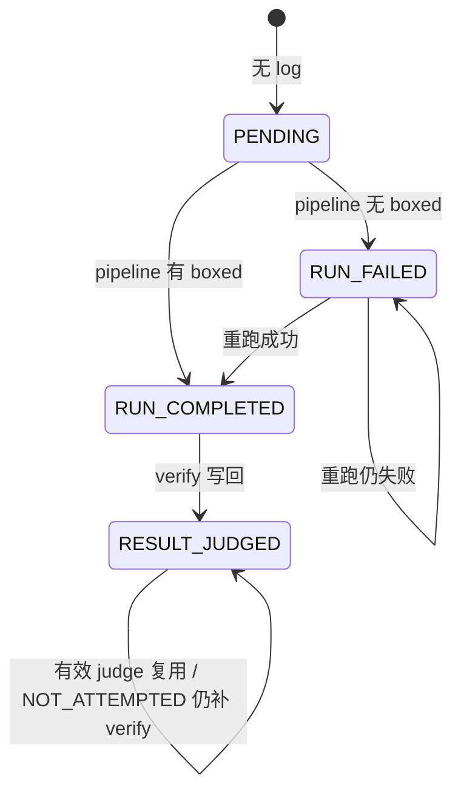

# 工程化能力 — 追踪、熔断、并发与断点续跑

> 对应简历：问数结果深度研究 · 追踪 / 熔断 / 断点续跑
> 题纲：[`../面试题纲.md`](../面试题纲.md) § 三 G21–G24
> 指标 / 问题 / 改进：[`01-通用问答.md`](./01-通用问答.md)（G 节详解在本文）
> 上一章工具：[`04-Hybrid-Search-MCP.md`](./04-Hybrid-Search-MCP.md)
> 编排章：[`03-Main-Sub-Agent编排.md`](./03-Main-Sub-Agent编排.md)（§8–§9 指针指向本文）
> 设计规格：[`../../../superpowers/specs/2026-08-06-hybrid-search-and-engineering-interview-prep-design.md`](../../../superpowers/specs/2026-08-06-hybrid-search-and-engineering-interview-prep-design.md)
> 复习标本：`miro-flow-solution`（对齐工程细节；面试不主动对比 MiroFlow，不宣称「我发明框架」）

---

## 1. 与前两章的关系 + 地图 + 诚实边界

### 1.1 与 `03` / `04` 的衔接

[`03`](./03-Main-Sub-Agent编排.md) 讲 **Main–Sub 编排决策与会话隔离**：主循环怎么拆任务、怎么委派 Sub、怎么汇总 final summary。

[`04`](./04-Hybrid-Search-MCP.md) 讲 **工具 harness 与 Hybrid Search**：MCP 怎么注册/发现/调用/降级，Hybrid 怎么路由召回融合并产出可引用 hit。

本章从 **「任务跑起来之后怎么可观测、怎么控预算、怎么批量跑、怎么续跑」** 往下钻——承接 [`04` §5 回看清单第 7 条](./04-Hybrid-Search-MCP.md#回看清单) 指过来的工程化专题，并成为 **预算熔断与两类并发的权威详解**（[`03` §8–§9](./03-Main-Sub-Agent编排.md) 已改为短指针链到本文 §3）。

**不在本章展开（后续章）：**

- 预算熔断、`max_turns` / `max_tool_calls_per_turn`、评测多题并行（→ §3 / G22–G23）
- 断点续跑状态机、`scan_latest_attempt`（→ §4 / G24）
- G 节题索引与回看清单（→ §5）

### 1.2 本章地图

| 章 | 内容 | 题纲 |
|----|------|------|
| **§1** | 与 `03`/`04` 衔接 + 诚实边界 | — |
| **§2** | 全链路追踪与回放 | G21 |
| **§3** | 预算熔断 + 两类「并发」 | G22、G23 |
| **§4** | 断点续跑状态机 | G24 |
| **§5** | 面试题索引 G21–G24 + 回看清单 | G21–G24 |

阅读顺序：**先 §2 追踪回放（排障基础）→ §3 预算/并发 → §4 续跑**。面试被追问「任务挂了怎么查」时，先答 `task_id` + step 时间线 + message history，再落到熔断/并发/续跑机制。

### 1.3 诚实边界总表

| 说法 | 可讲 | 不可讲 |
|------|------|--------|
| **并发** | 多题并行隔离（`Semaphore` + `gather(return_exceptions=True)`）；单题内 tool call 顺序 `for`；架构可演进并行无依赖子任务 | 标本已 `gather` 子 Agent；`10` = 同时跑 10 个子任务 |
| **单轮截断** | 超限只执行前 N 个；orchestrator 可能 `logger.warning` | 模型一定能从 message history 看到「超限提示」 |
| **熔断参数** | 标本配置示例（Main 20/10、Sub worker 50/10）；触顶后仍尝试 final summary | 线上已验证最优；熔断绝不误伤正常长任务 |
| **续跑省时** | 跳过已完成 attempt 的机制；有效 judge 跳过 verify；pass@k 提前停 | 无实测数据时报「节省 X 小时」或百分比；直接汇总历史 `start_time`/`end_time` |
| **业务会话续跑** | 可讲分层构想（§4.6）：评测 attempt 级已落地；turn 边界恢复可演进；工具中途恢复难 | 标本已支持一般 deep research「从第 N 轮无缝接着跑」 |
| **超时 660s** | `n=3` 历史样本的临时建议值 | 正式 P95 / SLA |
| **追踪回放** | 按 `task_id` → step 时间线 → message history / metadata 排查；异常前链路通常可保留 | 虚构具体生产事故与损失；把仅定义未持续更新的 turn ID 字段说成已完整驱动回放 |
| **归属** | 工程 harness owner；标本对齐细节 | 「我发明了这套追踪框架」 |

---

## 2. 全链路追踪与回放（G21）

面试常问：「任务跑飞了你怎么查？」这一章的答案可以压成一句话——

> 每个任务有一份按 `task_id` 落盘的 JSON；先扫时间线找「哪一步开始不对」，再打开那一轮的对话原文看工具到底回了什么。

下面按「记什么 → 何时落盘 → 怎么回放 → 举个例」讲清楚。

### 2.1 故事从哪开始

一次深度研究任务进 `execute_task_pipeline` 时，会先建一个 `TaskTracer`（[`03`](./03-Main-Sub-Agent编排.md) 编排、[`04`](./04-Hybrid-Search-MCP.md) 工具都往里写），再交给 `run_main_agent`。跑的过程中不断 `log_step` + 阶段性 `save()`；跑完或崩了，由 pipeline 的 `finally` 再统一收尾落盘。

评测路径下文件名是：`task_{task_id}_attempt_{n}.json`。

### 2.2 记什么：两层结构

可以把它想成「目录 + 正文」：

| 层 | 是什么 | 排查时干什么 |
|----|--------|--------------|
| **目录** | `step_logs` 里一条条 `StepRecord` | 快速扫时间线，定位可疑 turn |
| **正文** | `main_agent_message_history` / 各 Sub 的 history | 看该 turn 的 tool 参数和返回原文 |

```python
# 文件：src/logging/task_tracer.py · StepRecord
# 作用：时间线上的「一步」——目录项，不是证据全文
class StepRecord(BaseModel):
    step_name: str       # 如 main agent turn 3 / hybrid_search_observability
    message: str         # 一句话摘要；工具 JSON 原文不在这里
    timestamp: datetime
    status: Literal["info", "warning", "failed", "success", "debug"] = "info"
    metadata: dict       # route、session_id、命中数等结构化附带

# 文件：同上 · TaskTracer（一份 JSON = 一次 attempt）
# 作用：整单快照；step 是索引，message_history 才是证据
class TaskTracer:
    task_id / log_path                      # 找到这份文件
    input                                   # 当初题面（可含 index_ref）
    status                                  # running → completed | interrupted | ...
    final_boxed_answer / judge_result / error
    main_agent_message_history              # Main 全文
    sub_agent_message_history_sessions      # key=session_id → 某个 Sub 全文
    step_logs: list[StepRecord]             # ★ 先扫这里

    def log_step(...):  # 往 step_logs 追加；可选推 UI
    def save(self):     # 整份 JSON 落盘；finally 里调用，不向外抛
```

诚实点：`current_main_turn_id` 等字段有定义，但标本 orchestrator **没持续更新**——对齐 turn 靠 step 名 + history，别吹 turn ID 驱动回放。

### 2.3 何时落盘：边跑边记 + 收尾再记

长任务最怕「跑了半小时崩了，日志是空的」。所以落盘分两层：

```
边跑边记（orchestrator 热路径）     收尾再记（pipeline）
───────────────────────────       ────────────────────
每 turn 开头先 save                 try 成功 → completed + boxed answer
LLM 前后写完 history 再 save        except → interrupted + error 栈
Sub 会话里也会阶段性 save           finally → end_time + 统一 save（必跑）
```

**收尾（保证「有结局」）：**

```python
# 文件：src/core/pipeline.py · execute_task_pipeline
# 作用：无论成败，finally 都把最终状态写进同一份 JSON
task_log = TaskTracer(...)
try:
    task_log.status = "running"
    ..., boxed = await orchestrator.run_main_agent(...)
    task_log.final_boxed_answer = boxed
    task_log.status = "completed"
except Exception:
    task_log.status = "interrupted"
    task_log.error = traceback.format_exc()
finally:
    task_log.end_time = datetime.now()
    task_log.log_step("task_execution_finished", ...)
    task_log.save()   # ★ 连热路径末段还在内存里的 step 一并写出
```

**边跑边记（崩了也不至于从零开始）：**

```python
# 文件：src/core/orchestrator.py
# 作用：尽量保住「上一个完整 turn」之前的 history + step

# 每轮开头、LLM 调用前后：写 history → save()

# Sub 结束有个容易踩的顺序：
self.task_log.save()                     # ① 先落盘（此时还没有 session_end）
self.task_log.end_sub_agent_session(...) # ② 再记 session_end（先在内存）
self.task_log.log_step("sub_agent_completed", ...)
# → ② 要等 pipeline.finally 才进文件；别说「Sub 结束那次 save 已含 completed」
```

### 2.4 怎么回放：当一回侦探

拿到一个「答案不对」或「任务中断」的 `task_id`，按这个顺序查：

```
① 找到文件
   task_id + attempt → task_{id}_attempt_{n}.json

② 先看结局
   completed？interrupted？error 里有没有栈？
   final_boxed_answer 长什么样？

③ 再扫目录（step_logs）
   按时间往下看：哪一步开始 warning/failed？
   或哪一步之后结论明显跑偏？
   常见路标：main/sub turn N、session_start/end、
             hybrid_search_observability、max_turns_reached

④ 打开正文（message_history）
   Main：main_agent_message_history
   Sub：先从 session_start 的 metadata.session_id
        再进 sub_agent_message_history_sessions[同 key]
   → 对照那一轮 tool 参数和返回原文
```

```python
# 文件：task_tracer.py · start_sub_agent_session
# 作用：用 session_id 把「目录上的一步」和「Sub 正文」扣在一起
session_id = f"{sub_agent_name}_{self.sub_agent_counter}"  # 如 agent-worker_1
self.log_step("sub_..._session_start", ...,
              metadata={"session_id": session_id, "subtask": ...})
```

口诀始终是：**step 是索引，history 是证据。**

### 2.5 举个例：空检索被当成有效证据

> 方法模板，**不虚构**具体生产事故与损失。

场景：报告结论很自信，但本地材料其实没召回上来——`hybrid_search` 返回了空 `results`（或明显空洞的 JSON），模型仍继续往下写，后面几轮越推越偏。

怎么查：

1. **从结局往回翻** — `final_boxed_answer` 里哪句「已验证」站不住？
2. **在目录里卡住时间点** — `step_logs` 找到对应 `main agent turn N`；看 N 与 N+1 之间有没有 tool / Hybrid 相关 step。
3. **打开正文** — 该 turn 的 tool result：是空列表、错误串，还是结构合法但内容误导？
4. **看一眼 Hybrid 索引 step** — `hybrid_search_observability` 的 `route` / `local_hits` / `web_hits`（命中为 0 却仍被当证据，根因往往在这里）。
5. **若经过 Sub** — 用 `session_id` 进子 history，看错误是否在子会话里已经传播。

```python
# 文件：orchestrator.py · _log_hybrid_observability
# 作用：给 Hybrid 留一条好找的目录项；原文仍在 history
self.task_log.log_step(
    "hybrid_search_observability",
    f"Hybrid search route={...} scope={agent_scope}",
    metadata={"route", "mix", "local_hits", "web_hits", "scope"},
)
```

能讲清这条链路，G21 的「最复杂 Bug 怎么查」就有了可复述骨架：不是靠印象猜，而是 **终态 → 时间线 → 原文** 三段式。

**下一跳：** [§3 预算熔断 + 两类「并发」](#3-预算熔断--两类并发g22g23) · [§4 断点续跑](#4-断点续跑状态机g24)

---

## 3. 预算熔断 + 两类「并发」（G22、G23）

> 权威落点；[`03` §8–§9](./03-Main-Sub-Agent编排.md) 仅短指针到此。

面试常问两句，其实是一件事的两面：

> 「Agent 会不会一直调工具烧预算？」——要熔断。  
> 「并发数一般设多少？一题挂了会不会拖垮别的？」——先问清「并发」指哪一层。

一句话版本：

> 单题用两道预算卡住「轮次深度」和「单轮爆炸」；触顶不硬掐死，带着已有证据做 final summary。  
> 「并发」在标本里主要是**评测多题并行**；单题内 tool / Sub 仍是顺序 `await`。

下面按「为什么要限 → 两道闸怎么卡 → 触顶怎么收 → 并发别串层 → 举个例」讲。

### 3.1 故事从哪开始

深度研究不是一次 LLM 调用：Main 在 `while` 里「想 → 调工具 / 委派 Sub → 再想」，Sub 自己也有一套同构循环（[`03`](./03-Main-Sub-Agent编排.md)）。若不设上限，最坏情况是：

- 模型反复检索同一类材料，上下文越堆越大；
- 单轮一次吐出几十个 tool call，顺序执行到天荒地老；
- 评测几百道题一起跑时，再叠「单题内伪并行」会把 API / 本机进程打爆。

所以工程上要先回答：**钱和时间从哪两道闸流走，以及「并发」到底并行的是题还是工具。**

标本复习配置（示例，**不是**线上最优）：

```yaml
# 文件：config/agent_llm_qwen37plus.yaml
# 作用：GAIA 复习控制流；Sub 轮次通常高于 Main（子任务多步检索）
main_agent:
  max_turns: 20
  max_tool_calls_per_turn: 10
sub_agents:
  agent-worker:
    max_turns: 50
    max_tool_calls_per_turn: 10
```

### 3.2 两道预算：别混成「一共能调 200 次」

可以把它想成电梯的两道限：

| | `max_turns` | `max_tool_calls_per_turn` |
|--|--|--|
| 像什么 | 最多按几层楼的按钮 | 一层楼最多开几扇门（**兜底闸**，见下） |
| 管什么 | 会话轮数（纵向深度） | 单轮实际执行的 tool 条数 |
| 防什么 | 无限「想—调—再想」/ 上下文膨胀 | 单轮调用爆炸 |
| 不等于 | 全任务工具总量硬上限 | 并发数 / worker 数；也**不等于** Prompt 说的「每轮 1 个」 |

**和 Prompt「每轮只调一个工具」不冲突——一层软、一层硬：**

| 层 | 在哪 | 说什么 | 模型违规时 |
|----|------|--------|------------|
| **软约束（规范）** | Main/Sub Prompt（如 `main_agent_prompt_gaia.py`） | `exactly ONE tool call`；禁止同一 response 里多个 tool | 没有语法级拦截，模型仍可能吐多个 |
| **硬截断（执行器）** | `orchestrator` 的 `max_tool_calls_per_turn`（标本常为 **10**） | 本轮最多**顺序执行**前 N 个 | 多出来的直接丢掉；`logger` 告警 |

所以「一层楼最多开几扇门」指的是 **执行器兜底**，不是鼓励每轮开 10 扇。正常路径应按 Prompt **每 turn 1 个 tool**；`10` 是防模型一次刷爆工具列表的保险，不是目标并发度。

```python
# 文件：src/core/orchestrator.py · run_main_agent（Sub 同构）
# 作用①：纵向闸——转够了就出循环，去 summary（§3.3）
max_turns = self.cfg.main_agent.max_turns
while turn_count < max_turns:
    turn_count += 1
    # LLM → 理想 1 个 tool_call；若吐多个 → 下面硬截断后顺序执行

# 作用②：横向闸——模型可以「提出」很多 call，执行器只跑前 N 个
max_tool_calls = self.cfg.main_agent.max_tool_calls_per_turn  # 如 10
tool_calls_exceeded = len(tool_calls[0]) > max_tool_calls
# 超限：logger.warning；切片后顺序 for，不是先全跑再统计
for call in tool_calls[0][:max_tool_calls]:
    ...
message_history = self.llm_client.update_message_history(
    ..., tool_calls_exceeded
)

# 文件：gpt_openai_client.py · update_message_history（qwen 标本路径）
# 作用：参数接了 tool_calls_exceeded，但实现里忽略——不写进 history
# → 调用会被截断；别说模型一定能看见「超限提示」
```

不能拿 `20×10=200` 当全任务硬上限：Prompt 路径下多数 turn 只有 1 次 tool；每轮还可能提前结束；Main 委派进 Sub 另有 50/10；summary / 重试另算。闸设太紧会误伤长任务——本质是**成本 vs 完成度** trade-off。

### 3.3 触顶之后：不硬掐死，带着证据收束

熔断不是「到点直接 `return None`」。轮次耗尽时打 `max_turns_reached`（warning）、标 `task_failed`，然后**仍进** final summary——用已经攒下的 history 尽量交卷（[`03` §7](./03-Main-Sub-Agent编排.md) 同口径）。

```python
# 文件：orchestrator.py · Main（Sub：sub_agent_max_turns_reached 同理）
# 作用：预算耗尽也不丢已有证据；带着 task_failed 语境收束
if turn_count >= max_turns:
    task_failed = True
    self.task_log.log_step("max_turns_reached", ..., "warning")
# 无论是否触顶，后面都走 final_summary
final_answer_text = await self._handle_summary_with_context_limit_retry(
    ..., task_failed, agent_type="main", ...
)
```

面试里这句很值钱：**熔断管的是「别无限花」，不是「别给用户任何输出」。**

### 3.4 「并发」到底指哪一层

简历/口语里的「并发」最容易串层。标本里其实是两层完全不同的故事：

```
单题内（orchestrator）              多题间（benchmark）
─────────────────────            ─────────────────────
LLM 一轮可提出多个 tool call       题库一次丢进 N 道题
执行：for + await 顺序跑           Semaphore 限制「同时几道」
含 run_sub_agent：一个接一个       gather(return_exceptions=True)
10 = 截断上限，不是 10 个并行 worker  一题挂了变成异常结果，不取消其他题
```

**第一类：单题内 = 顺序（别把 10 说成并行度）**

```python
# 文件：orchestrator.py · 主循环工具执行
# 作用：可「提出」多个；执行器逐个 await（含 Sub）
for call in tool_calls[0][:max_tool_calls]:
    if server_name.startswith("agent-"):
        await self.run_sub_agent(...)     # 一个接一个
    else:
        await self.main_agent_tool_manager.execute_tool_call(...)
```

**第二类：多题并行 = 真正落地的并发**

```python
# 文件：common_benchmark.py · run_parallel_inference
# 作用：题目级并行；与单题内顺序是不同层级
async def run_parallel_inference(self, tasks, max_concurrent=3):
    semaphore = asyncio.Semaphore(max_concurrent)
    async def run_with_semaphore(task):
        async with semaphore:
            with task_logging_context(task.task_id, ...):  # 每题独立日志
                return await self.run_single_task(task)
    results = await asyncio.gather(
        *[run_with_semaphore(t) for t in tasks],
        return_exceptions=True,   # ★ 一题失败不拖垮整批
    )
```

| 层级 | 单元 | 并行？ |
|------|------|--------|
| 单题内 | tool / Sub | 否，顺序 await |
| 多题间 | benchmark 题 | 是，Semaphore + gather |

`max_concurrent` 函数默认参数是 3，运行时看配置；要压测，别包装成生产最优。  
**不能**用这里的 `gather` 证明单题内 Sub 已并发。架构上可演进「无依赖子任务并行」，标本未落地——业务真要做，还得另加上限 / 超时 / 隔离。

### 3.5 举个例：面试把 G22、G23 串成一段话

> 方法模板，**不虚构**具体线上事故。

场景：评测跑 GAIA，有人追问「你们并发是 10 吗？会不会截断正常长任务？」

可以这样答：

1. **先拆层** — 「10」若指 `max_tool_calls_per_turn`，是单轮最多执行前 10 个 call，不是 10 个 Sub 一起跑；评测并发是另一层的 `max_concurrent`。
2. **再讲两道闸** — Main 20 轮 / Sub 50 轮管深度；单轮 10 管爆炸；不能 `20×10` 当总量。
3. **触顶怎么收** — `max_turns_reached` 后仍 summary，step 时间线上能看到 warning（接 [§2](#2-全链路追踪与回放g21)）。
4. **一题挂了呢** — 多题 `gather(return_exceptions=True)` + 每题独立 `task_logging_context`，失败变结果，不取消兄弟题。
5. **简历「子智能体并发」** — 架构可并行无依赖子任务；**当前标本**单题内顺序 `await`；已落地的是多题 Semaphore。

口诀：**预算看单题两道闸；并发先问「题还是工具」。**

**下一跳：** [§4 断点续跑](#4-断点续跑状态机g24) · [§2 追踪](#2-全链路追踪与回放g21)

---

## 4. 断点续跑状态机（G24）

面试常问：「评测跑到一半挂了，怎么判断这题已经完成？续跑到底省了多少时间？」

一句话版本：

> 每题每次 attempt 有一份 JSON（§2）；续跑不看「文件在不在」，而看里面有没有可用的 `final_boxed_answer` / 有效 `judge_result`。  
> 省时讲机制（跳过推理、跳过判分、pass@k 提前停），**不报**未实测的小时数。  
> 一般 deep research 中断：**不会**自动从第 N 轮接着跑——那是 §4.6 的演进构想，标本未做。

下面按「为什么要续跑 → 四态 → 怎么扫 → 三分支 → 评测举例 → 业务会话续跑构想」讲。

### 4.1 故事从哪开始

GAIA 一类评测不是「点一下跑完」：多题并行（§3.4）× 每题 pass@k 多次 attempt，单题还可能跑十几分钟。现实里常见三种中断：

- 进程被杀 / OOM / 机器重启；
- 中途改配置、想重跑失败题，但已成功的题别再烧一遍；
- 推理已经出答案，只是判分 LLM 当时挂了——答案其实还在。

所以 harness 要回答的不是「有没有 log 文件」，而是：**这轮 attempt 已经推进到哪一格，下一格该重做还是该跳过。**

承接关系：

```
§2 落盘                    §4 续跑读什么
──────────────────        ────────────────────────
task_{id}_attempt_{n}.json  →  扫 boxed / judge 字段
TaskTracer.status           ≠  harness 的 TaskStatus
（completed/interrupted）      （能不能跳过推理/判分）
```

入口链：`run_parallel_inference` → 每题 `run_single_task` → 对 attempt 1…k 先 `scan_latest_attempt` 再决定动作。

### 4.2 四态：这轮 attempt 走到哪了

把 `TaskStatus` 想成进度条上的四格——**harness 侧「可复用程度」**，别和 §2 里 trace 的 `running/completed/interrupted` 混用：

```python
# 文件：common_benchmark.py · TaskStatus
# 作用：评测侧「这轮 attempt 能不能跳过」
class TaskStatus(StrEnum):
    PENDING = "pending"               # 无 log —— 还没开跑
    RUN_FAILED = "run_failed"         # 有 log 但无有效 boxed —— 半截/失败
    RUN_COMPLETED = "run_completed"   # 有 final_boxed_answer —— 推理完成，待判分
    RESULT_JUDGED = "result_judged"   # 有 boxed + judge_result —— 判过分
```

升级规则一句话：**文件存在 ≠ 完成。** glob 到 log 先当 `RUN_FAILED`（保守）；读到 boxed 才升 `RUN_COMPLETED`；再有 judge 才升 `RESULT_JUDGED`。

### 4.3 怎么扫：`scan_latest_attempt`

续跑第一步永远是「读盘定格」，不先开 pipeline：

```python
# 文件：common_benchmark.py · scan_latest_attempt
# 作用：读一份 attempt 的 log → AttemptStats（含 status）
def scan_latest_attempt(self, task, attempt):
    matched = glob(f"task_{task.task_id}_attempt_{attempt}.json")
    if not matched:
        return {..., "status": PENDING}          # 格子空着

    status = RUN_FAILED                          # 有文件先悲观
    log = json.load(latest)
    if log.get("final_boxed_answer"):
        status = RUN_COMPLETED
        if log.get("judge_result"):
            status = RESULT_JUDGED               # 含 NOT_ATTEMPTED 也会扫到这
            is_correct = (judge == "CORRECT")
    return {...}
```

例外要单独记：`judge_result == "NOT_ATTEMPTED"` 时，scan 虽可能是 `RESULT_JUDGED`，但后面仍会**再 verify**——占位 judge 不可当有效结果复用。

### 4.4 三分支怎么走 + pass@k 提前停

扫完之后，`run_single_task` 本质是一张决策表：

| 扫到的状态 | 做什么 | 省什么 |
|------------|--------|--------|
| `PENDING` / `RUN_FAILED` | 重跑 `execute_task_pipeline` | — |
| `RUN_COMPLETED`，或 judge=`NOT_ATTEMPTED` | 只 `verify`，答案写回 log | 跳过整段推理 |
| 有效 `RESULT_JUDGED`（非 NOT_ATTEMPTED） | 推理+判分都跳过 | 整轮 attempt 复用 |

```python
# 文件：common_benchmark.py · run_single_task（attempt 1…k 循环内）
# 作用：按扫描状态决定重跑 / 只判分 / 全跳过

attempt_result = self.scan_latest_attempt(task, attempt)

# A：没跑成 → 重跑推理
if status in (PENDING, RUN_FAILED):
    _, boxed, log_path = await execute_task_pipeline(...)
    status = RUN_COMPLETED if boxed else RUN_FAILED

# B：有答案但无有效 judge → 只 verify（跳过推理）
if status == RUN_COMPLETED or judge_result == "NOT_ATTEMPTED":
    evaluation = await verify_answer_for_datasets(...)
    # 原子写回 log（临时文件 + os.replace）→ 下次可当有效 RESULT_JUDGED

# C：有效 judge → 推理+判分都跳过，直接复用 cached 结果

# pass@k：任一 attempt CORRECT → break，不再烧后面的 attempt
if found_correct_answer:
    break
```

总图（方便口述）：



### 4.5 举个例：半夜评测断了，早上怎么续

> 方法模板，**不虚构**「省了 X 小时」的具体数字。

场景：昨晚跑 100 题 × pass@3，机器凌晨重启。早上同一 `output_dir` 再启 harness。

可以这样想 / 这样答：

1. **每题进来先 scan** — attempt_1 若已有 boxed + `CORRECT`，整题可能直接 pass@k 成功并跳过后续 attempt。
2. **有文件但没 boxed**（你打开过的那种 `status: running` 半截 log）— 扫成 `RUN_FAILED`，会重跑推理，不会误判「文件在就算完成」。
3. **有 boxed、judge 空或 `NOT_ATTEMPTED`** — 只补 verify，最贵的 Main/Sub 循环不用再走。
4. **被追问「省了多少时间」** — 只讲上面三层跳过机制；不拿历史 `start_time/end_time` 直接加总（计时未必可靠，见 [`01` §2](./01-通用问答.md#21-环境与口径)）；无压测就不报百分比。

口诀：**文件是线索，boxed/judge 才是完成度；省时讲跳过，不讲玄学小时数。**

### 4.6 构想：一般 deep research 的会话级续跑（未落地）

> **设计备忘，先不开发。** 面试可讲分层与边界；不可说标本已支持业务会话无缝续跑。

#### 现状边界（先钉死）

| 路径 | 中断后 |
|------|--------|
| **评测**（§4.1–§4.5） | 同 `output_dir` 再跑 → attempt 级跳过 / 重跑整段 pipeline |
| **一般 deep research**（`server/bridge/runner` 或直调 `execute_task_pipeline`） | §2 仍落盘（可回放）；再发起 = **新任务**，不读旧 history 接着 turn |

即便评测续跑，粒度也是 **整次 attempt**，不是「Main turn 7 断了从 turn 8 接着」。

#### 为什么不必一上来做「万能续跑」

地基其实已经有一半：`message_history`、Sub `session_id`、turn 边界附近的阶段性 `save`。缺的不是落盘，而是 **恢复语义** 与 **副作用边界**。

| 层级 | 做什么 | 难度 | 建议 |
|------|--------|------|------|
| **L0** | 评测 attempt 跳过 | 低 | **已落地**（本文 §4） |
| **L1** | 会话级：从上一**完整 turn** 接着 | 中 | 优先演进；与现有 trace 最贴 |
| **L2** | 某个 MCP/tool 执行到一半再续 | 高 | 依赖工具幂等；多数不如重做该 turn |
| **L3** | 进程任意瞬间快照 | 很高 | Agent 场景通常不值得 |

#### L1 构想（若做，复杂度可控）

恢复点钉在 **turn 边界**：本轮 LLM 已返回、本轮 tool（含 Sub）已顺序跑完并 `save` 之后。

```
启动时发现同 task_id 有 interrupted / 可恢复快照
  → 灌回 main_agent_message_history
  → 灌回未完结的 sub_agent_message_history_sessions（若策略允许）
  → 恢复 turn_count（累计 or 剩余：规则写死，与 §3 熔断对齐）
  → 再进 while，继续「想 → 调 → 再想」

明确不续（降级为重做该 turn / 整段 Sub）：
  · tool 调用中途崩溃（未写入完整 tool result）
  · Sub 会话半截且无法判定一致性
  · 人机澄清 / 审计划卡在等待中（须连 HumanInteraction 状态一起存才谈续）
```

工程上大致是：pipeline / orchestrator 增加「加载快照」分支 + 恢复策略枚举 + 单测。难在产品约定，不在新算法。

#### 真正难的点（被追问时用）

1. **工具副作用** — 网页会变、写文件 / 跑代码不宜盲目重放；续跑应「接着想」，不是把历史 tool 再执行一遍。  
2. **嵌套 Sub** — Main 按 history 续较干净；Sub 半截优先「整段 Sub 重跑」，按 `session_id` 热续状态更多。  
3. **与熔断交叉** — 恢复后 `max_turns` 算累计还是剩余，必须事先约定。  
4. **正确性预期** — LLM 非确定性：续跑只保证不丢已花上下文与已落盘 tool 结果，**不保证**与未中断跑出同一答案。

#### 面试收束句

> 追踪落盘是通用的；「断点续跑」当前对齐的是**评测批量 attempt 级**。  
> 业务若要做，优先 **L1 turn 边界恢复**，复用现有 JSON；L2 工具中途恢复单独评估幂等，不与 L0/L1 混为一谈。

**下一跳：** [§5 题索引](#5-面试题索引-g21g24--回看清单) · [§2](#2-全链路追踪与回放g21) · [§3.4 两类并发](#34-并发到底指哪一层)

---

## 5. 面试题索引 G21–G24 + 回看清单

<a id="g21-关键中间结果落盘后怎么回放最复杂的一次-bug-怎么排查"></a>
### G21. 关键中间结果落盘后怎么回放？最复杂的一次 Bug 怎么排查？

- **第一句：** `task_id` 关联一份 JSON trace；先扫 `step_logs` 找偏离点，再下钻该 turn 的 `message_history`（step 索引、history 证据）。
- **要点：** 热路径阶段性 `save` + pipeline `finally` 统一终态；Hybrid 看 `hybrid_search_observability` metadata（§2.5）。不虚构事故损失。
- **易踩坑：** 只讲 ELK；把未更新的 turn ID 字段说成已驱动回放。
- **详见：** [§2](#2-全链路追踪与回放g21)；`task_tracer.py` / `orchestrator.py` / `pipeline.py`。

<a id="g22-并发数一般设多少一个任务挂了会影响其他任务吗"></a>
### G22. 并发数一般设多少？一个任务挂了会影响其他任务吗？

- **第一句：** 并发指评测多题 `max_concurrent`；单题内顺序 await。`gather(return_exceptions=True)` 一题失败不取消其他题。
- **要点：** 默认参数 3 需压测；每题独立 `task_logging_context`。多题并行 ≠ 单题内 Sub 并发（§3.4）。
- **易踩坑：** `10` 说成同时 10 个 Sub；用 benchmark `gather` 证明单题内并行。
- **详见：** [§3.4](#34-并发到底指哪一层)；`run_parallel_inference()`。

<a id="g23-max_turns-和-max_tool_calls_per_turn-怎么设会截断正常任务吗"></a>
### G23. `max_turns` 和 `max_tool_calls_per_turn` 怎么设？会截断正常任务吗？

- **第一句：** 两道预算：轮次深度 + 单轮截断；标本 Main 20/10、Sub 50/10，非未经压测的最优。
- **要点：** 触顶仍 summary（§3.3）；qwen 的 `GPTOpenAIClient` 忽略 `tool_calls_exceeded` 写入 history（§3.2）。
- **易踩坑：** 模型一定看见截断提示；`20×10` 当全任务硬上限；触顶完全无输出。
- **详见：** [§3.2–§3.3](#32-两道预算别混成一共能调-200-次)。

<a id="g24-怎么判断任务已经完成断点续跑省了多少时间"></a>
### G24. 怎么判断任务已经完成？断点续跑省了多少时间？

- **第一句：** 扫 log：有 boxed → 可跳过推理；有效 judge（非 `NOT_ATTEMPTED`）才跳过判分；文件存在 ≠ 完成。
- **要点：** `scan_latest_attempt` + `run_single_task` 三分支；pass@k 提前停；省时只讲跳过机制（§4.4–§4.5）。一般 deep research 无会话级续跑；可演进 L1 turn 边界恢复（§4.6，未落地）。
- **易踩坑：** 只看文件；虚构省时；混淆 trace `status` 与 harness `TaskStatus`；把评测续跑说成业务会话已无缝接着跑。
- **详见：** [§4.5 举例](#45-举个例半夜评测断了早上怎么续) · [§4.6 构想](#46-构想一般-deep-research-的会话级续跑未落地)。

### 回看清单

0. [§1 诚实边界](#1-与前两章的关系--地图--诚实边界)
1. `task_tracer.py`：StepRecord / save / 子会话（§2）
2. `orchestrator.py`：阶段性 save、两道预算、顺序 tool 循环（§2–§3）
3. `pipeline.py`：try/except/finally 终态（§2、§4）
4. `agent_llm_qwen37plus.yaml`：20/10、50/10（§3.1）
5. `common_benchmark.py`：多题并行、scan、run_single_task（§3.4、§4）
6. [§2.5 排查举例](#25-举个例空检索被当成有效证据) · [§3.5 预算/并发串讲](#35-举个例面试把-g22g23-串成一段话) · [§4.5 续跑举例](#45-举个例半夜评测断了早上怎么续) · [§4.6 会话续跑构想](#46-构想一般-deep-research-的会话级续跑未落地)
7. 工具章 [`04`](./04-Hybrid-Search-MCP.md) · 编排章 [`03`](./03-Main-Sub-Agent编排.md)

### 附录：`03` §8–§9 迁移说明

预算/并发权威在本文 [§3](#3-预算熔断--两类并发g22g23)；`03` §8–§9 仅为短指针，避免双处长文口径冲突。
