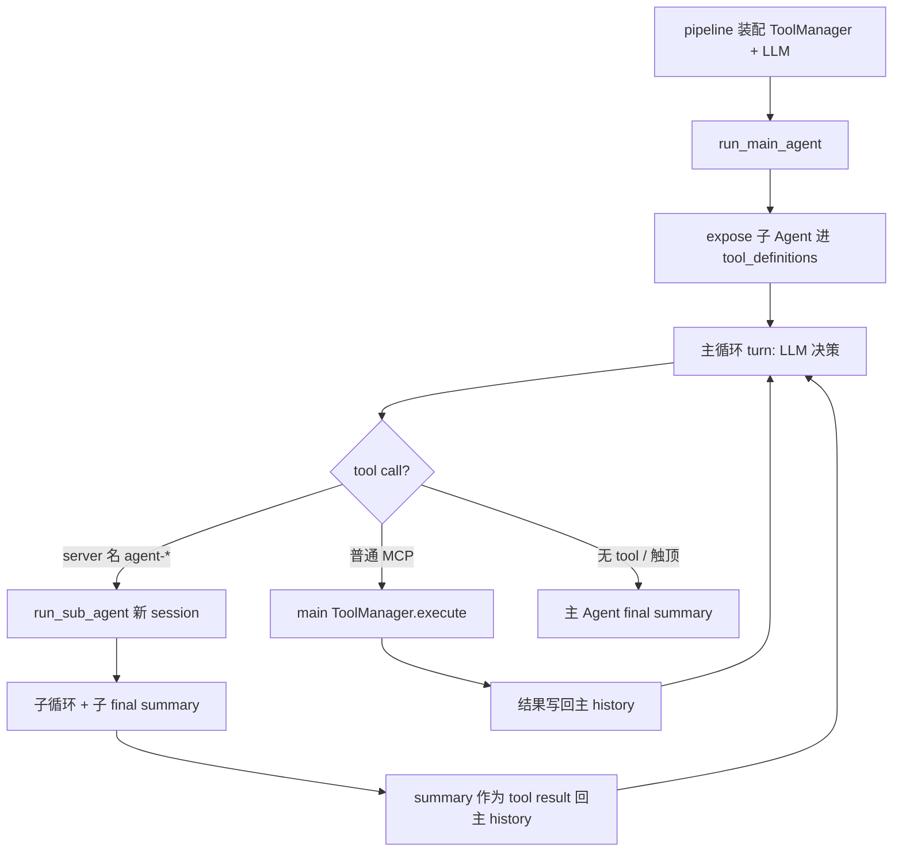

# Main-Sub Agent 编排专项精读 — 实现计划

> **面向 AI 代理的工作者：** 必需子技能：使用 superpowers:subagent-driven-development（推荐）或 superpowers:executing-plans 逐任务实现此计划。步骤使用复选框（`- [ ]`）语法来跟踪进度。

**目标：** 新建调用链级精读文档 `03-Main-Sub-Agent编排.md`，将 `02-面试问答.md` 的 E 节整段迁出改为索引，并同步题纲/旧规格交叉引用。

**架构：** 双轨文档——上半按一次任务跑通贴标本代码并加中文旁注；中段专钉「顺序 vs 并发」；下半承接 E13–E16 题索引并链回精读锚点。`02` 长期退化为问题索引本。

**技术栈：** Markdown；标本仓库 Python（`miro-flow-solution`：orchestrator / pipeline / tool_utils / task_tracer / Hydra yaml）。

**规格：** `docs/superpowers/specs/2026-08-05-main-sub-agent-deep-dive-design.md`

**标本根目录：** `/Users/yourton_ma/workspace/agent_project/research-agent/miro-flow-solution`

---

## 文件结构

| 文件 | 职责 |
|------|------|
| 创建：`docs/resume/interview/深度研究/03-Main-Sub-Agent编排.md` | 主交付：架构总览 + 调用链精读 + 并发专节 + E 题索引 |
| 修改：`docs/resume/interview/深度研究/02-面试问答.md` | E 节改为索引；L2-E16 与 §5 对照表锚点改指 `03`；文首加 `03` 链接 |
| 修改：`docs/resume/interview/面试题纲.md` | E 节题干下增加「详解见 `深度研究/03-...`」一行（不改编题干） |
| 修改：`docs/superpowers/specs/2026-08-04-deep-research-interview-prep-design.md` | 增加一句：Main-Sub 深挖已拆至 2026-08-05 规格与 `03` |

**明确不修改：** `miro-flow-solution` / SuperSonic 功能代码；`01-集成设计.md`；Hybrid Search / MCP 98% / 断点续跑正文。

---

## 标本锚点速查（实现时按文件核对行号，若漂移以符号名为准）

| 符号 / 注释 | 文件 |
|-------------|------|
| `create_pipeline_components` | `src/core/pipeline.py` ~L200–234 |
| `execute_task_pipeline`（Orchestrator 创建与 `run_main_agent`） | `src/core/pipeline.py` ~L30–175 |
| `expose_sub_agents_as_tools` | `src/utils/tool_utils.py` ~L87–105 |
| `SubAgentWorkerPrompt.expose_agent_as_tool` | `config/agent_prompts/sub_worker.py` ~L229–247 |
| `run_main_agent` | `src/core/orchestrator.py` ~L886 起 |
| `# Execute tool calls (in sequence)` + `for call in ...` | `src/core/orchestrator.py` ~L1110–1150 |
| `run_sub_agent` | `src/core/orchestrator.py` ~L577–884 |
| `start_sub_agent_session` / history 字段 | `src/logging/task_tracer.py` ~L56–94 |
| Main/Sub 预算配置 | `config/agent_llm_qwen37plus.yaml` |
| 多题并行（对比用） | `common_benchmark.py` `run_parallel_inference` ~L369–418 |

---

### 任务 1：创建 `03` 骨架 + §0 定位 + §1 架构总览

**文件：**
- 创建：`docs/resume/interview/深度研究/03-Main-Sub-Agent编排.md`

- [ ] **步骤 1：创建文件并写入头部、目录、§0、§1（可直接粘贴后按需微调）**

```markdown
# Main–Sub Agent 编排 — 代码精读与面试深挖

> 对应简历：问数结果深度研究 · 第二点（Main–Sub Agent 编排）
> 题纲：[`../面试题纲.md`](../面试题纲.md) § 三 E13–E16
> 索引本：[`02-面试问答.md`](./02-面试问答.md)（E 节已迁出至本文）
> 设计规格：[`../../superpowers/specs/2026-08-05-main-sub-agent-deep-dive-design.md`](../../superpowers/specs/2026-08-05-main-sub-agent-deep-dive-design.md)
> 复习标本：`miro-flow-solution`（对齐工程细节；面试不主动对比 MiroFlow，不宣称「我发明框架」）

---

## 0. 目标与诚实边界

### 0.1 本文做什么

- 按一次任务跑通 Main→Sub→回传→final summary 的调用链，贴关键代码并注释。
- 钉死「简历并发」与「标本顺序执行」的可答辩关系。
- 承接原 `02` E13–E16 详答，供面试深挖。

### 0.2 本文不做什么

- Hybrid Search / MCP 98% / GAIA 断点续跑全文 / Java↔Python 集成契约 / 完整 TaskTracer 回放教程。

### 0.3 诚实边界总表

| 说法 | 可讲 | 不可讲 |
|------|------|--------|
| 子会话隔离 | 新 `message_history` + 独立 session；只回传 summary | 「子 Agent 共享主会话全量上下文」 |
| 动态拆分 | 主 Agent 按 tool 描述决定是否委派 | 「每类问题写死固定角色路由表」（无额外依据时） |
| 并发 | 架构可并行无依赖子任务；业务需另加并发/超时/隔离 | 标本 `for` 说成已 `gather`；把 `10` 说成同时跑 10 个 |
| 结构化报告 | 逻辑结构（结论/证据/缺口/不确定性）；标本多为自然语言 summary | 「代码级 JSON schema 强校验已落地」 |
| 归属 | 工程 harness owner；标本对齐细节 | 「我发明了这套编排框架」 |

---

## 1. 架构总览

### 1.1 角色

| 角色 | 职责 | 标本依据 |
|------|------|----------|
| Main Agent | 拆任务、选工具/子 Agent、汇总最终答案 | `run_main_agent`；工具偏轻（如 `tool-reasoning`） |
| Sub Agent（如 `agent-worker`） | 独立会话内检索/阅读/代码等，产出 summary | `run_sub_agent`；工具更重 |
| Tool 化外壳 | `agent-` 前缀暴露为可调用工具 | `expose_sub_agents_as_tools` |
| TaskTracer | 主/子 history 分存；`session_id = {name}_{counter}` | `start_sub_agent_session` |

### 1.2 一次任务数据流



### 1.3 配置骨架（标本示例，非业务最优）

以 `config/agent_llm_qwen37plus.yaml` 为准列出 Main/Sub 的 `llm`、`tool_config`、`max_turns`、`max_tool_calls_per_turn`；注明 Main/Sub llm 块分开故**支持**异构，GAIA 示例通常同模。

---

## 2. 调用链精读①：配置装配

（任务 2 填充）

## 3. 调用链精读②：子 Agent 工具化

（任务 2 填充）

## 4. 调用链精读③：主循环

（任务 3 填充）

## 5. 调用链精读④：`run_sub_agent`

（任务 3 填充）

## 6. 调用链精读⑤：主 Agent final summary

（任务 4 填充）

## 7. 预算与熔断

（任务 4 填充）

## 8. 专节：顺序执行 vs 简历「并发」

（任务 5 填充）

## 9. 面试题索引（E13–E16）

（任务 6 填充）

## 10. 回看清单

（任务 6 填充）
```

- [ ] **步骤 2：确认文件存在且 §0/§1 关键表齐全**

运行：

```bash
test -f docs/resume/interview/深度研究/03-Main-Sub-Agent编排.md && \
rg -n "诚实边界总表|一次任务数据流|agent-worker|max_turns" \
  "docs/resume/interview/深度研究/03-Main-Sub-Agent编排.md"
```

预期：文件存在；上述关键词均有命中。

- [ ] **步骤 3：Commit**

```bash
git add docs/resume/interview/深度研究/03-Main-Sub-Agent编排.md
git commit -m "$(cat <<'EOF'
docs: scaffold Main-Sub Agent deep-dive chapter

Add architecture overview, honesty boundaries, and section stubs for call-chain study.
EOF
)"
```

---

### 任务 2：填写 §2 配置装配 + §3 工具化（精读）

**文件：**
- 修改：`docs/resume/interview/深度研究/03-Main-Sub-Agent编排.md`
- 只读标本：`pipeline.py`、`tool_utils.py`、`sub_worker.py`、`agent_llm_qwen37plus.yaml`

- [ ] **步骤 1：打开标本，核对行号后写入 §2**

§2 必须包含：

1. 粘贴 `agent_llm_qwen37plus.yaml` 中 `main_agent` / `sub_agents.agent-worker` 关键字段（可删 env 噪音，保留 max_turns / tool_config / llm.model_name）。
2. 粘贴 `create_pipeline_components` 全文（~L200–234），旁注：Main 一个 ToolManager；每个 sub 一个 ToolManager。
3. 粘贴 `execute_task_pipeline` 中创建 `LLMClient`、`Orchestrator`、调用 `run_main_agent` 的片段（约 L113–151 一带，以实现时为准），旁注：入口是 pipeline。
4. 「面试时怎么说」3–5 句；「易踩坑」至少含：不要说整个 Data Agent 都在 Python 里装配。
5. 下一跳 → §3。

每段代码用 fenced block，并在块前用一行注明 `文件:行号`。

- [ ] **步骤 2：写入 §3 工具化**

§3 必须包含：

1. 粘贴 `expose_sub_agents_as_tools` 全文（~L87–105）；旁注：名称必须以 `agent-` 开头。
2. 粘贴 `SubAgentWorkerPrompt.expose_agent_as_tool`（~L229–247）；旁注：工具描述写明返回 **processed summary reports**；入参 `subtask` 字符串。
3. 粘贴主循环里 `tool_definitions += expose_sub_agents_as_tools(...)` 三行上下文（`run_main_agent` 取 tools 段）。
4. 「面试时怎么说」：子 Agent = 可调用工具，动态委派不是写死路由表。
5. 「易踩坑」：不要把 expose 说成子 Agent 共享主 history。

- [ ] **步骤 3：验证 §2/§3 含关键符号**

运行：

```bash
rg -n "create_pipeline_components|expose_sub_agents_as_tools|expose_agent_as_tool|execute_subtask|agent-" \
  "docs/resume/interview/深度研究/03-Main-Sub-Agent编排.md"
```

预期：均有命中；且正文出现「面试时怎么说」「易踩坑」。

- [ ] **步骤 4：Commit**

```bash
git add docs/resume/interview/深度研究/03-Main-Sub-Agent编排.md
git commit -m "$(cat <<'EOF'
docs: deep-dive Main-Sub config assembly and tool exposure

Walk through pipeline component creation and expose_sub_agents_as_tools with specimen excerpts.
EOF
)"
```

---

### 任务 3：填写 §4 主循环 + §5 `run_sub_agent`（精读核心）

**文件：**
- 修改：`docs/resume/interview/深度研究/03-Main-Sub-Agent编排.md`
- 只读标本：`orchestrator.py`、`task_tracer.py`

- [ ] **步骤 1：写入 §4 主循环**

必须钉死并贴码：

1. `while turn_count < max_turns` 循环头 + `_handle_llm_call_with_logging` 调用。
2. **完整** tool 执行段，从注释 `# Execute tool calls (in sequence)` 到 `agent-*` 分支调用 `run_sub_agent` 再写回结果（勿省略 `for call in tool_calls[0][:max_tool_calls]`）。
3. 旁注三句硬结论：
   - 顺序执行（注释已写 in sequence）
   - `max_tool_calls_per_turn` = 截断前 N 个，不是并发度
   - `server_name.startswith("agent-")` 才进子 Agent
4. 「面试时怎么说」+「易踩坑」（禁止声称标本已 gather）。
5. 下一跳 → §5。

- [ ] **步骤 2：写入 §5 `run_sub_agent`**

将近全文分段粘贴（建议四段，中间不省略关键分支）：

1. session 启动 + `message_history = [{"role":"user", ...}]`（~L577–595）
2. 子 turn 循环头与 LLM 调用（说明与主循环同构、工具集来自 sub ToolManager）
3. max_turns / task_failed 后仍走 `sub_agent_final_summary` + `_handle_summary_with_context_limit_retry`（~L829–845）
4. 写入 `sub_agent_message_history_sessions`、`end_sub_agent_session`、`return final_answer_text`（~L865–884）

同时粘贴 `TaskTracer.start_sub_agent_session`（~L68–84）说明 `session_id` 生成规则。

旁注必须覆盖：隔离单元；回传是 summary 文本；信息缺失靠主 Agent 写全任务描述而非塞全历史。

- [ ] **步骤 3：验证顺序执行证据与 session 字段出现在正文**

运行：

```bash
rg -n "in sequence|run_sub_agent|start_sub_agent_session|sub_agent_message_history_sessions|final_answer_text|max_tool_calls_per_turn" \
  "docs/resume/interview/深度研究/03-Main-Sub-Agent编排.md"
```

预期：全部命中；且存在字面 `Execute tool calls (in sequence)` 或等价中英对照指出顺序执行。

- [ ] **步骤 4：Commit**

```bash
git add docs/resume/interview/深度研究/03-Main-Sub-Agent编排.md
git commit -m "$(cat <<'EOF'
docs: deep-dive main loop and run_sub_agent isolation

Document sequential tool dispatch, sub-session history, and summary return path.
EOF
)"
```

---

### 任务 4：填写 §6 主汇总 + §7 预算熔断

**文件：**
- 修改：`docs/resume/interview/深度研究/03-Main-Sub-Agent编排.md`
- 只读标本：`orchestrator.py`（final summary 段）、`agent_llm_qwen37plus.yaml`

- [ ] **步骤 1：写入 §6**

必须包含：

1. 主循环结束后调用 `_handle_summary_with_context_limit_retry` 的片段。
2. 说明 `task_failed` / 触顶仍尝试 summary（与子 Agent 对称）。
3. 明确：标本 summary 是自然语言；逻辑结构（结论/证据/缺口/不确定性）是工程关注点，不是已落地的 JSON schema 校验。
4. 质量差处理口径：重派 / 补证 / 降置信——无自动打分器。
5. 「面试时怎么说」+「易踩坑」。

- [ ] **步骤 2：写入 §7**

必须包含：

1. 表：Main `20/10`，Sub worker `50/10`（标注标本配置）。
2. 贴码：`tool_calls_exceeded` 截断逻辑 + `max_turns` 循环条件各一段。
3. 两道预算含义对照表（循环深度 vs 单轮调用数）。
4. 交叉引用：完整 G23 题仍见 `02`；本文只讲 Main-Sub 相关。
5. 「面试时怎么说」：20/10 不是未经实测的线上最优。

- [ ] **步骤 3：验证**

运行：

```bash
rg -n "_handle_summary_with_context_limit_retry|task_failed|max_turns|tool_calls_exceeded|JSON schema|G23" \
  "docs/resume/interview/深度研究/03-Main-Sub-Agent编排.md"
```

预期：均有命中；出现否定「JSON schema 强校验」的表述。

- [ ] **步骤 4：Commit**

```bash
git add docs/resume/interview/深度研究/03-Main-Sub-Agent编排.md
git commit -m "$(cat <<'EOF'
docs: cover Main-Sub final summary and turn/tool budgets

Clarify natural-language summaries and specimen max_turns limits.
EOF
)"
```

---

### 任务 5：填写 §8 顺序 vs 并发专节

**文件：**
- 修改：`docs/resume/interview/深度研究/03-Main-Sub-Agent编排.md`
- 只读标本：`orchestrator.py` ~L1110；`common_benchmark.py` `run_parallel_inference`

- [ ] **步骤 1：按规格四段写满 §8**

固定结构（标题可微调，内容不可缺）：

```markdown
## 8. 专节：顺序执行 vs 简历「并发」

### 8.1 标本证据：单题内顺序调度
（再次贴 in sequence + for 循环；强调一轮可提出多个 tool call，但仍逐个 await）

### 8.2 对比：多题并行不是单题内并行
（贴 `run_parallel_inference` 中 Semaphore + gather(return_exceptions=True) 核心 15–30 行）
（旁注：这是 benchmark 多题；G22 详答仍在 02 / 未来 G 专项）

### 8.3 简历口径模板（可背）
「主 Agent 动态拆子任务；子任务在独立会话执行并回传摘要。当前可核对实现里，单题内 tool call / 子 Agent 调用是顺序调度；架构上可以把无依赖子任务并行化，但需要单独配置全局并发、超时和异常隔离。评测里的 max_concurrent 是多题并行，不是单题内同时跑 N 个子 Agent。」

### 8.4 可选演进（非必做代码）
（asyncio.gather 伪代码草图 10–20 行即可；明确「未在标本落地 / 本准备文档不改代码」）
```

- [ ] **步骤 2：验证禁止越界词与必备口径**

运行：

```bash
rg -n "简历口径|in sequence|run_parallel_inference|Semaphore|gather|无依赖" \
  "docs/resume/interview/深度研究/03-Main-Sub-Agent编排.md"
# 不应出现把标本说成已并行的肯定句；抽查：
rg -n "标本已用 asyncio.gather|已经并行执行子 Agent" \
  "docs/resume/interview/深度研究/03-Main-Sub-Agent编排.md" || true
```

预期：第一组全命中；第二组无命中（或仅出现在「不要说…」的反例句中）。

- [ ] **步骤 3：Commit**

```bash
git add docs/resume/interview/深度研究/03-Main-Sub-Agent编排.md
git commit -m "$(cat <<'EOF'
docs: pin sequential vs concurrent narrative for Main-Sub

Separate in-task sequential dispatch from multi-task benchmark parallelism.
EOF
)"
```

---

### 任务 6：填写 §9 题索引（迁入 E13–E16）+ §10 回看清单

**文件：**
- 修改：`docs/resume/interview/深度研究/03-Main-Sub-Agent编排.md`
- 只读来源：`02-面试问答.md` 原 E13–E16 正文（约 L192–232）

- [ ] **步骤 1：把 E13–E16 迁入 §9，并为每题增加「详见」链接**

要求：

1. 保留每题「第一句 / 要点 / 易踩坑」。
2. 将「回看标本」改为「回看标本 + 详见本文 §x」。
3. 锚点 id 保持可链：`e13-...`、`e14-...`、`e15-...`、`e16-...`（可用 HTML `<a id="...">` 或标题自动 slug；须与任务 7 中 `02` 外链一致）。
4. 交叉引用句（各 1 句即可）：
   - E14 ↔ §8、G22（多题并行细节见 `02` G22）
   - E15 ↔ §6
   - 模型异构 B4 ↔ §1.3（支持 ≠ 已线上异构）

建议映射：

| 题 | 详见 |
|----|------|
| E13 | §5 + `task_tracer` 摘录 |
| E14 | §3 + §4 + §8 |
| E15 | §5 回传 + §6 |
| E16 | §0.3 + `02` §0.1 职责（本文重复 L0 一句即可） |

- [ ] **步骤 2：写 §10 回看清单**

按阅读顺序列出：

1. `config/agent_llm_qwen37plus.yaml`
2. `src/core/pipeline.py`（components + execute）
3. `src/utils/tool_utils.py` + `config/agent_prompts/sub_worker.py`
4. `src/core/orchestrator.py`（`run_main_agent` tool 段 → `run_sub_agent`）
5. `src/logging/task_tracer.py`（session 字段）
6. （对比）`common_benchmark.py` `run_parallel_inference`

- [ ] **步骤 3：验证四题锚点存在**

运行：

```bash
rg -n "E13|E14|E15|E16|第一句|详见" \
  "docs/resume/interview/深度研究/03-Main-Sub-Agent编排.md" | head -80
```

预期：四题均有「第一句」；均有「详见」。

- [ ] **步骤 4：Commit**

```bash
git add docs/resume/interview/深度研究/03-Main-Sub-Agent编排.md
git commit -m "$(cat <<'EOF'
docs: migrate E13-E16 answers into Main-Sub deep-dive

Add interview index with links back to call-chain sections and reading order.
EOF
)"
```

---

### 任务 7：将 `02` 的 E 节改为索引

**文件：**
- 修改：`docs/resume/interview/深度研究/02-面试问答.md`

- [ ] **步骤 1：更新文首配套链接**

在文首引用块增加一行（保持现有链接风格）：

```markdown
> Main-Sub 精读：[`03-Main-Sub-Agent编排.md`](./03-Main-Sub-Agent编排.md)
```

- [ ] **步骤 2：用下列索引块替换原「### E. Main-Sub Agent 编排」整段（含 E13–E16 正文，直到 `### F.` 之前）**

```markdown
### E. Main-Sub Agent 编排

> 详解已迁至专项：[`03-Main-Sub-Agent编排.md`](./03-Main-Sub-Agent编排.md)（调用链精读 + 并发口径 + E13–E16）。
> `02` 仅保留题号索引。

| 题号 | 一句话 | 详解 |
|------|--------|------|
| E13 | 子任务描述开新会话；独立 session/history；只回传 summary | [03 §9 E13](./03-Main-Sub-Agent编排.md#e13-子会话隔离具体怎么做信息缺失怎么办) · 精读 [§5](./03-Main-Sub-Agent编排.md#5-调用链精读run_sub_agent) |
| E14 | 动态委派；标本单题内顺序执行；`10` 是单轮上限不是并发度 | [03 §9 E14](./03-Main-Sub-Agent编排.md#e14-子任务怎么分配最多同时跑几个) · [§8 并发专节](./03-Main-Sub-Agent编排.md#8-专节顺序执行-vs-简历并发) |
| E15 | 子 Agent 先 summary 再回传；主 Agent 二次汇总；无 JSON 强校验 | [03 §9 E15](./03-Main-Sub-Agent编排.md#e15-主-agent-如何汇总子-agent-质量差怎么办) |
| E16 | 0-1 工程 owner；比赛原型 + 实习接入；博士后咨询 | [03 §9 E16](./03-Main-Sub-Agent编排.md#e16-模块是谁做的花了多久) |

```

注意：若 `03` 最终标题 slug 与上表锚点不一致，以实现后 `03` 实际锚点为准修正链接（GitHub/常见 Markdown 对中文标题的 slug 规则可能不同；可用在 `03` 题目标题下显式加 `<a id="e13-..."></a>` 保证稳定）。

- [ ] **步骤 3：改 L2-E16 与 §5 对照表**

将 `### 3.3 E16` 中「详答回看 [E16](#e16-...)」改为指向 `03` 的 E16。

将 §5 表中三-E13…E16 四行的「文档锚点」列改为链接 `03` 对应题（层与标本路径可保留）。

- [ ] **步骤 4：验证 `02` 不再含 E 详答长文**

运行：

```bash
rg -n "^#### E1[3-6]" "docs/resume/interview/深度研究/02-面试问答.md" || true
rg -n "03-Main-Sub-Agent编排" "docs/resume/interview/深度研究/02-面试问答.md"
rg -n "run_sub_agent\(\) 调用 \`start_sub_agent_session" \
  "docs/resume/interview/深度研究/02-面试问答.md" || true
```

预期：无 `#### E13` 级详答标题；有多处 `03-Main-Sub-Agent编排`；原 E13 长要点句不再出现在 `02`。

- [ ] **步骤 5：Commit**

```bash
git add docs/resume/interview/深度研究/02-面试问答.md
git commit -m "$(cat <<'EOF'
docs: turn deep-research E section into index to 03

Move Main-Sub detailed answers out of the interview Q&A index file.
EOF
)"
```

---

### 任务 8：同步题纲与旧规格交叉引用

**文件：**
- 修改：`docs/resume/interview/面试题纲.md`
- 修改：`docs/superpowers/specs/2026-08-04-deep-research-interview-prep-design.md`

- [ ] **步骤 1：在题纲 E 节标题下增加一行指针（不改编题干）**

定位 `E. Main-Sub Agent 编排`（约 L225），在标题行后插入：

```markdown
> 详解与代码精读：`docs/resume/interview/深度研究/03-Main-Sub-Agent编排.md`
```

题干 13–16 保持不变。

- [ ] **步骤 2：在 2026-08-04 规格增加拆分说明**

在该文件「## 1. 背景与目标」或「## 4. L1 / L2 范围」的 Main-Sub 行附近增加：

```markdown
> **拆分更新（2026-08-05）：** Main-Sub Agent 编排的调用链精读与 E13–E16 详答已拆至
> `docs/superpowers/specs/2026-08-05-main-sub-agent-deep-dive-design.md` 与
> `docs/resume/interview/深度研究/03-Main-Sub-Agent编排.md`；本规格不再作为该主题的唯一正文来源。
```

- [ ] **步骤 3：验证**

运行：

```bash
rg -n "03-Main-Sub-Agent编排" "docs/resume/interview/面试题纲.md" \
  "docs/superpowers/specs/2026-08-04-deep-research-interview-prep-design.md"
```

预期：两个文件均命中。

- [ ] **步骤 4：Commit**

```bash
git add docs/resume/interview/面试题纲.md \
  docs/superpowers/specs/2026-08-04-deep-research-interview-prep-design.md
git commit -m "$(cat <<'EOF'
docs: link Main-Sub deep-dive from outline and prior spec

Point E-section readers to the dedicated 03 call-chain document.
EOF
)"
```

---

### 任务 9：规格验收自检（对照设计 §10）

**文件：**
- 只读：`03`、`02`、规格

- [ ] **步骤 1：跑验收命令清单**

```bash
DOC="docs/resume/interview/深度研究/03-Main-Sub-Agent编排.md"
IDX="docs/resume/interview/深度研究/02-面试问答.md"

# 1) 调用链关键符号
rg -n "create_pipeline_components|expose_sub_agents_as_tools|run_main_agent|run_sub_agent|in sequence|_handle_summary" "$DOC"

# 2) 并发口径
rg -n "简历口径|run_parallel_inference|max_tool_calls_per_turn" "$DOC"

# 3) 禁止越界（下列若作为肯定声称出现则失败；允许出现在「不可讲/易踩坑」）
rg -n "我发明|JSON schema 强校验已落地|标本已用 asyncio.gather" "$DOC" || true

# 4) 范围未膨胀
rg -n "Hybrid Search|工具调用成功率|断点续跑|DataInterpretProcessor" "$DOC" || true

# 5) 02 已索引化
rg -n "03-Main-Sub-Agent编排" "$IDX"
test ! -n "$(rg -n '^#### E13' "$IDX" || true)"

# 6) 篇幅粗检（精读应明显长于速答）
wc -l "$DOC"
```

预期：

- (1)(2)(5) 通过。
- (3) 无越界肯定句（或仅在反例/不可讲表中）。
- (4) 若命中，确认只是交叉引用一句而非展开专章；否则删改。
- (6) `wc -l` 建议 ≥ 400（精读目标）；若显著偏短，回到任务 3/5 补贴码。

- [ ] **步骤 2：人工口述检查（执行者自问）**

不看源码，能否按 §2→§6 讲完一次委派？被问「同时跑几个」能否指向 §8？若不能，补对应节的「面试时怎么说」。

- [ ] **步骤 3：若有修正则 commit**

```bash
git add docs/resume/interview/深度研究/03-Main-Sub-Agent编排.md \
  docs/resume/interview/深度研究/02-面试问答.md
git commit -m "$(cat <<'EOF'
docs: fix Main-Sub deep-dive acceptance gaps

Align excerpts and cross-links with the design verification checklist.
EOF
)"
```

若无需修改可跳过本 commit。

---

## 计划自检（写作时已核对）

| 规格章节 | 对应任务 |
|----------|----------|
| §1 目标/非目标 | 任务 1 §0 |
| §2 已确认决策 / 双轨组织 | 任务 1–6 结构 |
| §4.1 `03` 目录 §0–§10 | 任务 1–6 |
| §4.2 连带改动 `02`/题纲/旧规格 | 任务 7–8 |
| §5 架构与诚实边界 | 任务 1 |
| §6 精读范围 §2–§7 | 任务 2–4 |
| §7 并发专节 | 任务 5 |
| §8 题索引 E13–E16 | 任务 6 |
| §9 一致性 | 任务 5/9 |
| §10 验证标准 | 任务 9 |
| §11 交付顺序 | 任务 1→9 |

无 TBD/TODO 占位；标本路径与符号名已给出；行号允许漂移但要求实现时按符号重核。
