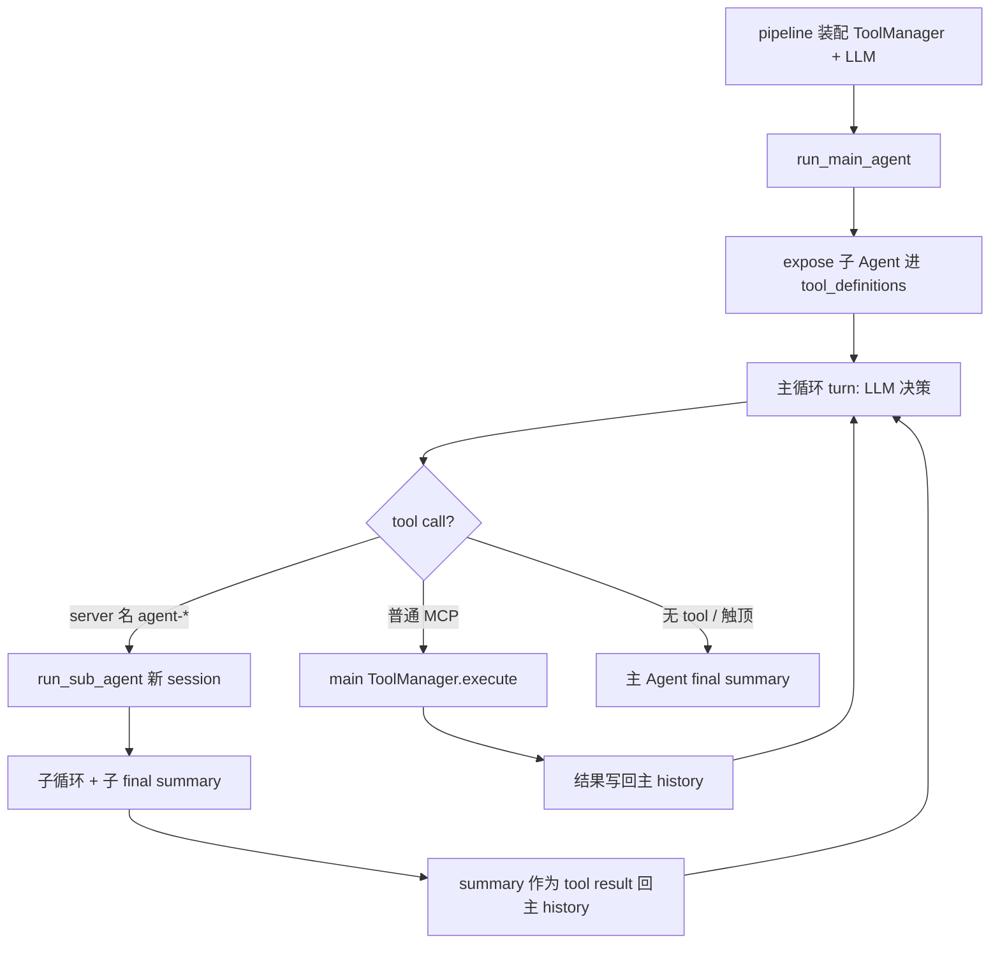

# Main-Sub Agent 编排专项精读 — 设计规格

> 日期：2026-08-05  
> 状态：待用户审查  
> 简历锚点：`docs/resume/my_resume.md`「问数结果深度研究」第二点  
> 题纲锚点：`docs/resume/interview/面试题纲.md` § 三 E13–E16（及与 G22/G23、模型 B4 交叉）  
> 现行速答：`docs/resume/interview/深度研究/02-面试问答.md` § E（实现时迁出）  
> 复习标本：`miro-flow-solution`（对齐工程细节；面试不主动对比 MiroFlow，不宣称「我发明框架」）  
> 上游规格：`docs/superpowers/specs/2026-08-04-deep-research-interview-prep-design.md`（Main-Sub 深挖从总册拆出）

---

## 1. 背景与目标

### 1.1 问题

`02-面试问答.md` 的 E 节（Main-Sub Agent 编排）以「第一句 + 要点 + 易踩坑 + 回看路径」压成面试速答，对应对简历第二点时信息密度不够：候选人难以对着代码讲清一次完整委派链路，也容易在「并发」「结构化报告」「子会话隔离」上越界。

同时，`02` 的长期角色将退化为**问题索引**，各主题最终拆成深度研究子目录下的专项文档。Main-Sub 是首个按此模式拆出的主题。

### 1.2 目标

1. 新建调用链级精读文档 `docs/resume/interview/深度研究/03-Main-Sub-Agent编排.md`。
2. 文档采用双轨：上半按一次任务跑通贴码注释；中段专钉「顺序 vs 并发」；下半承接 E13–E16 题索引并链回精读锚点。
3. 将 `02` 的 E 节整段迁出，改为索引 + 外链；题纲/对照表锚点同步改指 `03`。
4. 口径与 L0 事实库、简历诚实边界一致，特别是「标本顺序执行」与简历「并发」表述的可答辩关系。

### 1.3 非目标

- 不写 Hybrid Search 路由/融合细节（归后续 F 专项）。
- 不写 MCP 工具成功率 98% 统计定义（归 F18）。
- 不写 GAIA 断点续跑与多题并行评测全文（归 G24 / G22；本文仅在并发专节对比「多题并行 ≠ 单题内并行」）。
- **预算/并发权威详解改归 `05-工程化能力.md`**（及 `2026-08-06-hybrid-search-and-engineering-interview-prep-design.md`）；本规格对应的 `03` §8–§9 仅为编排侧短指针。
- 不写 Java↔Python 集成契约（归 `01-集成设计.md`）。
- 不写完整 TaskTracer 回放教程（归 G21；本文只覆盖 Main-Sub 用到的 session / history 字段）。
- 不把「业务侧子 Agent 并行化」写成必须落地的代码改造；最多伪代码级演进草图。
- 不改 `miro-flow-solution` / SuperSonic 功能代码。

---

## 2. 已确认决策

| 决策点 | 选择 |
|--------|------|
| 文档角色 | **混合**：先架构/调用链精读，再挂面试题索引 |
| 与 `02` 关系 | **E 整段迁出**；`02` 只留索引；长期 `02` = 问题索引本 |
| 范围 | **Main-Sub 运行时全景**：E13–E16 + 配置装配 + 主循环 + 预算熔断 + 顺序/并发专节；G21/G22/模型 B4 交叉引用不展开 |
| 代码密度 | **调用链精读**：关键函数近全文贴码 + 中文旁注；预计教程级篇幅 |
| 组织方案 | **双轨**：时间线精读为主体 + 并发专节 + 题索引 |
| 文件名 | `03-Main-Sub-Agent编排.md` |

---

## 3. 方案对比（记录）

| 方案 | 描述 | 结论 |
|------|------|------|
| 1. 纯时间线精读 | 按执行顺序贴码，概念散落 | 不单独采用 |
| 2. 机制专章 + 附录全文 | 面试好查，但与「精读 B」重复维护 | 不采用 |
| 3. 上半精读 + 并发专节 + 下半题索引 | 兼顾深度与面试入口 | **采用** |

---

## 4. 交付物

### 4.1 主交付：`03-Main-Sub-Agent编排.md`

建议目录：

| 章 | 内容 |
|----|------|
| 0 | 目标 / 非目标 / 与 `02`·简历·题纲关系 / 诚实边界总表 |
| 1 | 架构总览（角色表、配置骨架、一次任务数据流 mermaid） |
| 2 | 调用链精读①：配置装配（yaml → `create_pipeline_components` → Orchestrator） |
| 3 | 调用链精读②：子 Agent 工具化（`expose_sub_agents_as_tools`） |
| 4 | 调用链精读③：主循环（turn、tool call 分支、委派入口） |
| 5 | 调用链精读④：`run_sub_agent`（独立 session / history / summary 回传） |
| 6 | 调用链精读⑤：主 Agent final summary 与结束态 |
| 7 | 预算与熔断（`max_turns` / `max_tool_calls_per_turn`，与 G23 交叉） |
| 8 | 专节：顺序执行 vs 简历「并发」（代码证据 + 面试口径 + 业务可并行化边界） |
| 9 | 面试题索引（E13–E16 详答迁入；链回 §2–§8；G22/模型 B4 只交叉引用） |
| 10 | 回看清单（文件路径 + 建议阅读顺序） |

### 4.2 连带改动

| 文档 | 动作 |
|------|------|
| `深度研究/02-面试问答.md` | 删除 E13–E16 详答正文；E 节改为题号 + 一句话 + 链到 `03` 锚点；L2-E16 改指 `03`；§5 对照表三-E13…E16 锚点改指 `03`；文首增加 `03` 链接 |
| `面试题纲.md` | 若有 E 节回看路径，改指 `03`；不改编题干 |
| `2026-08-04-deep-research-interview-prep-design.md` | 增加一句：Main-Sub 深挖已拆至本规格与 `03` 文档，避免范围打架 |

### 4.3 精读章统一模板

每章：

1. 前置条件（读到这里应已知什么）
2. 关键代码：完整或近完整函数/代码段 + 中文旁注（这一步在干什么 / 对应简历哪句 / 面试别说成什么）
3. 「面试时怎么说」3–5 句
4. 「易踩坑」
5. 下一跳指针

---

## 5. 架构与诚实边界（写入 `03` §0–§1）

### 5.1 角色

| 角色 | 职责 | 标本依据 |
|------|------|----------|
| Main Agent | 拆任务、选工具/子 Agent、汇总最终答案 | `Orchestrator.run_main_agent`；自身工具偏轻（如 `tool-reasoning`） |
| Sub Agent（如 `agent-worker`） | 独立会话内检索/阅读/代码等执行，产出 summary | `run_sub_agent`；工具更重（searching/reading/code…） |
| Tool 化外壳 | 子 Agent 名以 `agent-` 前缀暴露成可调用工具 | `expose_sub_agents_as_tools` |
| TaskTracer | 主/子 history 分存；`session_id = {name}_{counter}` | `start_sub_agent_session` / `sub_agent_message_history_sessions` |

### 5.2 一次任务数据流

### 5.3 配置骨架（标本示例，非业务最优）

以 `miro-flow-solution/config/agent_llm_qwen37plus.yaml` 为准写清结构：

- Main：`max_turns=20`，`max_tool_calls_per_turn=10`
- Sub `agent-worker`：`max_turns=50`，`max_tool_calls_per_turn=10`
- Main/Sub 的 `llm` 配置块分开 → **支持**异构；当前 GAIA 示例通常同模（「支持 ≠ 已线上异构」）

### 5.4 诚实边界总表

| 说法 | 可讲 | 不可讲 |
|------|------|--------|
| 子会话隔离 | 新 `message_history` + 独立 session；只回传 summary | 「子 Agent 共享主会话全量上下文」 |
| 动态拆分 | 主 Agent 按 tool 描述决定是否委派 | 「每类问题写死固定角色路由表」（无额外配置依据时） |
| 并发 | 架构上可并行无依赖子任务；业务若做需另加并发/超时/隔离 | 把标本 `for call in tool_calls` 说成已 `gather` 并行；把 `max_tool_calls_per_turn=10` 说成同时跑 10 个 |
| 结构化报告 | 逻辑结构（结论/证据/缺口/不确定性）；标本多为自然语言 summary | 「代码级 JSON schema 强校验已落地」 |
| 归属 | 工程 harness owner；标本用于对齐细节 | 「我发明了这套编排框架」 |

---

## 6. 调用链精读范围（写入 `03` §2–§7）

标本根目录：workspace 内 `miro-flow-solution`。

| 章 | 贴码范围 | 必须钉死的结论 |
|----|----------|----------------|
| §2 配置装配 | `config/agent_llm_qwen37plus.yaml`；`src/core/pipeline.py` 的 `create_pipeline_components`、`execute_task_pipeline`（创建 Orchestrator + `run_main_agent`） | Main/Sub 各自 ToolManager；Sub 可有独立 LLM client；入口是 pipeline |
| §3 工具化 | `src/utils/tool_utils.py` 的 `expose_sub_agents_as_tools` 全文；若 prompt 侧存在 `expose_agent_as_tool` 则跟一段；主循环 `tool_definitions += expose...` | 子 Agent = `agent-` 前缀伪工具；入参是任务描述 |
| §4 主循环 | `orchestrator.py` `run_main_agent`：取 tools → while turn → `for call in tool_calls[0][:max_tool_calls]` 的 human / `agent-*` / 普通工具分支 | 顺序 `for`；注释写明 in sequence；`max_tool_calls_per_turn` 是截断前 N 个 |
| §5 `run_sub_agent` | 函数近全文：`start_sub_agent_session` → 新 history → 子 turn → summary → 写 sessions → `end_sub_agent_session` → `return final_answer_text` | 隔离单元是 session + history；回传 summary 文本不是 tool dump |
| §6 主汇总 | 主循环结束后的 `_handle_summary_with_context_limit_retry`；`task_failed` / max_turns 仍尝试 summary | 触顶 ≠ 立刻丢弃；无自动打分器 |
| §7 预算 | yaml 数字 + 主/子循环截断逻辑 | 两道预算含义不同；20/10、50/10 标明标本值 |

**篇幅约束：**

- `run_sub_agent`、主循环 tool 执行段：允许长贴，可分段但不省略关键分支。
- LLM client / MCP `execute_tool_call` 内部：只点函数名，不展开。
- Human feedback / plan review：一笔带过为可选产品能力，非 Main-Sub 核心。
- 旁注用中文；不逐行翻译 Python。

---

## 7. 并发专节（写入 `03` §8）

固定四段：

1. **证据**：主循环 `# Execute tool calls (in sequence)` + `for call in tool_calls[0][:max_tool_calls]`。
2. **对比**：`common_benchmark.run_parallel_inference` 是多题并行（Semaphore + gather），不是单题内子 Agent 并行。
3. **简历口径模板**：架构支持将无依赖子任务并行化；当前可核对标本是顺序调度；业务若上并行需补全局并发上限、超时、异常隔离。
4. **可选演进**：`asyncio.gather` 级伪代码草图即可；不纳入本规格的必做代码改造。

---

## 8. 面试题索引（写入 `03` §9）

从 `02` 迁入并加厚锚点链接：

| 题号 | 主题 | 精读回链 |
|------|------|----------|
| E13 | 子会话隔离 / 信息缺失 | §5 + TaskTracer session 字段 |
| E14 | 子任务分配 / 同时跑几个 | §3 + §4 + §8 |
| E15 | 主 Agent 汇总 / 子质量差 | §5 回传 + §6 |
| E16 | Owner / 时间口径 | §0 职责；与 L0 一致，不编人天百分比 |

交叉引用（不迁正文）：

- G22 并发隔离 → 多题并行细节仍在 `02` 或未来 G 专项；本文 §8 只做边界对比
- G23 熔断 → 本文 §7 写 Main-Sub 相关部分，完整题仍可指 `02`/未来专项
- 模型 B4 主/子异构 → §1 配置骨架点到为止

体例：保留「第一句 / 要点 / 易踩坑」，并增加「详见 §x」链接。

---

## 9. 错误处理与一致性

- 凡标本与业务叙事不一致处（尤其并发），以代码证据为准，用「标本 / 业务演进」分层表述，禁止抹平差异。
- 与 `02` 其他章节（A–D、F–G）口径冲突时，以 `02` §0 L0 与本规格 §5.4 为准；发现冲突在实现时一并改索引句，不扩大改写范围。
- 数字类（max_turns 等）必须标注「标本配置示例」，不包装成线上最优。

---

## 10. 验证与成功标准

| 检查项 | 通过标准 |
|--------|----------|
| 调用链可口述 | 不看源码能按 §2→§6 讲完一次 Main→Sub→回传→final summary |
| 并发追问 | 能指向顺序 `for` 证据，并区分多题并行 vs 单题内并行 |
| 题覆盖 | E13–E16 在 `03` 可答全；`02` 无重复长正文 |
| 诚实边界 | 无「发明框架 / JSON 强校验已落地 / 标本已 gather 并行」 |
| 范围 | 未展开 Hybrid Search、MCP 98%、断点续跑、Java 集成细节 |
| 索引 | `02` E 节、对照表、题纲路径均指向 `03` 锚点 |

---

## 11. 实现阶段交付顺序（供 writing-plans）

1. 对照标本核对行号与函数签名（orchestrator / pipeline / tool_utils / task_tracer / yaml）。
2. 撰写 `03-Main-Sub-Agent编排.md` 全文（§0–§10）。
3. 将 E13–E16 从 `02` 迁出并改成索引；更新对照表与文首链接。
4. 更新题纲回看路径（若有）与 `2026-08-04` 规格的拆分说明句。
5. 按 §10 做自检；必要时用真实行号修正摘录。

---

## 12. 后续

用户批准本规格后，调用 **writing-plans** 编写实现计划（任务拆分、文件清单、验收 checklist）。  
本规格批准前不创建 `03` 正文，不改 `02`。
