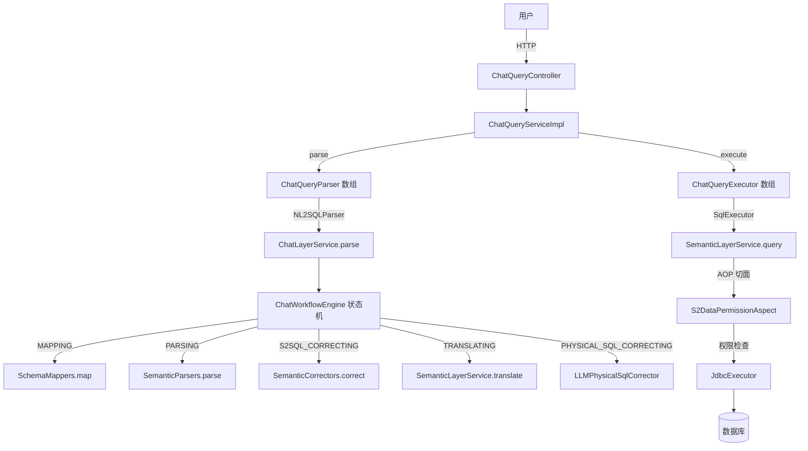
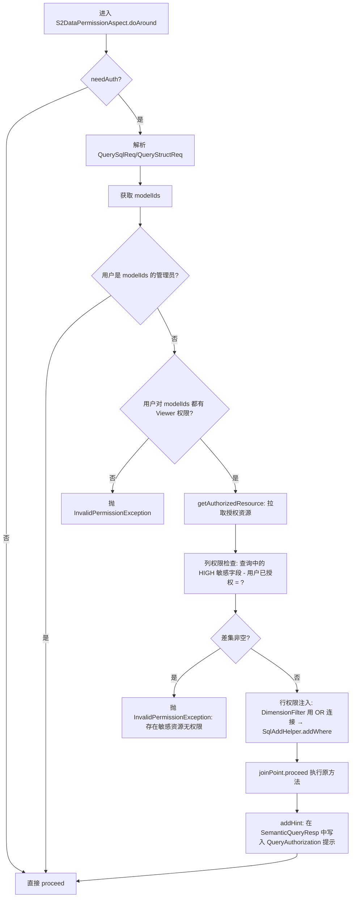

# 架构面试文档（01/02/03）— 设计规格

> 日期：2026-08-11
> 状态：待用户审查
> 目标目录：`docs/resume/interview/架构设计/`
> 目标文件：
>   - `01-架构总览.md`
>   - `02-查询数据流详解.md`
>   - `03-数据权限控制.md`
> 题纲：`docs/resume/interview/面试题纲.md`
> 体例参照：`docs/resume/interview/智能问数/01-总览与业务背景.md`、`docs/resume/interview/深度研究/*`
> 代码标本：本仓库 SuperSonic（chat / headless / auth / common 四个模块）
> 现有相关文档：`智能问数/02-SchemaMapper.md`（02 文档引用，不重复）

---

## 1. 背景与目标

### 1.1 问题

现有面试准备文档集中在「智能问数」「深度研究」「业务背景」三条线，缺少**面向数据平台/数仓团队面试官**的项目整体架构与核心数据流介绍。面试官背景为数据平台开发者或数仓团队，关心：

- 项目整体架构与模块职责（一句话能说清是什么）
- 一次查询从发起到 SQL 执行的关键阶段（特别是语义解析与校正，每个细节都要到位）
- 数据权限控制（数据表/模型/字段权限，**不是登录鉴权**）

现有 `智能问数/02-SchemaMapper.md` 已深挖 SchemaMapper 单阶段，不需重写；本文档群补齐**宏观架构 + 全链路数据流 + 数据权限**三块。

### 1.2 目标

1. 新建 `docs/resume/interview/架构设计/` 目录，含三篇文档：
   - `01-架构总览.md`（宏观鸟瞰，~600-800 行）
   - `02-查询数据流详解.md`（双轨制：管道阶段 + 端到端示例，~1000-1200 行）
   - `03-数据权限控制.md`（数据资源权限全景，~700-900 行）
2. 三篇可独立阅读，相互引用（不重复内容）。
3. 所有论断附 `file_path:line_number`，便于对码追溯。
4. 每篇设「面试问答速查」结尾小节，高频问题加粗。
5. **Corrector 阶段用中等粒度**（按 4 组分类，每组一段总结 + 少量源码片段），不展开 8 个子 corrector 的逐行代码。
6. sample query 选**财务金融场景**：「比亚迪今年的期间费用同比增加了多少」，并拆出「基础聚合版」和「派生同比版」两个对照状态快照。

### 1.3 非目标

- 不重写或修改 `智能问数/02-SchemaMapper.md`，只在 02 文档 A3 节做概览并引用。
- 不覆盖 `智能问数/03-查询记忆复用.md`、`智能问数/04-推荐问题.md` 已有内容。
- 不覆盖 `深度研究/*` 已有内容（Agent 编排、Hybrid Search、工程化能力）。
- **不写登录鉴权**（Token / ApiKey / SSO / AuthenticationInterceptor），03 文档只写数据资源权限。
- 不做物理 SQL 翻译阶段的深挖（02 文档 A6 节简略略过）。
- 不改业务代码。

---

## 2. 整体设计原则（三篇共用）

| 原则 | 说明 |
|------|------|
| **面向面试** | 每篇结尾设「面试问答速查」小节，高频问题加粗；正文不做 FAQ 散落 |
| **代码可溯** | 关键论断附 `file_path:line_number`；源码片段只贴 5-15 行 |
| **图示优先** | Mermaid 画数据流图、状态机图、调用链图、类图（GitHub 渲染原生支持） |
| **避免重复** | 三篇之间不复制粘贴；引用现有文档用短表 + 链接 |
| **诚实边界** | 文首必有「诚实边界表」，标注哪些是 OSS 代码可证、哪些是产品/ELK 口径 |
| **数仓视角叙事** | 用数仓团队能听懂的语言（语义层 / 指标 / 维度 / 脱敏 / 行权限），不堆砌 Chat BI 营销话术 |

---

## 3. `01-架构总览.md` 结构（~600-800 行）

### 3.1 章节大纲

| 节 | 标题 | 要点 |
|----|------|------|
| 文首 | 元信息 + 诚实边界 | 导航、代码标本、与现有文档关系图 |
| §1 | 项目定位 | 一句话：Chat BI + Headless BI 融合；解释 Headless BI 是什么；与 Tableau / Looker / dbt 的对位关系 |
| §2 | 顶层模块清单 | 表格：chat / headless / auth / common / launchers / webapp，每个一句话职责 + 关键子包 |
| §3 | 核心抽象 | 3.1 语义层（Model / DataSet / Metric / Dimension / Entity）；3.2 SchemaElementType 枚举；3.3 S2SQL vs 物理 SQL（为什么要有这一层） |
| §4 | 端到端数据流图 | 一张 Mermaid 大图：用户请求 → ChatQueryController → ChatQueryServiceImpl → ChatWorkflowEngine 状态机 → Mapper/Parser/Corrector/Translator → 执行 → 返回 |
| §5 | 关键技术栈 | 表格：Spring Boot 3.3 / LangChain4j 0.36 / JSqlParser 4.9 / Calcite 1.38 / HanLP / pgvector |
| §6 | SPI 扩展机制 | spring.factories 位置（`assembly/conf/META-INF/`）；以 SchemaMapper / SemanticParser / SemanticCorrector 为例；如何自定义扩展 |
| §7 | 三种部署模式 | standalone / chat-only / headless-only；何时选哪种；与 launchers 模块的对应 |
| §8 | 面试问答速查 | 10 问，例：「一句话介绍项目」「最复杂的部分」「为什么用状态机而非线性调用」「SPI 扩展点举例」「与 Looker 的区别」 |

### 3.2 §3 核心抽象要点

- **Model**：物理表的语义封装（类似 dbt model）
- **DataSet**：多 Model 组成的可查询数据集（类似语义视图）
- **Metric**：指标，可由表达式派生（销售费用 + 管理费用 = 期间费用）
- **Dimension**：维度，可标注敏感级别（SensitiveLevelEnum：LOW/MID/HIGH）
- **Entity**：业务实体（如「公司」「产品」），用于值映射

S2SQL vs 物理 SQL 的抽象是 SuperSonic 的核心创新点：
- S2SQL 用语义字段（metric_bizName / dimension_bizName）写
- 物理 SQL 由 SemanticTranslator 翻译，展开指标表达式、做方言适配
- **价值**：用户/LLM 写 SQL 时不用关心底表结构；权限可在语义层统一管控

### 3.3 §4 数据流图（Mermaid 草图）



---

## 4. `02-查询数据流详解.md` 结构（~1000-1200 行，双轨制）

### 4.1 总体结构

```
02-查询数据流详解.md
├── 文首元信息（导航、诚实边界、sample query 引子）
├── Part A · 管道阶段章节（按代码制口）
│   ├── A0 全局视图（ChatWorkflowEngine 状态机图）
│   ├── A1 入口与编排
│   ├── A2 ChatWorkflowEngine 状态机
│   ├── A3 SchemaMapper 阶段
│   ├── A4 SemanticParser 阶段
│   ├── A5 SemanticCorrector 阶段（中等粒度，4 组）
│   └── A6 SemanticTranslator 阶段（简单略过）
├── Part B · 端到端示例（sample query 贯穿）
│   ├── B1 基础聚合版（比亚迪今年的期间费用是多少）
│   └── B2 派生同比版（比亚迪今年的期间费用同比增加了多少）
└── 面试问答速查（15 问）
```

### 4.2 Part A 详细

#### A0 全局视图

- Mermaid 状态机图：5 个 state（MAPPING / PARSING / S2SQL_CORRECTING / TRANSLATING / PHYSICAL_SQL_CORRECTING）
- 一段话说明：为什么用状态机而非线性调用（便于条件跳过、回退）

#### A1 入口与编排

- `ChatQueryController` 三个端点（`/search` `/parse` `/execute`，行 28-48）
- `ChatQueryServiceImpl.parse()` / `execute()` 双循环模式（行 110-138、141-164）
- 关键设计：用 `ComponentFactory.getChatParsers()` 等三个集合做 SPI 加载，便于扩展

#### A2 ChatWorkflowEngine 状态机

- 文件：`ChatWorkflowEngine.java:38-94`
- 5 个 state 详解（每个 state 的进入条件、退出条件、产出）
- 状态转换图（Mermaid）

#### A3 SchemaMapper 阶段（概览，引用现有文档）

- 6 个 Mapper 清单表（KeywordMapper / EmbeddingMapper / QueryFilterMapper / PartitionTimeMapper / TermDescMapper / AllFieldMapper）
- 7 个 MatchStrategy 清单表
- 三种 MapMode（STRICT / MODERATE / LOOSE）+ ALL 的调度顺序（NL2SQLParser.java:99-108）
- 知识库 backing（KnowledgeBaseService + HanLP 字典 + Embedding 向量）
- **引用**：详见 `智能问数/02-SchemaMapper.md`，本节不重复展开

#### A4 SemanticParser 阶段

- **RuleSqlParser**（`RuleSqlParser.java:26-45`）
  - 通过 `RuleSemanticQuery.resolve()` 区分指标 vs 明细查询
  - MetricSemanticQuery 要求至少 1 个 METRIC 元素；DetailSemanticQuery 不要求
  - 候选查询送入 TimeRangeParser / AggregateTypeParser 补充信息
- **LLMSqlParser**（`LLMSqlParser.java:26-91`）
  - Prompt 7 组件表：schema / exemplar / mappingResult / terms / sideInfo / databaseType / question
  - OnePassSCSqlGenStrategy：自一致性投票（多次推理 + 投票选出最可靠 SQL）
  - 重试机制（recallMaxRetries 次，首次失败时 temperature 从 0 → 0.5）
- **多轮对话改写**（NL2SQLParser.rewriteMultiTurn，行 179-222）
  - 取上一轮的 queryText + parseInfo + S2SQL，组装 prompt 让 LLM 改写当前问句
  - 仅当 chatApp `REWRITE_MULTI_TURN` 启用时触发
- **Few-shot exemplar recall**（NL2SQLParser.addDynamicExemplars，行 262-274）
  - 从 `memory_{agentId}` 向量库召回相似 NL-SQL 示例，加入 prompt

#### A5 SemanticCorrector 阶段（中等粒度，4 组）

> 按类别分组，每组一段总结（2-3 句）+ 一段核心源码片段。不展开 8 个子 corrector 的逐行代码。

| 组 | 成员 | 一句话职责 | 源码片段 |
|----|------|-----------|----------|
| **Schema 修正组** | SchemaCorrector | 修正字段名（alias → bizName）、聚合函数名、LinkingValue 维度值映射 | 5-10 行关键代码 |
| **时间修正组** | TimeCorrector | 根据分区时间维度自动添加/移除日期条件；处理「今年」「上月」等相对时间 | 5-10 行关键代码 |
| **语法修正组** | GrammarCorrector（编排器）<br/>├ SelectCorrector<br/>├ WhereCorrector<br/>├ GroupByCorrector<br/>├ AggCorrector<br/>└ HavingCorrector | 补全 SELECT 缺失字段 / 注入 queryFilter / AGGREGATE 查询补 GROUP BY / 指标补聚合函数 / 指标加 HAVING | 一段 GrammarCorrector 编排代码 |
| **LLM 修正组** | LLMSqlCorrector<br/>LLMPhysicalSqlCorrector | S2SQL 二次审查（senior data engineer review prompt）/ 物理 SQL 性能优化（JOIN 顺序、条件下推） | prompt 模板片段 |

调用链表（SPI 注册位置 + 加载位置 + 调用位置）：
- 注册：`assembly/conf/META-INF/spring.factories:16-19`
- 加载：`ComponentFactory.getSemanticCorrectors()`
- S2SQL 校正调用：`ChatWorkflowEngine.performCorrecting()`
- 物理 SQL 校正调用：`ChatWorkflowEngine.performPhysicalSqlCorrecting()`

Corrector 树状调用结构（Mermaid 或 ASCII 图）。

#### A6 SemanticTranslator 阶段（简单略过）

- `DefaultSemanticTranslator.translate()`（行 27）的 3 步：QueryParser 链 → mergeOntologyQuery → QueryOptimizer 链
- 8 个 QueryParser 清单表（重点提 MetricExpressionParser 和 MetricRatioParser，呼应 B2 同比场景）
- 2 个 QueryOptimizer（DbDialectOptimizer / ResultLimitOptimizer）
- Calcite 的角色：用于 WITH 语句合并（`SqlMergeWithUtils.java:86`），不是翻译主路径
- **声明**：本节不深挖，面试现场能说清「语义层做了指标表达式展开 + 方言适配 + LIMIT 补全」即可

### 4.3 Part B 端到端示例（sample query 贯穿）

> 主线 query：「比亚迪今年的期间费用同比增加了多少」
> 拆出两个对照：B1 基础聚合版 / B2 派生同比版

#### B1 基础聚合版：「比亚迪今年的期间费用是多少」

7 个状态快照（每个快照用代码块 + 1-2 段说明）：

| 快照 | 内容 |
|------|------|
| 1. HTTP 请求 | `POST /api/chat/query/parse` body 示例 |
| 2. ChatWorkflowEngine 入口 | state=MAPPING，ChatQueryContext 初始化 |
| 3. SchemaMapper 输出 | SchemaElementMatch 列表（ENTITY:比亚迪 / DIMENSION:公司名称 / METRIC:期间费用 / TIME:今年） |
| 4. RuleSqlParser 输出 | MetricSemanticQuery 候选（因含 METRIC 元素）；AggregateType=SUM |
| 5. LLMSqlParser 输出 | 跳过（rule 已成功）或 LLM 生成的 S2SQL 字符串 |
| 6. SemanticCorrector 输出 | 修正后的 S2SQL（GROUP BY 补全、时间条件明确化为 YEAR=2026）；前后对比 |
| 7. SemanticTranslator 输出 | 物理 SQL（简略，展示指标表达式展开为 `SUM(销售费用) + SUM(管理费用) + SUM(财务费用)`） |

#### B2 派生同比版：「比亚迪今年的期间费用同比增加了多少」

7 个状态快照（重点对照 B1 的差异）：

| 快照 | 与 B1 的差异点 |
|------|---------------|
| 1-3. 入口与 SchemaMapper | 多识别「同比」关键词（EmbeddingMapper 命中 YoY 概念） |
| 4. RuleSqlParser | rule 也能处理，但需要 MetricRatioParser 介入；候选 +1 |
| 5. LLMSqlParser | LLM 生成更复杂的 S2SQL（含子查询或窗口函数做同比对比） |
| 6. SemanticCorrector | HavingCorrector 介入；时间修正处理「同比」相对时间 |
| 7. SemanticTranslator | **MetricRatioParser 展开**（重点讲）：本期 vs 上期子查询拼接 |

B2 节末尾设「派生指标差异化能力」小节：MetricExpressionParser（指标表达式）+ MetricRatioParser（同比/环比比率）是 SuperSonic 语义层的亮点，面试可作加分项。

### 4.4 面试问答速查（15 问）

示例问题：
- 「画一下从用户提问到 SQL 执行的数据流」
- 「SchemaMapper 用了哪些策略？为什么需要 Embedding + 关键词 + 字典三种？」
- 「LLM 生成的 SQL 怎么保证正确性？」（A5 corrector + A6 LLM physical corrector）
- 「同比环比怎么实现？」（B2 MetricRatioParser）
- 「为什么用状态机而不是直接调用？」（A2）
- 「ChatWorkflowEngine 的 5 个 state 能跳过吗？什么情况下跳？」
- 「多轮对话怎么处理？」（rewriteMultiTurn）
- 「Few-shot exemplar 是怎么召回的？」（addDynamicExemplars）
- ……

---

## 5. `03-数据权限控制.md` 结构（~700-900 行）

### 5.1 章节大纲

| 节 | 标题 | 要点 |
|----|------|------|
| 文首 | 元信息 + 诚实边界 | 数据资源权限（非登录鉴权）；数仓视角对位说明 |
| §1 | 设计哲学 | 把数据权限从业务代码下沉到语义层；AOP 切面零侵入；与元数据绑定 |
| §2 | 权限数据模型 | AuthGroup / AuthRule / AuthRes / DimensionFilter POJO 结构 + 类图 + 表结构；与 Model/DataSet/User 关系图；RBAC/ABAC 视角对比 |
| §3 | 查询时拦截链路（核心） | `@S2DataPermission` 注解 + S2DataPermissionAspect 七步流程图 + 关键源码片段 |
| §4 | LLM SQL 场景下的权限注入 | 注入时机（TRANSLATING 之前）；注入到 S2SQL 而非物理 SQL；双保险；AI 时代新问题 |
| §5 | 管理端配置与持久化 | AuthController REST 接口；规则落库；热生效；与 Model/DataSet 元数据绑定（SensitiveLevel） |
| §6 | 边界场景与陷阱 | 多模型 JOIN、子查询、嵌套语义层 |
| §7 | 面试问答速查 | 8 问 |

### 5.2 §2 权限数据模型要点

四个核心 POJO（输出类图）：

| POJO | 文件 | 含义 |
|------|------|------|
| `AuthGroup` | `auth/api/.../pojo/AuthGroup.java` | 授权组：一组规则集合，绑定到某 Model |
| `AuthRule` | `auth/api/.../pojo/AuthRule.java` | 授权规则：维度 + 操作符 + 值（如 `公司='比亚迪'`） |
| `AuthRes` | `auth/api/.../pojo/AuthRes.java` | 授权资源：被授权的敏感字段 |
| `DimensionFilter` | `auth/api/.../pojo/DimensionFilter.java` | 维度过滤器：规则编译后生成的 SQL 片段 + description |

与 RBAC/ABAC 对位（数仓视角）：
- User → AuthGroup（角色/用户组）
- AuthGroup → AuthRule（具体的行权限规则，类似行级安全策略 RLS）
- AuthRes → 列权限（类似列级脱敏）
- DimensionFilter → 最终注入到 WHERE 的 SQL 表达式

### 5.3 §3 七步流程图

Mermaid 流程图（核心）：



每一步配：
- 关键源码片段（`S2DataPermissionAspect.java:70-125`）
- 失败时的异常类型与提示文案
- 设计意图（为什么这一步在切面里做，而不是业务代码里）

**陷阱点单独强调**：
- 行权限注入用 **OR** 连接（每个 DimensionFilter 是一个授权范围，满足任一即可）
- 列权限失败时返回的提示包含「请联系管理员 XX 申请」（admin from `ModelResp.getAdmins()`）

### 5.4 §4 LLM SQL 场景下的权限注入（差异化亮点）

> 这是面试官最爱问的「AI 时代新问题」切入点。

**问题**：LLM 生成的 SQL 不可信，可能：
- 引用了用户无权限的表/字段
- 缺少必要的行权限过滤条件
- 通过子查询/CTE 绕过权限

**解决方案**（三道防线）：

| 防线 | 位置 | 作用 |
|------|------|------|
| **第一道：Schema Mapper 阶段** | Mapper.map | LLM 看到的 schema 已经按用户权限过滤（visibleModels） |
| **第二道：S2SQL 校正之后注入行权限** | ChatWorkflowEngine TRANSLATING 之前 | 在 S2SQL 层注入 DimensionFilter 到 WHERE，时机选在 S2SQL 校正之后（保证 SQL 语法已合法） |
| **第三道：执行时 AOP 切面兜底** | S2DataPermissionAspect | 列权限检查 + 行权限再次注入，双保险 |

**为什么注入到 S2SQL 而非物理 SQL？**
- 语义层知道字段是维度还是指标
- 语义层知道字段的 bizName → 物理 name 的映射
- 物理层已经被翻译展开，权限注入会破坏表达式结构

### 5.5 §5 管理端配置与持久化

- `AuthController` REST 接口清单（增删改查 AuthGroup）
- 规则落库（基于 DO 推断；若 OSS 未提供 schema，标注「对码时确认」）
- 热生效机制：规则修改后下次查询即生效（无需重启；规则走 AuthServiceImpl 查询，每次都读最新数据）
- 与元数据绑定：SensitiveLevel 在 Model 管理界面配置，影响 §3 列权限检查

### 5.6 §6 边界场景

| 场景 | 处理方式 | 关键代码 |
|------|---------|----------|
| **多模型 JOIN** | 每个 modelId 独立检查；DimensionFilter 分别注入到对应表的 WHERE | `S2DataPermissionAspect.getModelIdInQuery` 返回 Set<Long> |
| **子查询** | JSqlParser 解析后按顶层 SELECT 检查；嵌套层不重复检查 | `queryStructUtils.getModelIdFromSql` |
| **嵌套语义层（DataSet 含多 Model）** | 权限按 modelIds 集合检查；DataSetSchema 持有所有 modelId | `getSemanticSchemaResp` |
| **LLM 生成的 SQL 含子查询绕过** | 第二道 + 第三道防线兜底；行权限注入到最外层 WHERE | `SqlAddHelper.addWhere` |

### 5.7 §7 面试问答速查（8 问）

示例：
- 「行权限注入为什么用 OR 而不是 AND？」
- 「多模型 JOIN 时权限怎么加？」
- 「LLM 生成的 SQL 如何保证不泄露数据？」
- 「敏感字段是怎么标识的？怎么检查？」
- 「管理员为什么跳过权限检查？怎么判定？」
- 「权限规则修改后多久生效？」
- 「权限失败时用户看到什么？」
- 「这套权限模型怎么和我们现有的 RBAC 打通？」

---

## 6. 代码锚点清单（实现对码）

> 实现时按此清单逐一核对代码位置与行号。

### 6.1 01 文档锚点

| 职责 | 预期落点 |
|------|----------|
| 项目入口 | `launchers/standalone/.../StandaloneLauncher.java` |
| 模块清单 | 顶层 pom.xml + 各模块 README |
| SPI 注册 | `assembly/conf/META-INF/spring.factories` |
| ComponentFactory | `headless/chat/.../utils/ComponentFactory.java` |

### 6.2 02 文档锚点

| 职责 | 预期落点 |
|------|----------|
| REST 入口 | `chat/server/.../rest/ChatQueryController.java:28-48` |
| 编排中心 | `chat/server/.../service/impl/ChatQueryServiceImpl.java:110-164` |
| Chat 层解析器 | `chat/server/.../parser/NL2SQLParser.java` |
| 状态机 | `headless/server/.../utils/ChatWorkflowEngine.java:38-94` |
| SchemaMapper | 见 `智能问数/02-SchemaMapper.md`（不重复） |
| RuleSqlParser | `headless/chat/.../parser/rule/RuleSqlParser.java:26-45` |
| LLMSqlParser | `headless/chat/.../parser/llm/LLMSqlParser.java:26-91` |
| SqlGenStrategy | `headless/chat/.../parser/llm/OnePassSCSqlGenStrategy.java` |
| Corrector 编排 | `headless/chat/.../corrector/RuleSqlCorrector.java`、`GrammarCorrector.java` |
| Translator | `headless/core/.../translator/DefaultSemanticTranslator.java:27` |
| 8 个 QueryParser | `assembly/conf/META-INF/spring.factories:34-42` |
| 2 个 QueryOptimizer | `assembly/conf/META-INF/spring.factories:30-32` |
| MetricRatioParser | `headless/core/.../translator/parser/MetricRatioParser.java`（B2 同比） |
| MetricExpressionParser | `headless/core/.../translator/parser/MetricExpressionParser.java` |

### 6.3 03 文档锚点

| 职责 | 预期落点 |
|------|----------|
| 切面注解 | `headless/server/.../annotation/S2DataPermission.java:12` |
| 切面实现 | `headless/server/.../aspect/S2DataPermissionAspect.java:55-351` |
| 七步流程主方法 | `S2DataPermissionAspect.doAround:70-125` |
| 行权限注入（SQL） | `S2DataPermissionAspect.doRowPermission:192-226` |
| 行权限注入（Struct） | `S2DataPermissionAspect.doRowPermission:228-258` |
| 列权限检查 | `S2DataPermissionAspect.checkColPermission:127-149` |
| 模型可见性检查 | `S2DataPermissionAspect.checkModelVisible:272-289` |
| 管理员判定 | `S2DataPermissionAspect.checkModelAdmin:260-270` |
| 授权 POJO | `auth/api/.../pojo/AuthGroup.java`、`AuthRule.java`、`AuthRes.java`、`DimensionFilter.java` |
| 授权服务 | `auth/authorization/.../service/AuthServiceImpl.java` |
| 授权 REST | `auth/authorization/.../rest/AuthController.java` |
| 敏感级别枚举 | `common/.../enums/SensitiveLevelEnum.java` |
| 查询授权 POJO | `common/.../pojo/QueryAuthorization.java:14` |

---

## 7. 三篇交叉引用关系

```
01-架构总览.md
   ├── §4 数据流图 ──┐
   │                │
   └── §8 面试速查 ──┼──► 02-查询数据流详解.md
                    │       │
                    │       ├── A3 SchemaMapper ──► 智能问数/02-SchemaMapper.md（已有）
                    │       └── §7 面试速查
                    │
                    └──► 03-数据权限控制.md
                            ├── §1 设计哲学（呼应 01 §3 核心抽象）
                            └── §7 面试速查

02 ↔ 03 交叉：
- 02 A6 § SemanticTranslator 之后、A6 之前，加一段「权限拦截发生在何时」
  链接 03 §3 七步流程
- 03 §3 §4 引用 02 A2 ChatWorkflowEngine 状态机说明注入时机
```

---

## 8. 文风与体量

| 文档 | 目标行数 | 关键风格 |
|------|---------|----------|
| 01-架构总览.md | 600-800 | 大量表格 + Mermaid 图；章节短小；面向快速通读 |
| 02-查询数据流详解.md | 1000-1200 | Part A 按代码制口（严谨）；Part B 双轨制（故事感）；A5 中等粒度；A6 简略 |
| 03-数据权限控制.md | 700-900 | §3 七步流程图为核心；数仓视角叙事；§4 LLM SQL 为差异化亮点 |

**风格约定**：
- 节标题用「01.」「1.1」「A1」「B2」层级编号
- 所有 `file_path:line_number` 用反引号包裹，便于 IDE 点击跳转
- 源码片段用 ```java ``` ```sql ``` ```typescript ``` 标注语言
- 表格列宽适中，避免横向滚动
- 面试问答速查用 `**Q：** ...` `A：...` 格式，高频问题前加 ⭐

---

## 9. 验收标准

### 9.1 01 文档验收

1. 仅读 §1-§3 能用三句话说清项目是什么、有什么核心抽象
2. §4 数据流图与 02 文档 Part A 一致
3. §6 SPI 机制能给出扩展 SchemaMapper 的步骤
4. §8 能回答 10 个面试问题

### 9.2 02 文档验收

1. 仅读 A0-A2 能画下 5 个 state 的状态机
2. A4 能说清 RuleSqlParser vs LLMSqlParser 的选择策略
3. A5 能列出 4 组 corrector 的职责（不要求逐个子 corrector）
4. Part B 能用 sample query 串讲一遍完整数据流
5. B2 同比场景能引出 MetricRatioParser 并链到 A6

### 9.3 03 文档验收

1. §2 能说清 4 个 POJO 的关系与表结构
2. §3 能画下七步流程图并指出每步异常处理
3. §4 能回答「LLM 生成的 SQL 如何保证不泄露数据」
4. §6 多模型 JOIN、子查询、嵌套语义层三种边界场景都有交代
5. §7 能回答 8 个面试问题

---

## 10. 实现顺序（批准后）

1. 创建 `docs/resume/interview/架构设计/` 目录
2. 实现 01 文档（宏观，依赖较少对码）
3. 实现 02 文档 Part A（对码最多）
4. 实现 02 文档 Part B（依赖 Part A 的代码锚点）
5. 实现 03 文档（独立，可并行）
6. 三篇交叉链接互检
7. 调用 `writing-plans` 产出逐步实现计划（建议拆 3 个 plan 文件，与文档一一对应）

---

## 11. 规格自检

| 检查项 | 结果 |
|--------|------|
| 占位符 | 无；行号实现对码时按 §6 锚点清单核对补全 |
| 一致性 | 三篇结构、章节编号、风格统一；02 双轨制与 §1 目标一致；sample query 在 Part B 与 §1.2 一致；Corrector 中等粒度与 §1.2 一致 |
| 范围 | 三篇文档可由一份或多份实现计划覆盖（建议拆 3 个 plan，每篇一个） |
| 模糊性 | 02 A5 中等粒度已明确「按 4 组分类，每组一段总结 + 一段源码」；03 §3 七步流程已用 Mermaid 固定；03 §4 三道防线已用表格固定；02 B1/B2 状态快照数量固定为各 7 个 |
| 重复 | 02 A3 SchemaMapper 不重复 `智能问数/02-SchemaMapper.md`，仅概览+引用；03 不重复 02 的数据流，仅引用 A2 状态机说明注入时机 |
| 数仓视角对齐 | 03 §2 含 RBAC/ABAC 对位表；02 B sample query 用财务金融场景；01 §1 含与 Looker/dbt 对位 |

---

## 12. 修订记录

| 日期 | 变更 |
|------|------|
| 2026-08-11 | 初稿：三篇结构、02 双轨制、03 七步流程、sample query 选「比亚迪今年的期间费用同比增加了多少」 |
